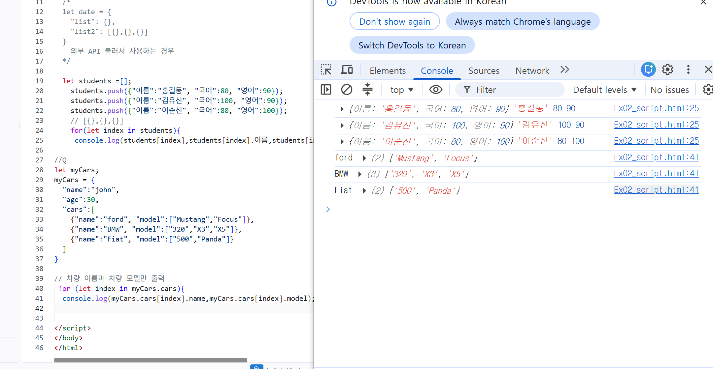
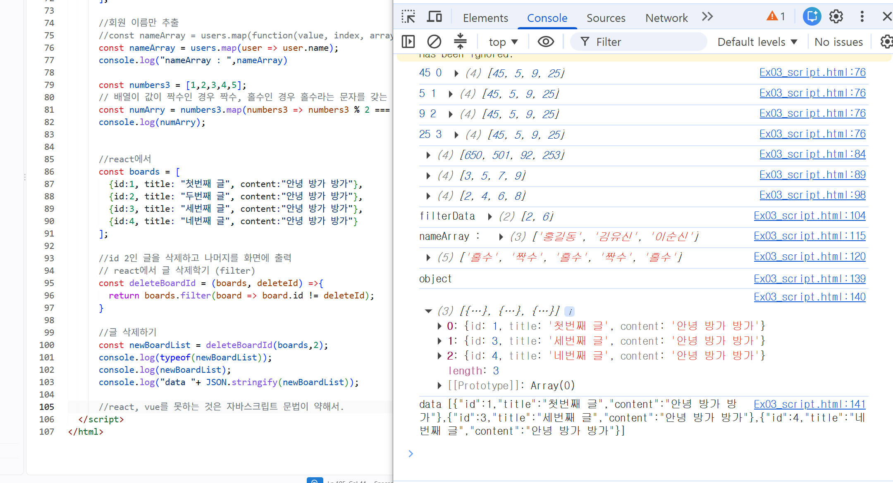
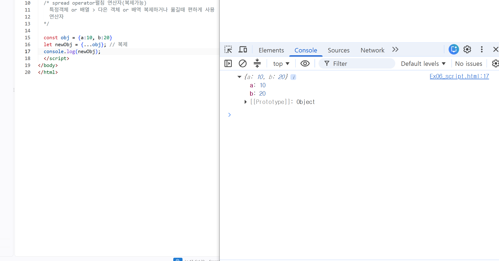
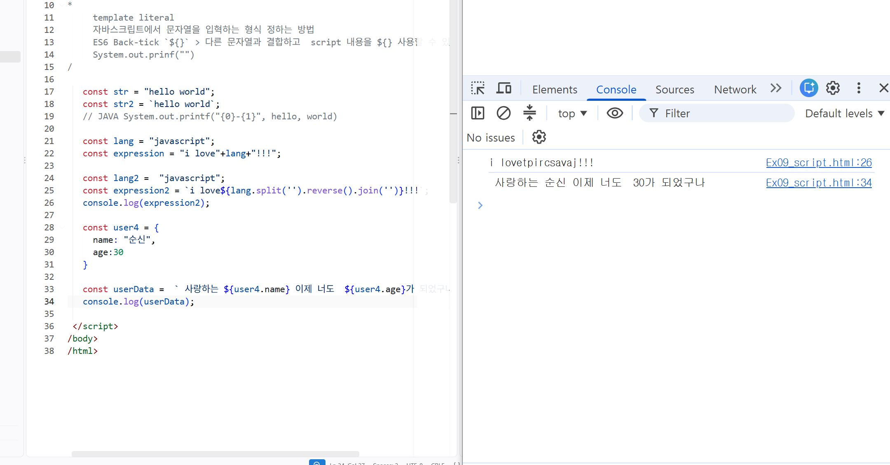
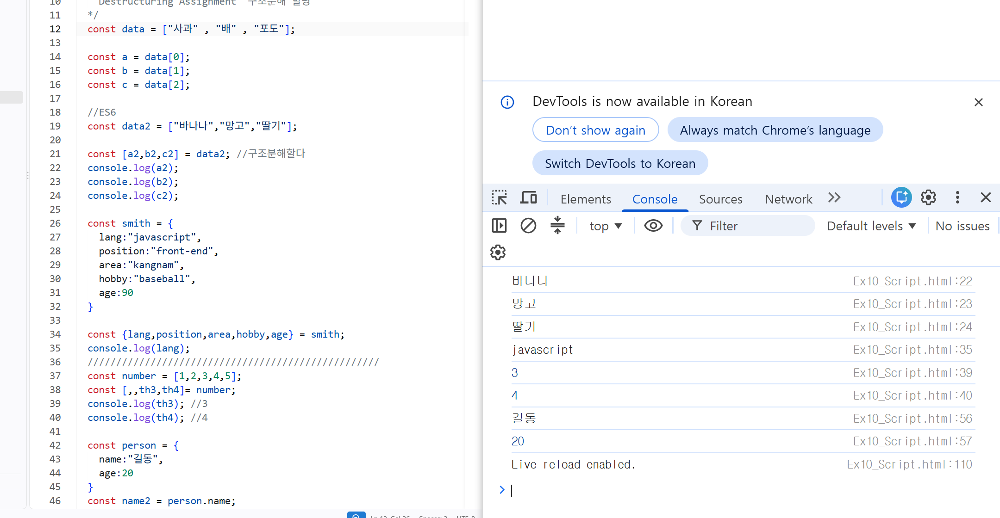
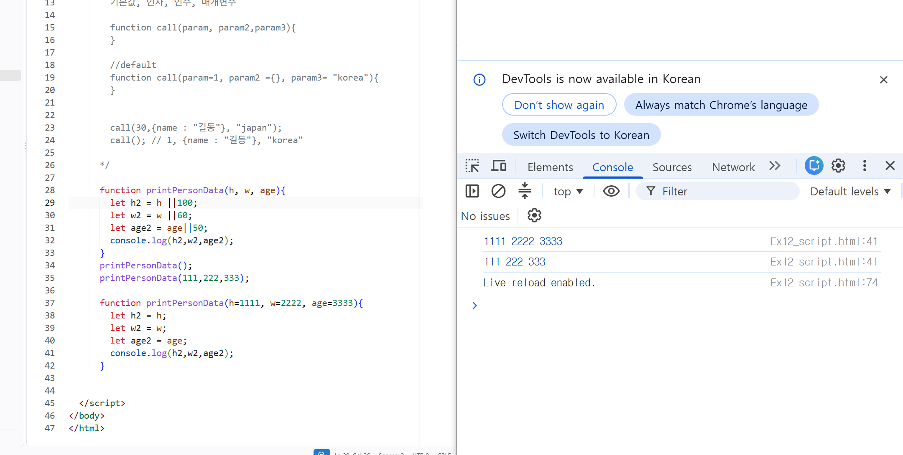

# DAY 78 — 모던 JavaScript: 배열 메서드와 실무 문법 실습

> 2026-10-29 · JavaScript, ES2015+, Array, Callback, DOM Event, Module

오늘은 React와 Vue에서도 자주 사용하는 모던 JavaScript 문법을 실습했다. 화살표 함수와
콜백을 시작으로 객체·배열을 순회하고, `map()`과 `filter()`로 새로운 배열을 만들었다. 이어서
이벤트 전파, 객체 리터럴 축약, spread, ES module, 템플릿 리터럴, 구조 분해 할당, 널 병합
연산자와 기본 매개변수까지 하나의 흐름으로 정리했다.

## 오늘 학습 흐름

```text
함수와 콜백
  ↓
객체·배열 순회와 map/filter
  ↓
DOM 이벤트와 이벤트 전파
  ↓
객체 리터럴·spread·module
  ↓
템플릿 리터럴·구조 분해·기본값
```

## 1. 함수도 값처럼 다루기

JavaScript에서 함수는 변수에 저장하고, 다른 함수의 인자로 전달하고, 반환값으로 돌려줄 수
있는 일급 값이다. 콜백은 이런 특징을 이용해 다른 함수가 필요한 시점에 호출하는 함수다.

```javascript
const increment = value => value + 1;

const apply = (value, callback) => {
  return callback(value);
};

console.log(apply(100, increment)); // 101
```

화살표 함수는 짧은 콜백을 표현할 때 편리하지만 자체 `this`와 `arguments`를 만들지 않는다.
따라서 객체 메서드나 생성자처럼 호출 방식에 따라 `this`가 달라져야 하는 곳에서는 일반 함수와
차이를 고려해야 한다.

## 2. 객체와 중첩 배열 순회

객체 안에 배열을 두고, 배열 안에 다시 객체와 배열을 넣어 계층형 데이터를 표현했다. 배열의
값을 순서대로 사용할 때는 `for...of`, 인덱스까지 필요할 때는 `forEach()`를 사용하는 편이
명확하다. `for...in`은 값이 아니라 열거 가능한 **키**를 순회하므로 일반적인 배열 순회에는
주의가 필요하다.

```javascript
const cars = [
  { name: "Ford", models: ["Mustang", "Focus"] },
  { name: "BMW", models: ["320", "X3", "X5"] },
];

for (const car of cars) {
  console.log(car.name);

  for (const model of car.models) {
    console.log(`- ${model}`);
  }
}
```



실습에서 작성한 `{ name: "Ford" }` 형태는 JavaScript **객체 리터럴**이다. JSON은 객체가
아니라 문자열 기반 데이터 형식이며, 객체를 JSON 문자열로 바꿀 때는 `JSON.stringify()`,
JSON 문자열을 객체로 읽을 때는 `JSON.parse()`를 사용한다.

## 3. 콜백과 배열 메서드

| 메서드 | 역할 | 반환값 |
| --- | --- | --- |
| `Array.isArray(value)` | 배열인지 확인 | `boolean` |
| `forEach(callback)` | 각 요소를 순서대로 처리 | `undefined` |
| `map(callback)` | 각 요소를 변환 | 같은 길이의 새 배열 |
| `filter(callback)` | 조건을 만족하는 요소만 선택 | 새 배열 |

`map()`은 변환 결과를 모은 새 배열을 만들고, `filter()`는 조건을 통과한 요소만 새 배열에
담는다. 메서드 자체는 원본 배열을 직접 변경하지 않지만, 새 배열의 객체는 원본과 같은 참조를
가질 수 있다. React 상태를 불변하게 다루려면 콜백 안에서도 원본 객체나 중첩 객체를 직접
변경하지 않아야 한다.

```javascript
const users = [
  { id: 1, name: "홍길동" },
  { id: 2, name: "김유신" },
];

const names = users.map(user => user.name);

const boards = [
  { id: 1, title: "첫 번째 글" },
  { id: 2, title: "두 번째 글" },
  { id: 3, title: "세 번째 글" },
];

const remainingBoards = boards.filter(board => board.id !== 2);
```



단순히 콘솔에 출력하거나 외부 값을 변경하는 순회라면 `forEach()`가 알맞고, 새로운 배열이
필요한 변환이라면 `map()`을 선택한다.

## 4. DOM 이벤트와 이벤트 전파

브라우저 이벤트는 일반적으로 상위 요소에서 내려오는 캡처링, 실제 대상에 도달하는 타깃, 다시
상위로 올라가는 버블링 단계를 거친다. 단, 모든 이벤트가 버블링하는 것은 아니다.

| 메서드 | 막는 것 |
| --- | --- |
| `preventDefault()` | 링크 이동·폼 제출 같은 브라우저 기본 동작 |
| `stopPropagation()` | 이벤트 경로에서 이후 캡처링·버블링 전파 |
| `stopImmediatePropagation()` | 전파와 현재 요소의 같은 이벤트에 등록된 나머지 리스너 |

```javascript
const link = document.querySelector("#guide-link");

link.addEventListener("click", event => {
  event.preventDefault();
  console.log(event.target);        // 실제 이벤트가 발생한 요소
  console.log(event.currentTarget); // 리스너가 연결된 요소
});
```

`preventDefault()`와 `stopPropagation()`은 목적이 다르다. 링크 이동을 막았다고 버블링까지
멈추는 것은 아니므로 필요한 동작에 맞는 메서드를 선택해야 한다.

## 5. 객체 리터럴 축약과 spread

ES6에서는 변수명과 속성명이 같으면 속성값 표기를 줄일 수 있고, 함수 속성은 메서드 축약
문법으로 표현할 수 있다.

```javascript
const language = "JavaScript";

const course = {
  language,
  study() {
    console.log(`${this.language} 공부 중`);
  },
};
```

spread 문법은 배열이나 객체의 요소를 펼쳐 새 배열·객체를 만들 때 사용한다.

```javascript
const person = { name: "홍길동", profile: { city: "Seoul" } };
const updated = { ...person, age: 25 };

const front = ["HTML", "CSS"];
const skills = [...front, "JavaScript"];
```



spread로 만든 복사본은 **얕은 복사**다. 최상위 객체는 새로 만들어지지만 `profile` 같은 중첩
객체는 원본과 같은 참조를 가질 수 있으므로 중첩 데이터 수정 시 한 단계씩 다시 펼치거나
구조화된 복사 방법을 사용해야 한다.

## 6. 외부 스크립트와 ES module

JavaScript는 HTML의 인라인 속성, 문서 내부의 `<script>`, 외부 `.js` 파일로 연결할 수 있다.
코드를 파일 단위로 나누고 필요한 값만 공유할 때는 ES module의 `export`와 `import`를 사용한다.

```javascript
// math.js
export const PI = 3.14;
export const sum = (a, b) => a + b;

// app.js
import { PI, sum } from "./math.js";

console.log(PI, sum(10, 20));
```

```html
<script type="module" src="./app.js"></script>
```

모듈 스크립트는 자동으로 엄격 모드로 실행되고 각 파일이 독립된 스코프를 가진다. 브라우저의
보안 정책과 모듈 경로 해석을 고려해 `file://`이 아닌 HTTP 개발 서버에서 실행한다.

## 7. 템플릿 리터럴

백틱으로 감싼 템플릿 리터럴은 여러 줄 문자열을 작성하고 `${}` 안에 변수나 표현식을 넣을 수
있다.

```javascript
const user = { name: "이순신", age: 30 };
const message = `안녕하세요, ${user.name}님. 나이는 ${user.age}세입니다.`;
```



단순한 문자열 연결보다 데이터와 문장의 경계가 잘 보이고, 함수 호출이나 계산식도 `${}` 안에
직접 넣을 수 있었다.

## 8. 구조 분해 할당

구조 분해 할당은 배열이나 객체에서 필요한 값을 꺼내 변수로 선언하는 문법이다. 배열은 위치와
순서가 중요하고, 객체는 순서가 아니라 속성명이 중요하다.

```javascript
const fruits = ["사과", "배", "포도"];
const [first, second] = fruits;

const developer = {
  language: "JavaScript",
  position: "front-end",
};

const { language, position: role } = developer;
```



배열에서는 빈 자리를 사용해 값을 건너뛸 수 있고, 객체에서는 `position: role`처럼 원하는 변수명으로
바꿀 수 있다.

## 9. 엄격 동등·널 병합·기본 매개변수

- `===`는 값과 자료형을 함께 비교한다.
- `??`는 왼쪽 값이 `null` 또는 `undefined`일 때만 오른쪽 기본값을 사용한다.
- 기본 매개변수는 전달된 인수가 `undefined`일 때 적용된다.

```javascript
const printTitle = text => {
  console.log(text ?? "제목 없음");
};

function printPersonData(height = 170, weight = 60, age = 20) {
  console.log(height, weight, age);
}

printTitle("");          // 빈 문자열을 그대로 유지
printTitle(undefined);   // 제목 없음
printPersonData();       // 170 60 20
```



`||`는 `0`, 빈 문자열, `false`처럼 falsy인 값도 기본값으로 바꾼다. 반면 `??`와 기본
매개변수는 유효한 falsy 값을 보존할 수 있다. 실습 원본에서는 같은 함수명을 두 번 선언해 뒤의
선언이 앞의 선언을 덮을 수 있었으므로, 공개 예제는 함수 하나에서 기본 매개변수를 사용하도록
정리했다.

## 실습하며 바로잡은 점

- JavaScript 객체 리터럴과 JSON 문자열은 서로 다른 개념이다.
- 배열의 값을 순회할 때는 `for...in`보다 `for...of`나 배열 메서드가 의도를 잘 드러낸다.
- `map()`은 새 배열을 만들 때, `forEach()`는 반환 배열이 필요 없는 순회에 사용한다.
- 식별자를 비교할 때는 자동 형 변환이 없는 `!==`를 우선 사용한다.
- spread는 중첩 객체까지 복사하는 깊은 복사가 아니라 얕은 복사다.
- 객체 구조 분해는 속성명이 중요하고, 배열 구조 분해는 위치와 순서가 중요하다.
- `??`는 `null`·`undefined`만 기본값으로 바꾸므로 `||`와 동작 범위가 다르다.
- HTML의 언어 코드는 `lang="ko"`, viewport는 `width=device-width`로 작성한다.

## 공개 전 점검

- 수업 TXT와 HTML·JavaScript 전체 원본은 공개 저장소에 복사하지 않았다.
- 공개 예제는 직접 다시 구성해 오타와 혼동하기 쉬운 설명을 바로잡았다.
- 실습 화면은 코드와 결과 영역만 남기고 브라우저 탭·작업표시줄을 제외했다.
- 비밀번호·토큰·API 키·개인 이메일·로컬 사용자 경로가 없는지 확인했다.

## 오늘의 정리

- 화살표 함수와 콜백으로 함수를 값처럼 전달했다.
- 객체와 중첩 배열을 순회하고 객체 리터럴과 JSON을 구분했다.
- `forEach()`, `map()`, `filter()`의 역할과 반환값 차이를 익혔다.
- 기본 동작 취소와 이벤트 전파 중단의 차이를 정리했다.
- 객체 리터럴 축약, spread와 ES module로 코드를 나누고 조합했다.
- 템플릿 리터럴, 구조 분해, `??`와 기본 매개변수로 ES6 문법을 연습했다.
