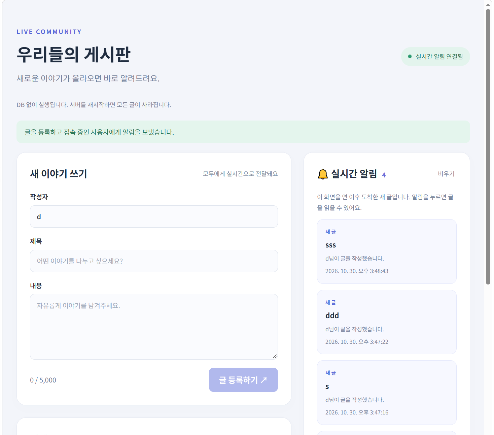

# DAY 79 — Java 함수형 프로그래밍과 WebSocket 실시간 게시판

> 2026-10-30 · Java, Lambda, Stream API, Spring Boot, React, WebSocket·STOMP

오늘은 Java에서 명령형 코드와 선언형 코드의 차이를 비교하고, 함수형 인터페이스·람다식·
메서드 참조와 Stream API를 실습했다. 이어서 Spring Boot와 React를 연결해 게시글을 REST로
등록하고, STOMP 메시지를 구독 중인 브라우저에 실시간으로 전달하는 게시판을 만들었다.

[DAY 18의 람다·Stream 기초](../20260812/)를 복습한 뒤, 이번에는 메서드 참조와 Stream의
실행 특성을 더 정확히 살펴보고 Spring Boot·React WebSocket 기능으로 확장했다.

## 오늘의 학습 흐름

```text
명령형과 선언형 비교
  ↓
함수형 인터페이스와 람다식
  ↓
메서드 참조와 Stream 파이프라인
  ↓
Spring Boot REST + WebSocket/STOMP
  ↓
React 실시간 구독과 화면 상태 반영
```

## 1. 명령형과 선언형 코드

명령형 코드는 **어떻게 처리할지**를 반복문과 조건문으로 직접 표현한다. 선언형 코드는 세부
반복 방법보다 **무엇을 구할지**를 연산의 연결로 나타낸다.

```java
List<Integer> numbers = List.of(1, 2, 3, 4, 5, 6, 7, 8, 9, 10);

// 명령형: 반복과 조건, 누적 방법을 직접 작성
int imperativeTotal = 0;
for (int number : numbers) {
    if (number % 2 == 0) {
        imperativeTotal += number;
    }
}

// 선언형: 필요한 데이터 처리 과정을 연결
int streamTotal = numbers.stream()
    .filter(number -> number % 2 == 0)
    .mapToInt(Integer::intValue)
    .sum();
```

두 결과는 모두 `30`이었다. Stream은 내부 반복을 감추고 `짝수 선택 → 정수 변환 → 합계`라는
의도를 드러낸다. 선언형 코드도 내부에서는 명령형 구현 위에서 동작하므로, 두 방식은 서로
반대라기보다 추상화 수준이 다른 표현으로 이해했다.

## 2. 함수형 프로그래밍의 핵심

함수형 프로그래밍은 계산을 함수의 조합으로 표현하고, 가능한 한 외부 상태 변경과 부수효과를
줄이는 방식이다.

- **순수 함수**: 같은 입력에는 같은 결과를 반환하고 외부 상태를 바꾸지 않는다.
- **불변성**: 기존 값을 직접 수정하기보다 새로운 값을 만들어 의도하지 않은 변경을 줄인다.
- **동작 전달**: 처리할 동작을 인자처럼 전달하고 조합한다.

Java가 함수형 스타일을 지원한다고 모든 람다가 자동으로 순수 함수가 되는 것은 아니다. 람다
안에서도 외부 컬렉션을 수정하거나 입출력을 수행할 수 있으므로, 부수효과를 어디에서 허용할지
의식적으로 설계해야 한다.

## 3. 함수형 인터페이스와 람다식

Java의 람다식은 독립적으로 타입이 정해지는 함수 선언이 아니라, 문맥의 **함수형 인터페이스를
대상 타입으로 삼아 단일 추상 메서드**를 구현하는 표현식이다. 함수형 인터페이스에는 추상
메서드가 하나만 있어야 하지만 `default`와 `static` 메서드는 함께 둘 수 있다.

```java
@FunctionalInterface
interface Calculator {
    int calculate(int left, int right);
}

Calculator max = (left, right) -> left >= right ? left : right;
Calculator add = (left, right) -> left + right;

System.out.println(max.calculate(10, 20)); // 20
System.out.println(add.calculate(111, 222)); // 333
```

`@FunctionalInterface`는 필수 문법은 아니지만, 추상 메서드가 하나라는 조건을 컴파일러가
검사하게 해 실수로 인터페이스의 계약을 깨는 일을 막는다.

### 익명 클래스에서 람다식으로

```java
Runnable anonymous = new Runnable() {
    @Override
    public void run() {
        System.out.println("익명 클래스 실행");
    }
};

Runnable lambda = () -> System.out.println("람다 실행");
```

람다는 한 번 사용할 작은 동작이나 콜백을 간결하게 표현한다. 다만 동작이 길거나 이름 자체가
의도를 설명해야 한다면 별도 메서드로 분리하는 편이 읽기 쉽다.

## 4. 메서드 참조

람다가 이미 존재하는 메서드를 그대로 호출할 때는 `::` 메서드 참조로 줄일 수 있다.

| 형태 | 예시 | 의미 |
| --- | --- | --- |
| 특정 객체의 인스턴스 메서드 | `System.out::println` | 준비된 객체의 메서드 호출 |
| 클래스의 정적 메서드 | `Integer::parseInt` | 정적 메서드 호출 |
| 클래스의 임의 객체 인스턴스 메서드 | `String::toUpperCase` | 전달받은 객체의 메서드 호출 |
| 생성자 | `ArrayList::new` | 새 객체 생성 |

```java
List<String> languages = List.of("java", "react", "spring");

languages.stream()
    .map(String::toUpperCase)
    .forEach(System.out::println);
```

메서드 참조는 람다보다 무조건 좋은 문법이 아니라, 전달할 메서드와 함수형 인터페이스의 매개변수·
반환형이 자연스럽게 맞을 때 사용한다.

## 5. Stream 파이프라인

Stream은 컬렉션이나 배열 자체를 저장하는 자료구조가 아니라, 데이터를 한 번 흘려보내며 처리하는
파이프라인이다.

```text
소스 → Stream 생성 → 중간 연산 0회 이상 → 최종 연산 1회 → 결과
```

| 구분 | 주요 연산 | 특징 |
| --- | --- | --- |
| 생성 | `stream()`, `Stream.of()` | 컬렉션·배열 등에서 Stream 생성 |
| 중간 연산 | `filter`, `map`, `distinct`, `sorted`, `limit`, `peek` | Stream을 반환해 연산을 연결 |
| 최종 연산 | `forEach`, `count`, `sum`, `collect`, `reduce` | 파이프라인을 실행하고 결과 생성 |

```java
List<String> result = List.of("a", "b", "c", "aa", "aaa", "bb")
    .stream()
    .filter(name -> name.contains("a"))
    .map(String::toUpperCase)
    .sorted()
    .toList();

System.out.println(result); // [A, AA, AAA]
```

중간 연산은 최종 연산이 호출될 때까지 실행을 미루는 **지연 연산**이다. 최종 연산이 끝난
Stream은 소비된 상태이므로 다시 사용할 수 없고, 같은 처리가 필요하면 소스에서 새 Stream을
만들어야 한다. `peek()`는 파이프라인을 관찰하거나 디버깅할 때 유용하지만, 핵심 비즈니스
부수효과를 넣는 용도로는 피하는 편이 좋다.

`distinct()`는 객체의 `equals()`와 `hashCode()`를 기준으로 중복을 판단한다. 따라서 문자열
`"CC"`와 `"cc"`는 서로 다른 값이며, 이후 대소문자를 무시해 정렬하더라도 중복 판단 기준까지
바뀌지는 않는다.

## 6. `record`로 데이터 묶기

웹 실습에서는 게시글 응답과 요청을 간단한 데이터 묶음으로 표현하기 위해 `record`를 사용했다.
`record`는 Java 14·15에서 미리보기로 제공된 뒤 **Java 16에서 정식 도입**되었다.

```java
public record Post(
    long id,
    String title,
    String author,
    String content,
    Instant createdAt
) {}
```

각 컴포넌트에 대응하는 `private final` 필드와 접근자, 생성자, `equals()`, `hashCode()`,
`toString()`이 자동 생성된다. 일반적인 setter는 제공하지 않아 값 객체나 DTO에 편리하지만,
참조하는 객체의 내부까지 깊은 불변으로 만들어 주는 것은 아니다.

## 7. Spring Boot WebSocket·STOMP 구성

HTTP는 요청과 응답이 한 번씩 오가는 방식이다. 새 글이 생길 때 서버가 연결된 브라우저에 먼저
알리려면 양방향 연결인 WebSocket을 사용할 수 있다. 오늘 실습에서는 WebSocket 위에 메시지
목적지와 구독 방식을 제공하는 STOMP를 함께 사용했다.

```java
@Configuration
@EnableWebSocketMessageBroker
public class WebSocketConfig implements WebSocketMessageBrokerConfigurer {
    @Override
    public void configureMessageBroker(MessageBrokerRegistry registry) {
        registry.enableSimpleBroker("/topic");
        registry.setApplicationDestinationPrefixes("/app");
    }

    @Override
    public void registerStompEndpoints(StompEndpointRegistry registry) {
        registry.addEndpoint("/ws")
            .setAllowedOriginPatterns("http://localhost:5173");
    }
}
```

- `/ws`: React 클라이언트가 연결하는 WebSocket 엔드포인트
- `/app`: 클라이언트가 서버의 메시지 처리 메서드로 보낼 때 사용하는 접두사
- `/topic`: 여러 구독자에게 메시지를 전달하는 단순 메시지 브로커 경로

## 8. REST 등록과 실시간 브로드캐스트 연결

게시글은 REST API로 검증·저장한 뒤, 저장이 끝난 결과를 STOMP 구독자에게 전송했다.

```text
React에서 POST /api/posts
  → Spring Controller에서 입력 검증
  → 메모리에 게시글 저장
  → convertAndSend("/topic/posts", post)
  → 구독 중인 모든 브라우저가 새 글 수신
  → React 상태와 알림 목록 갱신
```

```java
Post post = new Post(
    sequence.incrementAndGet(),
    title,
    author,
    content,
    Instant.now()
);

posts.put(post.id(), post);
messagingTemplate.convertAndSend("/topic/posts", post);
```

REST 응답으로도 생성된 게시글을 받고 STOMP로도 같은 게시글을 받을 수 있으므로, React에서는
게시글 `id`를 기준으로 합쳐 중복 표시를 막았다.

## 9. React에서 구독하고 화면에 반영하기

```tsx
const client = new Client({
  brokerURL: `${location.protocol === "https:" ? "wss:" : "ws:"}//${location.host}/ws`,
  reconnectDelay: 3000,
  onConnect: () => {
    client.subscribe("/topic/posts", frame => {
      const post: Post = JSON.parse(frame.body);
      setPosts(current => mergePosts(current, [post]));
      setAlerts(current => [post, ...current]);
    });
  },
});
```

`useEffect()`에서 연결을 만들고 컴포넌트가 사라질 때 `deactivate()`로 정리했다. 연결이 끊기면
자동 재연결하고, 새 메시지를 받으면 함수형 상태 업데이트로 이전 목록을 기준으로 안전하게
추가했다. 개발 중에는 Vite 프록시가 `/api`와 `/ws` 요청을 Spring Boot 서버로 전달했다.

## 10. 실시간 게시판 실행 결과



최종 화면에서 WebSocket 연결 상태, 게시글 등록 폼, 전체 글 목록과 실시간 알림 영역을 함께
확인했다. 탭을 두 개 열어 한쪽에서 글을 등록하면 다른 쪽 구독자 화면에도 바로 표시되도록
구성했다.

## 11. 현재 구현의 범위와 다음 단계

이번 결과물은 실시간 전달 흐름을 확인하기 위한 학습용 프로토타입이다.

- 게시글은 `ConcurrentHashMap`에 저장되므로 서버를 재시작하면 사라진다.
- `AtomicLong`으로 여러 요청에서 게시글 번호가 겹치지 않게 증가시켰다.
- 제목·작성자·내용의 빈 값과 최대 길이는 서버에서도 검사했다.
- 아직 로그인·권한·영속 DB·수정·삭제 기능은 연결하지 않았다.
- 운영 환경에서는 HTTPS/WSS, 인증·인가, Origin 설정 외부화와 메시지 크기·속도 제한이 필요하다.
- 개발 서버를 `0.0.0.0`에 열면 같은 네트워크의 다른 장치에서도 접근할 수 있으므로 신뢰할 수
  있는 네트워크에서만 사용해야 한다.

## 실습하며 바로잡은 점

- `record`는 Java 17이 아니라 Java 16에서 정식 기능이 되었다.
- Java 람다는 함수형 인터페이스의 단일 추상 메서드를 구현하는 표현식이다.
- 람다와 Stream을 사용한다고 코드가 자동으로 순수 함수가 되거나 빨라지는 것은 아니다.
- `parallelStream()`은 작업량·분할 비용·공유 상태에 따라 순차 처리보다 느릴 수도 있다.
- Stream은 최종 연산 뒤 닫힌다고 표현하기보다, 소비되어 재사용할 수 없다고 이해하는 편이 정확하다.
- 메서드 참조와 원본 설명용 의사코드의 오타는 컴파일 가능한 형태로 다시 정리했다.

## 공개 전 점검

- 수업 TXT, Java 원본 6개와 전체 Spring Boot·React 프로젝트는 공개 저장소에 복사하지 않았다.
- `node_modules`, `.gradle`, `build`, `dist` 같은 의존성과 빌드 산출물은 제외했다.
- 이미지의 주소창을 잘라 사설 IP와 브라우저 프로필 영역이 보이지 않게 했다.
- 공개 코드에서는 내부 IP가 포함된 허용 Origin 목록을 제거하고 `localhost` 예시만 사용했다.
- 비밀번호·토큰·API 키·이메일·DB 접속정보·개인 로컬 경로가 없는지 확인했다.

## 오늘의 정리

- 명령형 반복문과 선언형 Stream의 표현 차이를 비교했다.
- 함수형 인터페이스를 익명 클래스와 람다식으로 각각 구현했다.
- 메서드 참조와 Stream의 중간·최종 연산, 지연 실행과 일회성을 확인했다.
- Spring Boot에서 WebSocket·STOMP 엔드포인트와 메시지 브로커를 구성했다.
- REST로 저장한 게시글을 브로드캐스트하고 React 상태와 실시간 알림에 반영했다.
