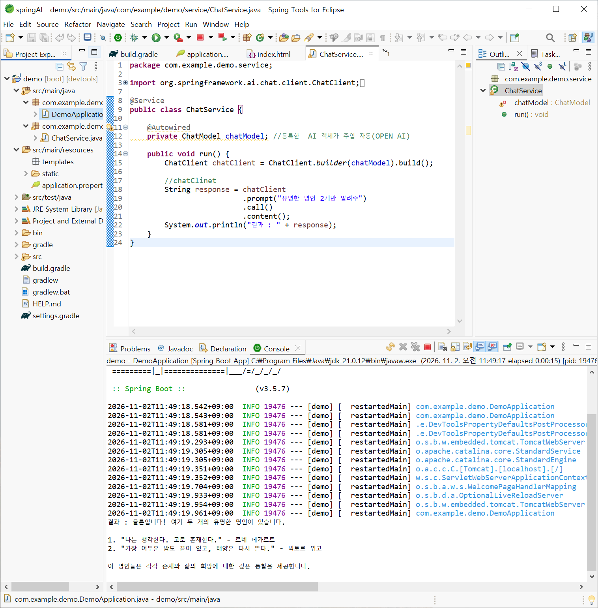

# DAY 81 — Spring AI와 ChatClient로 생성형 AI 연결하기

> 2026-11-02 · Spring AI, ChatModel, ChatClient, Prompt, Spring Boot, React

오늘은 생성형 AI와 머신러닝의 기본 분류를 살펴본 뒤, Spring 개발 방식으로 LLM을 연결하는
**Spring AI**를 배웠다. `ChatModel`과 `ChatClient`의 역할, 시스템·사용자 프롬프트,
Structured Output 개념을 정리하고, Spring Boot에서 AI 응답을 받아 명언과 마케팅 문구를
생성했다. 마지막에는 Thymeleaf 화면을 REST API와 React·Vite 프론트엔드로 확장했다.

## 오늘의 학습 흐름

```text
프로젝트 기획과 챗봇 아이디어
  ↓
생성형 AI·머신러닝 기초
  ↓
Spring AI와 ChatModel·ChatClient
  ↓
SystemMessage·UserMessage로 프롬프트 구성
  ↓
Thymeleaf 마케팅 문구 생성
  ↓
REST API와 React 화면으로 확장
```

## 1. 프로젝트 기획과 AI 기능의 범위

프로젝트를 시작할 때는 구현부터 하기보다 **주제 조사·벤치마킹·장단점·기술 스택**을 먼저
정리하고, 요구사항 정의와 명세를 준비한 뒤 팀과 합의하는 과정이 필요하다. 챗봇도 모든 질문에
답하게 만들기보다 서비스 이용 안내, 청약, 건물 정보처럼 담당 범위를 명확히 정하고 범위를
벗어난 질문은 제한하는 방식이 안전하고 운영하기 쉽다.

```text
문제와 사용자 정의
  → 유사 서비스 조사
  → 기능 범위와 제외 범위 결정
  → 요구사항·화면·API 명세
  → 구현과 검증
```

## 2. 생성형 AI와 머신러닝 기초

생성형 AI는 학습한 패턴을 바탕으로 새로운 텍스트·이미지·오디오·비디오·코드 등을 만든다.
머신러닝 학습 방식은 정답 제공 여부와 피드백 방식에 따라 나눌 수 있다.

| 구분 | 핵심 | 예시 |
| --- | --- | --- |
| 지도 학습 | 입력과 정답을 함께 학습 | 분류, 회귀 |
| 비지도 학습 | 정답 없이 데이터 구조를 탐색 | k-means 군집화, PCA 차원 축소 |
| 강화 학습 | 행동 결과의 보상을 높이는 방향으로 학습 | 게임, 제어 |

CNN은 이미지의 공간적 특징을 처리하는 데 널리 쓰이는 신경망 구조이고, OCR은 이미지 속 글자를
인식해 텍스트로 바꾸는 기술이다. 오늘은 이 항목들을 개념으로 살펴보고 직접 모델을 학습하지는
않았다.

## 3. Spring AI

Spring AI는 Spring 애플리케이션에서 AI 모델을 일관된 추상화로 사용할 수 있게 돕는다. 모델
호출뿐 아니라 프롬프트, 구조화된 출력, 도구 호출, 대화 기억과 RAG 같은 기능을 Spring 방식으로
확장할 수 있다.

### `ChatModel`과 `ChatClient`

| 항목 | `ChatModel` | `ChatClient` |
| --- | --- | --- |
| 추상화 수준 | 모델을 직접 호출하는 저수준 인터페이스 | `ChatModel`을 감싼 고수준 API |
| 코드 스타일 | 요청·메시지 객체를 직접 구성 | Fluent 메서드 체이닝 |
| 공통 설정 | 호출마다 직접 구성 | 기본 시스템 프롬프트 등을 재사용 가능 |
| 응답 처리 | 응답 객체를 직접 다룸 | 문자열·Java 객체·스트림 형태로 연결하기 편리 |

`ChatModel`이 JDBC의 `Connection`처럼 모델 호출의 기반이라면, `ChatClient`는
`JdbcTemplate`이나 `WebClient`처럼 반복 코드를 줄이고 호출 흐름을 읽기 쉽게 만든 도구로
이해했다.

## 4. 첫 번째 `ChatClient` 호출

Spring Boot에 OpenAI 모델 starter를 추가하고, 주입받은 `ChatModel`로 `ChatClient`를
생성해 문자열 응답을 받았다.

```java
@Service
public class QuoteService {
    private final ChatModel chatModel;

    public QuoteService(ChatModel chatModel) {
        this.chatModel = chatModel;
    }

    public String generateQuotes() {
        return ChatClient.builder(chatModel)
            .build()
            .prompt("유명한 명언 두 개를 알려줘")
            .call()
            .content();
    }
}
```



## 5. 시스템 프롬프트와 사용자 프롬프트

프롬프트의 역할을 나누면 재사용성과 통제 가능성이 높아진다.

- **SystemMessage**: 모델의 역할, 출력 목적, 말투와 작성 규칙처럼 모든 요청에 공통인 지침
- **UserMessage**: 제품명·가격·구매 링크·특징처럼 요청마다 달라지는 실제 입력

```java
var systemMessage = new SystemMessage("""
    당신은 온라인 쇼핑몰의 마케팅 카피라이터입니다.
    입력된 정보만 사용하고, 과장된 사실은 만들지 마세요.
    """);

var userMessage = new UserMessage("""
    제품명: 휴대용 노트북
    가격: 1,190,000원
    특징: 가벼운 무게와 선명한 화면
    """);

String result = chatClient.prompt()
    .messages(systemMessage, userMessage)
    .call()
    .content();
```

프롬프트를 구분해도 LLM의 결과가 항상 사실인 것은 아니다. 가격·링크처럼 서비스가 이미 알고
있는 값은 서버에서 검증하고, 생성 문구도 사용자에게 보여주기 전에 확인하는 과정이 필요하다.

## 6. Structured Output

일반적인 LLM 응답은 문자열이지만, 실제 애플리케이션에서는 추천 상품 목록이나 회원 정보처럼
정해진 필드가 있는 Java 객체가 더 다루기 쉽다. Structured Output은 모델에게 원하는 구조를
알리고 응답을 객체로 변환하는 방식이다.

```text
자유로운 문자열 응답
  → 출력 형식 안내
  → JSON 등 구조화된 응답
  → Java DTO로 변환
  → 검증 후 서비스 로직에서 사용
```

오늘 실습은 문자열 응답까지 구현했고, 객체 변환·Advisor·RAG·Tool Calling은 개념과 확장
방향으로 학습했다.

## 7. AI 마케팅 문구 생성 실습

제품 정보를 입력하면 Spring Boot가 프롬프트를 만들고, AI가 생성한 마케팅 문구를 결과 화면에
전달하도록 구성했다.

```text
제품명·가격·구매 링크·특징 입력
  → Spring MVC Controller
  → MarketingService에서 메시지 구성
  → ChatClient로 모델 호출
  → 생성된 문자열 반환
  → Thymeleaf 또는 React에서 출력
```

### Thymeleaf 방식

`GET /marketing`에서 입력 폼을 보여 주고, `POST /marketing`에서 폼 값을 받아 생성 결과를
`Model`에 담았다. 서버가 HTML까지 완성해 반환하므로 구현 흐름을 한 프로젝트 안에서 확인하기
쉬웠다.

### REST API와 React 방식

같은 `MarketingService`를 재사용하면서 `POST /api/marketing`이 JSON 요청과 응답을 처리하도록
확장했다. Vite 개발 서버는 `/api` 요청을 Spring Boot로 프록시했다.

React 화면에서는 다음 상태와 동작을 구현했다.

- 제품명·가격·구매 링크·특징을 하나의 폼 상태로 관리
- 요청 중 버튼 비활성화와 로딩 문구 표시
- HTTP 오류와 빈 응답 처리
- 생성된 문구 복사
- `http`·`https` 구매 링크만 외부 링크로 노출
- 입력값과 AI 결과를 미리보기 카드에 즉시 반영

## 8. 보안과 공개 원칙

AI 연동 키를 소스 코드나 빌드 결과물에 직접 넣으면 저장소, JAR, 테스트 보고서 등을 통해 다시
노출될 수 있다. 설정에는 실제 값을 적지 않고 환경변수만 참조한다.

```properties
spring.ai.openai.api-key=${OPENAI_API_KEY}
```

이번 일지에는 다음 항목을 올리지 않았다.

- 실제 API 키가 남을 수 있는 설정·빌드 산출물·JAR
- `.gradle`, `build`, `bin`, `dist`와 테스트 보고서
- 원본 실습 프로젝트와 전체 수업 자료
- 로컬 사용자명·컴퓨터 이름·개인 경로가 포함된 로그

## 오늘의 정리

- Spring AI는 Spring 애플리케이션과 AI 모델을 연결하는 공통 추상화를 제공한다.
- `ChatModel`은 저수준 모델 인터페이스이고 `ChatClient`는 호출 흐름을 간결하게 만드는 고수준
  API다.
- 시스템 지침과 사용자 입력을 분리하면 역할과 데이터의 경계가 명확해진다.
- 같은 서비스 로직을 Thymeleaf와 REST·React 화면에서 재사용할 수 있다.
- LLM 응답과 사용자 입력은 검증해야 하며, 비밀값은 환경변수로 관리하고 빌드 결과물까지
  점검해야 한다.

## 다음에 이어서 볼 내용

- Structured Output을 DTO로 변환하고 Bean Validation 적용하기
- 공통 시스템 프롬프트와 모델 옵션 구성하기
- 대화 기억·RAG·Tool Calling을 작은 기능부터 검증하기
- 타임아웃·재시도·사용량·오류 응답을 포함한 운영 흐름 설계하기
