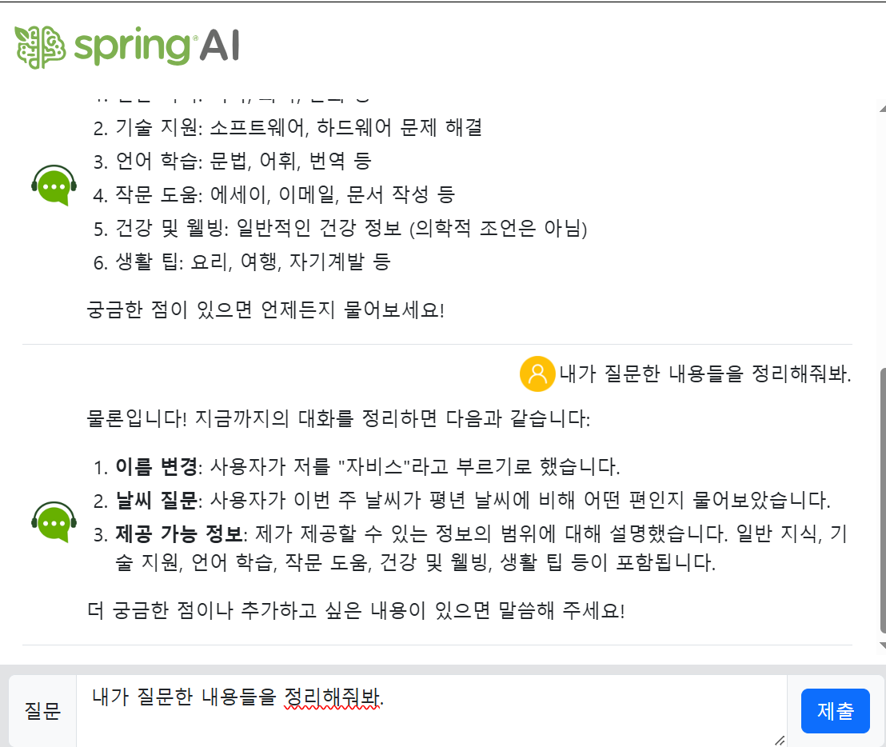
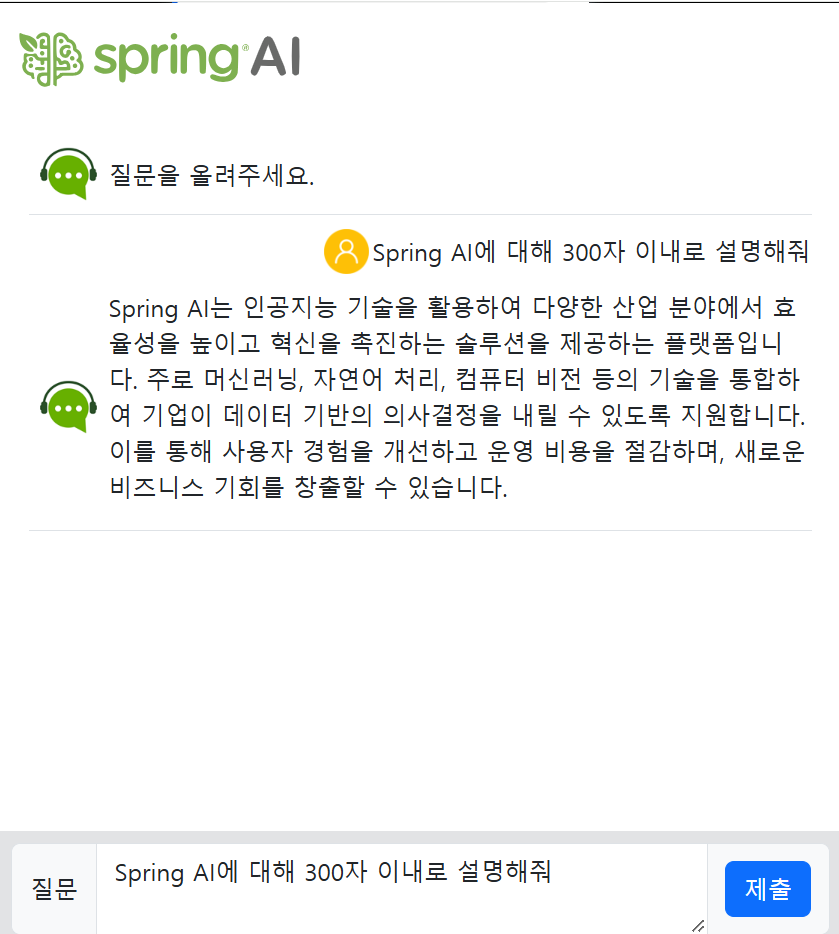
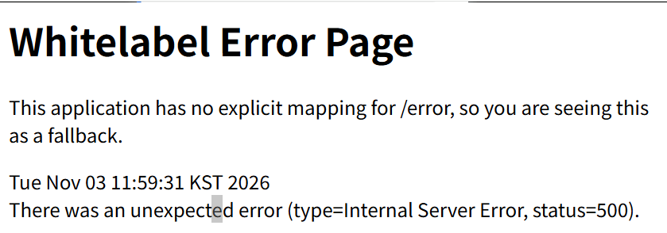
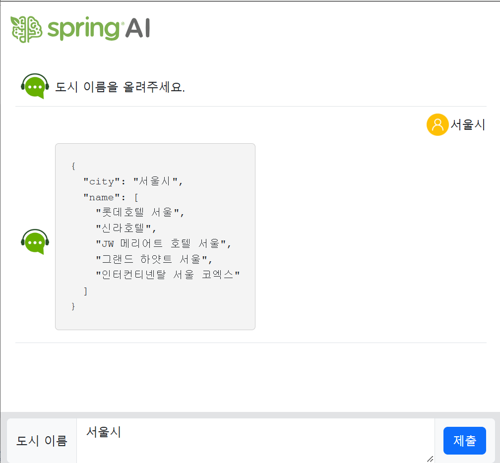
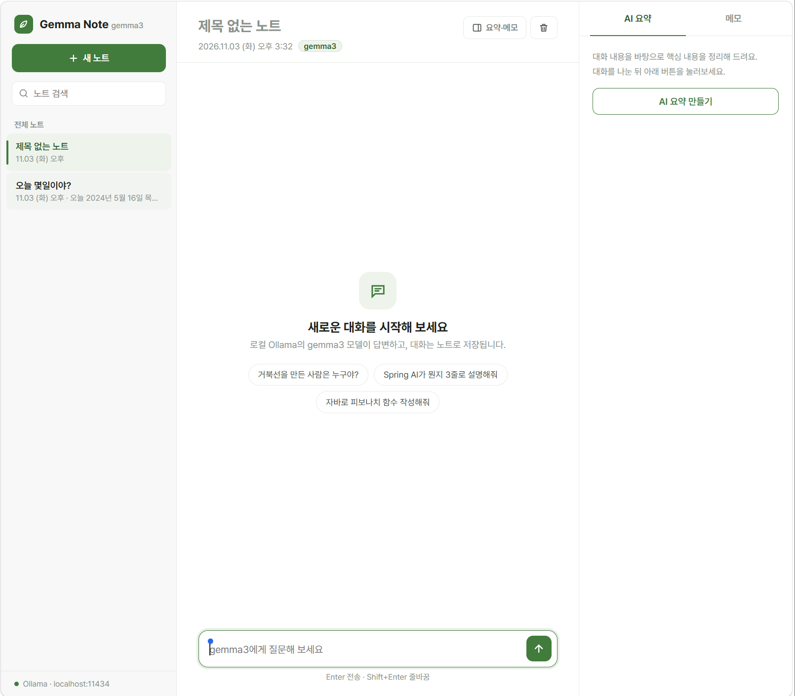
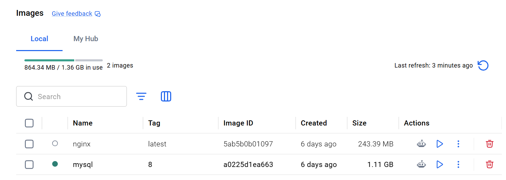

# DAY 82 — 대화 기억·스트리밍·구조화 출력과 Ollama 로컬 AI, Docker 기초

> 2026-11-03 · Spring AI Message, ChatMemory, WebFlux, Mono·Flux, Structured Output, Ollama, Docker

어제 배운 Spring AI를 이어서, LLM 대화를 구성하는 **메시지 역할(role)** 을 정리하고 이전 대화를
기억하는 챗봇을 만들었다. 이어서 **WebFlux의 `Flux`** 로 AI 응답을 실시간 스트리밍하고,
`BeanOutputConverter`로 AI 응답을 **Java 객체(DTO)** 로 받아 봤다. 오후에는 클라우드 API 대신
**Ollama의 gemma3 모델**을 로컬에서 실행해 노트형 챗봇을 만들었고, 마지막으로 **Docker** 명령어를
익히며 Nginx 컨테이너를 실행했다.

## 오늘의 학습 흐름

```text
메시지 역할 정리 → 대화 기억 챗봇 (demo-2)
  ↓
동기·비동기, 블로킹·논블로킹 → WebFlux Flux 스트림 (demo-3)
  ↓
ChatModel·Prompt·ChatOptions → 일반 응답과 스트리밍 응답 (demo-4)
  ↓
Structured Output → 호텔 목록을 DTO로 받기 (demo-5)
  ↓
Ollama 로컬 LLM 연결 (demo-6) → Gemma Note 챗봇 (demo-7)
  ↓
Docker 명령어와 Nginx 컨테이너 실습 → 볼륨 맛보기
```

## 1. 프롬프트를 구성하는 메시지 역할

LLM에 보내는 프롬프트는 하나의 문자열이 아니라 **역할이 붙은 메시지의 목록**이다.

| 클래스 | 역할(role) | 설명 |
| --- | --- | --- |
| `SystemMessage` | `system` | 모델의 행동 지침·말투·컨텍스트를 정하는 설정 |
| `UserMessage` | `user` | 사람이 입력한 질문이나 요청 |
| `AssistantMessage` | `assistant` | 모델이 생성한 응답 (대화 기록으로 다시 전달 가능) |
| `FunctionMessage` | `function` | 함수 호출 결과를 전달하던 예전 방식 |
| `ToolMessage` | `tool` | 도구 호출 결과를 모델에 다시 전달 |

> `function` 역할은 초기 Function Calling 방식이고 지금은 `tool` 역할로 대체되는 추세다.
> Spring AI에서는 도구 실행 결과를 `ToolResponseMessage`로 다룬다.

## 2. 실습 ① 이전 대화를 기억하는 챗봇

LLM은 요청마다 이전 대화를 기억하지 못한다. 그래서 지금까지의 메시지를 `HttpSession`에 리스트로
저장해 두고, 질문할 때마다 **대화 기록 전체 + 새 질문**을 함께 보냈다.

```java
public String multiMessages(String question, List<Message> chatMemory) {
    // 대화를 처음 시작할 때만 시스템 메시지 저장
    if (chatMemory.isEmpty()) {
        chatMemory.add(SystemMessage.builder()
            .text("당신은 AI비서입니다. 제공되는 지난 대화 내용을 보고 우선적으로 답변해주세요.")
            .build());
    }

    ChatResponse response = chatClient.prompt()
        .messages(chatMemory)   // 지난 대화
        .user(question)         // 이번 질문
        .call()
        .chatResponse();

    AssistantMessage answer = response.getResult().getOutput();
    chatMemory.add(UserMessage.builder().text(question).build());
    chatMemory.add(answer);     // 질문과 답변을 모두 기록
    return answer.getText();
}
```

이름을 "자비스"로 바꿔 부르게 하고 날씨를 물어본 뒤 "내가 질문한 내용들을 정리해줘"라고 하자,
앞선 대화를 순서대로 요약했다.



컨트롤러의 `consumes`·`produces`도 함께 정리했다.

| 속성 | 의미 | 오늘 사용한 값 |
| --- | --- | --- |
| `consumes` | 서버가 **받는** 요청 데이터 형식 | `application/x-www-form-urlencoded` (HTML form) |
| `produces` | 서버가 **반환하는** 응답 데이터 형식 | `text/plain`, `application/json`, `application/x-ndjson` |

## 3. 동기·비동기와 블로킹·논블로킹

| 구분 | 의미 |
| --- | --- |
| 동기(Synchronous) | 작업이 순서대로 이어진다. 앞 작업이 끝나야 다음 작업이 시작된다. |
| 비동기(Asynchronous) | 완료를 기다리지 않고 다른 일을 진행하고 결과는 나중에 받는다. JavaScript의 `Promise`, `async/await`가 대표적이다. |
| 블로킹(Blocking) | 작업이 끝날 때까지 **현재 스레드가 멈춰서 기다린다.** |
| 논블로킹(Non-Blocking) | 작업 완료를 기다리느라 **현재 스레드를 붙잡아 두지 않는다.** |

동기·비동기는 **작업 흐름과 결과를 받는 시점**, 블로킹·논블로킹은 **기다리는 동안 스레드가
묶이는지**에 대한 개념으로 나눠서 이해했다.

## 4. 리액티브 프로그래밍과 WebFlux

Spring MVC는 요청 하나에 스레드 하나를 배정하고, 외부 API 응답을 기다리는 동안 그 스레드가
블로킹된다. **WebFlux**는 논블로킹 방식으로 I/O 대기 중인 스레드를 다른 요청 처리에 활용한다.

```text
Spring MVC   요청 → 스레드 할당 → [외부 API 대기: 스레드 블로킹] → 응답
WebFlux      요청 → 이벤트 등록 → (스레드는 다른 일 처리) → 데이터 도착 시 이어서 처리 → 응답
```

| 타입 | 발행하는 데이터 수 | 예시 |
| --- | --- | --- |
| `Mono<T>` | 0개 또는 1개 | 단건 조회, AI 응답 전체를 한 번에 받기 |
| `Flux<T>` | 0개 이상 N개 | 목록 조회, AI 응답을 조각(chunk) 단위로 스트리밍 |

### 실습 ② `Flux`로 서버 메시지 흘려보내기

1초마다 메시지를 하나씩, 총 5개를 브라우저로 보내는 SSE(Server-Sent Events) 예제를 만들었다.

```java
@GetMapping(value = "/stream", produces = MediaType.TEXT_EVENT_STREAM_VALUE)
public Flux<String> stream() {
    return Flux.interval(Duration.ofSeconds(1))
            .map(i -> "서버 메시지 " + (i + 1) + " 도착")
            .take(5);
}
```

### `@Async`와 WebFlux

| 항목 | `@Async` | WebFlux |
| --- | --- | --- |
| 방식 | 별도 스레드 풀에서 메서드를 비동기 실행 | 이벤트 루프 기반 논블로킹 스트림 |
| 블로킹 여부 | 작업 스레드 안에서는 여전히 블로킹될 수 있음 | I/O 전 구간을 논블로킹으로 구성 |
| 적합한 상황 | 기존 MVC 코드에서 메일 발송 같은 작업 분리 | 동시 요청이 많은 I/O 서비스, 스트리밍 |

## 5. 실습 ③ `ChatModel`로 일반 응답과 스트리밍 응답

`ChatModel`에 `Prompt`를 직접 만들어 전달하는 저수준 방식과, 같은 기능을 `ChatClient`로 짧게
쓰는 방식을 비교했다. `ChatOptions`로 모델·`temperature`·최대 토큰 수도 지정했다.

```java
Prompt prompt = Prompt.builder()
    .messages(systemMessage, userMessage)
    .chatOptions(ChatOptions.builder()
        .model("gpt-4o-mini")
        .temperature(0.3)     // 낮을수록 일관된 답변
        .maxTokens(1000)
        .build())
    .build();

// 한 번에 받기
String answer = chatModel.call(prompt).getResult().getOutput().getText();

// 조각 단위로 받기
Flux<String> stream = chatModel.stream(prompt)
    .map(r -> {
        String chunk = r.getResult().getOutput().getText();
        return chunk == null ? "" : chunk;   // 빈 조각 방어
    });
```

```java
// ChatClient 방식: .call() 대신 .stream()만 바꾸면 스트리밍
Flux<String> stream = chatClient.prompt()
    .system("사용자 질문에 대해 한국어로 답변을 해야 합니다.")
    .user(question)
    .stream()
    .content();
```

스트리밍 엔드포인트는 `produces = APPLICATION_NDJSON_VALUE`로 줄 단위 청크를 반환하게 했다.



> gpt-5 계열 모델은 `temperature`가 1.0으로 고정되고 최대 토큰 파라미터 이름도 달라서,
> 사용 중인 Spring AI 버전에서는 옵션을 그대로 적용할 수 없다는 점도 메모해 두었다.

### 트러블슈팅: `/chat-model` 접속 시 500 에러



- **증상**: `localhost:8080/chat-model`에 접속하자 Whitelabel Error Page(500)가 표시됐다.
- **원인**: 컨트롤러는 `"chat-model"` 뷰를 반환하는데, `templates` 폴더의 파일 이름이
  `chat-moble.html`로 오타가 나 있어 Thymeleaf가 템플릿을 찾지 못했다.
- **해결**: 파일 이름을 `chat-model.html`로 바꾸자 정상적으로 화면이 열렸다.
- **배운 점**: 500 에러가 나면 브라우저보다 **콘솔의 스택트레이스**를 먼저 보고, 뷰 이름과
  템플릿 파일 이름이 정확히 일치하는지 확인한다.

## 6. 실습 ④ Structured Output — AI 응답을 DTO로 받기

도시 이름을 입력하면 유명 호텔 5개를 `Hotel` 객체로 받아 JSON으로 반환했다.

```java
@Data
public class Hotel {
    private String city;
    private List<String> name;
}
```

```java
// 저수준: 변환기가 만든 출력 형식 안내를 프롬프트에 직접 넣기
BeanOutputConverter<Hotel> converter = new BeanOutputConverter<>(Hotel.class);
Prompt prompt = PromptTemplate.builder()
    .template("{city}에서 유명한 호텔 목록 5개를 출력하세요. {format}")
    .build()
    .create(Map.of("city", city, "format", converter.getFormat()));
Hotel hotel = converter.convert(chatClient.prompt(prompt).call().content());

// 고수준: entity()가 형식 안내와 변환을 한 번에 처리
Hotel hotel = chatClient.prompt()
    .user("%s에서 유명한 호텔 목록 5개를 출력하세요.".formatted(city))
    .call()
    .entity(Hotel.class);
```



AI가 만든 목록이 항상 정확한 것은 아니므로, 실제 서비스라면 결과를 그대로 믿지 않고 검증 단계를
두어야 한다.

## 7. Ollama — 로컬에서 LLM 실행하기

**Ollama**는 LLM을 **내 컴퓨터나 서버에서 내려받아 실행·관리**하게 해 주는 도구다. 클라우드 API
없이 모델을 직접 실행할 수 있다.

| 장점 | 고려할 점 |
| --- | --- |
| API 호출 비용이 없다 | 모델 크기에 맞는 CPU·GPU·메모리가 필요하다 |
| 데이터가 외부로 나가지 않는다 | 대형 클라우드 모델보다 성능이 낮을 수 있다 |
| 네트워크 없이도 실행 가능 | 모델 다운로드·버전 관리를 직접 해야 한다 |

### 실습 ⑤ Spring AI + Ollama(gemma3) 연결

의존성을 `spring-ai-starter-model-ollama`로 바꾸고 설정만 추가하면, OpenAI 때와 같은
`ChatClient` 코드로 로컬 모델을 호출할 수 있었다.

```properties
spring.ai.model.chat=ollama
spring.ai.ollama.base-url=http://localhost:11434
spring.ai.ollama.chat.options.model=gemma3
spring.ai.ollama.chat.options.temperature=0.7
# 모델이 없을 때만 자동으로 내려받기
spring.ai.ollama.init.pull-model-strategy=when-missing
spring.ai.ollama.init.timeout=60s
spring.ai.ollama.init.max-retries=1
```

### 실습 ⑥ Gemma Note — 노트별로 대화를 기억하는 로컬 챗봇

오전에는 세션 리스트로 대화를 직접 관리했다면, 이번에는 Spring AI의 **`ChatMemory`** 와
**`MessageChatMemoryAdvisor`** 를 사용했다. 노트마다 `conversationId`를 부여해 대화를 분리하고,
최근 20개 메시지만 기억하도록 했다.

```java
@Bean
public ChatMemory chatMemory() {
    return MessageWindowChatMemory.builder()
            .maxMessages(20)          // 노트별 최근 20개 메시지만 기억
            .build();
}
```

```java
public Flux<String> stream(String conversationId, String message) {
    return chatClient.prompt()
            .user(message)
            .advisors(a -> a.param(ChatMemory.CONVERSATION_ID, conversationId))
            .stream()
            .content();
}
```

| API | 기능 |
| --- | --- |
| `POST /api/chat` | 한 번에 응답 받기 (JSON) |
| `POST /api/chat/stream` | 토큰이 생성되는 대로 텍스트 스트리밍 |
| `DELETE /api/chat/{conversationId}` | 해당 노트의 대화 기록 초기화 |

스트리밍은 Spring MVC의 `StreamingResponseBody`로 `Flux`의 토큰을 하나씩 `write`·`flush`했고,
프록시가 응답을 모아 두지 않도록 `Cache-Control: no-cache`, `X-Accel-Buffering: no` 헤더를
추가했다. 화면은 노트 목록·검색, 대화 영역, AI 요약·메모 패널로 구성했다.



## 8. Docker 기초 명령어

### 컨테이너 실행과 포트 연결

```bash
# docker run -d -p [호스트 포트]:[컨테이너 포트] 이미지명[:태그명]
docker run -d -p 4000:80 nginx
```

- `-d`: 백그라운드(detached) 모드로 실행
- `-p 4000:80`: 호스트의 **4000번 포트**를 컨테이너의 **80번 포트**로 연결

### 조회·중지·삭제

| 명령어 | 설명 |
| --- | --- |
| `docker ps` | 실행 중인 컨테이너만 조회 |
| `docker ps -a` | 중지된 컨테이너까지 모두 조회 |
| `docker stop <컨테이너>` | 정상 종료 (시스템 종료 버튼으로 끄기) |
| `docker kill <컨테이너>` | 강제 종료 (본체 전원 버튼을 눌러 끄기) |
| `docker rm <컨테이너>` | 중지된 컨테이너 삭제 |
| `docker rm -f <컨테이너>` | 실행 중인 컨테이너를 강제로 삭제 |
| `docker rm $(docker ps -qa)` | 중지된 컨테이너 전체 삭제 (실행 중인 것은 오류로 남는다) |
| `docker rm -f $(docker ps -qa)` | 실행 중인 것까지 모든 컨테이너 삭제 |

`docker ps -qa`는 모든 컨테이너의 **ID만**(`-q`) 출력하므로 `$( )`로 감싸 다른 명령의 인자로
넘길 수 있다.

### 실행 중인 컨테이너 내부 접속

```bash
docker exec -it <컨테이너명 또는 ID> bash

ls              # 컨테이너 내부 파일 조회
cd /etc/nginx
cat nginx.conf  # Nginx 설정 파일 확인
```

## 9. 실습 ⑦ Docker로 Nginx 실행하기

Docker Desktop(Docker 29.x)을 설치한 뒤 명령 프롬프트에서 진행했다.

```bash
docker pull nginx                              # 1. 이미지 다운로드
docker image ls                                # 2. 이미지 확인
docker run --name webserver -d -p 80:80 nginx  # 3. 컨테이너 실행
                                               # 4. 브라우저에서 http://localhost 접속
docker ps                                      # 5. 실행 상태 확인
docker stop webserver                          # 6. 컨테이너 정지
```



```text
이미지(nginx) ──run──▶ 컨테이너(webserver) ──-p 80:80──▶ 브라우저 localhost
```

이미지는 실행 환경을 담은 **설계도**, 컨테이너는 그 설계도로 띄운 **실행 중인 인스턴스**로
이해했다.

## 10. Docker 볼륨 (다음 시간 이어서)

컨테이너를 삭제하면 내부 데이터도 함께 사라진다. **볼륨**은 데이터를 컨테이너 바깥에 보관해
컨테이너를 다시 만들어도 데이터를 유지하게 해 준다. 오늘은 개념만 소개받았고, MySQL 데이터 보존
같은 실습은 다음에 이어서 진행한다.

## 공개 원칙

- 실습 프로젝트 원본, `bin`·`build`·`.gradle` 폴더와 설정 파일은 올리지 않았다.
- 화면 캡처는 사용자명·로컬 경로가 보이지 않도록 브라우저와 Docker Desktop 영역만 잘라 사용했다.
- 코드는 학습에 필요한 부분만 다시 정리했고, API 키는 환경변수로 관리한다.

## 오늘의 정리

- LLM 대화는 `system`·`user`·`assistant`·`tool` 역할이 붙은 메시지 목록이며, 이전 메시지를 함께
  보내야 대화가 이어진다.
- 대화 기억은 세션 리스트로 직접 관리할 수도 있고, `ChatMemory`와 Advisor로 `conversationId`별로
  관리할 수도 있다.
- WebFlux는 논블로킹 I/O로 적은 스레드로 많은 요청을 처리하며, `.stream()`이 반환하는
  `Flux<String>`으로 AI 응답을 실시간으로 보여 줄 수 있다.
- `BeanOutputConverter`와 `.entity()`로 AI 응답을 DTO로 받을 수 있지만 결과 검증은 필요하다.
- Ollama를 쓰면 설정만 바꿔 같은 Spring AI 코드로 로컬 LLM을 호출할 수 있다.
- Docker는 `run`·`ps`·`stop`·`kill`·`rm`·`exec`로 컨테이너 생명주기를 관리하고 `-p`로 포트를
  연결한다.

## 다음에 이어서 볼 내용

- Docker 볼륨과 바인드 마운트로 MySQL 데이터 보존하기
- Ollama를 Docker 컨테이너로 실행하고 Spring Boot와 연결하기
- `ChatMemory`를 DB 저장소로 바꿔 서버 재시작 후에도 대화 유지하기
- Dockerfile로 Spring Boot 애플리케이션 이미지 만들기
