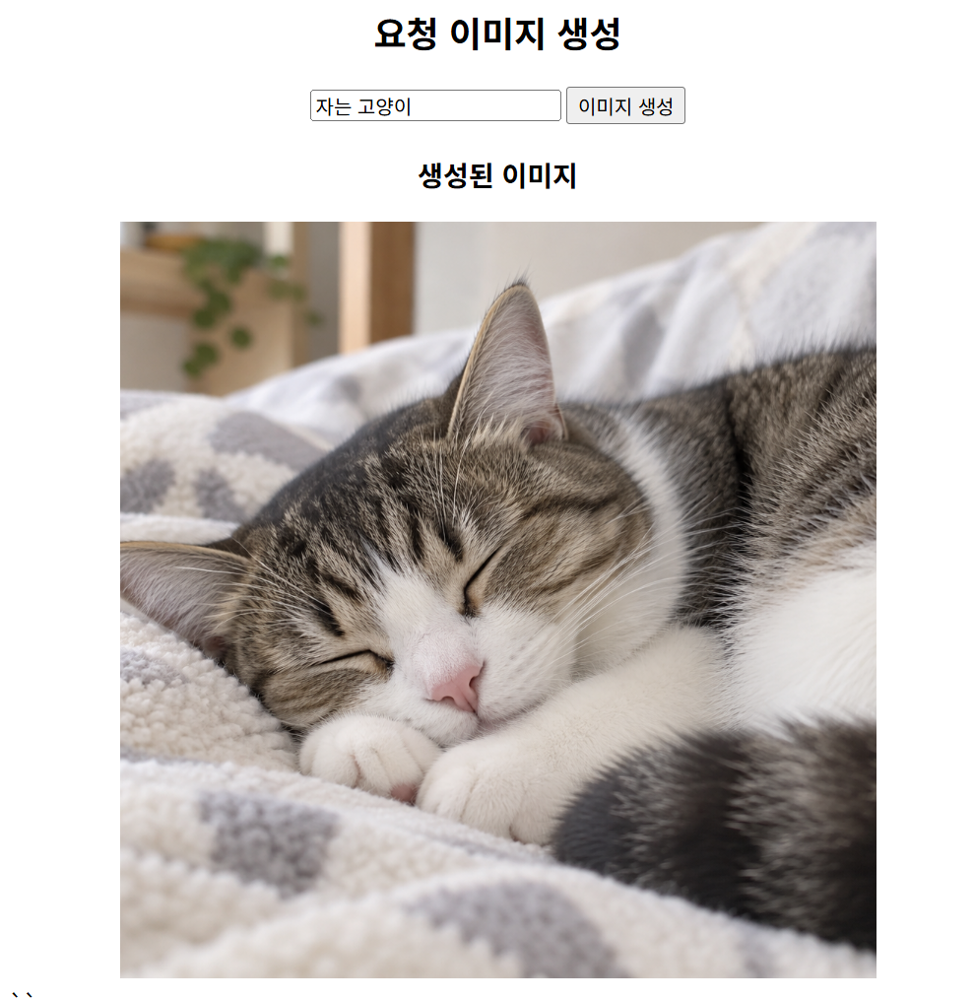
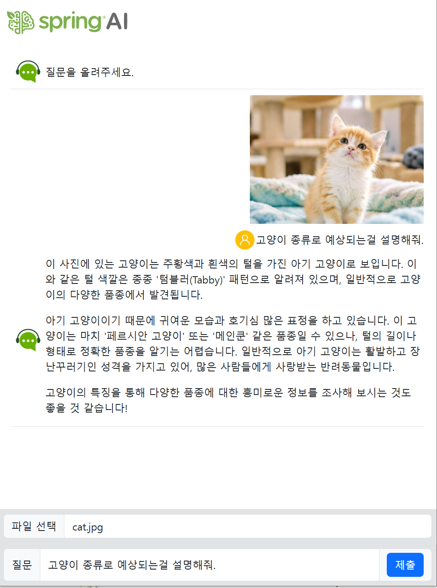
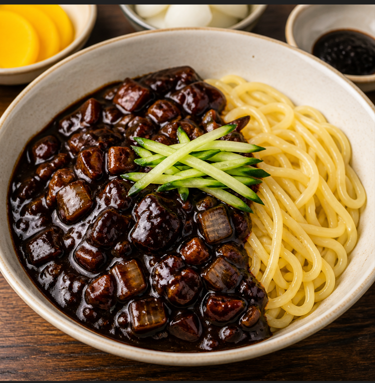
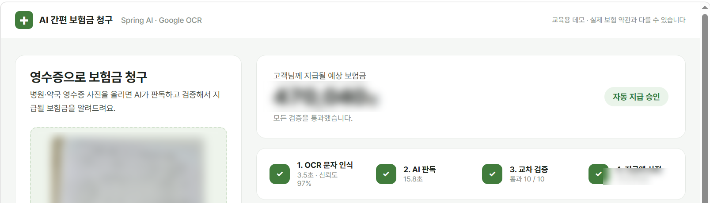
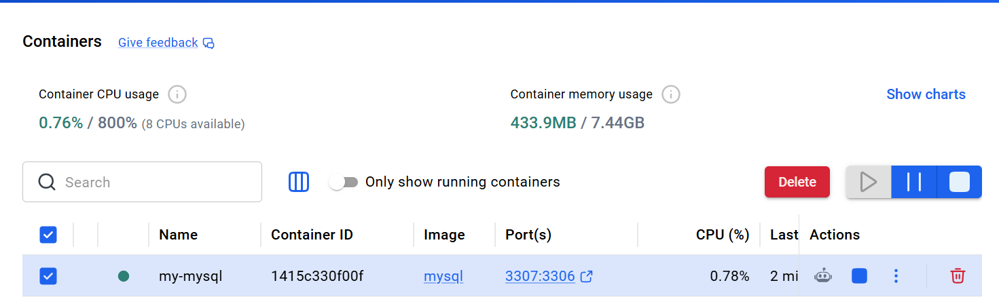
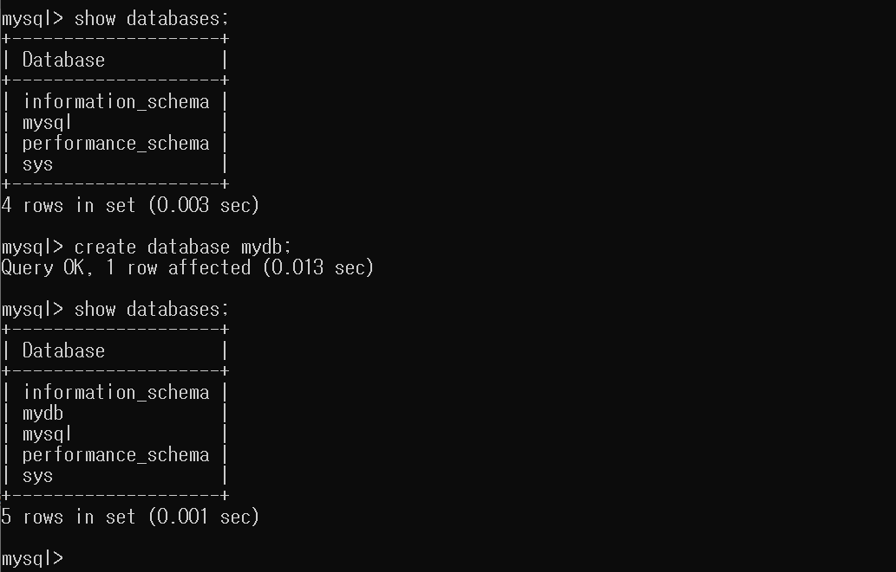

# DAY 83 — Spring AI 비전·이미지 생성과 OCR 보험금 청구, Docker 볼륨

> 2026-11-04 · Spring AI Vision, Media, ImageModel, MultipartFile, Google Vision OCR, Docker Volume, MySQL

어제는 텍스트로 묻고 텍스트로 답받았다면, 오늘은 **이미지를 입력하거나 출력하는** Spring AI 기능을
배웠다. `UserMessage`에 이미지(`Media`)를 붙여 사진을 분석하고, `ImageModel`로 글을 그림으로
바꿨다. 이어서 **OCR과 Vision AI를 함께 써서 영수증으로 보험금을 계산하는** 예제를 만들었고,
파일 업로드 구조와 **Docker 볼륨**으로 MySQL 데이터를 보존하는 방법도 실습했다.

## 오늘의 학습 흐름

```text
AI 기능 구분: 일반 채팅 · 이미지 생성 · Vision
  ↓
이미지 생성 (ImageModel, base64 응답)
  ↓
Vision 이미지 분석 (UserMessage + Media, 스트리밍)
  ↓
한글 설명 → 영어 번역 → 이미지 생성
  ↓
OCR + Vision AI 보험금 청구 (교차 검증 · 규칙 기반 계산)
  ↓
파일 업로드 구조 (MultipartFile, DB에는 파일 정보만)
  ↓
Docker 컨테이너·호스트 개념 → 볼륨으로 MySQL 데이터 보존
```

## 1. 입력과 출력으로 구분한 AI 기능

| 구분 | 입력 | 출력 | 예 |
| --- | --- | --- | --- |
| 일반 채팅 | 텍스트 | 텍스트 | "부산 맛집 알려줘" |
| 이미지 생성 | 텍스트 | 이미지 | "고양이 그려줘" |
| Vision | 텍스트 + 이미지 | 텍스트 | "이 사진 속 음식 뭐야?" |

Spring AI에서 Vision은 별도의 API가 아니다. 기존 `ChatClient`에 보내는 `UserMessage`에 이미지를
**`Media`로 첨부**하기만 하면 된다.

```text
UserMessage
 ├── text  : "이 사진 분석해줘"        ← 질문
 └── media : [image/png, 이미지 데이터] ← 첨부 (여러 장 가능)
```

## 2. 실습 ① 텍스트로 이미지 생성하기

`ImageModel`에 `ImagePrompt`(설명 + 옵션)를 보내 1024×1024 이미지를 생성했다.

```java
ImageOptions options = ImageOptionsBuilder.builder()
        .model("gpt-image-...")   // 사용한 이미지 모델
        .width(1024)
        .height(1024)
        .build();

ImageResponse response = imageModel.call(new ImagePrompt(request, options));
String b64Json = response.getResult().getOutput().getB64Json();

// 파일로 저장하거나, data URL로 바꿔 에 바로 넣는다
Files.write(Path.of("new.png"), Base64.getDecoder().decode(b64Json));
return "data:image/png;base64," + b64Json;
```



> Spring AI 0.8~1.0 초기 버전은 옵션 메서드가 `withModel()`이었고, 1.0 정식 이후로는 `model()`만
> 남았다. 예전 예제를 볼 때는 버전을 먼저 확인한다.

## 3. 실습 ② Vision — 사진을 보고 답하기

업로드한 사진을 `MultipartFile`로 받아 `Media`로 만들고, 시스템 메시지와 함께 보낸 뒤 답변을
`Flux`로 스트리밍했다.

```java
@PostMapping(value = "/image-analysis",
        consumes = MediaType.MULTIPART_FORM_DATA_VALUE,
        produces = MediaType.APPLICATION_NDJSON_VALUE)
public Flux<String> imageAnalysis(@RequestParam("question") String question,
                                  @RequestParam(value = "attach", required = false) MultipartFile attach)
        throws IOException {
    if (attach == null || attach.getContentType() == null
            || !attach.getContentType().startsWith("image/")) {
        return Flux.just("이미지를 올려주세요");
    }
    return aiService.imageAnalysis(question, attach.getContentType(), attach.getBytes());
}
```

```java
Media media = Media.builder()
        .mimeType(MimeType.valueOf(contentType))
        .data(new ByteArrayResource(bytes))
        .build();

UserMessage userMessage = UserMessage.builder()
        .text(question)
        .media(media)
        .build();

return chatClient.prompt(Prompt.builder().messages(systemMessage, userMessage).build())
        .stream()
        .content();
```



## 4. 실습 ③ 한글 설명 → 영어 번역 → 이미지 생성

이미지 모델은 영어 설명을 더 잘 이해하므로, 먼저 `ChatClient`로 한글 설명을 영어로 번역한 뒤
`OpenAiImageOptions`로 품질·크기·개수를 지정해 이미지를 만들었다.

```java
public String generateImage(String question) {
    String englishDescription = koToEn(question);   // ChatClient로 번역

    OpenAiImageOptions options = OpenAiImageOptions.builder()
            .model("gpt-image-...")
            .quality("low")
            .width(1024).height(1024)
            .N(1)
            .build();

    ImagePrompt prompt = new ImagePrompt(List.of(new ImageMessage(englishDescription)), options);
    return imageModel.call(prompt).getResult().getOutput().getB64Json();
}
```



화면에는 "새 이미지 생성"과 "이미지 편집" 모드가 있고, 편집 모드는 원본 이미지와 마스크(투명 영역)가
있어야 요청할 수 있도록 프론트에서 먼저 검증했다.

## 5. OCR과 Spring AI Vision의 차이

| 구분 | OCR | Spring AI Vision |
| --- | --- | --- |
| 하는 일 | 이미지 속 **글자를 그대로 추출** | 글자 인식 + **내용 이해** |
| 강점 | 문자 추출에 최적화, 숫자를 정확하게 읽음 | "이 숫자가 비급여 금액이다" 같은 의미를 구분 |
| 약점 | 어떤 숫자가 무슨 값인지 모름 → 별도 처리 필요 | 숫자를 잘못 읽거나 지어낼 수 있음(환각) |

## 6. 실습 ④ AI 간편 보험금 청구 — OCR × Vision 교차 검증

병원·약국 영수증 사진을 올리면 두 AI의 약점을 서로 보완해 보험금을 계산하는 예제를 만들었다.

```text
[영수증 이미지]
  → ① Google Vision OCR    : 글자와 인식 신뢰도
  → ② Spring AI Vision     : 병원명·진료일·급여/비급여 금액을 ReceiptData로 구조화
  → ③ 교차 검증            : AI가 뽑은 값이 OCR 원문에 실제로 있는가?
  → ④ 지급액 계산          : AI가 아닌 규칙 코드로 계산
  → 판정                   : 자동 지급 / 담당자 확인 / 재제출
```

### ② Vision 결과를 record로 바로 받기

```java
ReceiptData data = chatClient.prompt()
        .system(SYSTEM)   // "보이지 않는 값은 추측하지 말고 0 또는 빈 문자열로" 등 판독 규칙
        .user(u -> u
                .text("이 영수증을 판독해서 데이터로 정리해 주세요.")
                .media(MimeTypeUtils.parseMimeType(contentType), new ByteArrayResource(imageBytes)))
        .call()
        .entity(ReceiptData.class);   // Structured Output
```

### ③ 단계별 검증

| 단계 | 확인 내용 | 결과 |
| --- | --- | --- |
| 1. 입력 품질 | OCR 신뢰도 80% 이상인가, 영수증 키워드가 2개 이상인가 | PASS / WARN |
| 2. AI 판독 | 환자부담 총액을 찾았는가 | PASS / FAIL |
| 3. 교차 검증 | AI가 뽑은 총액·급여·비급여·병원명·진료일이 OCR 원문에 있는가 | PASS / WARN / FAIL |
| 4. 논리 검증 | 급여 + 비급여 = 총액, 항목 합계 = 총액 (1% 또는 10원 오차 허용) | PASS / WARN |

FAIL이 하나라도 있으면 **지급 보류·재제출**, WARN이 있으면 **담당자 확인 후 지급**, 모두 통과하면
**자동 지급 승인**으로 판정했다.

### ④ 돈 계산은 AI에게 맡기지 않는다

```java
long coveredPay   = Math.round(covered * coveredRate);     // 급여 본인부담금 × 80%
long uncoveredPay = Math.round(uncovered * uncoveredRate); // 비급여 × 70%
long total = Math.max(0, coveredPay + uncoveredPay - deductible); // 공제금액 차감
total = total / 10 * 10;                                   // 10원 미만 절사
```

보장 비율과 공제금액은 `application.properties`의 교육용 예시값으로 분리했다. 같은 영수증이면 언제나
같은 금액이 나와야 하고, 나중에 계산 근거를 설명할 수 있어야 하기 때문이다.



여러 영수증으로 시험해 보니 병원명이나 진료일을 AI가 추출하지 못하거나, 항목 합계가 총액과 다르게
나오는 경우 WARN으로 걸러져 담당자 확인 단계로 넘어갔다. AI 결과를 그대로 믿지 않고 검증 단계를
두는 이유를 직접 확인할 수 있었다.

## 7. 파일 업로드 구조

게시판 글쓰기에 사진을 첨부할 때, **파일 자체는 DB에 넣지 않는다.** CLOB·BLOB 같은 큰 타입 대신
파일은 웹 서버 디스크나 AWS S3 같은 파일 서버에 저장하고, DB에는 **파일 이름·용량·확장자** 같은
정보만 저장한다.

```text
1. 파일 서버(디스크·S3)에 파일 쓰기   ← InputStream / OutputStream
2. DB에 파일 정보 INSERT              ← 파일 이름, 용량, 확장자
```

```sql
CREATE TABLE photo (
    name   VARCHAR2(50),
    age    NUMBER,
    image  VARCHAR2(200)   -- 파일 자체가 아니라 '1.jpg' 같은 파일 이름
);
```

Spring에서는 DTO의 필드로 파일 객체를 받는다. 예전 Spring MVC는 `CommonsMultipartFile`을 썼고,
Spring Boot에서는 `MultipartFile`을 사용한다. 업로드 크기도 설정으로 제한했다.

```properties
spring.servlet.multipart.max-file-size=10MB
spring.servlet.multipart.max-request-size=15MB
```

## 8. Docker 컨테이너와 볼륨

**컨테이너**는 하나의 컴퓨터 안에 독립된 컴퓨터 환경을 만들어, 환경마다 프로그램을 따로 설치할 수
있게 한 개념이다. 컨테이너를 담고 있는 컴퓨터는 **호스트(host) 컴퓨터**라고 부른다.

컨테이너를 삭제하면 내부 데이터도 함께 사라진다. **볼륨(Volume)** 은 컨테이너 자체 저장 공간 대신
호스트의 저장 공간을 공유해 데이터를 **영속적으로** 보관하는 방법이다. DB처럼 데이터가 지워지면 안
되는 컨테이너에 사용한다.

### 실습 ⑤ 볼륨을 연결한 MySQL 컨테이너

```bash
docker run -d -p 3307:3306 \
  -e MYSQL_ROOT_PASSWORD=<비밀번호> \
  -v "<호스트 폴더>/mysql_data:/var/lib/mysql" \
  --name my-mysql mysql

docker ps                              # 3307→3306 포트로 실행 중인지 확인
docker exec -it my-mysql bash          # 컨테이너 내부 접속
mysql -u root -p                       # MySQL 접속 후
```

```sql
SHOW DATABASES;
CREATE DATABASE mydb;
SHOW DATABASES;   -- mydb 추가 확인
```

- `-p 3307:3306`: 로컬에 이미 MySQL이 3306을 쓰고 있을 수 있어 호스트 포트를 3307로 연결
- `-e`: 컨테이너 환경변수 설정 (MySQL 루트 비밀번호)
- `-v 호스트경로:컨테이너경로`: MySQL 데이터 폴더(`/var/lib/mysql`)를 호스트 폴더와 연결





볼륨을 연결했기 때문에 컨테이너를 지우고 같은 `-v` 옵션으로 다시 만들어도 `mydb`가 남아 있다.

## 트러블슈팅

### 1. gpt-image 모델의 이미지 URL이 `null`

- **증상**: `getOutput().getUrl()`로 받은 이미지 주소가 `null`이라 화면에 그림이 나오지 않았다.
- **원인**: DALL·E 3는 URL로 응답하지만, gpt-image 계열 모델은 항상 **base64(`b64_json`)** 로만
  응답한다.
- **해결**: `getB64Json()`으로 받아 `data:image/png;base64,...` 형태로 반환하거나 디코딩해 파일로
  저장했다.

### 2. `docker run`에서 `-v` 옵션 오류

- **증상**: `docker run ... -v`까지만 입력하자 `-v` 플래그에 인자가 필요하다는 오류와 사용법이
  출력됐다.
- **원인**: `-v` 뒤에 `호스트경로:컨테이너경로` 값을 빠뜨렸다.
- **해결**: `-v "<호스트 폴더>/mysql_data:/var/lib/mysql"`와 `--name my-mysql`을 붙여 다시 실행하니
  컨테이너가 정상 실행됐다.

### 3. 이미지가 없을 때 응답이 반환되지 않던 코드

이미지 분석 컨트롤러에서 이미지가 없을 때 `Flux.just("이미지를 올려주세요")`를 변수에만 담고
`return`하지 않아, 그대로 다음 줄에서 `attach`를 사용하면 `NullPointerException`이 날 수 있었다.
일지의 코드처럼 **바로 `return`** 하고, `getContentType()`이 `null`인 경우도 함께 검사하도록
정리했다.

## 공개 원칙

- 실제 진료비 영수증은 개인 의료 정보이므로 원본·OCR 원문·금액이 보이는 화면은 올리지 않았다.
  보험금 청구 화면은 금액을 가린 요약 부분만 사용했다.
- Google Vision·OpenAI API 키와 MySQL 비밀번호는 코드와 일지에 적지 않고 환경변수로 관리한다.
- 실습 프로젝트 원본, 빌드 산출물, 사용자명·로컬 경로가 보이는 캡처는 올리지 않았다.

## 오늘의 정리

- Vision은 별도 API가 아니라 `UserMessage`에 `Media`를 붙이는 방식이며, 결과는 `Flux`로 스트리밍하거나
  `.entity()`로 객체로 받을 수 있다.
- `ImageModel`과 `ImagePrompt`로 이미지를 생성하며, gpt-image 계열은 base64로 응답한다.
- OCR은 글자를 정확히, Vision AI는 의미를 잘 읽는다. 둘을 교차 검증하고 돈 계산은 규칙 코드로 하면
  AI의 환각을 줄이고 결과를 설명할 수 있다.
- 업로드 파일은 파일 서버에, DB에는 파일 정보만 저장한다.
- Docker 볼륨은 호스트 저장 공간을 공유해 컨테이너를 지워도 데이터를 유지한다.

## 다음에 이어서 볼 내용

- 업로드 파일을 S3에 저장하고 DB에는 파일 정보만 기록하기
- 영상(`video-analysis`) 입력을 Vision으로 분석하기
- 이미지 편집(마스크) 요청 흐름 완성하기
- Docker Compose로 Spring Boot와 MySQL 컨테이너를 함께 실행하기
