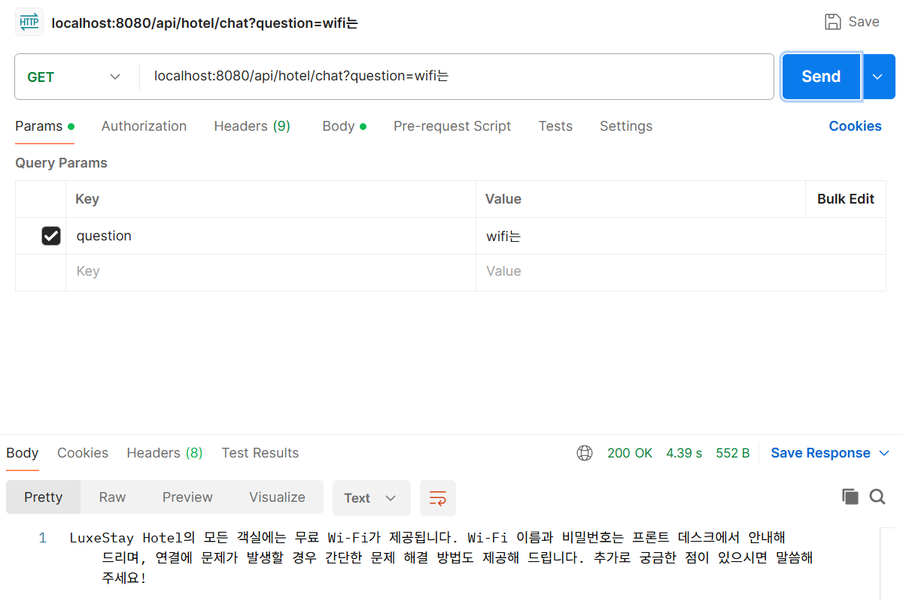
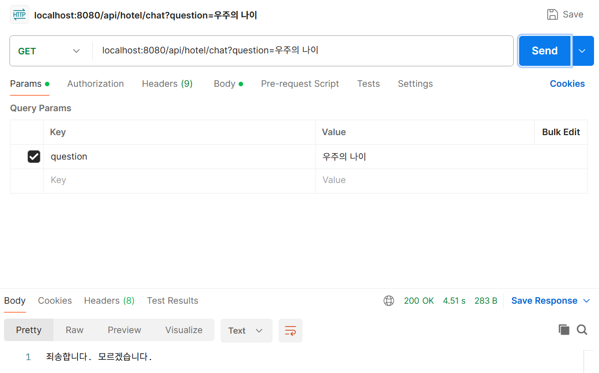
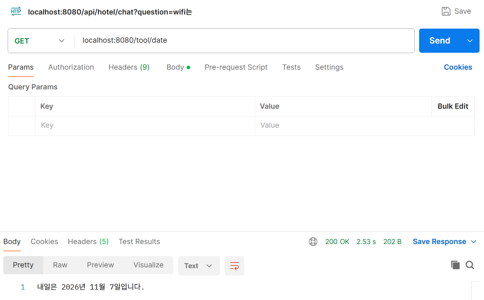
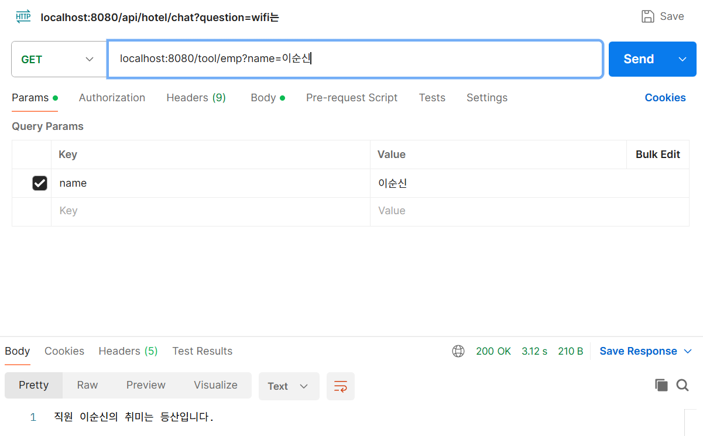
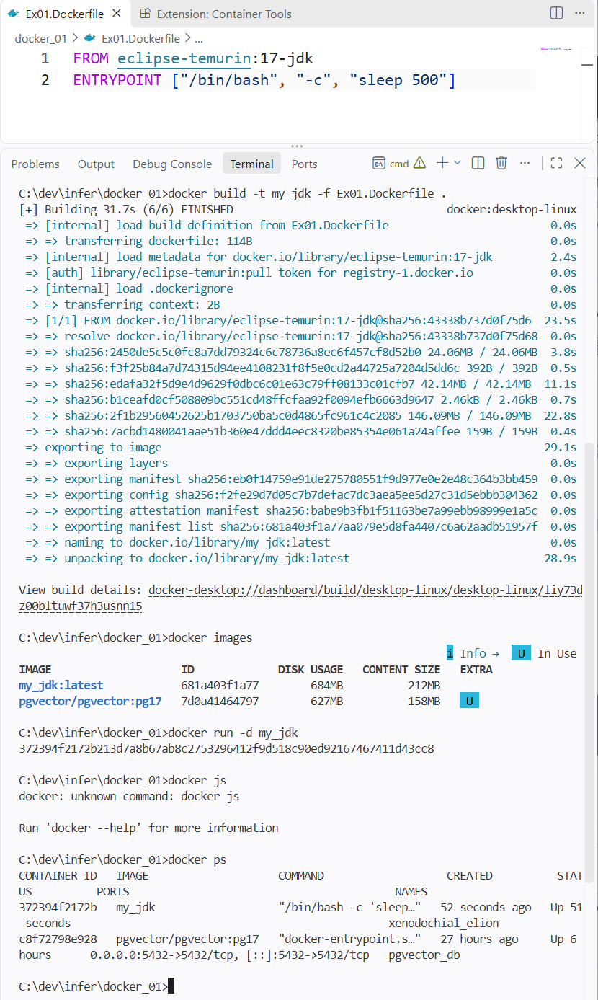
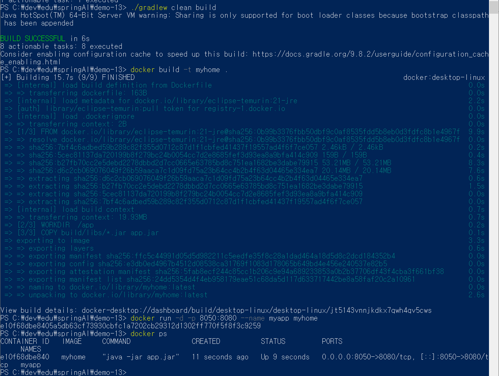
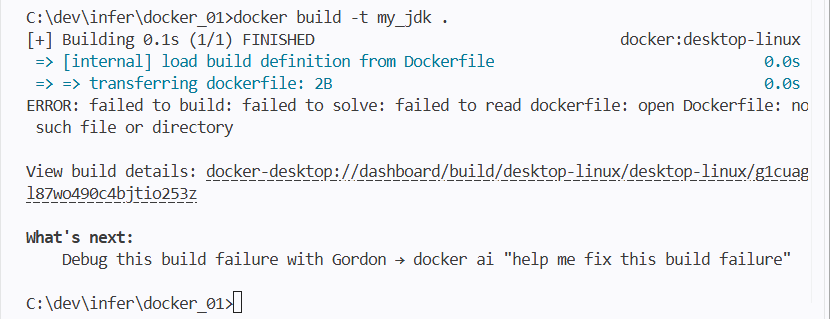

# DAY 85 — RAG 검색 조절과 호텔 FAQ 챗봇, Tool Calling·MCP, Dockerfile 배포

> 2026-11-06 · Spring AI RAG, topK, similarityThreshold, PGVector, Tool Calling, MCP, AI Agent, Dockerfile

어제 만든 PDF RAG를 이어서, 검색 결과의 양과 품질을 정하는 **`topK`와 `similarityThreshold`** 를
정리하고 텍스트 FAQ로 **호텔 상담 챗봇**을 만들었다. 이어서 LLM이 Java 메서드를 직접 호출하게 하는
**Tool Calling**을 실습하고, 외부 도구와 연결하는 표준인 **MCP**, 그리고 **AI Agent**와의 차이를
정리했다. 마지막으로 **Dockerfile**로 이미지를 만들고 Spring Boot 애플리케이션을 컨테이너로 실행했다.

## 오늘의 학습 흐름

```text
RAG 검색 조절: topK · similarityThreshold
  ↓
호텔 FAQ 텍스트 → 임베딩 → hotel_vector 테이블 → 상담 챗봇
  ↓
Tool Calling: 날짜 조회 · 직원 취미 조회 도구
  ↓
MCP와 AI Agent 개념 정리
  ↓
Dockerfile 작성 → 이미지 빌드 → 컨테이너 실행
  ↓
Spring Boot JAR를 Docker 이미지로 배포
```

## 1. RAG 검색 조절 — `topK`와 `similarityThreshold`

RAG에서 어떤 문서를 LLM에 넘기느냐가 답변 품질을 좌우한다. 검색 단계에서 두 값을 조절한다.

```java
SearchRequest.builder()
    .query(question)
    .topK(5)                   // 유사한 문서를 최대 5개까지
    .similarityThreshold(0.7)  // 유사도 0.7 이상인 문서만
    .build();
```

| 설정 | 의미 | 너무 낮거나 작으면 | 너무 높거나 크면 |
| --- | --- | --- | --- |
| `topK` | 가져올 문서의 **최대 개수** | 필요한 근거가 빠질 수 있음 | 관련 없는 문서까지 섞이고 토큰 비용 증가 |
| `similarityThreshold` | 허용할 **최소 유사도** (0~1) | 관련성 낮은 문서도 통과 | 관련 문서까지 걸러져 "모르겠습니다"가 늘어남 |

`topK`는 "몇 개까지", 임계값은 "얼마나 비슷해야" 가져올지를 정한다. 둘을 함께 쓰면 상위 K개 중에서도
기준을 넘는 문서만 남는다.

## 2. 실습 ① 호텔 FAQ 상담 챗봇

체크인 시간, Wi-Fi, 주차, 반려동물, 취소 수수료 등 12개 항목이 담긴 호텔 FAQ 텍스트를 업로드해
벡터 저장소에 넣고, 질문과 가장 가까운 항목을 찾아 답하게 했다.

```properties
spring.ai.vectorstore.pgvector.index-type=HNSW
spring.ai.vectorstore.pgvector.distance-type=COSINE_DISTANCE
spring.ai.vectorstore.pgvector.dimensions=1536
spring.ai.vectorstore.pgvector.table-name=hotel_vector   # 원하는 테이블 이름 지정
```

### 업로드 — 한 줄을 하나의 문서로

FAQ는 한 줄에 한 항목이라, PDF처럼 페이지 단위가 아니라 **줄 단위로 `Document`** 를 만들었다.
같은 파일을 여러 번 올려도 중복 저장되지 않도록 `JdbcClient`로 테이블이 비어 있을 때만 저장했다.

```java
Integer count = jdbcClient.sql("select count(*) from hotel_vector")
        .query(Integer.class)
        .single();

if (count == 0) {
    List<Document> documents = Files.lines(tmpFile.toPath())
            .map(Document::new)          // 한 줄 = 문서 하나
            .toList();
    vectorStore.accept(new TokenTextSplitter().apply(documents));
}
```

`TokenTextSplitter`의 기본값도 정리했다.

| 설정 | 기본값 | 의미 |
| --- | --- | --- |
| `defaultChunkSize` | 800 | 청크의 목표 최대 토큰 수 |
| `minChunkSizeChars` | 350 | 분할할 때 고려하는 최소 문자 수 |
| `minChunkLengthToEmbed` | 5 | 임베딩할 청크의 최소 문자 수 |
| `maxNumChunks` | 10,000 | 문서당 최대 청크 수 |
| `keepSeparator` | true | 분할할 때 구분자 유지 여부 |

### 질문 — 검색 결과를 프롬프트에 넣어 스트리밍

```java
List<Document> results = vectorStore.similaritySearch(SearchRequest.builder()
        .query(question)
        .similarityThreshold(0.5)
        .topK(1)                // FAQ 한 항목이면 충분
        .build());

return chatClient.prompt()
        .user(u -> u.text("""
                당신은 어느 호텔의 직원입니다. 문맥에 따라서 고객의 질문에 정중하게 답변해주세요.
                컨텍스트가 질문에 대답할 수 없는 경우, "죄송합니다. 모르겠습니다."라고 대답하세요.
                컨텍스트: {context}
                질문: {question}
                """)
                .param("context", results)
                .param("question", question))
        .stream()
        .content();
```

"wifi는?"이라고 묻자 FAQ의 Wi-Fi 항목을 근거로 답했고, FAQ와 관계없는 "우주의 나이"를 묻자 지어내지
않고 "죄송합니다. 모르겠습니다."라고 답했다. 임계값과 프롬프트 규칙이 함께 **환각을 막는 장치**가 됐다.





> `.param("context", results)`는 `List<Document>`를 문자열로 바꿔 넣으므로 메타데이터까지 섞일 수 있다.
> 어제 PDF RAG처럼 `getText()`만 꺼내 줄바꿈으로 합쳐 넣는 편이 프롬프트가 깔끔하다.

## 3. 실습 ② Tool Calling — LLM이 Java 메서드를 호출

LLM은 오늘 날짜도, 회사 내부 데이터도 모른다. **Tool Calling**은 LLM이 필요할 때 등록된 Java
메서드를 실행해 DB 조회, 외부 API 호출, 파일 관리 같은 작업을 하도록 만드는 기술이다. Spring AI는
도구의 **이름·설명·매개변수 스키마**를 모델 요청에 함께 보내고, 모델이 도구를 고르면 실행 결과를
다시 받아 최종 답변을 만든다.

```java
@Component
public class SpringTools {

    private static final Map<String, String> dictionary = Map.of(
            "이순신", "등산", "김유신", "축구", "유관순", "영화감상", "아무개", "독서");

    @Tool(description = "오늘 날짜를 yyyy-MM-dd 형식으로 반환합니다.")
    public String getCurrentDateTime() {
        return LocalDate.now().toString();
    }

    @Tool(description = "직원 이름을 넣으면 그 직원의 취미를 반환합니다.")
    public String userHobby(@ToolParam(description = "직원 이름") String name) {
        return dictionary.getOrDefault(name, "해당 직원 없음");
    }
}
```

```java
@GetMapping("/date")
public String toolDate() {
    return chatClient.prompt("내일은 몇일일까?")
            .tools(new SpringTools())   // 이 요청에서 쓸 수 있는 도구 등록
            .call()
            .content();
}
```

| 요청 | 도구 없이 | 도구 사용 |
| --- | --- | --- |
| "내일은 몇일일까?" (`/tool/simple` → `/tool/date`) | 오늘 날짜를 몰라 정확히 답하지 못함 | 날짜 도구를 호출해 "내일은 2026년 11월 7일입니다." |
| `GET /tool/emp?name=이순신` | 내부 데이터 없음 | 취미 도구를 호출해 "직원 이순신의 취미는 등산입니다." |





> 실습 코드는 `@Tool`에 설명 없이 메서드 이름만 두었는데, 모델은 이름·설명을 보고 도구를 고르므로
> 위처럼 `description`과 `@ToolParam`을 적어 두는 것이 더 정확하다.

## 4. MCP와 AI Agent

**MCP(Model Context Protocol)** 는 AI 애플리케이션이 **외부 도구와 데이터에 연결하기 위한 표준
프로토콜**이다. LLM은 회사 DB에 직접 접근할 수 없지만, DB 조회 기능을 제공하는 MCP 서버와 연결하면
그 기능을 도구처럼 사용할 수 있다. 수업에서는 **애플리케이션 내부 기능은 Tool Calling, 외부 서버의
기능은 MCP**로 구분했다.

| 구분 | Tool Calling | AI Agent |
| --- | --- | --- |
| 핵심 | 외부 기능 호출 | 목표 달성을 위한 판단과 실행 |
| 도구 사용 | 한 개 또는 여러 개 | 필요에 따라 여러 도구를 조합 |
| 실행 흐름 | 도구 호출 → 결과 처리 | 계획 → 실행 → 관찰 → 재판단 |
| 예시 | 상품 재고 조회 | 상품 검색 → 재고 확인 → 추천 |
| 관계 | 에이전트의 핵심 기능 중 하나 | Tool Calling을 활용해 동작 |

## 5. Dockerfile로 이미지 만들기

### 실습 ③ 첫 Dockerfile

```dockerfile
FROM eclipse-temurin:17-jdk
ENTRYPOINT ["/bin/bash", "-c", "sleep 500"]
```

| 명령 | 의미 |
| --- | --- |
| `FROM` | 기반 이미지 (JDK 17이 설치된 리눅스) |
| `ENTRYPOINT` | 컨테이너가 시작될 때 실행할 명령 (500초 동안 대기) |

```bash
docker build -t my_jdk -f Ex01.Dockerfile .   # -t 이미지 이름, -f Dockerfile 경로, . 빌드 컨텍스트
docker images                                 # my_jdk:latest 확인
docker run -d my_jdk
docker ps                                     # "/bin/bash -c 'sleep…'" 실행 중
```



목록에는 어제 RAG 실습에 쓴 `pgvector/pgvector:pg17` 컨테이너(5432 포트)도 함께 실행 중이었다.

### 실습 ④ Spring Boot 애플리케이션을 이미지로 배포

```dockerfile
# 실행만 하면 되므로 JDK보다 가벼운 JRE 이미지 사용
FROM eclipse-temurin:21-jre
WORKDIR /app
# Gradle로 만든 실행 JAR 복사
COPY build/libs/*.jar app.jar
EXPOSE 8080
ENTRYPOINT ["java", "-jar", "app.jar"]
```

```bash
./gradlew clean build                          # build/libs에 JAR 생성
docker build -t myhome .                       # 이미지 빌드
docker run -d -p 8050:8080 --name myapp myhome # 호스트 8050 → 컨테이너 8080
docker ps                                      # "java -jar app.jar" 실행 확인
```



```text
소스 코드 ──gradlew build──▶ app.jar ──docker build──▶ 이미지(myhome) ──docker run──▶ 컨테이너(myapp) :8050
```

## 트러블슈팅

### 1. `docker build` — Dockerfile을 찾지 못함



- **증상**: `docker build -t my_jdk .` 실행 시 `failed to read dockerfile: open Dockerfile: no such file
  or directory` 오류가 났다.
- **원인**: `docker build`는 기본으로 `Dockerfile`이라는 이름의 파일을 찾는데, 파일 이름이
  `Ex01.Dockerfile`이었다.
- **해결**: `-f Ex01.Dockerfile` 옵션으로 파일을 지정해 빌드에 성공했다.

### 2. `docker js` — 알 수 없는 명령

`docker ps`를 `docker js`로 잘못 입력해 `unknown command` 오류가 났다. 명령이 기억나지 않으면
`docker --help`로 확인한다.

### 3. Spring Boot 이미지 빌드 전 Gradle 빌드 실패

처음 Gradle 빌드가 실패해 `build/libs`에 JAR가 없는 상태였다. Dockerfile이 `build/libs/*.jar`를
복사하므로, `./gradlew clean build`가 **BUILD SUCCESSFUL**로 끝나 JAR가 생긴 것을 확인한 뒤
`docker build`를 실행했다.

## 다음 프로젝트 안내 — 1인 웹 서비스 MVP

수업 마지막에 2주 동안 진행할 1인 웹 프로젝트의 제출 예시를 받았다. 예시는 개인 일정 관리 서비스
"MyDay"로, MVP 문서에 담을 내용은 다음과 같다.

- 프로젝트 개요(목적·기간·주요 기술), 목표 사용자, **MVP 목표 한 문장**
- MVP 핵심 기능: 회원가입·로그인, 일정 목록·등록·상세·수정·삭제, 완료 처리
- 화면 예시, 기술 스택(Spring MVC·HTML/CSS/JS·Oracle), 주차별 개발 일정
- 복잡한 기능은 빼고 **핵심 기능이 정상 동작하는 것**을 완료 기준으로 삼는다.

## 공개 원칙

- OpenAI API 키와 PostgreSQL 비밀번호는 코드와 일지에 적지 않고 환경변수로 관리한다.
- 실습 프로젝트 원본, 빌드 산출물(JAR), 참고한 외부 사이트 화면은 올리지 않았다.
- 캡처는 요청·응답 영역과 터미널 부분만 잘라 사용했다.

## 오늘의 정리

- `topK`는 가져올 문서 수, `similarityThreshold`는 최소 유사도이며, 둘을 조절해 근거의 양과 품질을
  맞춘다.
- FAQ처럼 짧은 항목은 줄 단위로 임베딩하고, 컨텍스트가 없으면 "모르겠습니다"라고 답하게 해 환각을 막는다.
- Tool Calling은 LLM이 등록된 Java 메서드를 실행하게 하는 기술이고, MCP는 외부 도구·데이터와 연결하는
  표준 프로토콜이다. AI Agent는 이런 도구를 조합해 목표를 달성한다.
- Dockerfile의 `FROM`·`WORKDIR`·`COPY`·`EXPOSE`·`ENTRYPOINT`로 Spring Boot JAR를 이미지로 만들고
  `-p`로 포트를 연결해 실행했다.

## 다음에 이어서 볼 내용

- MCP 서버를 연결해 외부 도구를 Spring AI에서 사용하기
- 여러 도구를 조합하는 간단한 AI Agent 만들기
- Docker Compose로 Spring Boot·PGVector 컨테이너를 함께 실행하기
- 1인 웹 프로젝트 MVP 문서 작성과 DB 설계
