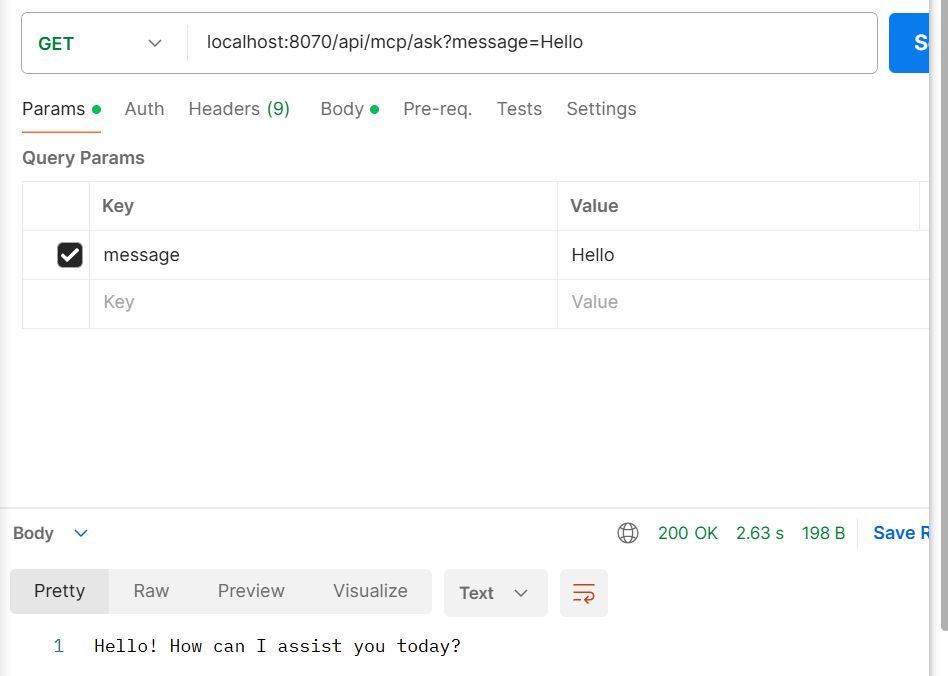
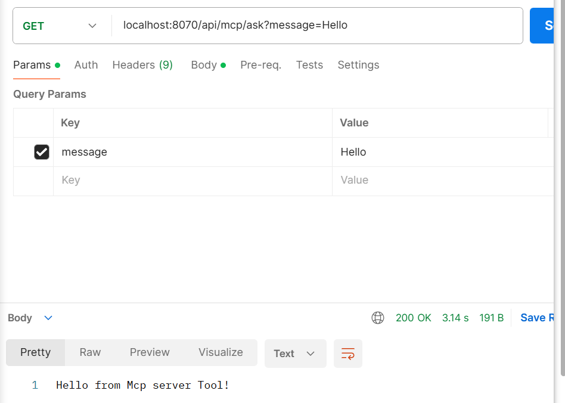
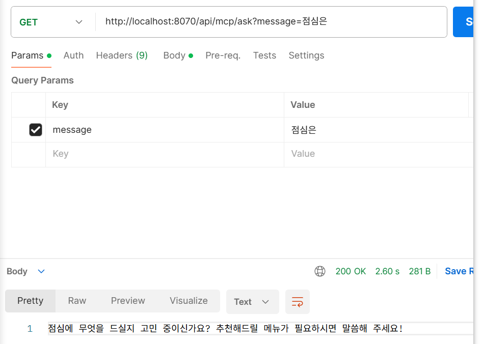
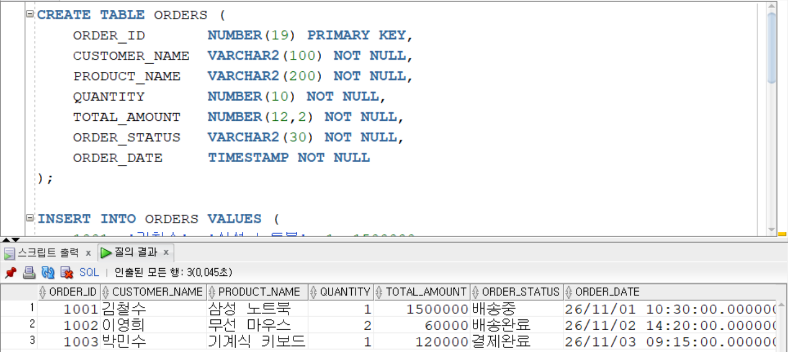
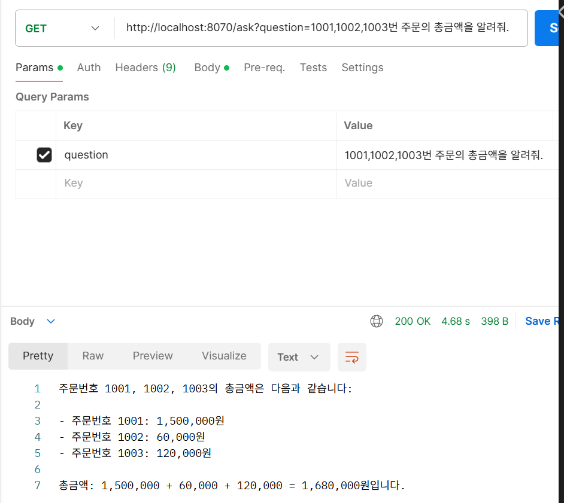
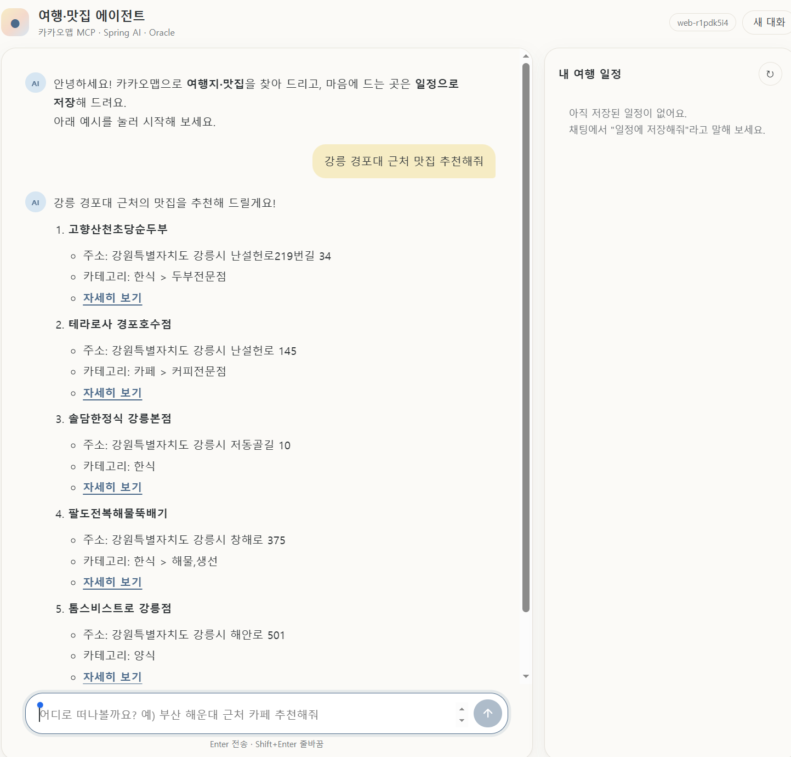
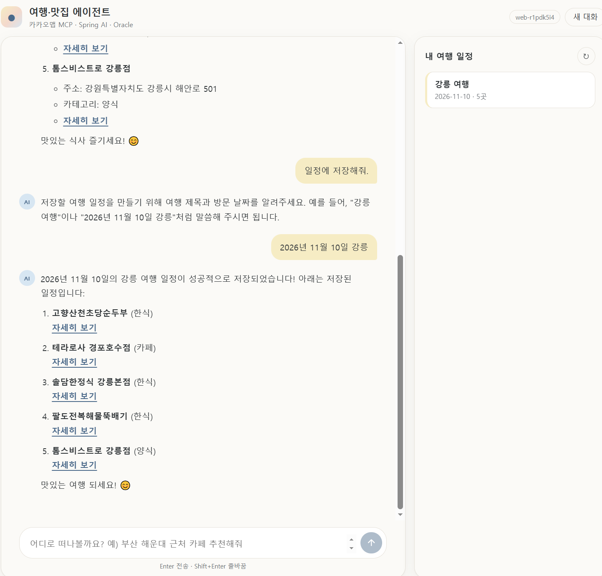
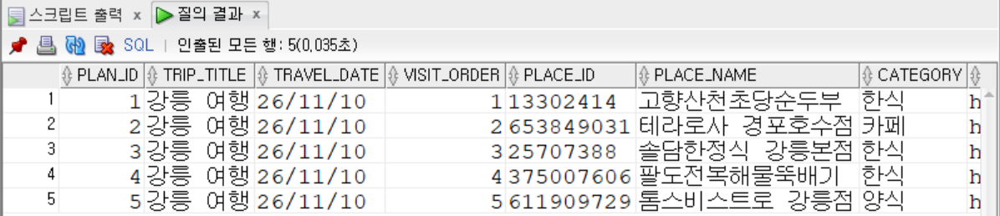

# DAY 87 — Tool Calling 차단기와 MCP 서버·클라이언트, 카카오맵 여행 에이전트

> 2026-11-09 · Spring AI Tool Calling, Vision, MCP Server, MCP Client, @McpTool, MyBatis, Kakao PlayMCP

지난주 배운 Tool Calling을 이어서, **차량 번호판 사진을 보고 차단기를 올리거나 내리는** 예제를
만들었다. 그다음 도구를 다른 애플리케이션에 제공하는 **MCP 서버**와 그 도구를 가져다 쓰는 **MCP
클라이언트**를 직접 만들어 연결했고, Oracle DB의 주문 정보를 MCP 도구로 제공했다. 마지막으로 카카오
PlayMCP의 카카오맵 도구와 로컬 DB 도구를 함께 쓰는 **여행·맛집 에이전트**를 만들었다.

## 오늘의 학습 흐름

```text
AI가 할 일과 시스템이 할 일 구분
  ↓
Vision + Tool Calling: 번호판 인식 → 등록 조회 → 차단기 제어
  ↓
Spring AI 구성 요소 정리 (ChatClient · Advisors · Tool Calling · MCP · RAG …)
  ↓
MCP 서버(@McpTool) ↔ MCP 클라이언트 연결
  ↓
주문 조회 MCP 서버 (Oracle + MyBatis) ↔ 상담 클라이언트
  ↓
카카오 PlayMCP(원격) + 일정 저장 도구(로컬) → 여행·맛집 에이전트
```

## 1. AI가 할 수 있는 일과 할 수 없는 일

요구사항을 받으면 먼저 **AI가 맡을 일과 시스템이 맡을 일을 나눠야** 한다.

| AI에게 맡길 일 | 시스템(코드·DB)이 해야 할 일 |
| --- | --- |
| 사진에서 번호판 글자 인식 | 등록 차량 여부 조회 (DB에 있는 사실) |
| 상황을 보고 어떤 도구를 쓸지 판단 | 실물 차단기 제어 API 호출 |
| 결과를 자연어로 정리 | 인증·권한, 장애 대응, 모니터링 |

등록 차량 조회처럼 **정답이 DB에 있는 일은 AI가 추측하면 안 되고**, 도구를 통해 시스템이 확인한
결과를 받아야 한다.

## 2. 실습 ① 번호판 인식 차단기 — Vision + Tool Calling

번호판 사진을 올리면 AI가 번호를 읽고, 등록 여부를 **도구로** 확인한 뒤 차단기를 올리거나 내리는
도구를 호출한다.

```java
@Component
public class CarCheckTools {
    // 실제로는 MyBatis로 DB를 조회하는 자리
    private final List<String> carNumbers = List.of("23가4567", "345가6789", "152가3108", "157고4895");

    @Tool(description = "LLM이 인식한 차량번호가 DB에 등록되어 있는지 판단하는 도구")
    public String checkCarNumber(@ToolParam(description = "차량번호") String carNumber) {
        carNumber = carNumber.replaceAll("\\s+", "");   // 공백 제거 후 비교
        return carNumbers.contains(carNumber) ? "등록번호" : "미등록번호";
    }
}

@Component
public class BoomBarrierTools {
    @Tool(description = "차단기를 올리는 도구")
    public String boomBarrierUp()   { return "차단기 올림"; }   // 실제로는 기계 제어 API 호출

    @Tool(description = "차단기를 내리는 도구")
    public String boomBarrierDown() { return "차단기 내림"; }
}
```

```java
UserMessage userMessage = UserMessage.builder()
        .text("""
            다음 단계별로 처리해 주세요.
            1단계: 이미지에서 '(숫자 2~3개)-(한글 1자)-(숫자 4개)'로 구성된 차량 번호를 인식하세요.
            2단계: 끝에서 5번째 문자가 한글 완성형 음절이 아니면 다시 1단계로 돌아가세요.
            3단계: 인식된 차량 번호가 등록된 번호인지 도구로 확인하세요.
            4단계: "미등록번호"면 도구로 차단기를 내리고, "등록번호"면 도구로 차단기를 올리세요.
            최종 답변은 차단기 내림 또는 차단기 올림으로 하고 추가 설명은 하지 마세요.
            """)
        .media(media)                                  // 번호판 사진
        .build();

return chatClient.prompt()
        .messages(userMessage)
        .tools(carCheckTools, boomBarrierTools)        // 사용할 도구는 반드시 등록
        .call()
        .content();
```

등록된 번호 두 장(`152가3108`, `157고4895`)을 올리자 콘솔에 "LLM 인식한 차량번호"와 "차단기를
올립니다." 로그가 차례로 찍히고, 화면에는 **차단기 올림**이 표시됐다. AI는 번호를 읽고 도구를 고르는
역할만 하고, 판단 근거(등록 여부)와 실제 동작(차단기)은 코드가 맡는 구조다.

> 실습 코드에서는 공백 제거를 `replaceAll("\\s+", carNumber)`로 작성해 공백 자리에 번호가 다시
> 들어가는 문제가 있었다. 번호판에 공백이 섞여 인식되면 등록 차량도 "미등록"이 될 수 있으므로 위처럼
> 빈 문자열(`""`)로 바꿔야 한다.

## 3. Spring AI 구성 요소 한눈에 보기

| 기술 | 핵심 질문 | 역할 |
| --- | --- | --- |
| ChatClient | AI에게 어떻게 질문할까? | LLM 호출 인터페이스 |
| Advisors | 대화에 어떤 부가 처리가 필요할까? | 기억, 로깅, 검색 보조 |
| Chat Model | 어떤 모델이 답변할까? | LLM 연동 (OpenAI, Ollama 등) |
| Tool Calling | AI가 어떤 기능을 사용할까? | 도구 선택 및 실행 연결 |
| MCP Client | 외부 도구를 어떻게 가져올까? | MCP 서버 연결 |
| MCP Server | 외부에 어떤 기능을 제공할까? | Tool 및 데이터 제공 |
| RAG | 외부 지식을 어떻게 활용할까? | 검색 기반 답변 생성 |
| Structured Output | 응답을 프로그램에서 어떻게 쓸까? | JSON, DTO 등으로 변환 |

```text
사용자 → REST API → Advisors(기억·로깅) → Prompt → Chat Model
                                                  │ 도구가 필요하다고 판단
                                                  ▼
                                   Tool Calling → 로컬 @Tool
                                                → MCP Client ──(Streamable HTTP)──▶ MCP Server
                                                  │
                                   도구 결과로 답변 생성 → (필요하면) Structured Output
```

**MCP 서버가 LLM을 포함할 필요는 없다.** 기존 Spring Boot의 Service 계층을 그대로 MCP Tool로 공개하는
것만으로도 다른 AI 애플리케이션이 그 기능을 쓸 수 있다.

## 4. 실습 ② 가장 작은 MCP 서버와 클라이언트

### MCP 서버 (8090) — `@McpTool` 자동 스캔

```java
@Service
public class SimpleToolService {
    @McpTool(name = "HelloTool", description = "간단한 Hello 메시지를 반환합니다.")
    public String helloTool() {
        return "Hello from Mcp server Tool";
    }
}
```

```properties
server.port=8090
spring.ai.mcp.server.name=mcp-server
# HTTP 스트리밍 방식
spring.ai.mcp.server.protocol=STREAMABLE
spring.ai.mcp.server.type=SYNC
spring.ai.mcp.server.capabilities.tool=true
# @McpTool 자동 등록
spring.ai.mcp.server.annotation-scanner.enabled=true
spring.ai.mcp.server.streamable-http.mcp-endpoint=/mcp
```

### MCP 클라이언트 (8070) — 서버의 도구를 ChatClient에 등록

```properties
server.port=8070
spring.ai.mcp.client.enabled=true
spring.ai.mcp.client.type=SYNC
spring.ai.mcp.client.toolcallback.enabled=true
spring.ai.mcp.client.streamable-http.connections.local-server.url=http://localhost:8090
spring.ai.mcp.client.streamable-http.connections.local-server.endpoint=/mcp
```

```java
@Bean
public ChatClient chatClient(ChatModel chatModel, ToolCallbackProvider mcpTools) {
    return ChatClient.builder(chatModel)
            .defaultToolCallbacks(mcpTools)   // MCP 서버가 공개한 도구 목록을 기본 도구로
            .build();
}
```

```java
String systemPrompt = """
        You are allowed to use the MCP tool only when the user asks for a greeting
        such as 'hello', 'hi', '안녕', or '인사해'.
        Do NOT call the tool for any other request.
        """;
```

| 요청 | 결과 |
| --- | --- |
| `message=Hello` (서버 연결 전) | "Hello! How can I assist you today?" — 도구 없이 LLM이 직접 인사 |
| `message=Hello` (서버 연결 후) | **"Hello from Mcp server Tool!"** — 서버 콘솔에 HelloTool 호출 로그 |
| `message=점심은` | 인사가 아니므로 도구를 쓰지 않고 LLM이 직접 답변 |







## 5. 실습 ③ 주문 조회 MCP 서버 — Oracle + MyBatis

쇼핑몰 주문 정보를 Oracle `ORDERS` 테이블에 넣고, 이를 조회하는 기능을 MCP 도구로 공개했다.



```text
[order-mcp-client :8070]  ──MCP──▶  [order-mcp-server :8081]
 ChatClient + MCP 도구                OrderTools(@Tool) → OrderService → OrderMapper(MyBatis) → Oracle ORDERS
```

```java
@Component
public class OrderTools {
    private final OrderService orderService;

    @Tool(name = "getOrder", description = "OracleDB에서 쇼핑몰 주문번호로 주문정보와 배송상태 조회")
    public String getOrder(@ToolParam(description = "조회할 주문 번호") Long orderId) {
        OrderInfo order = orderService.getOrder(orderId);
        if (order == null) return "해당 주문번호의 주문이 없습니다.";
        return """
                주문번호: %d
                고객명: %s
                상품명: %s
                총금액: %s원
                주문상태: %s
                """.formatted(order.orderId(), order.customerName(), order.productName(),
                              order.totalAmount(), order.orderStatus());
    }
}
```

```java
@Configuration
public class McpToolConfig {
    @Bean   // @Tool 메서드를 찾아 도구로 만들고, MCP 서버가 이 Bean을 MCP 도구로 공개
    public ToolCallbackProvider orderToolProvider(OrderTools orderTools) {
        return MethodToolCallbackProvider.builder().toolObjects(orderTools).build();
    }
}
```

```xml
<select id="findById" resultType="com.example.demo.dto.OrderInfo">
    SELECT ORDER_ID, CUSTOMER_NAME, PRODUCT_NAME, QUANTITY, TOTAL_AMOUNT, ORDER_STATUS, ORDER_DATE
      FROM ORDERS
     WHERE ORDER_ID = #{orderId}
</select>
```

클라이언트의 시스템 프롬프트에는 "도구에서 반환한 정보만 답하고, 없는 주문 정보는 만들지 말고,
주문번호가 없으면 번호를 물어보라"는 규칙을 넣었다.

"1001, 1002, 1003번 주문의 총금액을 알려줘"라고 묻자 서버 로그에 `OrderMapper.findById`가 **세 번**
실행됐고, 각 금액(1,500,000원 · 60,000원 · 120,000원)과 합계 1,680,000원을 답했다. 질문 하나에 LLM이
도구를 여러 번 호출해 결과를 합친 것이다.



### `@Tool`과 `@McpTool`의 차이

| 구분 | `@Tool` | `@McpTool` |
| --- | --- | --- |
| 용도 | 일반 Spring AI Tool (로컬·MCP 모두) | MCP 서버 전용 |
| 등록 방식 | `MethodToolCallbackProvider` Bean을 직접 등록 | MCP 어노테이션 스캐너가 자동 등록 |
| 설정 클래스 | 필요 (`McpToolConfig`) | 불필요 (`annotation-scanner.enabled=true`) |
| MCP 클라이언트 연결 | 가능 | 가능 |

**둘 중 한 방식만** 써야 한다. 같은 메서드에 섞어 쓰면 도구가 등록되지 않거나 중복 등록된다.

## 6. 실습 ④ 카카오맵 여행·맛집 에이전트

이번에는 MCP 서버를 직접 만들지 않고, 카카오가 제공하는 **PlayMCP 게이트웨이의 카카오맵 도구**를
원격으로 연결했다. 일정 저장은 로컬 Oracle에 하는 `@Tool`로 만들어, **원격 MCP 도구와 로컬 도구를
LLM이 함께 골라 쓰게** 했다.

```text
사용자 ─▶ TravelAgentService(ChatClient + 대화 기억)
            ├─ 원격 MCP: PlayMCP 카카오맵  (장소 검색 · 도보/대중교통/자전거 길찾기)
            └─ 로컬 @Tool: TripPlanTools   (일정 저장 · 조회 · 목록 · 삭제 → Oracle TRIP_PLAN)
```

```java
@Bean
public ChatClient chatClient(ChatModel chatModel, ToolCallbackProvider mcpToolProvider,
                             TripPlanTools tripPlanTools, ChatMemory chatMemory) {
    return ChatClient.builder(chatModel)
            .defaultToolCallbacks(mcpToolProvider)   // 원격: 카카오 PlayMCP 도구
            .defaultTools(tripPlanTools)             // 로컬: Oracle 일정 저장/조회/삭제
            .defaultAdvisors(MessageChatMemoryAdvisor.builder(chatMemory).build()) // "아까 찾은 곳 저장해줘"
            .build();
}
```

```java
@Tool(name = "saveTripPlace", description = """
        여행 일정에 장소 1개를 저장합니다. 여러 장소를 저장하려면 장소마다 한 번씩 호출하세요.
        placeName, placeId, category, placeUrl 은 카카오맵 도구 결과에 있는 값을 그대로 사용하세요.
        """)
public String saveTripPlace(
        @ToolParam(description = "여행 제목. 예: 강릉 1박2일") String tripTitle,
        @ToolParam(description = "방문 날짜 YYYY-MM-DD") String travelDate,
        @ToolParam(description = "그날 방문 순서(1부터). 모르면 비워두기", required = false) Integer visitOrder,
        @ToolParam(description = "장소명") String placeName,
        /* placeId · category · placeUrl · memo 생략 */ ...) {
    int order = tripPlanService.saveTripPlace(...);
    return "저장 완료: [%s] %s %d번째 - %s".formatted(tripTitle, travelDate, order, placeName);
}
```

시스템 프롬프트에 오늘 날짜를 `{today}`로 넣어 "내일", "이번 주말"을 계산하게 했고, 도구별 사용 규칙과
"평점·가격·영업시간처럼 도구 결과에 없는 정보는 지어내지 말 것", "제목이나 날짜를 모르면 저장 전에
물어볼 것"을 적었다.

```java
return chatClient.prompt()
        .system(s -> s.text(SYSTEM_PROMPT).param("today", LocalDate.now().toString()))
        .user(question)
        .advisors(a -> a.param(ChatMemory.CONVERSATION_ID, conversationId))   // 사용자별 대화 기억
        .call()
        .content();
```

일정 테이블은 카카오 운영정책에 맞춰 **주소·전화번호 같은 검색 결과를 통째로 저장하지 않고**, 장소 ID와
표시용 장소명·URL, 사용자가 정한 일정 정보만 저장하도록 설계했다.

```sql
CREATE SEQUENCE TRIP_PLAN_SEQ START WITH 1 INCREMENT BY 1 NOCACHE;

CREATE TABLE TRIP_PLAN (
    PLAN_ID      NUMBER         PRIMARY KEY,
    TRIP_TITLE   VARCHAR2(200)  NOT NULL,   -- 여행 제목
    TRAVEL_DATE  DATE           NOT NULL,   -- 방문 날짜
    VISIT_ORDER  NUMBER(3)      NOT NULL,   -- 그날 방문 순서
    PLACE_ID     VARCHAR2(30),              -- 카카오 장소 ID
    PLACE_NAME   VARCHAR2(300)  NOT NULL,
    CATEGORY     VARCHAR2(300),
    PLACE_URL    VARCHAR2(500),             -- 카카오맵 상세 URL
    MEMO         VARCHAR2(1000),
    CREATED_AT   DATE DEFAULT SYSDATE
);
```

"강릉 경포대 근처 맛집 추천해줘"에 카카오맵 검색 결과로 5곳을 추천했고, "일정에 저장해줘"라고 하자
제목과 날짜를 먼저 물었다. "2026년 11월 10일 강릉"이라고 답하자 `saveTripPlace`를 장소마다 호출해 5건을
저장했고, 오른쪽 "내 여행 일정"과 `TRIP_PLAN` 테이블에서 확인할 수 있었다. 대화 기억 덕분에 앞에서
추천한 장소를 그대로 이어서 저장했다.







PlayMCP는 인증이 필요해, 도구함에서 받은 일회용 토큰을 액세스 토큰으로 교환하고 MCP 요청마다
`Authorization: Bearer` 헤더를 붙였다. 토큰은 프로젝트 밖 사용자 홈 폴더 파일에 저장해 저장소에
올라가지 않게 했다.

```java
@Bean
public McpSyncHttpClientRequestCustomizer playMcpAuthCustomizer(PlayMcpTokenManager tokenManager) {
    return (builder, method, endpoint, body, context) -> {
        if (endpoint != null && "playmcp.kakao.com".equalsIgnoreCase(endpoint.getHost())) {
            builder.header(HttpHeaders.AUTHORIZATION, "Bearer " + tokenManager.getAccessToken());
        }
    };
}
```

## 트러블슈팅

### 1. MCP 클라이언트가 서버 도구를 호출하지 않음

- **증상**: "Hello"를 보내도 MCP 서버 도구 대신 LLM이 직접 "Hello! How can I assist you today?"라고
  답했고, 서버에는 호출 로그가 없었다.
- **원인**: 클라이언트에 서버 연결 정보가 없었다. `servers.mcp-server.transport` 같은 설정은 주석
  처리돼 있었고, 연결할 MCP 서버가 없으니 등록된 도구도 없었다.
- **해결**: `spring.ai.mcp.client.streamable-http.connections.<이름>.url`과 `endpoint`로 서버
  주소(`http://localhost:8090`, `/mcp`)를 지정하자 "Hello from Mcp server Tool!"이 반환됐다.

### 2. 주문 조회 클라이언트가 실행되지 않음 — 포트 불일치

- **원인**: MCP 서버는 8081에서 실행 중인데 클라이언트는 8090으로 접속하도록 되어 있었다. MCP
  클라이언트는 시작할 때 서버에 연결하므로, 연결에 실패하면 앱이 뜨지 않는다.
- **해결**: 클라이언트의 연결 URL을 `http://localhost:8081`로 맞췄다.

### 3. `SyncMcpToolCallbackProvider` 빈을 찾을 수 없음

- **원인**: MCP 자동 설정이 만드는 빈의 구현 타입이 버전에 따라 달라, 구현 클래스로 주입받으면 빈을
  찾지 못할 수 있다.
- **해결**: 인터페이스 `ToolCallbackProvider`로 주입받고 `defaultToolCallbacks(provider)`에 그대로
  넘겼다.

### 4. `@McpTool`로 바꿨더니 도구가 공개되지 않음

- **원인**: `McpToolConfig`의 `MethodToolCallbackProvider`는 `@Tool`만 인식한다. `@McpTool`은 어노테이션
  스캐너로 등록하는 다른 방식이다.
- **해결**: `MethodToolCallbackProvider`를 쓰는 서버에서는 `@Tool`·`@ToolParam`으로 통일했다.

### 5. MyBatis 타입 별칭 패키지 오타

`mybatis.type-aliases-package`가 `com.example.example.demo.dto`로 잘못 적혀 있어
`com.example.demo.dto`로 고쳤다. 로그 레벨 패키지도 실제 패키지와 달라 SQL 로그가 보이지 않던 것을
함께 맞췄다.

## 공개 원칙

- OpenAI API 키, Oracle 비밀번호, PlayMCP 토큰은 코드와 일지에 적지 않았다. 토큰 파일은 저장소 밖에
  두고 커밋하지 않는다.
- 실습 프로젝트 원본과 번호판 원본 사진, 수업 자료 이미지는 올리지 않았다.
- 캡처는 요청·응답 영역과 결과 화면만 잘라 사용했다.

## 오늘의 정리

- 정답이 DB에 있는 일(등록 차량 조회)은 AI가 추측하지 않고 도구로 확인해야 한다. AI는 인식과 도구
  선택을, 코드는 판단 근거와 실제 동작을 맡는다.
- MCP 서버는 LLM 없이도 기존 Service 계층을 도구로 공개할 수 있고, 클라이언트는 Streamable HTTP로
  연결해 그 도구를 `ChatClient`에 등록한다.
- `@Tool`은 `MethodToolCallbackProvider`로, `@McpTool`은 어노테이션 스캐너로 등록하며 한 가지 방식만
  쓴다.
- 원격 MCP 도구(카카오맵)와 로컬 `@Tool`(DB 저장), 대화 기억을 함께 쓰면 검색 → 추천 → 저장까지 이어지는
  에이전트를 만들 수 있다.

## 다음에 이어서 볼 내용

- 번호판 등록 조회를 실제 DB(MyBatis)와 연결하고 차단 이력 저장하기
- MCP 서버에 인증 추가하고 도구 호출 로그 모니터링하기
- RAG를 MCP 서버 도구로 공개해 여러 애플리케이션에서 함께 쓰기
- 여러 에이전트가 역할을 나눠 협력하는 멀티 에이전트 구조
