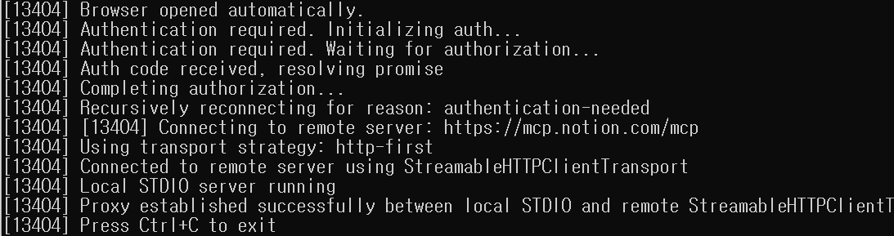
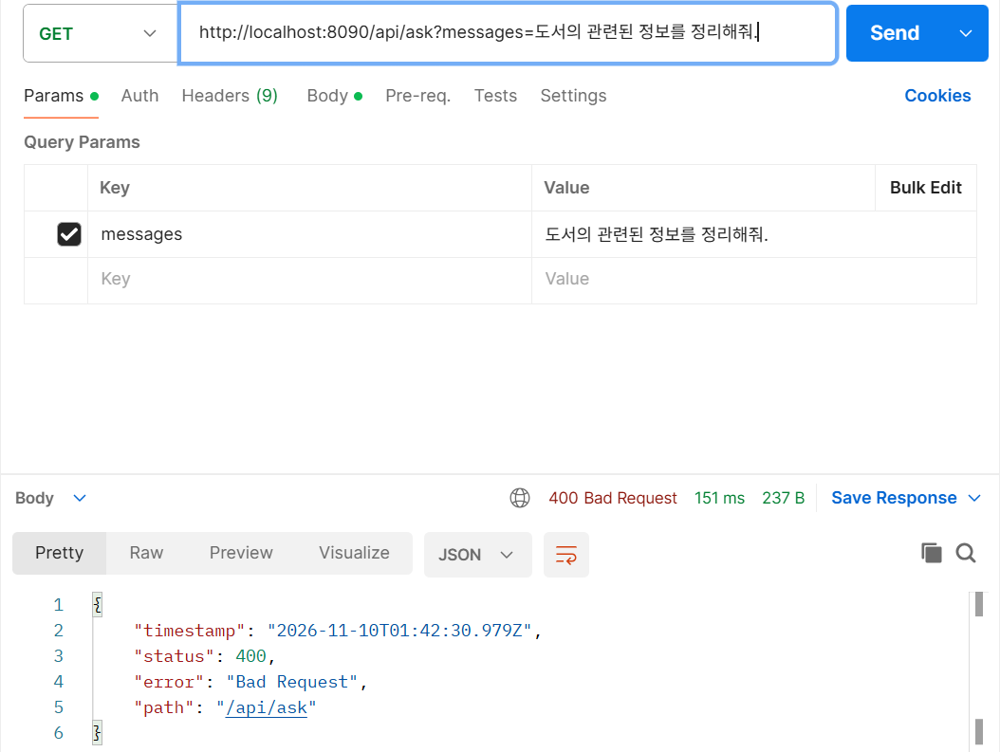

# DAY 88 — MCP 전송 방식과 Notion 공식 MCP 연결, AI Agent 단계와 멀티 에이전트

> 2026-11-10 · MCP Transport, STDIO, SSE, Streamable HTTP, mcp-remote, Notion MCP, OAuth, AI Agent, Multi-Agent

어제는 직접 만든 MCP 서버와 카카오 PlayMCP를 Streamable HTTP로 연결했다. 오늘은 MCP 메시지를 주고받는
**세 가지 전송 방식(STDIO·SSE·Streamable HTTP)** 을 비교하고, **Notion 공식 MCP 서버**를 STDIO 방식으로
Spring AI에 연결해 내 노션 문서를 검색·요약했다. 이와 함께 단순한 챗봇에서 멀티 에이전트까지 이어지는
**AI Agent 7단계**와, 역할을 나눠 협력하는 **멀티 에이전트** 구조를 정리했다.

## 오늘의 학습 흐름

```text
AI Agent 7단계 정리
  ↓
MCP 전송 방식 비교: STDIO · SSE · Streamable HTTP
  ↓
mcp-remote로 Notion 공식 MCP에 OAuth 인증
  ↓
Spring AI MCP Client(STDIO) → 노션 검색·요약 API
  ↓
조회용 도구만 골라 쓰기 (쓰기 도구 차단)
  ↓
멀티 에이전트: Supervisor · Sales · Inventory · Report
```

## 1. AI Agent 7단계

| 단계 | 내용 | 지금까지 실습 |
| --- | --- | --- |
| 1. 기본 AI 챗봇 | `ChatClient`로 질문하고 답변받기 | DAY 81 |
| 2. Tool Calling Agent | `@Tool`로 Java 메서드 실행 | DAY 85 날짜·취미 도구 |
| 3. 여러 Tool을 쓰는 Agent | 계산·날씨·여행지 검색 중 적절한 도구 선택 | DAY 87 차단기(조회 → 제어) |
| 4. 대화 기억 Agent | `ChatMemory`와 `conversationId`로 이전 대화 유지 | DAY 82 Gemma Note |
| 5. 판단 흐름 제어 Agent | Advisor, 도구 결과 검증, 단계별 작업 처리 | DAY 83 보험금 교차 검증 |
| 6. MCP 기반 Agent | 외부 MCP 서버의 도구를 가져와 사용 | DAY 87·88 |
| 7. 종합 여행 추천 Agent | 여러 도구 결과를 종합해 일정 생성 | DAY 87 카카오맵 에이전트 |

6단계의 핵심은 **클라이언트와 서버가 MCP 메시지를 주고받는 것**이다. 그 메시지를 어떤 통로로 보내는지가
오늘 배운 전송 방식이다.

## 2. MCP 전송 방식 (Transport)

```text
사용자 "서울 현재 시간을 알려줘"
  ↓
Spring AI 애플리케이션 (ChatClient + LLM + MCP Client)
  ↓  MCP 메시지 (JSON-RPC 2.0)
STDIO  |  SSE  |  Streamable HTTP     ← 전송 방식만 다르다
  ↓
MCP Server (시간 조회 · 파일 조회 · DB 조회 · 외부 API)
```

어떤 전송 방식을 쓰든 MCP 메시지 형식은 **JSON-RPC 2.0**으로 같다.

| 비교 항목 | STDIO | HTTP+SSE | Streamable HTTP |
| --- | --- | --- | --- |
| 통신 수단 | stdin / stdout | HTTP + SSE | HTTP + 선택적 SSE |
| 서버 위치 | 보통 로컬 | 원격 가능 | 원격 가능 |
| HTTP 포트 | 불필요 | 필요 | 필요 |
| 요청 전달 | 표준 입력 | HTTP POST | HTTP POST |
| 응답 전달 | 표준 출력 | SSE | JSON 또는 SSE |
| 인증 | 별도 설계 | HTTP 인증 | HTTP 인증 |
| 신규 개발 | 로컬 도구에 적합 | 레거시 호환 | **원격 서버에 권장** |

- **STDIO**: MCP 클라이언트가 서버 프로그램을 **직접 실행**하고, 표준 입력으로 요청을 보내고 표준
  출력으로 응답을 받는다. 포트가 필요 없어 로컬 도구에 간단하다.
- **SSE (기존 방식)**: 서버 → 클라이언트는 SSE 연결, 클라이언트 → 서버는 HTTP POST로 **경로가 두 개**다.
  원격 연결이 되지만 연결과 경로 관리가 복잡하다.
- **Streamable HTTP (권장)**: **엔드포인트 하나**(`/mcp`)로 HTTP POST에 JSON-RPC 메시지를 보내고, 서버는
  상황에 따라 일반 JSON이나 SSE 스트림으로 응답한다. 클라우드 MCP 서버, 사내 공통 MCP 플랫폼처럼 여러
  애플리케이션이 함께 쓰는 원격 도구 서버에 맞다.

어제 직접 만든 MCP 서버와 카카오 PlayMCP는 Streamable HTTP였고, 오늘 Notion 연결은 STDIO였다.

## 3. 실습 — Notion 공식 MCP를 Spring AI에 연결

Notion은 원격 MCP 서버(`https://mcp.notion.com/mcp`)를 제공하고, 로그인은 OAuth로 한다. 이번 실습에서는
**`mcp-remote`** 를 STDIO ↔ 원격 HTTP 다리로 사용했다. Spring AI는 `mcp-remote`를 로컬 프로세스로 실행해
STDIO로 대화하고, `mcp-remote`가 OAuth 인증과 원격 Streamable HTTP 통신을 대신 맡는다.

```text
Spring AI (MCP Client, STDIO)
   │ stdin/stdout
   ▼
npx mcp-remote  ── OAuth 토큰 보관(사용자 홈 ~/.mcp-auth)
   │ Streamable HTTP
   ▼
Notion 공식 MCP 서버 (https://mcp.notion.com/mcp)
```

### 1) OAuth 인증

```bash
node -v && npx -v                              # Node.js LTS 확인
npx -y mcp-remote https://mcp.notion.com/mcp   # 브라우저가 열리면 워크스페이스 선택 → 승인
```

브라우저에서 워크스페이스를 고르고 승인하자 터미널에 "local STDIO와 원격 StreamableHTTPClientTransport
사이 프록시 연결 성공"이 표시됐다. 인증이 끝나면 `Ctrl+C`로 종료하고, 이후에는 Spring AI가 이 명령을
직접 실행한다.



### 2) MCP 서버 실행 설정

```json
{
  "mcpServers": {
    "notion": {
      "command": "cmd.exe",
      "args": ["/c", "npx", "-y", "mcp-remote", "https://mcp.notion.com/mcp"]
    }
  }
}
```

```properties
server.port=8090
spring.ai.openai.api-key=${OPENAI_API_KEY}
spring.ai.openai.chat.options.model=gpt-4o-mini
spring.ai.openai.chat.options.temperature=0.2

spring.ai.mcp.client.enabled=true
spring.ai.mcp.client.type=SYNC
spring.ai.mcp.client.request-timeout=120s
# STDIO로 실행할 MCP 서버 목록
spring.ai.mcp.client.stdio.servers-configuration=classpath:mcp-servers.json
```

`cmd.exe /c npx …`는 Windows 전용 명령이다. macOS·Linux에서는 `"command": "npx"`처럼 OS에 맞게 바꿔야 한다.

### 3) 조회용 도구만 골라 쓰기

Notion MCP는 검색·조회뿐 아니라 **페이지 생성·수정 같은 쓰기 도구**도 제공한다. 실습에서는
`ChatClient`에 도구를 기본 등록하지 않고, 요청마다 **이름에 search·fetch·retrieve·list가 들어간 도구만**
골라 넘겼다.

```java
@Bean
ChatClient chatClient(ChatModel model) {
    return ChatClient.builder(model).build();   // 쓰기 도구를 전역으로 등록하지 않음
}
```

```java
public String getTools() {   // GET /api/tools : Notion MCP가 제공하는 도구 목록 확인
    return Arrays.stream(provider.getToolCallbacks())
            .map(t -> t.getToolDefinition().name() + " : " + t.getToolDefinition().description())
            .collect(Collectors.joining("\n\n"));
}

public String ask(String question) {
    ToolCallback[] readTools = Arrays.stream(provider.getToolCallbacks())
            .filter(t -> isReadTool(t.getToolDefinition().name()))
            .toArray(ToolCallback[]::new);
    if (readTools.length == 0) {
        return "조회용 Notion MCP Tool을 찾지 못했습니다. /api/tools에서 실제 이름을 확인하세요.";
    }
    return chatClient.prompt()
            .system("""
                당신은 Notion 문서 검색 및 요약 도우미입니다.
                제공된 조회 도구로 실제 문서를 검색한 뒤 답변하세요.
                문서 생성, 수정, 삭제를 수행하지 마세요.
                확인되지 않은 내용은 만들어내지 마세요.
                """)
            .user(question)
            .toolCallbacks(readTools)   // 이 요청에서만 조회 도구 사용
            .call()
            .content();
}

private boolean isReadTool(String name) {   // 교육용 규칙
    String n = name.toLowerCase(Locale.ROOT);
    return n.contains("search") || n.contains("fetch") || n.contains("retrieve") || n.contains("list");
}
```

> 이름으로 거르는 방식은 수업용 규칙이다. 도구 이름만으로 읽기 전용이 보장되지는 않으므로, 실제
> 서비스에서는 `/api/tools`로 목록을 확인한 뒤 **정확한 이름으로 허용 목록**을 만들어야 한다.

### 4) 결과

| 요청 (`GET /api/ask?message=…`) | 결과 |
| --- | --- |
| 도서와 관련된 정보를 정리해줘 | 도서 관련 노션 페이지 5개를 찾아 제목·링크·한 줄 설명으로 정리 (약 15초) |
| 노션을 요약해서 내용 목록을 정리해줘 | 노션 템플릿·포트폴리오 관련 페이지 목록을 제목·링크와 함께 정리 (약 8초) |

LLM이 Notion 검색 도구를 호출해 **실제 내 워크스페이스 문서**를 근거로 답했다. 질문 하나에 검색과 조회가
여러 번 일어나 일반 질문보다 응답이 오래 걸렸다. 테스트용 질문 목록(Spring AI·Java·MCP·Docker 문서 검색,
문서 요약, 검색 결과 개수 세기)도 함께 정리해 두었다.

## 4. 주의할 점

- **인증 정보는 커밋하지 않는다.** OAuth 토큰은 `mcp-remote`가 사용자 홈의 `.mcp-auth` 아래에 관리하고,
  OAuth 콜백 URL의 `code`도 설정 파일에 넣지 않는다. OpenAI 키는 실행 환경변수로만 넣는다.
- **로그인한 Notion 계정이 앱 전체에서 공유된다.** 이 구조는 내 컴퓨터에서 혼자 쓰는 로컬 실습용이다.
  여러 사용자가 쓰는 서비스에 그대로 쓰면 모든 사용자가 내 노션을 검색할 수 있게 된다.
- STDIO 서버는 앱을 실행한 Windows 사용자 계정의 인증 정보를 쓴다. 연결이 안 되면 Node/npx 경로,
  OAuth 승인 여부, 실행 계정, 포트, OpenAI 키 순서로 확인한다.

## 5. 멀티 에이전트

하나의 에이전트가 모든 일을 처리하는 대신 **역할을 나눈 에이전트들이 협력**하는 구조다. 쇼핑몰 운영
분석을 예로 들었다.

> "최근 7일간 매출을 분석하고, 재고가 부족한 상품을 확인해서 쇼핑몰 운영 개선안을 만들어줘."

| 에이전트 | 역할 |
| --- | --- |
| Supervisor Agent | 요청을 분석하고 전체 작업을 나눠 맡기고 조정 |
| Sales Agent | MySQL에서 매출 데이터를 조회하고 분석 |
| Inventory Agent | MySQL에서 상품 재고를 조회하고 분석 |
| Report Agent | 두 에이전트의 분석 결과를 종합해 운영 보고서 작성 |

```text
사용자 요청 → Supervisor ──┬─▶ Sales Agent     (매출 조회·분석)
                          └─▶ Inventory Agent (재고 조회·분석)
                                   │
                          Report Agent ◀─ 두 결과 종합 → 운영 개선 보고서
```

에이전트마다 필요한 도구와 프롬프트만 주면 각자 맡은 일에 집중할 수 있고, 한 에이전트에 모든 도구를
몰아넣을 때보다 잘못된 도구를 고를 가능성이 줄어든다.

## 트러블슈팅

### `/api/ask` 400 Bad Request



- **증상**: `GET /api/ask?messages=도서의 관련된 정보를 정리해줘.`를 보내자 `400 Bad Request`가 반환됐다.
- **원인**: 컨트롤러는 `@RequestParam("message")`를 필수로 받는데, 요청 파라미터 이름을 `messages`로
  보냈다. 필수 파라미터가 없으니 메서드에 들어가기도 전에 400이 났다.
- **해결**: 파라미터 이름을 `message`로 고쳐 보내자 200 OK와 함께 검색 결과가 반환됐다.

> 400은 요청 형식 문제, 500은 서버 처리 중 오류다. 400이 나면 서버 로직보다 먼저 파라미터 이름·필수
> 여부·타입을 확인한다.

## 공개 원칙

- OpenAI 키, Notion OAuth 토큰, 콜백 URL의 `code`는 일지와 캡처에 넣지 않았다.
- 개인 노션 페이지의 제목과 링크가 보이는 응답 화면, 워크스페이스 선택 화면은 올리지 않고 결과를 글로
  정리했다.
- 실습 프로젝트 원본과 수업 참고 이미지는 올리지 않았다.

## 오늘의 정리

- MCP 메시지는 모두 JSON-RPC 2.0이고, 전송 방식만 STDIO·SSE·Streamable HTTP로 다르다. 로컬 도구는
  STDIO, 새 원격 서버는 Streamable HTTP를 우선 고려한다.
- `mcp-remote`를 쓰면 STDIO만 지원하는 클라이언트도 OAuth가 필요한 원격 MCP 서버에 연결할 수 있다.
- 외부 MCP 도구는 전역 등록하지 않고 요청마다 필요한 도구만 넘기며, 실제 서비스에서는 이름 규칙 대신
  허용 목록을 쓴다.
- 멀티 에이전트는 Supervisor가 일을 나누고, 전문 에이전트가 각자 조회·분석한 결과를 Report 에이전트가
  종합하는 구조다.

## 다음에 이어서 볼 내용

- Notion MCP 도구 목록을 확인해 정확한 허용 목록 만들기
- 멀티 에이전트 쇼핑몰 분석을 Spring AI로 구현하기 (MySQL 매출·재고)
- 직접 만든 MCP 서버를 STDIO 방식으로도 실행해 보기
- 사용자별 인증이 필요한 MCP 서버 설계
