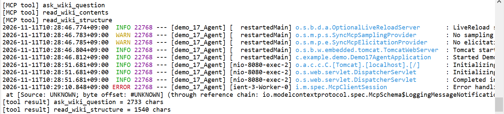
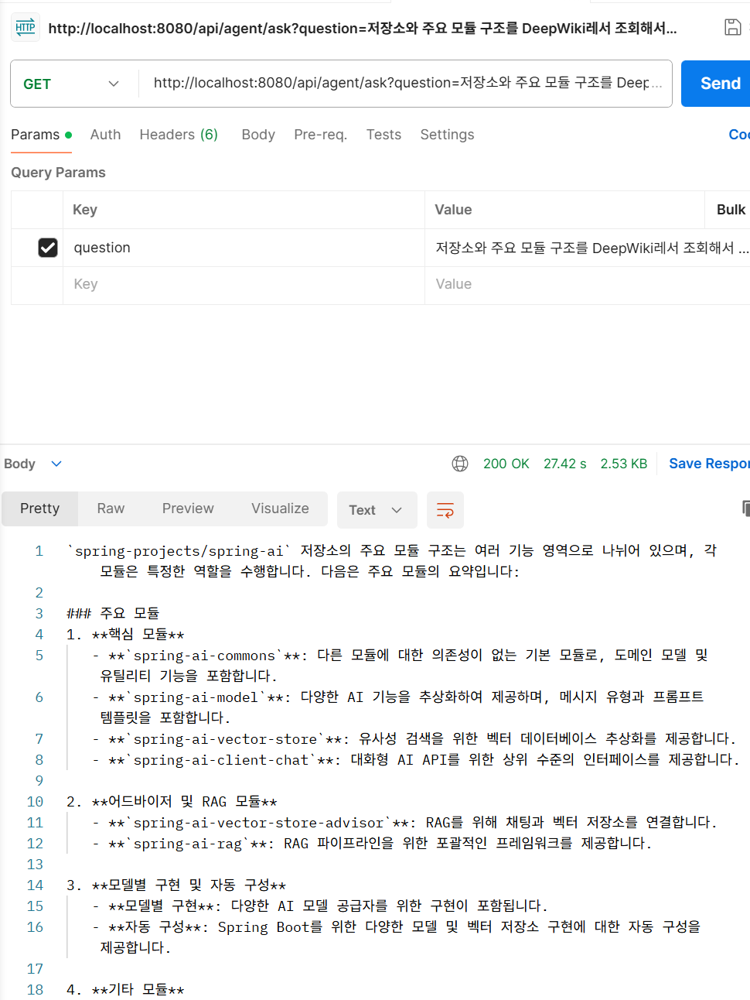
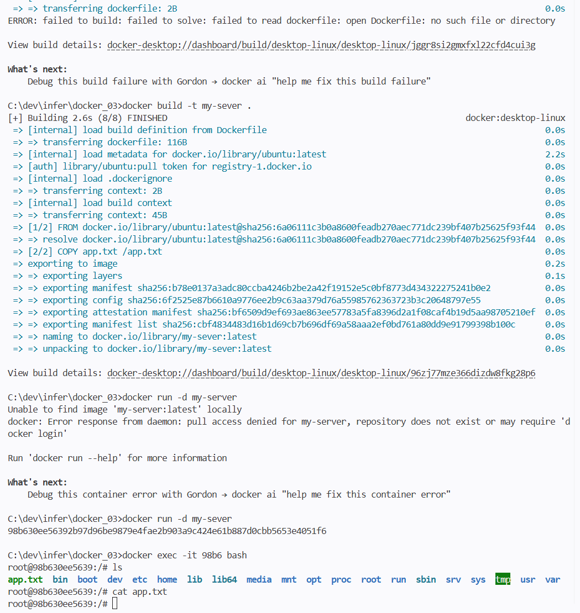
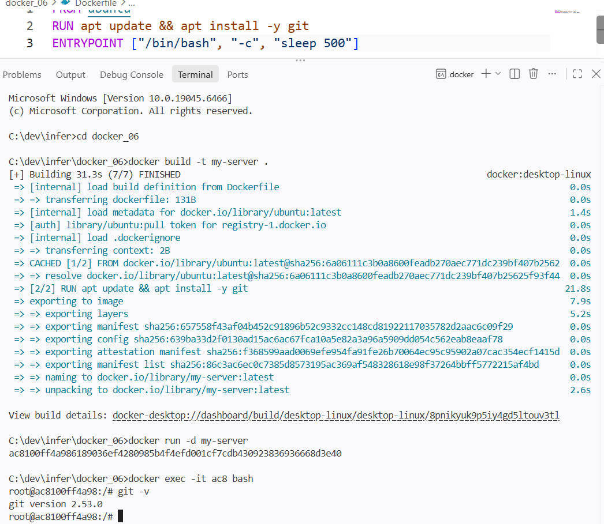
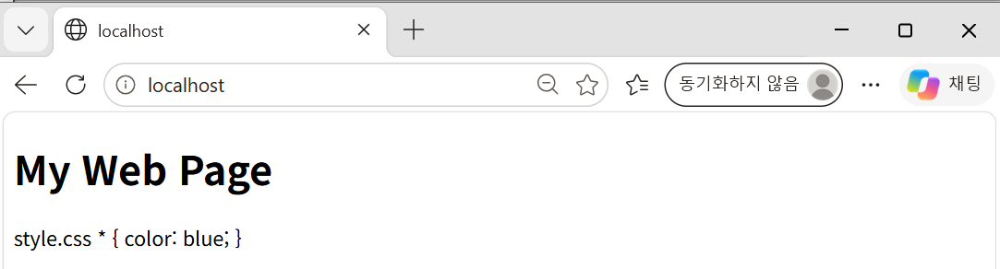
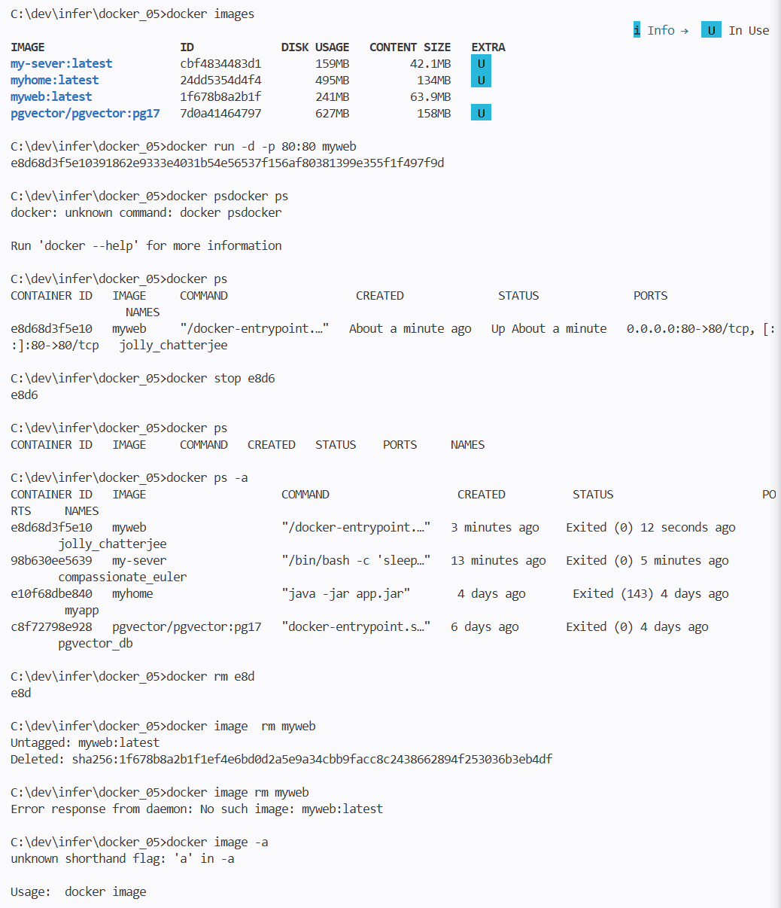

# DAY 89 — DeepWiki MCP 에이전트와 Dockerfile 이미지 만들기

> 2026-11-11 · Spring AI Agent, MCP Client, DeepWiki, ToolCallback, Dockerfile, COPY, RUN, nginx, .dockerignore, Docker Compose

지금까지 배운 MCP를 복습하며 **에이전트를 이루는 구성 요소의 역할**과 **LLM 중심 에이전트와 워크플로
기반 에이전트의 차이**를 정리했다. 실습으로는 공개 GitHub 저장소를 검색해 주는 **DeepWiki MCP 서버**를
연결해 Spring AI 저장소의 구조를 묻는 에이전트를 만들었다. 오후에는 Dockerfile의 `COPY`·`RUN`으로 파일과
프로그램이 들어간 이미지를 만들고, nginx로 정적 웹 페이지를 띄운 뒤 `.dockerignore`와 Docker Compose
개념을 살펴봤다.

## 오늘의 학습 흐름

```text
에이전트 구성 요소 역할 정리
  ↓
LLM 중심 vs 워크플로 기반 에이전트
  ↓
DeepWiki MCP 연결 → 허용 도구만 등록 → 결과 길이 제한
  ↓
Dockerfile: COPY로 파일 넣기 → RUN으로 git 설치
  ↓
nginx 이미지로 정적 웹 페이지 띄우기 → 컨테이너·이미지 정리
  ↓
.dockerignore · Docker Compose 개념
```

## 1. 에이전트 구성 요소와 역할

| 구성 요소 | 담당 역할 |
| --- | --- |
| LLM | 질문 이해, 도구 선택, 다음 행동 판단, 결과 종합 |
| Spring AI | LLM 호출, 도구 실행 연결, 결과 전달, 실행 루프 지원 |
| `@Tool` | 애플리케이션 내부 Java 기능 제공 |
| MCP Client | 외부 MCP 서버의 도구 연결 |
| MCP Server | 외부 기능과 데이터 제공 |
| Advisor | 대화 기억, 로깅, 요청·응답 처리 |
| Java Service | 업무 규칙, 권한 검증, 트랜잭션, 실행 제한 |

LLM은 **판단**을 맡고, 권한·트랜잭션처럼 반드시 지켜야 하는 규칙은 **Java Service**가 맡는다.

## 2. LLM 중심 에이전트와 워크플로 기반 에이전트

| 구분 | LLM 중심 에이전트 | 워크플로 기반 에이전트 |
| --- | --- | --- |
| 도구 선택 | LLM이 판단 | LLM 또는 코드가 결정 |
| 실행 순서 | LLM이 동적으로 선택 | Java 코드에 명시 |
| 반복 실행 | Tool Calling 루프 | 명시적인 반복·상태 관리 |
| 오류 복구 | LLM 판단에 의존할 수 있음 | Java에서 재시도·분기 제어 |
| 적합한 업무 | 검색, 추천, 상담 | 주문, 결제, 승인, 예약 |

틀려도 다시 물으면 되는 **검색·추천**은 LLM에게 순서를 맡겨도 되지만, 한 번 실행되면 되돌리기 어려운
**결제·예약**은 순서와 오류 처리를 코드로 고정해야 한다. 지난주 보험금 예제에서 지급액 계산을 AI에게
맡기지 않은 것도 같은 이유다.

## 3. 실습 — DeepWiki MCP로 GitHub 저장소 분석 에이전트

**DeepWiki**는 공개 GitHub 저장소의 코드 구조와 문서를 검색하고 질문에 답하는 MCP 서비스다. 원격
Streamable HTTP 서버라 설정만으로 연결된다.

```properties
spring.ai.mcp.client.enabled=true
spring.ai.mcp.client.type=SYNC
spring.ai.mcp.client.request-timeout=60s
spring.ai.mcp.client.toolcallback.enabled=true
spring.ai.mcp.client.streamable-http.connections.deepwiki.url=https://mcp.deepwiki.com
spring.ai.mcp.client.streamable-http.connections.deepwiki.endpoint=/mcp
```

앱을 실행하자 콘솔에 DeepWiki가 제공하는 도구 세 개가 출력됐다.

| 도구 | 기능 |
| --- | --- |
| `read_wiki_structure` | 저장소 문서 목차 조회 |
| `read_wiki_contents` | 저장소 문서 내용 조회 |
| `ask_wiki_question` | 저장소 코드·문서에 관한 질문 |

### 필요한 도구만, 결과는 짧게

`read_wiki_contents`는 문서 전체를 돌려줘 결과가 매우 길다. 결과가 길면 LLM 컨텍스트를 넘기거나 비용이
커지므로 **허용 목록으로 두 도구만** 등록하고, 결과도 4만 자(약 1만 토큰)에서 자르는 래퍼를 씌웠다.

```java
private static final Set<String> ALLOWED = Set.of("ask_wiki_question", "read_wiki_structure");
private static final int MAX_RESULT_CHARS = 40_000;   // 약 10k 토큰

@Bean
public ChatClient chatClient(ChatClient.Builder builder, ToolCallbackProvider mcpTools) {
    ToolCallback[] tools = Arrays.stream(mcpTools.getToolCallbacks())
            .filter(tc -> ALLOWED.stream().anyMatch(n -> tc.getToolDefinition().name().endsWith(n)))
            .map(tc -> (ToolCallback) new TruncatingToolCallback(tc, MAX_RESULT_CHARS))
            .toArray(ToolCallback[]::new);

    return builder
            .defaultSystem("""
                당신은 Spring AI 기술 문서 분석 Agent입니다.
                사용자가 GitHub 프로젝트에 대해 질문하면 DeepWiki MCP의 ask_wiki_question 도구를 사용하세요.
                문서 목차가 필요할 때만 read_wiki_structure를 사용하세요.
                기본 분석 대상 저장소는 spring-projects/spring-ai 입니다.
                MCP Tool로 확인한 내용과 일반적인 모델 지식을 구분하세요.
                """)
            .defaultToolCallbacks(tools)
            .build();
}
```

```java
/** 도구 결과가 너무 길면 잘라서 컨텍스트 초과를 막는 래퍼 */
record TruncatingToolCallback(ToolCallback delegate, int maxChars) implements ToolCallback {
    @Override public ToolDefinition getToolDefinition() { return delegate.getToolDefinition(); }
    @Override public ToolMetadata getToolMetadata() { return delegate.getToolMetadata(); }
    @Override public String call(String input) { return cut(delegate.call(input)); }
    @Override public String call(String input, ToolContext ctx) { return cut(delegate.call(input, ctx)); }

    private String cut(String s) {
        return s.length() <= maxChars ? s : s.substring(0, maxChars) + "\n...[truncated]";
    }
}
```

원래 도구를 감싸 **이름·설명은 그대로 두고 결과만 가공**하는 방식이라, LLM은 같은 도구로 인식한다.
도구 목록 필터링(어제 Notion 실습)과 결과 길이 제한을 함께 쓰면 외부 MCP 도구를 더 안전하게 쓸 수 있다.

### 결과

"저장소와 주요 모듈 구조를 DeepWiki에서 조회해서 설명해줘"라고 묻자 `ask_wiki_question`(2,733자)과
`read_wiki_structure`(1,540자)가 차례로 호출됐고, `spring-ai-commons`·`spring-ai-model`·
`spring-ai-client-chat` 같은 핵심 모듈, 어드바이저·RAG 모듈, 모델별 구현과 자동 구성으로 나눠 정리했다.





> 로그에 `McpClientSession`의 `LoggingMessageNotification` 처리 오류가 한 줄 찍혔지만, 서버가 보내는 로그
> 알림을 해석하지 못한 것이라 도구 호출과 답변에는 영향이 없었다.

## 4. Dockerfile로 이미지 만들기

### 실습 ① `COPY` — 파일을 이미지에 넣기

```dockerfile
FROM ubuntu
COPY app.txt /app.txt
ENTRYPOINT ["/bin/bash", "-c", "sleep 500"]
```

```bash
docker build -t my-sever .
docker run -d my-sever
docker exec -it 98b6 bash
ls             # app.txt 확인
cat app.txt    # hello world
```



### 실습 ② `RUN` — 이미지를 만들 때 프로그램 설치

```dockerfile
FROM ubuntu
RUN apt update && apt install -y git
ENTRYPOINT ["/bin/bash", "-c", "sleep 500"]
```

`RUN`은 **이미지를 빌드할 때** 한 번 실행되고 그 결과가 이미지 층(layer)으로 저장된다. 빌드 로그에서 git
설치에 약 22초가 걸렸고, 컨테이너 안에서 `git -v`로 `git version 2.53.0`을 확인했다.



| 명령 | 실행 시점 | 용도 |
| --- | --- | --- |
| `RUN` | 이미지 **빌드** 때 | 패키지 설치, 파일 준비 |
| `COPY` | 이미지 **빌드** 때 | 호스트 파일을 이미지에 복사 |
| `ENTRYPOINT` | 컨테이너 **시작** 때 | 컨테이너가 실행할 명령 |

`apt update`와 `apt install`을 `&&`로 한 줄에 묶으면 층이 하나로 줄고, 오래된 패키지 목록이 캐시에
남는 문제도 피할 수 있다.

### 실습 ③ nginx로 정적 웹 페이지 띄우기

```dockerfile
FROM nginx
COPY ./ /usr/share/nginx/html
```

```bash
docker build -t myweb .
docker run -d -p 80:80 myweb    # 브라우저에서 http://localhost
```

nginx 기본 이미지가 웹 서버를 실행하므로 `ENTRYPOINT` 없이 정적 파일만 복사하면 된다. 브라우저에서
"My Web Page"가 열렸다.



화면에 `style.css * { color: blue; }`가 글자로 보였는데, `style.css` 내용이 별도 파일이 아니라
`index.html` 안에 붙어 들어가 있었기 때문이다. `index.html`은 `style.css`를 링크하지만 파일이 없어 제목도
파란색으로 바뀌지 않았다. CSS 내용을 `style.css` 파일로 따로 저장하고 다시 빌드해야 한다.

### 컨테이너와 이미지 정리

```bash
docker ps                  # 실행 중인 컨테이너
docker stop e8d6           # 컨테이너 정지 (ID 앞자리만 써도 된다)
docker ps -a               # 정지된 컨테이너까지
docker rm e8d              # 컨테이너 삭제
docker image rm myweb      # 이미지 삭제 (컨테이너를 먼저 지워야 한다)
docker images              # 이미지 목록
```



## 5. `.dockerignore`와 Docker Compose

**`.dockerignore`** 는 `.gitignore`처럼 **빌드 컨텍스트에 넣지 않을 파일**을 정한다. Docker는 빌드 전에
`.dockerignore`를 읽어 걸러낸 파일만 컨텍스트로 보내므로, `COPY . .`처럼 폴더 전체를 복사할 때 특히
중요하다.

```text
# .dockerignore 예시
.git
build/
node_modules/
*.log
.env
```

`.env`나 키 파일을 빼 두지 않으면 비밀 정보가 이미지 안에 그대로 들어간다. 빌드 속도도 빨라진다.

**Docker Compose**는 여러 컨테이너를 **하나의 설정 파일(`docker-compose.yml`)** 로 정의하고 한 번의
명령으로 함께 실행·관리하는 도구다. 지난주 RAG 실습의 Spring Boot + pgvector처럼 여러 컨테이너가 필요한
구성에 쓴다.

```bash
docker compose up -d    # 정의한 컨테이너 모두 실행
docker compose down     # 모두 정지·삭제
```

## 트러블슈팅

### 1. `docker build` — Dockerfile을 읽지 못함

- **증상**: `failed to read dockerfile: open Dockerfile: no such file or directory`가 나며 빌드가
  실패했다. 로그에 `transferring dockerfile: 2B`가 찍혀 있었다.
- **원인**: 전달된 Dockerfile이 2바이트뿐이었다. 내용을 저장하기 전에 빌드해 거의 빈 파일이 전달된 것으로 보인다.
- **해결**: 파일을 저장한 뒤 다시 빌드하자 `transferring dockerfile: 116B`로 정상 빌드됐다.

### 2. `docker run` — 이미지를 찾지 못함

- **증상**: `docker run -d my-server`에서 `Unable to find image 'my-server:latest' locally`와
  `pull access denied` 오류가 났다.
- **원인**: 이미지를 `my-sever`(오타)로 빌드해 놓고 `my-server`로 실행했다. 로컬에 없는 이름이라 Docker
  Hub에서 받으려다 실패했다.
- **해결**: `docker images`로 실제 이름을 확인하고 `docker run -d my-sever`로 실행했다. 이름이 헷갈리면
  `docker images`부터 본다.

### 3. 명령어 오타

| 입력 | 오류 | 바른 명령 |
| --- | --- | --- |
| `docker psdocker ps` | `unknown command` | `docker ps` |
| `docker image -a` | `unknown shorthand flag: 'a'` | `docker images -a` 또는 `docker image ls -a` |
| `docker image rm myweb` (두 번째) | `No such image` | 이미 삭제됨 — `docker images`로 확인 |

## 공개 원칙

- OpenAI 키는 `${OPENAI_API_KEY}` 환경변수로만 넣고 일지에 적지 않았다.
- 실습 프로젝트 원본은 올리지 않고 학습에 필요한 코드만 정리했다.
- 캡처는 응답·로그·터미널 부분만 잘라 사용했다.

## 오늘의 정리

- 에이전트에서 LLM은 판단과 도구 선택을, Java Service는 권한·트랜잭션 같은 반드시 지켜야 할 규칙을 맡는다.
- 검색·추천은 LLM 중심으로, 결제·예약처럼 되돌리기 어려운 일은 워크플로 기반으로 순서를 코드에 고정한다.
- 외부 MCP 도구는 허용 목록으로 필요한 것만 등록하고, `ToolCallback` 래퍼로 결과 길이를 제한할 수 있다.
- Dockerfile에서 `COPY`·`RUN`은 빌드 때, `ENTRYPOINT`는 컨테이너 시작 때 실행된다.
- `.dockerignore`로 비밀 정보와 불필요한 파일을 빌드 컨텍스트에서 빼고, 여러 컨테이너는 Docker Compose로
  함께 관리한다.

## 다음에 이어서 볼 내용

- `style.css`를 분리해 nginx 웹 페이지 다시 빌드하기
- Spring Boot 애플리케이션용 `.dockerignore` 작성하기
- `docker-compose.yml`로 Spring Boot + DB 컨테이너 함께 실행하기
- 주문·결제 같은 업무를 워크플로 기반 에이전트로 설계하기
