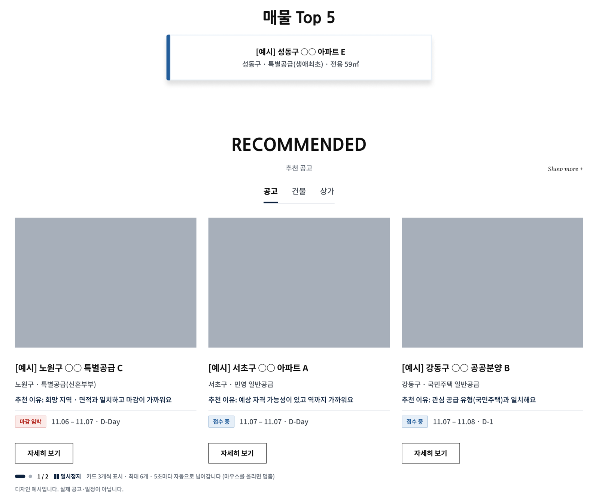
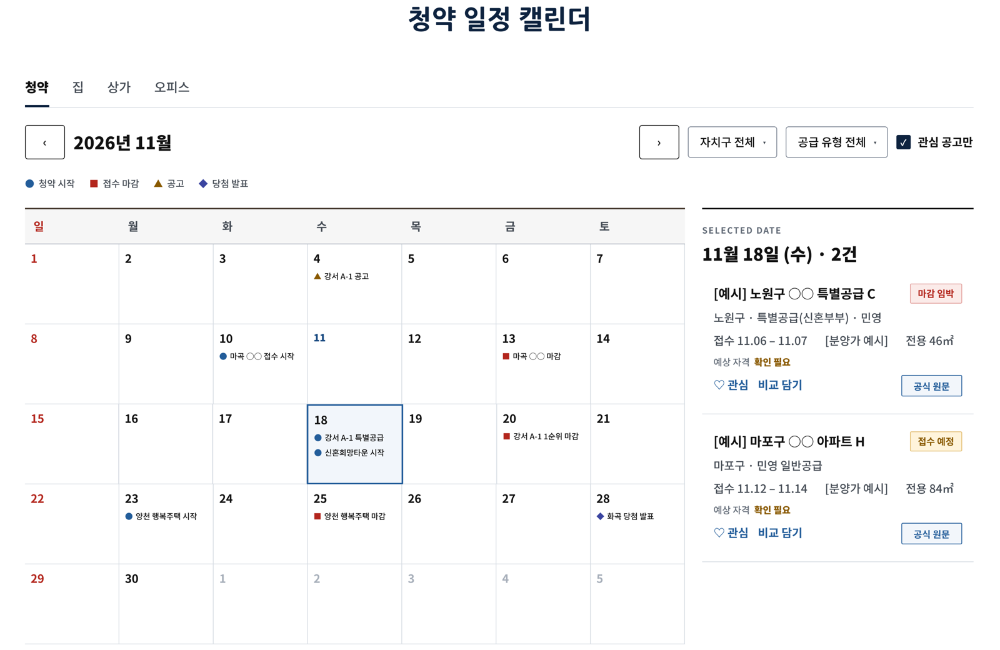
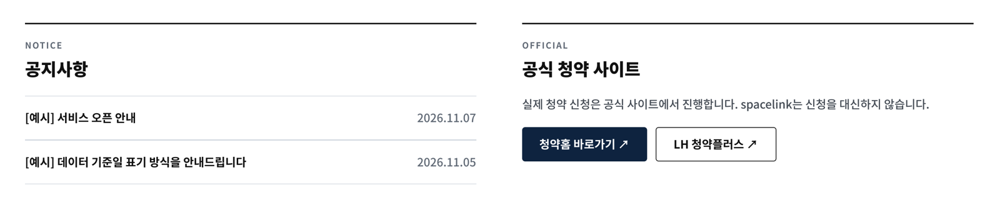

# DAY 90 — 최종 프로젝트 SpaceLink 화면 목업 정리 (화면설계서 동기화)

> 2026-11-12 · Final Project, Figma, 화면설계서, 컴포넌트, 레이아웃 규격, 메인 홈

다음 주(11/16)부터 시작하는 최종 프로젝트 **SpaceLink**의 화면 목업을 **화면설계서 기준으로 맞추는 작업**을
했다. SpaceLink는 사용자 조건을 바탕으로 서울의 청약 공고와 집·상가·오피스를 추천하고, 판단 근거와 위험
정보를 함께 보여 주는 2인 팀 포트폴리오 서비스다. 오늘은 Figma에서 공통 헤더를 컴포넌트로 만들고 화면
규격을 통일했으며, 설계서에는 있지만 목업에 없던 화면을 추가하고 기획안·화면설계서 문서를 서로 맞췄다.

## 오늘의 작업 흐름

```text
공통 헤더 컴포넌트화 · 하위 화면 공통 규격 정리
  ↓
로그인 · 회원가입 · 계정 찾기 화면 규격 통일 (7개)
  ↓
공매 화면 정리: 별도 화면 → 집 목록 안 "공매" 라벨
  ↓
설계서 기준 누락 화면 추가
  ↓
기획안 · 화면설계서 문서 동기화
  ↓
남은 작업 정리
```

## 1. 공통 영역 정리

| 작업 | 내용 |
| --- | --- |
| 헤더 컴포넌트 | 메인 홈 헤더를 `Header` 컴포넌트로 등록하고 사용자 화면 26개를 인스턴스로 교체 (높이 56) |
| 하위 화면 규격 | Photo/Banner 112, Breadcrumb 48, Page body 패딩 200/200/56/120 |
| AI 검색 버튼 | 플로팅 버튼이 본문에 가려지던 쌓임 순서 오류를 27개 화면에서 수정 |

헤더를 화면마다 복사해 두면 메뉴 하나를 바꿀 때 26곳을 고쳐야 한다. **컴포넌트 하나를 고치면 모든 인스턴스에
반영**되도록 바꿔, 이후 GNB(분양정보·매물비교·고객센터) 변경도 한 번에 적용했다.

## 2. 로그인 · 회원가입 · 계정 찾기 (7개 화면)

- Content panel 폭 **496**, 세로 한 줄 배치, 패딩 48/56/56, 요소 간격 16
- 패널 본문 글자 16px → **14px**, 안쪽 간격은 **4의 배수**로 정리
- 단독 작업 화면이라 배너·브레드크럼 제거

간격을 4의 배수로 맞추면 화면 사이 여백이 일정해지고, 개발할 때 CSS 값으로 옮기기도 쉽다.

## 3. 화면 정리와 누락 화면 추가

**공매 화면 정리**

- `AUC_LIST-01`(별도 공매 화면)을 없애고 `HOUSE_LIST-01`의 **"공매 물건 선택" 상태**로 바꿨다.
  기획대로 공매 물건은 별도 화면 없이 집·상가·오피스 목록에 **"공매" 라벨**로 섞어 보여 준다.
- `HOUSE_LIST-01`에서 외부 매물 사이트 문구·버튼을 제거했다. 서비스는 실제 매물 중개·계약을 하지 않기
  때문이다.

**설계서 기준으로 추가한 화면**

| 화면 ID | 추가한 상태 |
| --- | --- |
| COM_LIST-01 | 공매 물건 선택 |
| OFC_LIST-01 | 공매 물건 선택, 공공 오피스 공고 선택(공식 공고·신청 버튼) |
| MAIN_HOME-01 | AI 검색·추천 결과 |
| USR_JOIN-01 | 약관 내용 보기 모달 |
| USR_FIND-01 | 만료된 재설정 링크 |
| MY_HOME-01 | 탈퇴 확인 창 |

정상 화면만 그리면 개발할 때 모달·오류·만료 같은 **상태 화면**을 놓치기 쉽다. 설계서의 화면 ID별로 상태를
하나씩 대조해 빠진 것을 채웠다.

## 4. 문서 동기화

| 문서 | 수정 |
| --- | --- |
| 최종 프로젝트 기획안 | 개발 기간을 2026-11-16 ~ 12-12로 통일, 메인 홈 "TODAY 롤링" → **매물 Top 5**, 내외국인 입력 위치를 맞춤 청약 조건으로 이동 |
| 화면설계서 (메인 홈) | GNB를 분양정보·매물비교·고객센터로 변경, 6번 항목을 매물 Top 5로 변경 (기존 글꼴·크기 유지) |

Figma 목업, 기획안, 화면설계서 세 곳의 내용이 다르면 개발 중에 무엇이 기준인지 헷갈린다. 목업을 고치면서
바뀐 결정을 두 문서에도 바로 반영했다.

## 5. 메인 홈 목업

**헤더 · 빠른 검색** — 공통 헤더(분양정보·매물비교·고객센터)와 공급 유형 + 검색어로 바로 찾는 빠른 검색.


**매물 Top 5 · 추천 공고** — 조회수 기준 접수 중 매물 상위 5개를 한 개씩 롤링하고, 아래에는 공고·건물·상가
탭으로 나눈 추천 카드를 3개씩 보여 준다. 카드마다 **추천 이유**와 접수 상태·D-Day를 표시하고, 5초마다
넘어가되 일시정지할 수 있게 했다. 오른쪽에는 AI 검색 플로팅 버튼이 있다.



**청약 일정 캘린더** — 청약·집·상가·오피스 탭, 자치구·공급 유형 필터, 관심 공고만 보기. 날짜를 고르면 오른쪽에
그날의 공고가 예상 자격, 관심·비교 담기, 공식 원문 버튼과 함께 표시된다.



**공지사항 · 공식 청약 사이트** — 실제 신청은 공식 사이트(청약홈, LH 청약플러스)에서 하도록 안내하고,
SpaceLink는 신청을 대신하지 않는다는 점을 메인에서 분명히 했다.



> 화면의 공고·일정은 모두 디자인 예시이며 실제 데이터가 아니다.

## 남은 작업

- 홈 매물 Top 5 롤링 시안 3종
- 기존 화면 미반영 항목
  - 홈 빠른 검색(지역·접수 상태 필터), 정정 공고 안내 띠
  - 로그인 "둘러보기" 링크
  - 상가·오피스 구분 탭, 오피스 안내 배너
  - 오류 화면 "데이터 준비 중"
  - 개인정보 보관·파기 내용

## 오늘의 정리

- 여러 화면에 반복되는 헤더는 컴포넌트로 만들어 한 곳에서 관리한다.
- 간격·패딩·글자 크기를 숫자 규격(4의 배수 등)으로 정해 두면 화면이 일정해지고 개발로 옮기기 쉽다.
- 화면설계서의 화면 ID별로 모달·만료·확인 창 같은 상태 화면까지 대조해야 누락이 없다.
- 목업에서 바뀐 결정은 기획안·화면설계서에 바로 반영해 기준 문서를 하나로 맞춘다.

## 다음에 이어서 볼 내용

- 매물 Top 5 롤링 시안 3종 비교 후 확정
- 남은 미반영 항목 목업 반영
- 11/16부터 1주차 개발: 로그인·회원가입·계정 찾기, 맞춤 청약 조건 입력, 찾는 대상·희망 조건, 공통 프론트엔드
