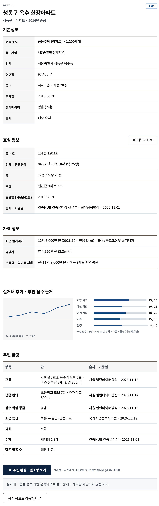
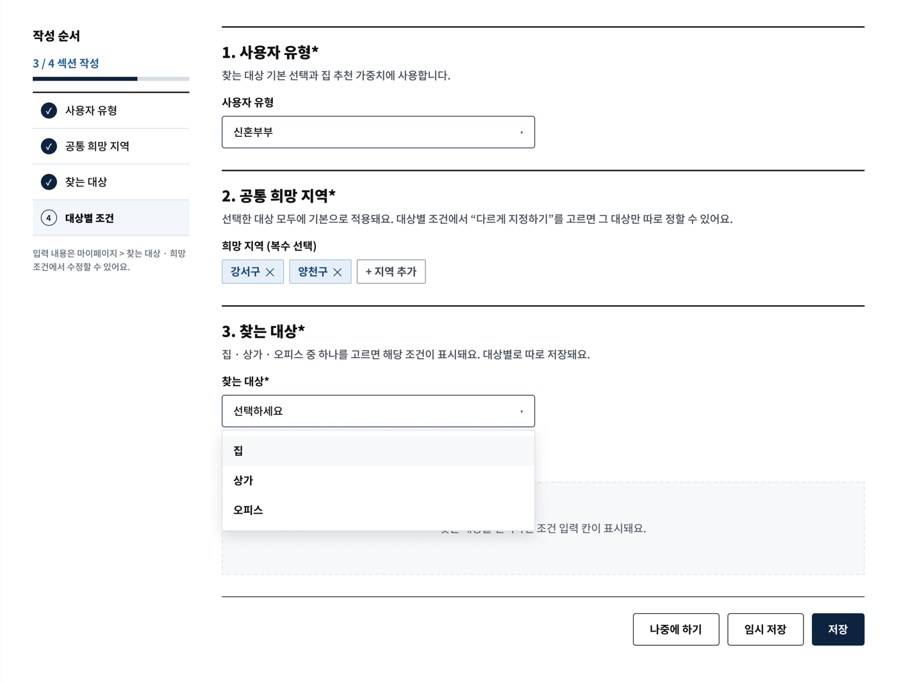
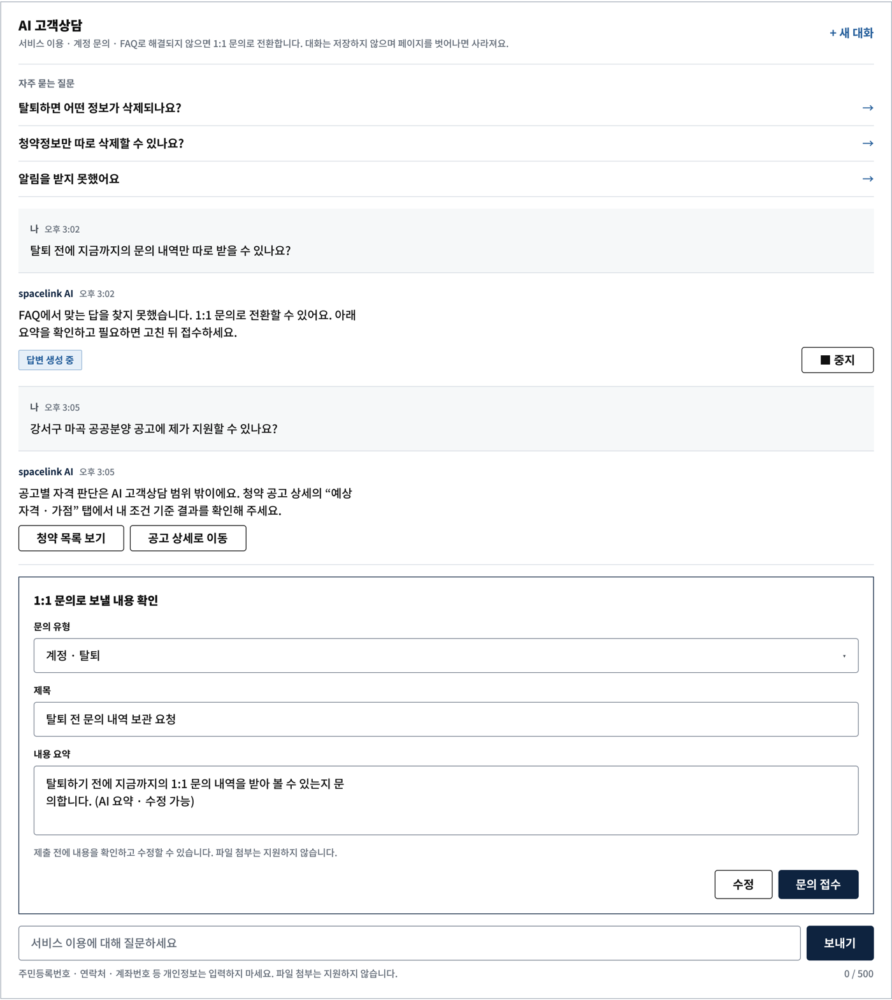
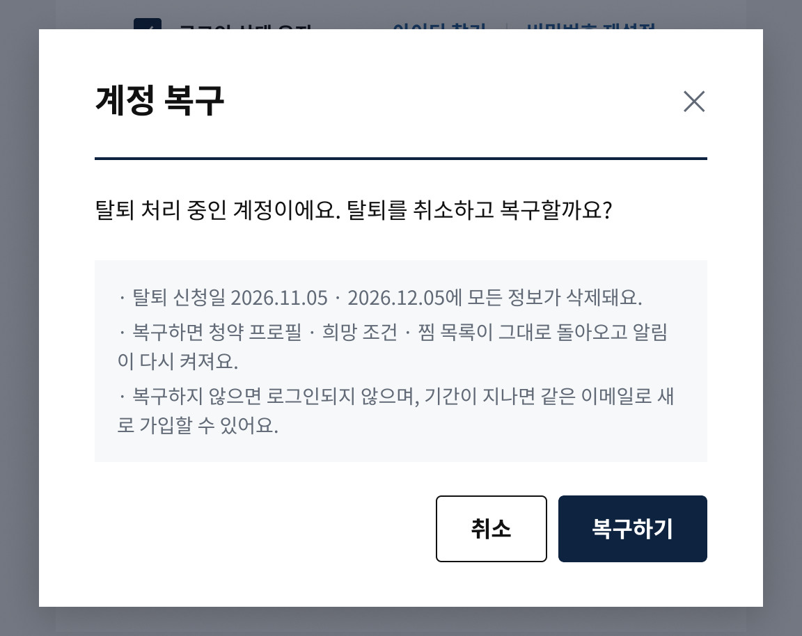
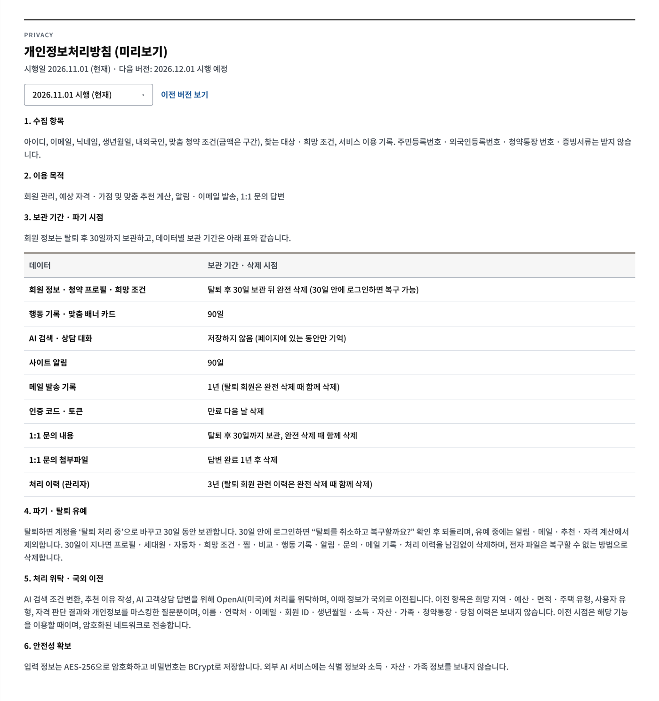
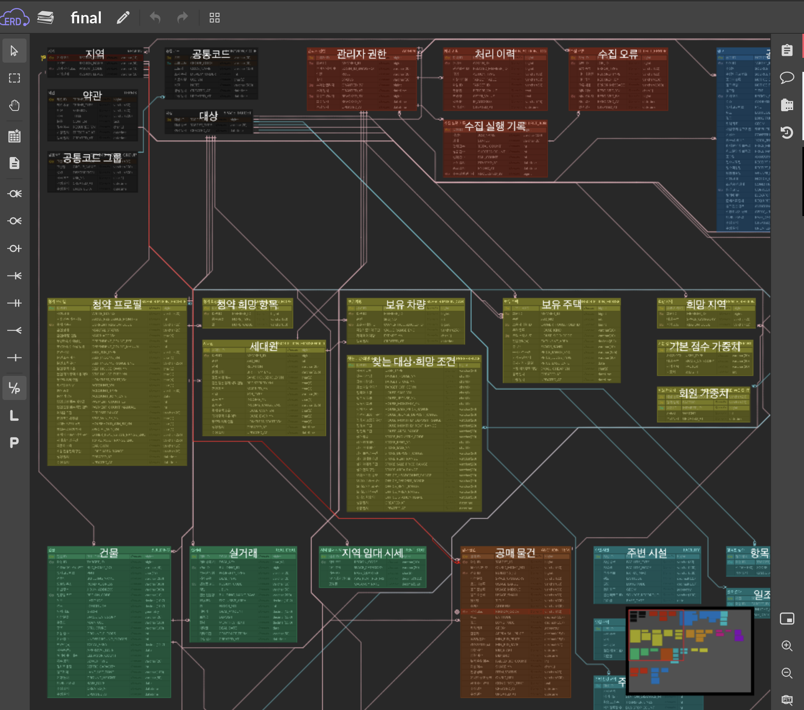

# DAY 91 — SpaceLink 화면설계 마감: 문서 대조, 시연값 교체, 유저플로우와 ERD

> 2026-11-13 · Final Project, Figma, 화면설계서, 요구사항 정의서, 유저플로우, ERD, 개인정보 보관 정책

어제 정리한 SpaceLink 화면 목업을 **최신 기획안·화면설계서·요구사항 정의서와 한 번 더 대조**해, 서로 다른
부분을 결정하고 Figma에 반영했다. 화면에 남아 있던 `[예시]`·`○○` 같은 자리표시를 **화면끼리 일관된 시연값**으로
바꾸고, 집·상가·오피스 상세를 같은 구성으로 맞췄다. 탈퇴 유예·계정 복구·개인정보처리방침 같은 화면을 새로
만들었고, 33개 화면을 **6개 유저플로우 섹션**으로 다시 배치했다. 팀에서 정리한 ERD도 함께 확인했다.

## 오늘의 작업 흐름

```text
기획안(md) · 화면설계서(pptx) · 요구사항 정의서(xlsx) ↔ Figma 대조
  ↓
다른 부분 결정 (위험 확인 섹션 삭제, 외부 신청 페이지 이동 등)
  ↓
자리표시 → 시연값 교체 (텍스트 586곳), 자격 규칙 값은 법령 확인 후 입력
  ↓
집·상가·오피스 상세 공통 구성, 희망 조건·소득·자산 입력 수정
  ↓
탈퇴 유예·계정 복구·개인정보처리방침 신규 화면
  ↓
유저플로우 6개 섹션 재배치 · ERD 확인
```

## 1. 문서 대조와 결정 사항

요구사항 정의서에는 요구사항 60개, 화면 목록 33개, 미결 사항 15개가 정리되어 있다. 세 문서와 Figma가 다르게
적힌 곳을 찾아 하나씩 결정했다.

| 항목 | 결정 |
| --- | --- |
| 위험 확인 섹션 | 삭제 확정 |
| 매물 상세 → 외부 신청 페이지 이동 | 확정. 버튼 문구는 "공식 공고로 이동하기 ↗" 유지 |
| 지도 화면 ID | Figma 기준(`MAP_HOME-01`) 유지 |
| 개발 일정 | 11-16 ~ 12-12로 통일 |
| 희망 조건 저장 방식 | Figma 기준(기록·임시저장·단일 반영) 유지 |
| 찾는 대상 초기 상태 (OPEN-05) | 선택 없음 |
| 예시·자리표시 정리 (OPEN-02) | 완료 |
| 희망 조건 1번 칸 | "직업"이 아니라 **"사용자 유형"** 으로 확정 |

## 2. 자리표시 → 시연값 교체 (텍스트 586곳)

- `[예시]`·`[교체 가능]`·`○○`·"디자인 예시" 표시를 모두 지웠다.
- 공고·매물·상가·오피스 이름, 가격, 주소(동 단위), 역·도보 거리, 좌표를 **화면 사이에서 같은 값**으로 맞췄다.
  목록에서 본 "성동구 옥수 한강아파트"가 상세·비교·찜 화면에서도 같은 가격과 위치로 나오게 했다.
- 데이터 기준일은 2026.11.12로 통일하고 출처 칸을 채웠다.
- 자격 규칙 값은 임의로 넣지 않고 **정부 자료를 확인한 뒤** 입력했다.

| 규칙 | 값 | 근거 |
| --- | --- | --- |
| 신혼부부 특별공급(민영) 우선공급 | 월평균소득 100%(맞벌이 120%) 이하 | 주택공급에 관한 규칙 제41조제3항 (시행 2026.06.15) |
| 생애최초 특별공급(민영) | 월평균소득 160% 이하 | 국토교통부고시 제2026-360호 제8조 |
| 1순위(규제지역) | 통장 가입 24개월 경과 + 예치금 이상 | — |

관리자 화면의 자격 규칙(`ADM_RULE`)과 처리 이력(`ADM_LOG`)의 시행일도 2026.06.15 기준으로 맞췄다.

## 3. 집 · 상가 · 오피스 상세 공통 구성

세 상세 화면과 공공 오피스 공고 상세를 **같은 순서의 섹션**으로 통일했다. 대상에 없는 값은 빼지 않고
"해당 없음" 또는 "확인 필요"로 표시해, 화면마다 칸이 달라 보이지 않게 했다.

| 섹션 | 내용 |
| --- | --- |
| 기본 정보 | 건물 용도, 용도지역, 위치, 연면적, 층수, 준공일, 엘리베이터 |
| 호실 정보 | 동·호, 전용·공용면적, 층, 구조, 사용승인일, 출처·기준일 |
| **가격 정보 (신설)** | 최근 실거래가, 평당가, 보증금·임대료 시세 |
| 실거래 추이·추천 점수 근거 | 가격 그래프, 항목별 점수 막대 |
| 주변 환경 | 교통, 생활 편의, 침수, 소음(원인), 악취, **주차·같은 업종 수 추가** |
| 하단 | 3D 주변 환경·일조량 보기, "매물·중개·계약은 제공하지 않습니다" 안내, 공식 공고로 이동 |

상가 공고의 공고 기관·임대 기간은 하단 신청 안내 문구로 옮겼다.



## 4. 입력 화면 수정

### 찾는 대상 · 희망 조건 (USR_PREF-01)

- 찾는 대상 위에 **"2. 공통 희망 지역"** 섹션을 추가하고, 대상별로 "공통 사용 / 다르게 지정하기"를 고를 수
  있게 했다.
- 오피스의 "희망 지역·역"은 "희망 역"으로 바꿨다.
- 작성 순서를 4단계(사용자 유형 → 공통 희망 지역 → 찾는 대상 → 대상별 조건)로 바꿨다.
- 1번 칸은 사용자 유형(청년·신혼부부·유자녀 가족·노부부·독거노인)으로 정리하고, 저장·임시저장 목록의
  보기도 같게 고쳤다.



### 맞춤 청약 조건 6. 소득 · 자산 (USR_PROF-01)

- 주택 외 부동산 구간과 총자산 구간을 분리했다.
- 자동차는 1대씩 소유자, 자동차기준가액 구간, 제외 자동차 여부를 입력한다.

## 5. 기타 화면 수정

| 화면 | 수정 |
| --- | --- |
| CS_CHAT-01 AI 고객상담 | 상담 기록 영역 삭제, "+ 새 대화"만 유지, **대화를 저장하지 않는다**는 안내 추가 |
| MY_HOME-01 마이페이지 | 찜 "마감됨" 상태 추가, 탈퇴 문구를 **30일 유예·복구**로 변경 (탈퇴 확인 창 포함) |
| USR_JOIN-01 약관 동의 | 선택 동의 "행동 기록 수집 동의 (맞춤 추천·90일 보관)" 추가 |
| SUB_DTL-01 공고 상세 | 소음 원인에 공연장(상시 소음원) 반영 |
| ADM_LOG-01 처리 이력 | 필터 "작업 종류" → "업무 영역" |

AI 고객상담은 대화를 DB에 저장하지 않고 페이지에 있는 동안만 기억한다. 해결되지 않으면 그 자리에서 요약을
1:1 문의로 넘기고, 공고·자격 질문은 청약 목록·공고 상세로 안내한다.



## 6. 신규 화면 — 탈퇴 유예와 개인정보

탈퇴하면 바로 지우지 않고 **30일 동안 유예**한다. 그 사이에 로그인하면 복구할 수 있고, 같은 아이디·이메일로
다시 가입하려 하면 로그인해서 복구하라고 안내한다.

| 화면 | 상태 |
| --- | --- |
| USR_LOGIN-01 | 탈퇴 계정 복구 확인 |
| USR_JOIN-02 | 탈퇴 유예 계정 안내 |
| INFO_DATA-01 | 개인정보처리방침: 보관 기간 표, 탈퇴 30일 유예, OpenAI 처리 위탁·국외 이전 |
| ADM_LOG-01 | 업무 영역 필터 선택 |



개인정보처리방침에는 데이터별 보관 기간(행동 기록 90일, AI 대화 저장 안 함, 메일 기록 1년, 처리 이력 3년 등)과,
AI 기능을 위해 OpenAI(미국)에 처리를 위탁할 때 **어떤 항목만 보내고 어떤 항목은 보내지 않는지**를 적었다.



## 7. 유저플로우 정리

Figma의 화면설계 페이지를 6개 섹션으로 다시 배치했다. 흐름은 왼쪽에서 오른쪽으로, 모달·오류 같은 상태 화면은
원본 화면 아래에 두었다.

| 섹션 | 내용 |
| --- | --- |
| 01 | 진입 · 로그인 · 회원가입 |
| 02 | 맞춤 조건 설정 |
| 03 | 탐색 · 상세 · 비교 |
| 04 | 마이페이지 |
| 05 | 고객센터 · 안내 · 오류 |
| 06 | 관리자 |

쓰지 않는 상태 화면과 원본 화면, 빈 캔버스 텍스트는 삭제했다.

## 8. ERD

팀에서 ERDCloud로 정리한 ERD(테이블 62개)를 확인했다. 지역·약관·공통코드 같은 기준 테이블, 관리자 권한·처리
이력·수집 기록 같은 운영 테이블, 청약 프로필·세대원·보유 차량·보유 주택·찾는 대상·희망 조건·희망 지역 같은
회원 입력 테이블, 건물·실거래·지역 임대 시세·공매 물건·주변 시설 같은 데이터 테이블로 나뉜다. 오늘 화면에서
바꾼 입력(세대원, 보유 차량·주택, 공통 희망 지역)이 각각 별도 테이블로 분리되어 있다.



건물 호실과 공매 회차별 입찰 정보는 테이블을 만들지 않고, 상세를 열 때 실시간으로 호출한 뒤 Redis에 캐시하기로
했다.

## 남은 작업

- 기획안·화면설계서·요구사항 정의서에 오늘 결정 사항 반영
- 가중치 표의 자영업자·프리랜서(직업) 행 처리 방법 결정 (1번 칸이 사용자 유형으로 바뀌었기 때문)
- 기획안 소득·자산 항목 수정: "소득 없음" 포함 구간 선택, 세대원별 직업 입력 삭제
- 공매 상세 3개에 공통 블록 추가 여부 결정
- 데이터 출처별 이용 조건(공공누리 유형) 확인 후 기재
- 처리 이력 화면 상단에 잘못 복사된 버튼 정리 여부 결정

## 오늘의 정리

- 문서가 여러 개면 다른 부분을 표로 모아 **하나씩 결정**하고, 결정한 기준을 모든 문서에 반영한다.
- 시연값은 화면끼리 같은 값을 써야 흐름을 따라가며 시연할 수 있고, 자격 규칙 같은 값은 법령 근거를 확인해 넣는다.
- 같은 종류의 상세 화면은 섹션 순서를 통일하고, 값이 없으면 "해당 없음·확인 필요"로 표시한다.
- 탈퇴 유예, 대화 미저장, 외부 AI 처리 위탁처럼 개인정보와 관련된 결정은 화면과 개인정보처리방침에 함께 드러낸다.

## 다음에 이어서 볼 내용

- 11/16부터 1주차 개발: 로그인·회원가입·계정 찾기, 맞춤 청약 조건, 찾는 대상·희망 조건, 공통 프론트엔드
- 탈퇴 유예(WITHDRAWN 상태)와 30일 후 완전 삭제 배치 설계
