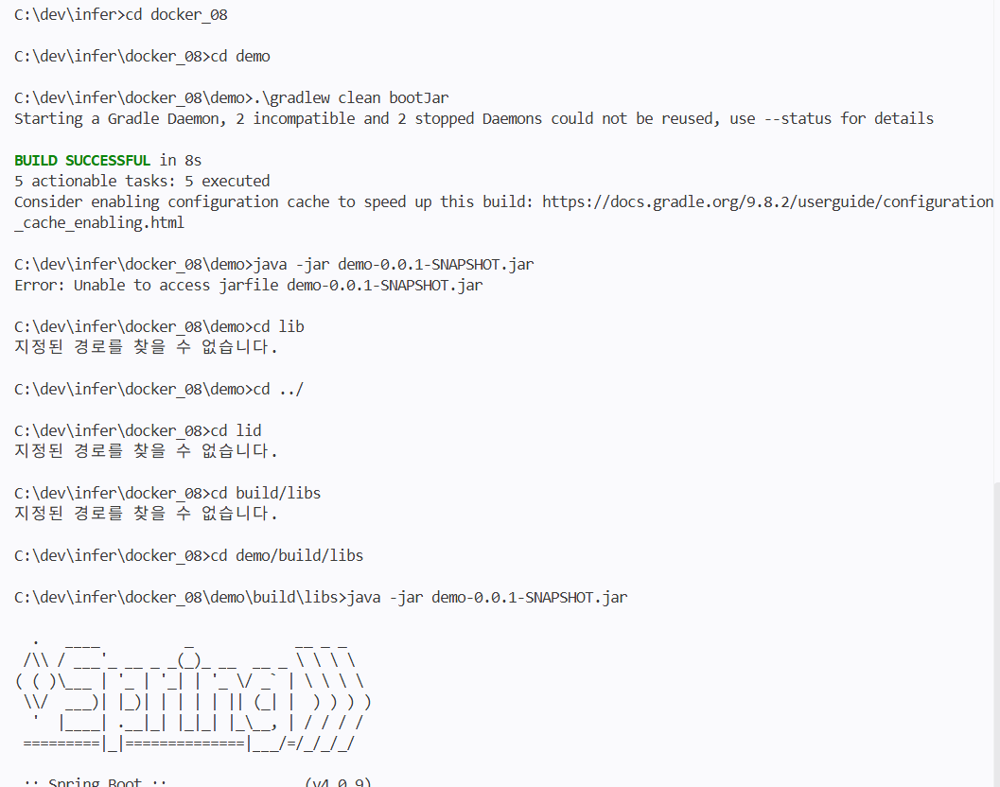
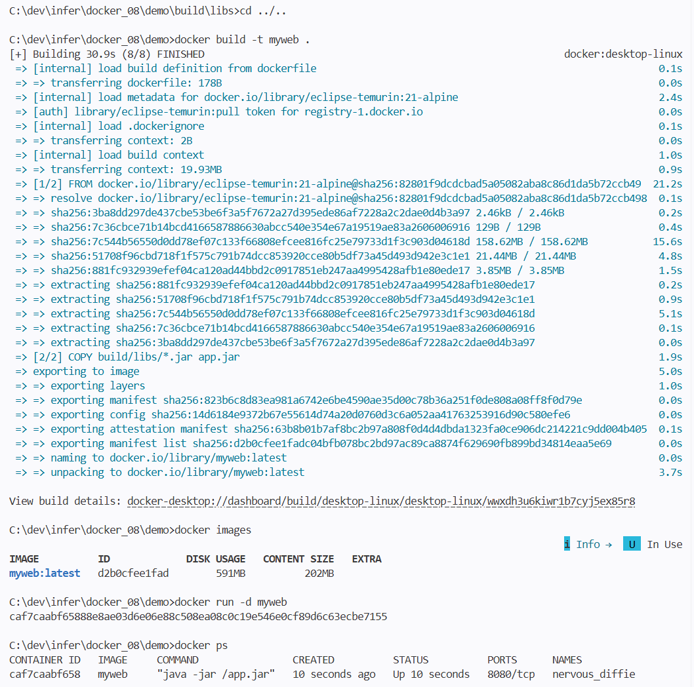
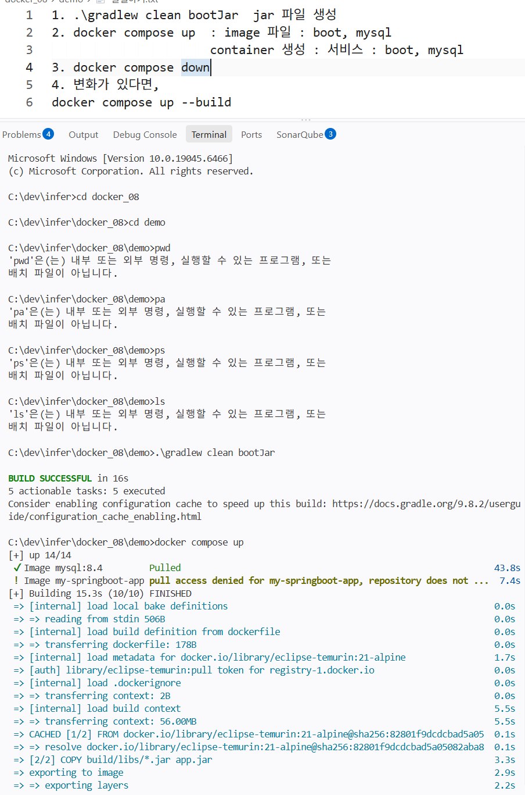
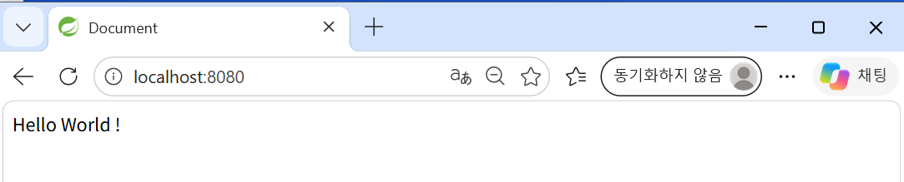
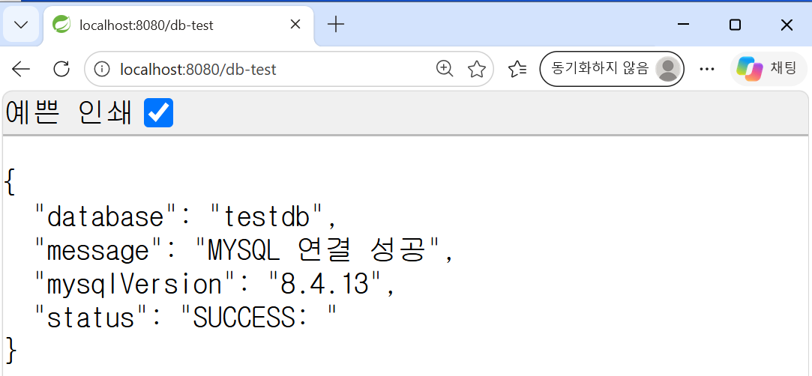

# DAY 92 — Docker Compose로 Spring Boot + MySQL 실행하기, Git 팀 협업 흐름

> 2026-11-16 · Docker, Dockerfile, Docker Compose, MySQL, healthcheck, depends_on, Git Flow, Pull Request

최종 프로젝트 개발 첫날, 수업에서는 **Spring Boot 애플리케이션을 Docker로 실행하는 과정**을 처음부터 다시
밟았다. 로컬에서 JAR를 만들어 실행하고, Dockerfile로 이미지를 만든 뒤, **Docker Compose로 Spring Boot와
MySQL 컨테이너를 한 번에 띄워** DB 연결까지 확인했다. 이어서 팀 프로젝트에서 쓸 **Git 협업 흐름**(브랜치
전략, Pull Request, 코드 리뷰, 충돌 해결)을 정리했다.

## 오늘의 학습 흐름

```text
gradlew bootJar → java -jar로 로컬 실행
  ↓
Dockerfile → docker build → docker run → docker logs
  ↓
docker-compose.yml: app + mysql 서비스 정의
  ↓
docker compose up → Hello World · /db-test 연결 확인
  ↓
Git 팀 협업: 이슈 → 브랜치 → 커밋·푸시 → PR → 리뷰 → 병합
```

## 1. JAR 만들어 로컬에서 실행하기

간단한 REST 컨트롤러를 만들고 `bootJar`로 실행 가능한 JAR를 만들었다.

```java
@RestController
public class RestDBController {
    @GetMapping("/db")
    public String db() {
        return "deTest";
    }
}
```

```bash
.\gradlew clean bootJar          # build/libs/demo-0.0.1-SNAPSHOT.jar 생성
cd build\libs
java -jar demo-0.0.1-SNAPSHOT.jar
```

Spring Boot 4.0.9가 Java 21에서 실행되고 Tomcat이 8080 포트로 올라오는 것을 확인했다.



## 2. Dockerfile로 이미지 만들기

```dockerfile
FROM eclipse-temurin:21-alpine
COPY build/libs/*.jar app.jar
ENTRYPOINT ["java", "-jar", "/app.jar"]
```

```bash
docker build -t myweb .     # 이미지 빌드
docker images               # myweb:latest (약 202MB)
docker run -d myweb         # 백그라운드 실행
docker ps                   # "java -jar /app.jar" 실행 중
docker logs caf             # 컨테이너 로그로 Spring Boot 시작 확인
```

`alpine` 기반 JRE 이미지를 써서 이미지 크기를 줄였다. `docker logs`로 컨테이너 안의 애플리케이션 로그를
확인할 수 있고, 컨테이너 ID는 앞 몇 글자만 써도 된다.



> 이 상태로는 `-p` 옵션 없이 실행해 컨테이너의 8080 포트가 호스트와 연결되지 않는다. 브라우저에서 접속하려면
> `docker run -d -p 8080:8080 myweb`처럼 포트를 연결해야 한다.

## 3. Docker Compose

**Docker Compose**는 여러 컨테이너를 **하나의 설정 파일(`docker-compose.yml`)** 로 정의하고, 한 번의 명령으로
함께 실행·관리하는 도구다.

| 사용 이유 | 설명 |
| --- | --- |
| 여러 컨테이너를 한 번에 실행 | 앱·DB를 `docker compose up` 하나로 실행 |
| 환경 구성 자동화 | 포트·환경변수·볼륨을 파일에 기록해 매번 같은 환경을 만듦 |
| 네트워크 자동 연결 | 같은 Compose 안의 서비스는 **서비스 이름**(`mysql`)으로 서로 접속 |
| 재사용성·버전 관리 | 설정 파일을 Git으로 관리해 팀원이 같은 환경을 재현 |

### 실습 — Spring Boot + MySQL

```yaml
services:
  app:
    build: .                          # 현재 폴더의 Dockerfile로 이미지 빌드
    image: my-springboot-app
    container_name: springboot-container
    ports:
      - "8080:8080"
    environment:
      SPRING_DATASOURCE_URL: jdbc:mysql://mysql:3306/testdb   # 호스트명 = 서비스 이름
      SPRING_DATASOURCE_USERNAME: root
      SPRING_DATASOURCE_PASSWORD: ${MYSQL_ROOT_PASSWORD}
    depends_on:
      mysql:
        condition: service_healthy    # MySQL이 준비된 뒤에 앱 시작

  mysql:
    image: mysql:8.4
    container_name: mysql-container
    environment:
      MYSQL_ROOT_PASSWORD: ${MYSQL_ROOT_PASSWORD}
      MYSQL_DATABASE: testdb
    ports:
      - "3306:3306"
    volumes:
      - ./mysql-data:/var/lib/mysql   # 컨테이너를 지워도 데이터 유지
    healthcheck:                      # 준비 상태 확인 (명령은 예시)
      test: ["CMD", "mysqladmin", "ping", "-h", "localhost"]
```

| 설정 | 의미 |
| --- | --- |
| `build` + `image` | Dockerfile로 빌드한 이미지에 `my-springboot-app` 이름을 붙임 |
| `jdbc:mysql://mysql:3306` | `localhost`가 아니라 **MySQL 서비스 이름**으로 접속 |
| `depends_on` + `service_healthy` | 컨테이너가 "시작"된 것이 아니라 healthcheck를 **통과**한 뒤 앱 실행 |
| `volumes` | DB 데이터를 호스트 폴더(`mysql-data`)에 보관 |

`depends_on`만 쓰면 MySQL 컨테이너가 시작되자마자 앱이 실행돼, DB가 아직 접속을 받지 못해 연결 오류가 날 수
있다. `healthcheck`와 `condition: service_healthy`를 함께 써야 준비가 끝난 뒤에 앱이 시작된다.

> 수업 예제는 비밀번호를 파일에 직접 적었지만, 일지에서는 `${MYSQL_ROOT_PASSWORD}`로 바꿨다. 실제 프로젝트에서는
> `.env` 파일로 값을 넣고 `.env`는 Git에 올리지 않는다.

### 실행 순서

```bash
.\gradlew clean bootJar     # 1. JAR 생성
docker compose up           # 2. 이미지 빌드 + 컨테이너 생성 (boot, mysql)
docker compose down         # 3. 종료 · 컨테이너 삭제
docker compose up --build   # 4. 코드가 바뀌었으면 이미지를 다시 빌드해서 실행
```



`localhost:8080`에서 Hello World 페이지가, `/db-test`에서 MySQL 연결 결과(DB `testdb`, MySQL 8.4.13,
`SUCCESS`)가 확인됐다.





## 4. Git 팀 협업 흐름

팀 프로젝트(게시판 예제)를 기준으로 Git·GitHub 협업 과정을 정리했다.

```text
① 이슈 생성 → ② 브랜치 생성(feature/기능) → ③ 개발·커밋·푸시
  → ④ PR 생성(코드 리뷰) → ⑤ 병합(develop) → ⑥ 배포(main)
            ↑_________ 리뷰 피드백 반영 후 다시 푸시 _________|
```

| 브랜치 | 역할 |
| --- | --- |
| `main` | 최종 배포 버전 (직접 커밋 금지) |
| `develop` | 기능이 완료된 브랜치를 통합 |
| `feature/*` | 기능 단위 개발 (예: `feature/login`, `feature/board`) |

```bash
git clone https://github.com/<팀계정>/team-board.git
git checkout develop && git pull         # 최신 develop 반영
git checkout -b feature/board            # 기능 브랜치 생성
git add . && git commit -m "[#1] 게시판 목록 구현"
git push -u origin feature/board         # 원격에 푸시 → GitHub에서 PR 생성
```

- **Pull Request**: `develop ← feature/board`로 PR을 만들고, 변경 내용과 이슈 번호를 적는다.
- **코드 리뷰**: 팀원이 코멘트를 남기면 수정 후 다시 푸시해 PR에 자동 반영한다.
- **병합**: 리뷰 승인 후 `develop`에 병합하고, 병합된 브랜치는 필요 시 삭제한다.
- **충돌 해결**: 같은 파일을 여러 명이 고치면 `<<<<<<< HEAD … ======= … >>>>>>>` 표시가 생긴다. 원하는 코드로
  정리한 뒤 `git add` → `git commit` → `git push`로 마무리한다.

저장소에는 `frontend/`, `backend/`, `docs/`(기획서·ERD·화면설계), `.github/`(이슈·PR 템플릿), `README.md`,
`docker-compose.yml`(실행 환경)을 두어, 팀원 누구나 같은 방법으로 실행할 수 있게 한다.

## 트러블슈팅

### 1. `java -jar` — Unable to access jarfile

- **증상**: 프로젝트 폴더에서 `java -jar demo-0.0.1-SNAPSHOT.jar`를 실행하자 `Unable to access jarfile`이 났다.
- **원인**: JAR는 프로젝트 폴더가 아니라 `build/libs` 안에 만들어진다. `cd lib`, `cd lid`처럼 잘못된 경로로도
  이동하려 했다.
- **해결**: `cd build\libs`로 이동해 실행했다. 또는 프로젝트 폴더에서 `java -jar build\libs\demo-0.0.1-SNAPSHOT.jar`로
  경로를 함께 적으면 된다.

### 2. Windows 명령 프롬프트에서 `pwd`·`ls`가 안 됨

`pwd`, `ls`는 리눅스·PowerShell 명령이라 `cmd`에서는 "내부 또는 외부 명령이 아닙니다"가 나온다. `cmd`에서는
`cd`(현재 위치), `dir`(목록)을 쓴다.

### 3. `docker compose up` — `pull access denied for my-springboot-app`

`build`와 `image`를 함께 적으면 Compose가 먼저 `my-springboot-app` 이미지를 Docker Hub에서 받으려다 실패해 경고가
뜬다. 이후 `build: .`로 이미지를 직접 빌드하므로 실행에는 문제가 없었다. 경고를 없애려면
`docker compose up --build`로 빌드를 먼저 하거나 `pull_policy: build`를 지정한다.

## 공개 원칙

- Git 협업 수업 자료(인포그래픽)는 올리지 않고 내용을 글로 정리했다.
- `docker-compose.yml`의 DB 비밀번호는 `${MYSQL_ROOT_PASSWORD}`로 바꿔 적었고, 비밀번호가 보이는 화면은
  브라우저 결과 부분만 잘라 사용했다.

## 오늘의 정리

- `bootJar`로 만든 JAR는 `build/libs`에 생기고, Dockerfile은 그 JAR를 이미지에 복사해 실행한다.
- Docker Compose는 여러 컨테이너를 한 파일로 정의하며, 같은 Compose 안에서는 서비스 이름으로 서로 접속한다.
- `depends_on`에 `service_healthy`를 함께 써야 DB가 준비된 뒤 앱이 시작된다.
- 코드를 바꾸면 `docker compose up --build`로 이미지를 다시 만든다.
- 팀 협업은 `main`·`develop`·`feature/*` 브랜치와 PR·코드 리뷰로 진행하고, 충돌은 표시를 정리한 뒤 다시 커밋한다.

## 다음에 이어서 볼 내용

- `.env`와 `.dockerignore`로 Compose 설정 정리하기
- SpaceLink 프로젝트에 Oracle·Spring Boot Compose 개발 환경 구성
- 팀 저장소에 이슈·PR 템플릿 만들고 `feature/login` 브랜치로 1주차 개발 시작
