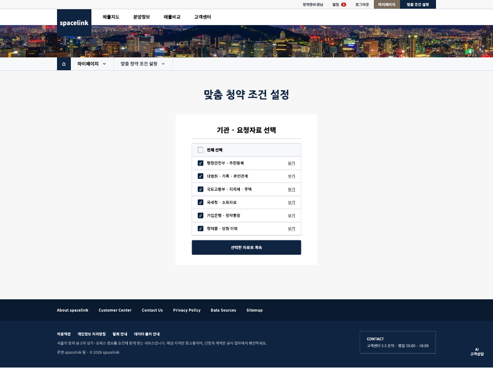
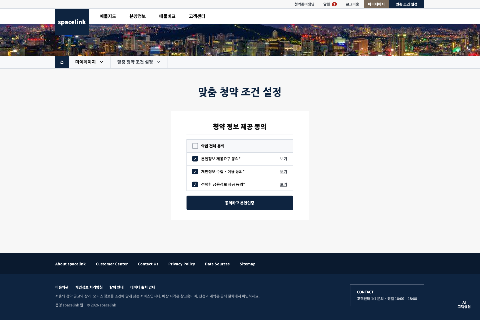
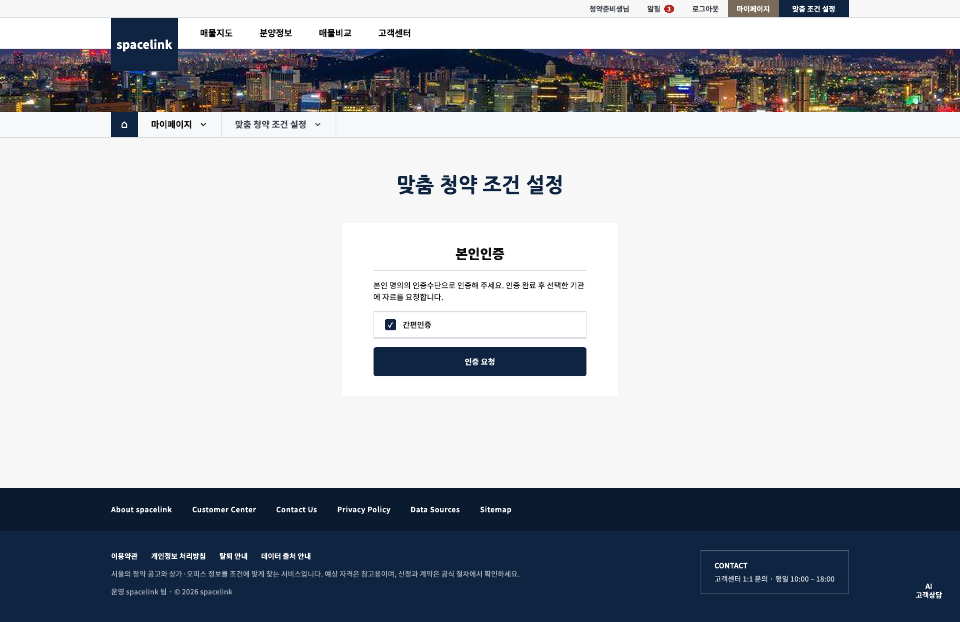
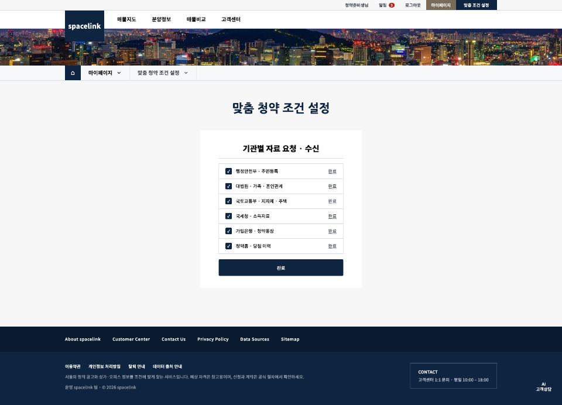
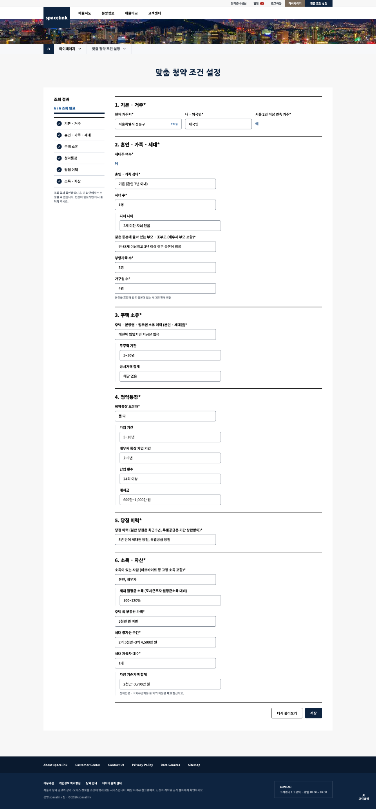

# DAY 93 — SpaceLink 맞춤 청약정보 불러오기 목업과 화면 정합성 정리

> 2026-11-17 · Final Project, Figma, User Flow, Easy Authentication, 화면설계

오늘은 최종 프로젝트 **SpaceLink**에서 사용자의 청약 관련 정보를 불러오는 흐름을 목업으로
정리했다. 기관과 요청 자료를 선택하고, 정보 제공에 동의한 뒤 본인인증을 거쳐 기관별 자료를
수신하고, 최종 조회 결과를 확인·저장하는 과정을 하나의 사용자 흐름으로 연결했다. 간편인증
상태, 결과 화면의 구간값, 소셜 가입과 마이페이지 요약도 같은 기준으로 맞췄다.

> 이 기록은 오늘 대화에서 정리한 작업 내용과 화면 목업 PDF를 기준으로 작성했다. 실제 Git
> 커밋·변경 파일을 직접 대조한 기록은 아니며, 기관 인증·자료 조회 API도 아직 연결하지 않았다.

## 오늘의 작업 흐름

```text
기관·요청자료 선택
  ↓
청약정보 제공 동의
  ↓
본인인증 요청
  ↓
기관별 자료 요청·수신
  ↓
조회 결과 확인
  ↓
읽기 전용 결과 저장 · 마이페이지 요약 동기화
```

## 1. 기관·요청자료 선택

맞춤 청약 조건 설정을 시작하면 먼저 사용자가 불러올 기관과 자료를 확인하도록 구성했다.
주민등록, 가족·혼인관계, 주택, 소득, 청약통장, 당첨 이력을 항목별로 나누고 전체 선택과 개별
선택을 모두 제공했다. 각 항목의 `보기`를 통해 어떤 자료를 요청하는지 확인한 뒤 다음 단계로
이동한다.



한 번에 모든 정보를 요청하게 만들기보다 **사용자가 요청 범위를 확인하고 선택할 수 있게 하는
것**이 중요하다. 화면에서는 기관명과 자료 종류를 함께 보여 주어 수집 목적을 이해하기 쉽게
했다.

## 2. 정보 제공 동의

선택한 공공정보를 불러오기 전에 개인정보 제공, 자료 요구, 선택 기관 제공에 대한 동의를
받도록 했다. 약관 전체 동의와 개별 동의를 나누고, 필수 항목을 확인해야 본인인증으로 넘어갈
수 있게 설계했다.



동의 화면은 단순한 체크박스가 아니라 **어떤 정보를 왜 요청하는지 확인하는 단계**다. 실제
개발에서는 약관 버전과 동의 시각, 필수·선택 여부를 서버에 기록하고, 철회·재동의 흐름도 함께
설계해야 한다.

## 3. 본인인증과 간편인증 상태

본인인증 진입 화면에서는 간편인증을 선택하고 인증 요청을 시작한다. 오늘 정리한 간편인증
모달은 다음 세 상태만 유지하도록 했다.

| 상태 | 화면 역할 |
| --- | --- |
| 입력 | 인증수단과 필요한 정보를 확인하고 요청 |
| 대기 | 휴대전화 앱에서 인증을 진행하도록 안내 |
| 완료 | 인증 성공을 확인하고 기관 자료 요청으로 이동 |

최종 인증수단은 **카카오·네이버·토스·PASS**만 선택할 수 있게 정리했다. 공개용 화면에서는
이름·생년월일·휴대전화번호 같은 예시 개인값과, 최종 정책과 다른 인증수단 목록이 있는 모달을
제외했다.



## 4. 기관별 자료 요청·수신

인증이 끝나면 기관별 자료를 순서대로 요청하고 진행 상태를 보여 준다. 화면에는 주민등록,
가족·혼인관계, 주택, 소득, 청약통장, 당첨 이력의 상태를 각각 표시한다.



진행 상태를 하나의 로딩 문구로만 보여 주면 어느 기관에서 지연되거나 실패했는지 알기 어렵다.
따라서 각 항목을 `요청 중·완료·실패`로 구분하고, 일부 실패가 발생하면 성공한 자료는 유지한
채 실패한 항목만 다시 요청할 수 있는 방향으로 정리했다.

## 5. 조회 결과와 정확한 시안용 값

조회 결과에서는 6개 항목의 완료 여부를 왼쪽에서 확인하고, 오른쪽에 기본·거주, 혼인·가족,
주택 소유, 청약통장, 당첨 이력, 소득·자산을 읽기 전용으로 표시한다. 사용자가 값을 직접
수정하는 화면처럼 보이지 않도록 안내를 추가하고, 확인한 결과를 저장하는 버튼을 배치했다.



> 화면의 주소·기간·횟수·금액은 사용자 흐름 검증을 위한 **시안용 가상 데이터**이며 실제
> 개인의 정보가 아니다.

자리표시 형태의 값은 시연할 때 의미가 모호해질 수 있어 다음 항목을 구체적인 구간과 날짜로
맞췄다.

- 거주 기간, 혼인 기간, 청약통장 가입 기간
- 납입 횟수와 예치금 구간
- 주택 외 부동산·자동차·총자산 구간
- 가입일, 혼인일, 자녀 출생일, 당첨일
- 실제 점수 합계와 항목별 최대 배점

같은 정보가 조회 결과와 마이페이지 요약에서 다르게 보이지 않도록 표시 기준도 함께
동기화했다.

## 6. 소셜 가입과 화면 정합성

소셜 로그인에서 확인한 이메일은 회원가입 화면에 자동 입력하고, 사용자는 같은 화면에서
서비스용 아이디와 비밀번호를 설정하도록 흐름을 정리했다. 별도의 소셜 회원가입 화면을 하나
더 만들기보다 기존 회원가입 화면을 재사용해 입력 규칙과 오류 처리를 일관되게 유지하는
방식이다.

다음 화면 정합성도 함께 확인했다.

- 이전 단계의 동의 화면과 마이페이지 배경 교체
- 불필요한 시연용 설명 문구 제거
- 조회 결과와 마이페이지 요약의 구간값·날짜 통일
- 계산된 점수와 항목별 최대 배점을 구분해 표시
- 기관별 완료·실패 상태의 표현 통일

## 7. 문서 반영 전 확인할 항목

요구사항 정의서, 화면설계서와 기획 정리 문서도 수정했지만 이번 공개 기록에는 원본 문서를
올리지 않았다. 문서 수정본을 최종본으로 사용하기 전에 다음 내용을 다시 맞춰야 한다.

1. 탈퇴 정책을 `즉시 파기`가 아니라 **30일 보관·기간 내 복구 가능**으로 롤백
2. Figma에서 확정한 기간·횟수·금액 구간을 문서에도 동일하게 반영
3. 혼인 연월과 혼인 기간 계산 설명을 원본·수정본과 대조해 누락 여부 확인

목업, 요구사항 정의서, 화면설계서 중 하나만 바뀌면 개발자가 서로 다른 기준을 보게 된다.
정책이나 값이 바뀔 때는 관련 화면과 문서를 함께 갱신하고, 최종 기준 문서를 명확하게 남겨야
한다.

## 8. 공개 범위와 보안 점검

이번 일지에는 전체 화면설계 PDF 대신 오늘 작업 흐름을 설명하는 화면 5장만 올렸다.

- 이름·생년월일·휴대전화번호 형태의 예시값이 있는 인증 입력 화면 제외
- 예시 이메일·아이디·생년월일이 있는 소셜 가입 화면 제외
- `즉시 파기·복구 불가` 문구가 남은 이전 탈퇴 정책 화면 제외
- 사람 이름과 문의자 정보가 있는 관리자 화면 제외
- 요구사항 정의서·화면설계서·기획 문서 원본 제외

선정한 화면에는 비밀키·토큰·내부 URL·실제 개인정보가 없으며, 결과 화면의 값은 시안용
가상 데이터다.

## 오늘의 정리

- 청약정보 불러오기는 선택·동의·인증·수신·결과 확인의 단계로 나누면 현재 위치가 명확해진다.
- 기관별 요청 상태를 따로 표시하면 일부 실패와 재시도 흐름을 설계하기 쉽다.
- 조회 결과는 읽기 전용임을 분명히 하고 저장 이후 마이페이지 표시와 같은 기준을 써야 한다.
- 간편인증은 입력·대기·완료 상태와 허용 인증수단을 명확하게 제한한다.
- 목업의 정책·구간값이 바뀌면 요구사항 정의서와 화면설계서도 함께 동기화해야 한다.
- 현재 작업은 화면 목업이며 실제 기관 인증·자료 조회 연동은 아직 구현하지 않았다.

## 다음에 이어서 볼 내용

- 탈퇴 30일 유예·복구 정책을 요구사항 정의서와 화면설계서에 반영
- 기간·횟수·금액 구간 및 혼인 기간 계산 기준 최종 대조
- 인증 실패·기관 일부 실패·재시도 상태 화면 확정
- 실제 연동 범위와 테스트용 모의 응답 계약 정의
- 화면 ID와 API 요청·응답 필드 매핑
