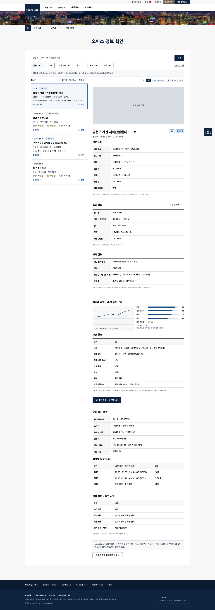
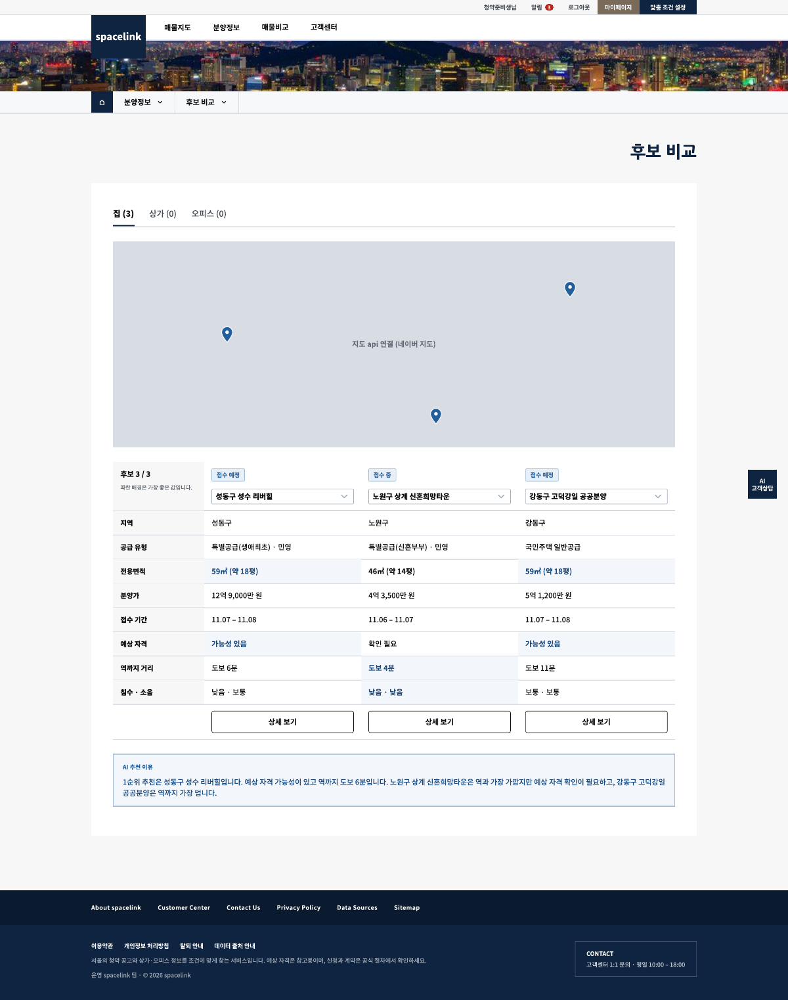
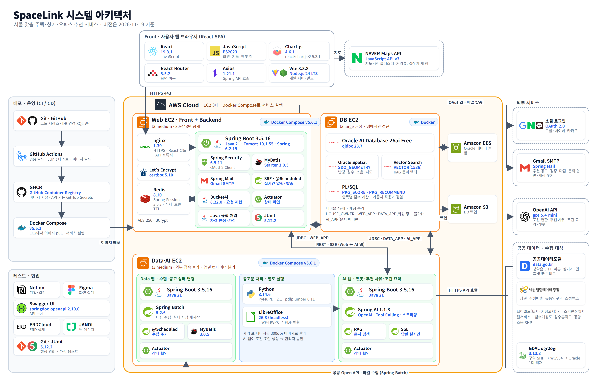

# DAY 95 — SpaceLink 반응형 설계와 프론트 컴포넌트 구조 정리

> 2026-11-19 · Final Project, Figma, Responsive Web, React Architecture

오늘은 최종 프로젝트 **SpaceLink**의 반응형 화면을 다시 설계하고, Figma 컴포넌트를 React에서
재사용할 수 있도록 프론트 구조와 작성 규칙을 정리했다. 데스크톱 화면을 단순히 줄이는 방식은
폐기하고, 데스크톱·태블릿·모바일에서 정보의 우선순위와 배치가 달라지도록 전용 모듈을 구성했다.

> 아래 화면은 공개 가능한 일부만 선별한 것이다. 원본 화면설계 PDF 전체와 개인정보 형태의
> 예시값이 있는 화면, 관리자 화면은 저장소에 올리지 않았다.

## 1. 브레이크포인트별 반응형 화면 설계

전체 72개 프레임을 `spacelink · Responsive` 변수와 공통 반응형 모듈로 구성했다. 모바일
본문 글자 크기는 14px로 맞추고, 화면 크기마다 단순 축소가 아닌 전용 레이아웃을 적용했다.

- 모바일: 767px 이하
- 태블릿: 768px 이상 1279px 이하
- 데스크톱: 1280px 이상

누락됐던 UI-013 오피스 화면을 다시 만들고 기존 상세 화면의 간격과 서식을 기준으로 화면을
정리했다. 아래 이미지는 오피스 정보 구조를 보여 주는 **데스크톱 기준 화면**이며, 태블릿과
모바일에서는 같은 정보를 화면 폭에 맞는 전용 배치로 재구성했다.



### 후보 비교 모바일 화면

UI-014 후보 비교는 데스크톱에서는 여러 매물을 표의 열로 나란히 볼 수 있지만, 작은 화면에서는
열이 지나치게 좁아진다. 모바일에서는 표를 없애고 매물마다 독립된 카드로 나눈 뒤 좌우
스와이프로 비교하도록 변경했다.



이 이미지는 데스크톱 기준 화면이다. 실제 모바일 설계에서는 한 번에 한 매물의 핵심 조건에
집중하고, 스와이프하면서 다른 후보와 비교할 수 있게 정보 구조를 바꿨다.

## 2. 프론트 컴포넌트 구조 결정

컴포넌트를 역할에 따라 세 영역으로 나눴다.

```text
components/
├── common/   버튼·폼·표시·내비게이션·데이터·오버레이·필터·지도
├── layout/   공통 화면 골격
└── domain/   home·auth·profile·compare·support·mypage·admin
```

세부 배치와 작성 규칙은 다음과 같이 정했다.

- `Tag`는 button, 필터 칩은 filter, AI 추천 질문 칩은 display에 배치
- 지도 관련 컴포넌트는 map 폴더에서 관리
- 컴포넌트와 CSS Modules 파일은 같은 폴더에 배치
- 색상·간격·글꼴 같은 공통 값은 `tokens.css` 변수 사용
- 배럴 파일 없이 `@` 별칭으로 시작하는 전체 경로에서 직접 import
- `paths.js` 주석은 요구사항의 UI 번호와 일치시킴
- Pretendard 웹폰트를 기본으로 하고 Noto Sans KR을 대체 글꼴로 사용

현재 구현은 데스크톱을 우선 진행하고, 개발 중간 단계에서 태블릿·모바일 반응형을 적용하는
순서로 정리했다.

## 3. Figma 컴포넌트의 React 전환

`tokens.css`, `fonts.css`와 Pretendard 웹폰트 5종을 추가하고 `global.css`에서 불러오도록
연결했다. Figma 컴포넌트 86개를 React 코드로 옮겨 정한 폴더 구조에 배치했다.

모양과 동작이 비슷한 모달은 다음 세 가지 공통 틀로 합쳐 중복을 줄였다.

| 공통 모달 | 역할 |
| --- | --- |
| `ConfirmModal` | 확인·취소가 필요한 짧은 안내 |
| `AgreementModal` | 약관과 동의 내용 표시 |
| `AdminModalForm` | 관리자 입력·수정 폼 |

조건부 클래스 이름을 다루는 `lib/cx.js`도 추가하고, `routes/paths.js`는 화면 ID를 기준으로
다시 정리했다.

## 4. 설계 기준 아키텍처

프론트·백엔드·데이터 처리·AI·배포 흐름을 한 장에서 확인할 수 있도록 시스템 아키텍처도 함께
정리했다.



아키텍처 이미지는 현재의 **설계 기준**을 정리한 자료다. 이번 세션에서 AWS 인프라 배포나
외부 서비스 연동까지 수행했다는 의미는 아니다. 공개 이미지에는 키·토큰·IP·비밀번호 같은
접속 정보가 포함되지 않았다.

## 5. 검증 결과

- 프론트 빌드 통과
- 변환한 86개 컴포넌트의 개별 렌더링 검사 통과
- 반응형 프레임과 컴포넌트 폴더 규칙 확인

이번 세션에서는 SpaceLink 프로젝트의 실제 Git 커밋을 만들지 않았다. 커밋 메시지만 정리했고,
프로젝트 저장소 커밋은 별도로 진행할 예정이다.

## 남은 작업

- `Header`·`Footer`를 `MainLayout`에 연결
- `AdminTopBar`·`AdminSidebar`를 `AdminLayout`에 연결
- `paths.js`의 실제 경로 문자열을 팀과 확정
- 구조 결정 문서에 button 폴더·공통 모달 3종·`cx` 유틸 내용 추가
- 데스크톱 구현 중간에 태블릿·모바일 반응형 스타일 적용

## 오늘의 정리

- 반응형 화면은 데스크톱을 축소하는 작업이 아니라 화면별 정보 구조를 다시 설계하는 작업이다.
- 공통 컴포넌트와 도메인 컴포넌트의 책임을 나누면 화면 수가 많아져도 구조를 찾기 쉽다.
- 디자인 토큰과 공통 모달을 사용하면 Figma와 React 사이의 스타일 차이와 중복을 줄일 수 있다.
- 디자인을 코드로 옮긴 뒤에는 빌드뿐 아니라 각 컴포넌트가 독립적으로 렌더링되는지도 확인해야 한다.
