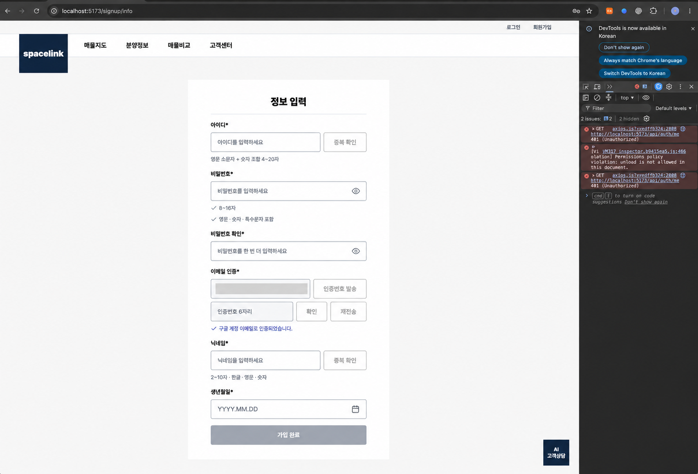
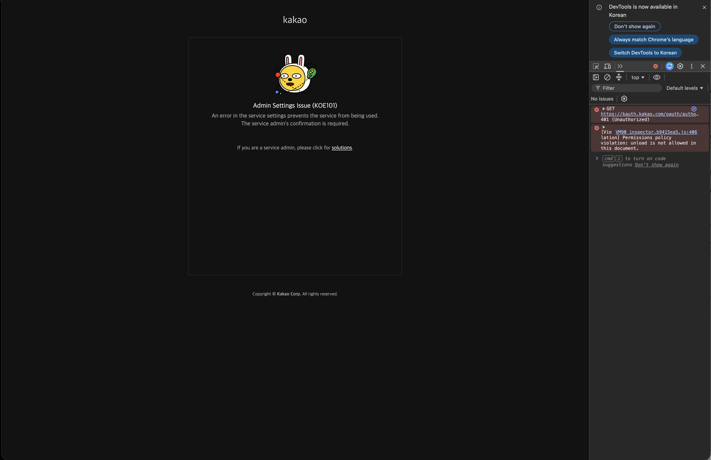

# DAY 96 — SpaceLink 공통 화면과 소셜 로그인 트러블슈팅

> 2026-11-20 · Final Project, React, Spring Boot, Session, OAuth2

오늘은 SpaceLink의 공통 화면과 인증 흐름을 연결하고, 소셜 인증 뒤 잘못된 주소로 이동하던
문제를 분석했다. 실제 저장소 상태에 맞춰 **main 반영**, **기능 브랜치 커밋**, **진행 중인
미커밋 작업**을 구분해 정리했다.

> 트러블슈팅 화면은 전체 5장 중 공개에 필요한 2장만 선별했다. 개인 이메일이 보인 화면은
> 공개용 사본에서 가렸으며, 원본 이미지와 인증 코드·세션·클라이언트 비밀값은 올리지 않았다.

## 1. main에 반영된 공통 화면

사용자·관리자 레이아웃에 페이지 틀과 라우트를 연결하고, 로그인 상태에 따라 헤더 메뉴가
달라지도록 공통 구조를 정리했다.

- UI-021 데이터 출처·이용약관·개인정보처리방침
- UI-022 서비스 이용 흐름·추천 점수·청약 제도 안내
- UI-023 403·404·500·503 공통 오류 화면
- 헤더 아래에서 사용하는 공통 `PageBanner`
- 푸터의 약관·개인정보·회원 탈퇴 링크
- Node.js 24 LTS 기준과 프론트 라우트·컴포넌트 문서

## 2. 기능 브랜치의 로그인·회원가입

세션 로그인과 로그인 상태 확인 API를 프론트에 연결하고, 회원가입 화면에서 아이디 중복을
확인할 수 있도록 구현했다. 이 작업은 기능 브랜치에 커밋된 상태이며 아직 원격 main에는
반영되지 않았다.

## 3. 소셜 로그인 트러블슈팅

소셜 인증 자체는 완료됐지만 성공 후 처리 흐름이 없어 백엔드 루트 주소로 이동하면서 404가
발생했다. 인증 성공과 서비스 로그인을 별개의 단계로 보고, 결과에 따라 이동 경로를 나누는
후처리 구조를 추가했다.

- 기존 회원: 세션 로그인 후 프론트 홈으로 이동
- 신규 회원: 소셜 정보를 세션에 보관하고 약관 동의 단계로 이동
- 실패·정지·탈퇴 유예 계정: 로그인 화면에서 상태별 안내 표시
- 가입 중인 소셜 이메일을 조회해 회원가입 입력 화면에 연결

구글 로그인은 신규 회원의 이메일을 불러와 인증 완료 상태로 표시하는 것까지 확인했다.

카카오 로그인은 관리자 설정 오류(`KOE101`) 화면을 확인했고, 콜백 요청이 거절되는 원인을
계속 점검하고 있다. 네이버 로그인 검증도 남아 있다.

## 4. 이메일 인증과 검증

이메일 인증번호 발송·확인 기능을 회원가입 화면에 연결하고, Redis를 이용해 재발송과 과도한
요청을 제한하는 작업을 진행했다. 설정 파일에는 실제 비밀값을 넣지 않고 환경변수로 연결했다.

확인한 결과는 다음과 같다.

- 백엔드 소셜 로그인 컨트롤러·서비스 테스트 통과
- 프론트 Vitest 54개 통과
- 프론트 빌드 통과
- 구글 로그인 정상 동작 확인

## 남은 작업

- 카카오 콜백 오류 원인 확인과 네이버 로그인 검증
- 소셜 신규 회원의 회원정보·연결정보 저장 흐름 완성
- 이메일 발송 처리와 프록시 환경의 요청 주소 처리 검토
- 미커밋 변경 정리 후 팀 공유·커밋·PR 진행

## 오늘의 정리

- OAuth 인증 성공과 서비스의 로그인 완료는 서로 다른 단계다.
- 성공·신규 가입·실패 상태마다 명시적인 후처리와 이동 경로가 필요하다.
- 완료된 main 작업과 기능 브랜치·미커밋 작업을 구분해야 진행 상황을 정확하게 기록할 수 있다.
