# DAY 97 — SpaceLink 회원 기능 마무리: 이메일 인증·소셜 로그인·계정 찾기·마이페이지·탈퇴 처리

> 2026-11-21 · Final Project, Spring Boot, React, OAuth2, Spring Mail, Session, Scheduler

어제 남겨 둔 소셜 로그인 점검을 끝내고, 회원 기능 전체를 **가입 → 로그인 → 계정 찾기 →
마이페이지 → 탈퇴·복구 → 자동 삭제**까지 한 흐름으로 완성했다. 작업은 PR #1·#2로 main에
병합했고, 진행 상황은 **main 반영**, **진행 중(미커밋)**, **막힌 점**으로 나눠 정리했다.

> 실습 화면 17장 중 11장을 골라 올렸다. 이메일 주소·실명·발신 계정·재설정 토큰·OAuth 요청 주소는
> 공개용 사본에서 가렸고, 원본 이미지는 올리지 않았다.

## 오늘의 흐름

```text
회원가입: 이메일 인증번호 발송·확인 → 가입 정보 저장
  ↓
소셜 로그인: 구글·카카오·네이버 연동 + 매번 계정 선택 화면
  ↓
계정 찾기(UI-005): 아이디 찾기 메일, 비밀번호 재설정 링크(30분·1회용)
  ↓
마이페이지(UI-019): 회원정보 수정, 소셜 연결·해제, 알림 설정, 회원 탈퇴
  ↓
탈퇴 계정 복구(30일 이내) / 30일 경과 계정 자동 삭제(매일 04:00)
  ↓
PR #1·#2 병합, 백엔드 188개·프론트 85개 테스트 통과
```

## 1. 회원가입과 이메일 인증

- Gmail SMTP로 인증번호를 보내고 확인한 뒤 가입 정보를 저장한다.
- 인증번호 발송 횟수를 제한해 같은 주소로 메일을 반복해서 보내지 못하게 했다.
- 메일 계정과 앱 비밀번호는 설정 파일에 직접 쓰지 않고 환경변수로 주입한다.

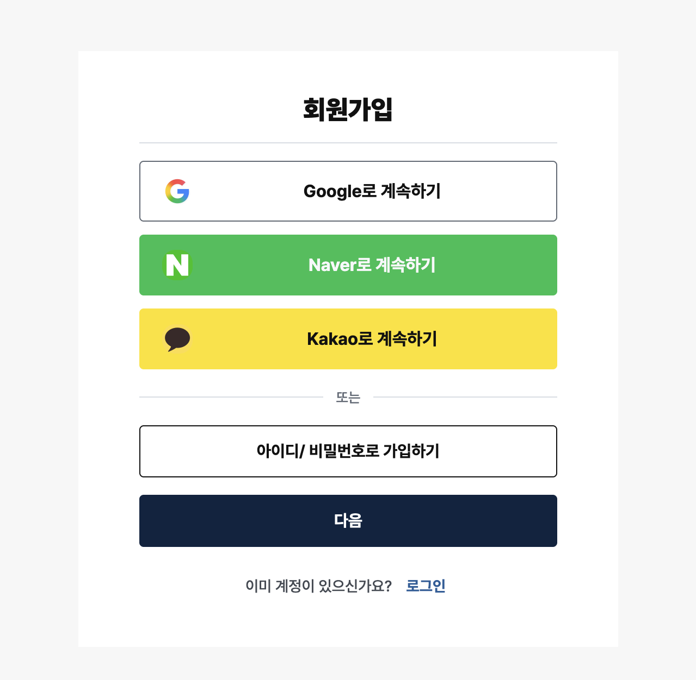

소셜 가입은 약관 동의 단계로 넘어오며, 필수 약관과 선택 동의(맞춤 알림·마케팅·행동 기록)를 나눠 받는다.

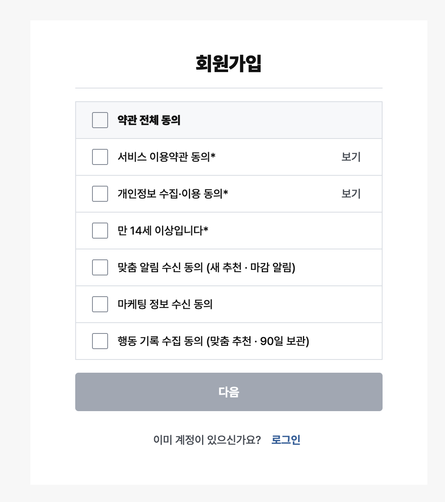

소셜 계정 이메일로 가입하면 이메일 인증을 따로 하지 않고 인증 완료 상태로 표시한다.

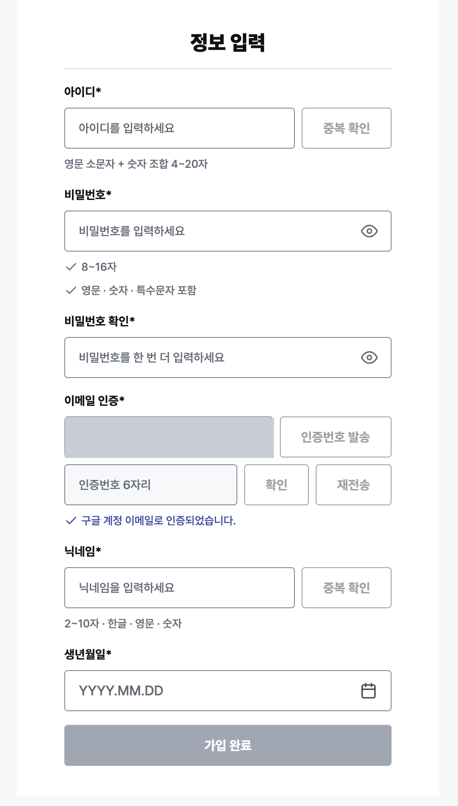

## 2. 소셜 로그인 3종 연동

어제 카카오 콜백 오류(`KOE101`)로 멈춰 있던 부분을 해결하고 구글·카카오·네이버 연동을
마쳤다. 네이버는 개발 중 상태라 **등록된 테스트 계정만 로그인할 수 있어**, 팀원 계정을 등록한
뒤 동작을 확인했다.

로그인할 때마다 계정 선택 화면이 뜨도록 각 제공자의 인가 요청에 계정 선택 옵션을 붙였다.
이전에 로그인한 계정으로 자동 진행되지 않아, 공용 PC나 여러 계정을 쓰는 상황에서 다른
계정으로 바꿔 들어가기 쉽다.

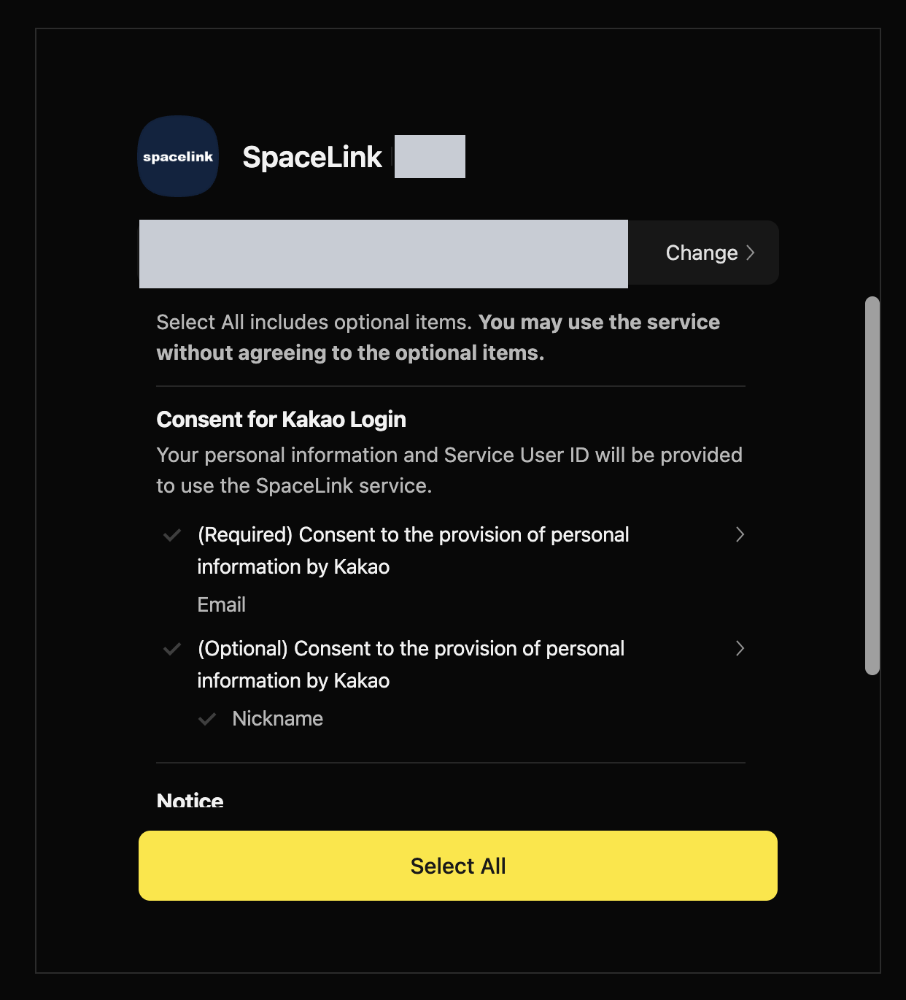

## 3. 계정 찾기(UI-005)

| 기능 | 처리 방식 |
| --- | --- |
| 아이디 찾기 | 가입 이메일로 아이디 안내 메일 발송 |
| 비밀번호 재설정 | 재설정 링크 메일 발송, **30분 유효·1회만 사용 가능** |
| 재요청 제한 | 다시 요청할 수 있을 때까지 남은 시간을 화면에 표시 |

만료되거나 이미 사용한 링크를 열면 공통 `ErrorCode`의 `RESET_LINK_EXPIRED`로 안내한다.

계정이 있는지 없는지 드러나지 않도록, 결과와 관계없이 같은 안내 문구를 보여 준다.

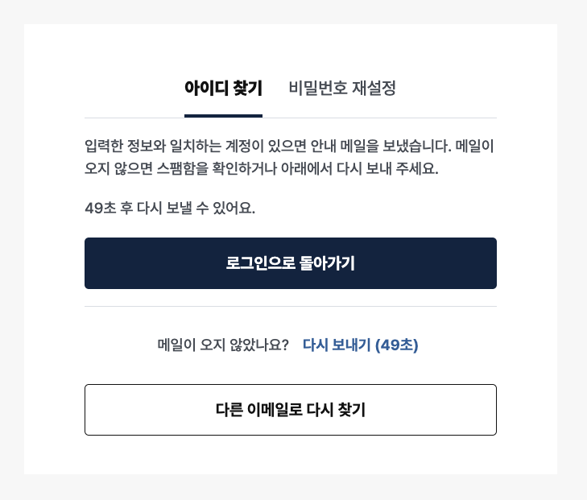

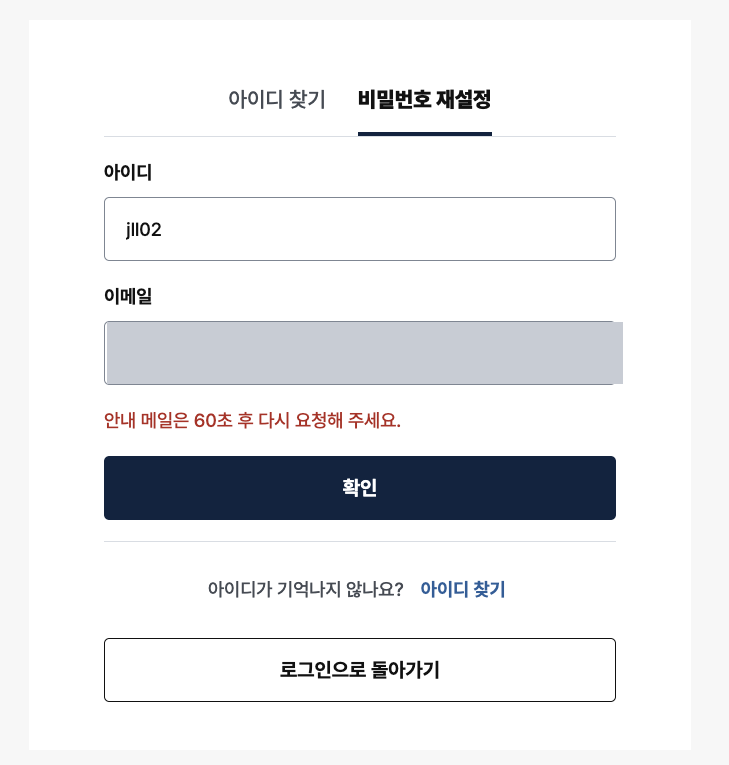

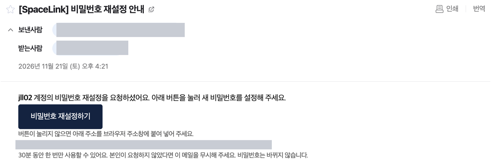

### 비밀번호 변경 시 "다른 기기 로그아웃"

비밀번호를 바꾸거나 재설정할 때 다른 기기의 로그인을 함께 끊을지 고를 수 있게 했다.
회원별로 로그인 세션을 찾아 지울 수 있어야 해서 **세션 저장 방식을 바꿨다**. 그래서 main을 받은
뒤에는 기존 세션이 맞지 않아 한 번 다시 로그인해야 할 수 있다.

## 4. 마이페이지(UI-019)

- 회원정보 수정
- 소셜 계정 연결·해제
- 알림 설정: 사이트 알림·이메일 알림을 토글하면 바로 저장
- 회원 탈퇴: 바로 삭제하지 않고 **30일 보관**, 탈퇴 즉시 모든 기기 로그아웃

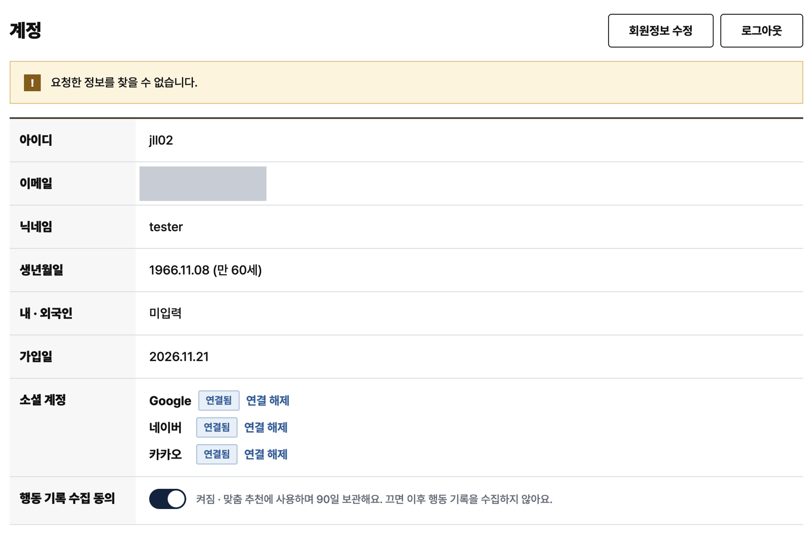

마케팅 알림은 정보통신망법 제50조에 따라 **사전 동의**가 필요해 기본값을 꺼짐으로 두었다.
기획 쪽 확인을 요청했다.

## 5. 탈퇴 계정 복구와 자동 삭제

```text
탈퇴 요청 → 탈퇴 처리 중(30일 보관) → 모든 세션 로그아웃
   │
   ├─ 30일 안에 로그인 → 복구 확인 창 → 복구하면 바로 로그인
   │
   └─ 30일 경과 → 매일 04:00 예약 작업이 회원·연결 데이터 삭제
                   (관리자·초기 계정 제외)
```

자동 삭제는 회원과 연결된 찜·비교·문의·청약 프로필·희망 조건·알림 데이터까지 함께 지운다.
회원 테이블은 `WEB_APP` 계정만 지울 수 있게 권한을 나눠 두었기 때문에, 이 작업은 **배치 서버가
아니라 API 서버**의 예약 작업으로 실행한다.

문의 첨부 파일은 지금은 DB 행만 지운다. 업로드 기능을 만들 때 실제 파일 삭제도 함께 구현해야 한다.

## 6. 팀 공통 규칙으로 정한 것

| 상황 | 규칙 |
| --- | --- |
| 알림·메일을 보낼 회원 고르기 | `NotificationSettingService.receivers()` 사용 (정상 회원 중 알림을 켠 회원만, 탈퇴 처리 중·정지 회원 제외) |
| 행동 기록(`USER_EVENT`) 남기기 | 행동 기록 수집에 동의(`BEHAVIOR_LOG_YN = 'Y'`)한 정상 회원만 기록 |
| 인증 관련 오류 | 공통 `ErrorCode`에 추가된 `RESET_LINK_EXPIRED` 등 사용 |

조건을 기능마다 따로 쓰면 탈퇴 처리 중인 회원에게 메일이 가는 식의 누락이 생기기 쉽다. 그래서
판단을 서비스 한 곳에 모으고 다른 기능은 그 결과만 쓰도록 했다.

## 트러블슈팅 — PostgreSQL `init.sh`가 실행되지 않음

**현상**: `docker compose down -v`로 볼륨까지 지운 뒤 다시 띄우면 PostgreSQL 초기화 스크립트가
실패해 벡터 테이블과 `ai_app` 계정이 만들어지지 않았다.

**원인**: 저장소에 들어간 `db/postgres/init.sh`에 실행 권한이 없었다. Windows에서 만든 파일은
Git이 실행 권한 없이(`100644`) 기록해 두기 때문에, 컨테이너에 연결돼도 실행할 수 없다.

**해결**: 우선 컨테이너 안에서 스크립트를 직접 실행해 테이블과 계정을 만들었다. 근본적으로는
Git에 실행 권한을 기록해야 한다.

```bash
git update-index --chmod=+x db/postgres/init.sh
git ls-files -s db/postgres/init.sh   # 100755로 바뀌었는지 확인
```

## 트러블슈팅 — 소셜 로그인·메일 발송 오류 화면

개발 중 만난 오류 화면도 남겨 둔다.

| 화면 | 의미 |
| --- | --- |
| 카카오 `KOE101` | 카카오 앱 설정(앱 키·Redirect URI 등)이 요청과 맞지 않을 때 나오는 관리자 설정 오류 |
| 네이버 "Unable to log in" | 네이버 앱 설정 문제로 로그인이 막힌 상태. 개발 중인 앱은 등록된 계정만 로그인 가능 |
| `/api/auth/email-verification` 503 | 메일 서버로 보내지 못해 "인증 메일을 보내지 못했습니다" 안내 표시 |

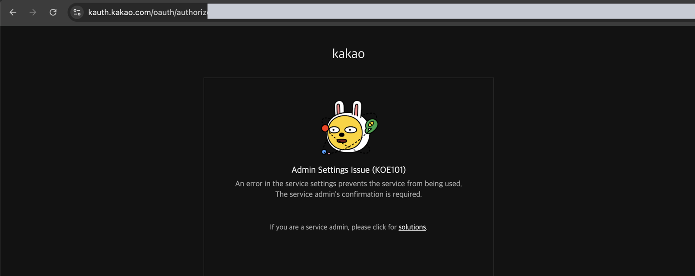

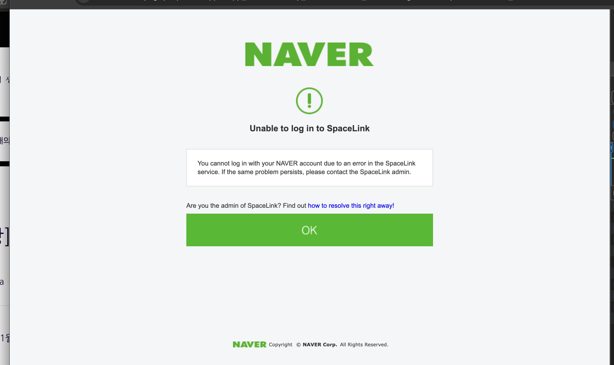

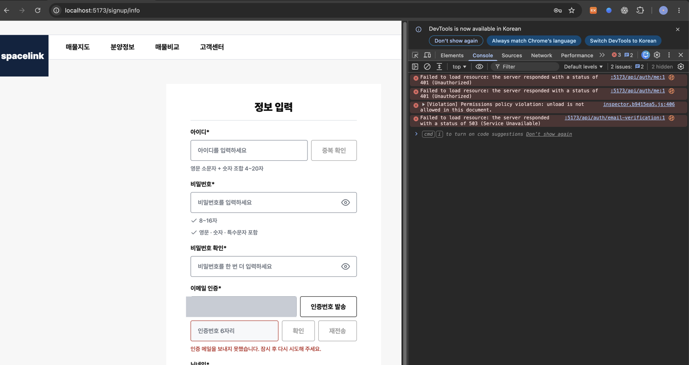

## 검증

- main 기준 백엔드 테스트 188개 통과
- main 기준 프론트 테스트 85개 통과
- 구글·카카오·네이버 로그인 동작 확인

## 진행 중 · 막힌 점 · 다음 계획

**진행 중**: 마이페이지 행동 기록 수집 동의 토글 저장(`feature/mypage-consent`). 구현과 테스트는
끝났고 커밋만 남았다.

**막힌 점**: WBS 2.3 희망 조건은 아래가 정해져야 진행할 수 있어 팀에 확인을 요청했다.

- 가격·보증금·월세·인원·업종 구간 공통코드
- 화면에 없는 필수 컬럼 `SEARCH_PREFERENCE.USER_TYPE`의 처리 방법
- 청약 프로필 없이 희망 조건을 저장할 수 있는지 (지금은 FK 때문에 불가)

**다음 계획**

1. 행동 기록 동의 토글 커밋·PR
2. 4.6 찜 등록·해제 API와 마이페이지 찜 목록 연동 먼저 시작
3. 2.3 희망 조건은 기준이 정해지면 진행

## 오늘의 정리

- 탈퇴는 바로 삭제하지 않고 보관 기간, 복구, 자동 삭제를 하나의 상태 흐름으로 설계해야 한다.
- "다른 기기 로그아웃"처럼 회원 단위로 세션을 다루려면 세션 저장 방식부터 바뀌어야 한다.
- 받는 사람·기록 대상을 고르는 조건은 공통 서비스 한 곳에 모아야 누락이 없다.
- Windows에서 만든 셸 스크립트는 Git에 실행 권한을 따로 기록해야 컨테이너에서 실행된다.
