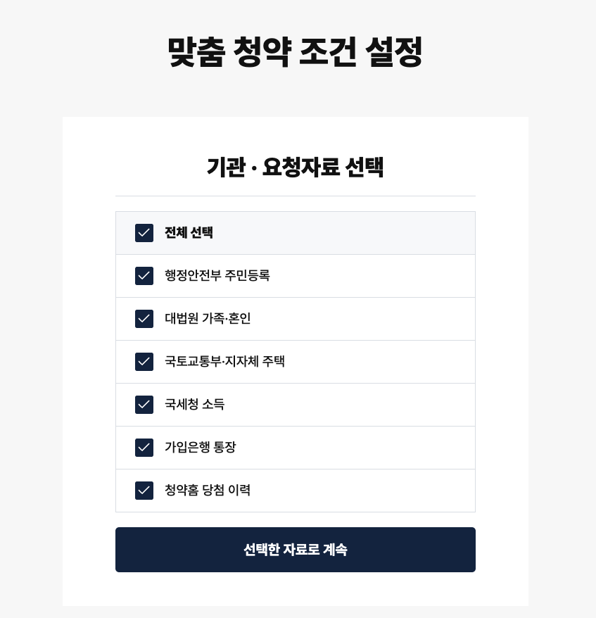
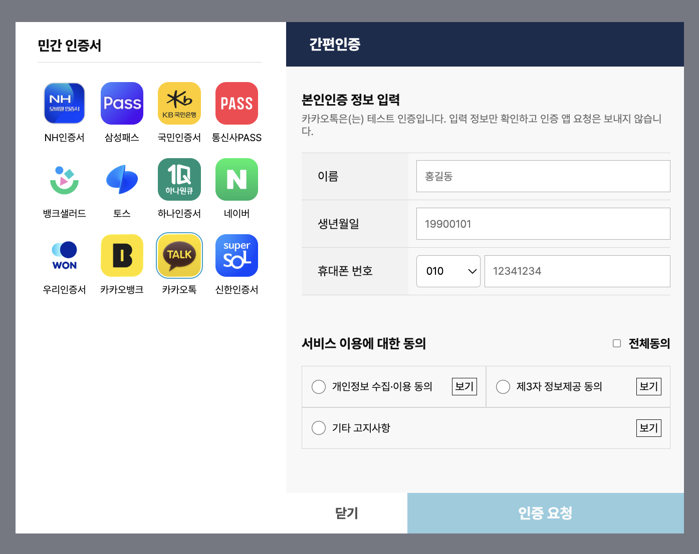
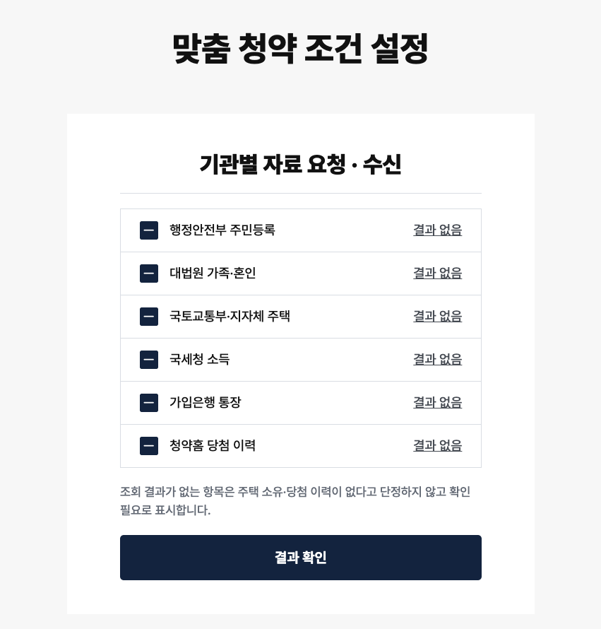
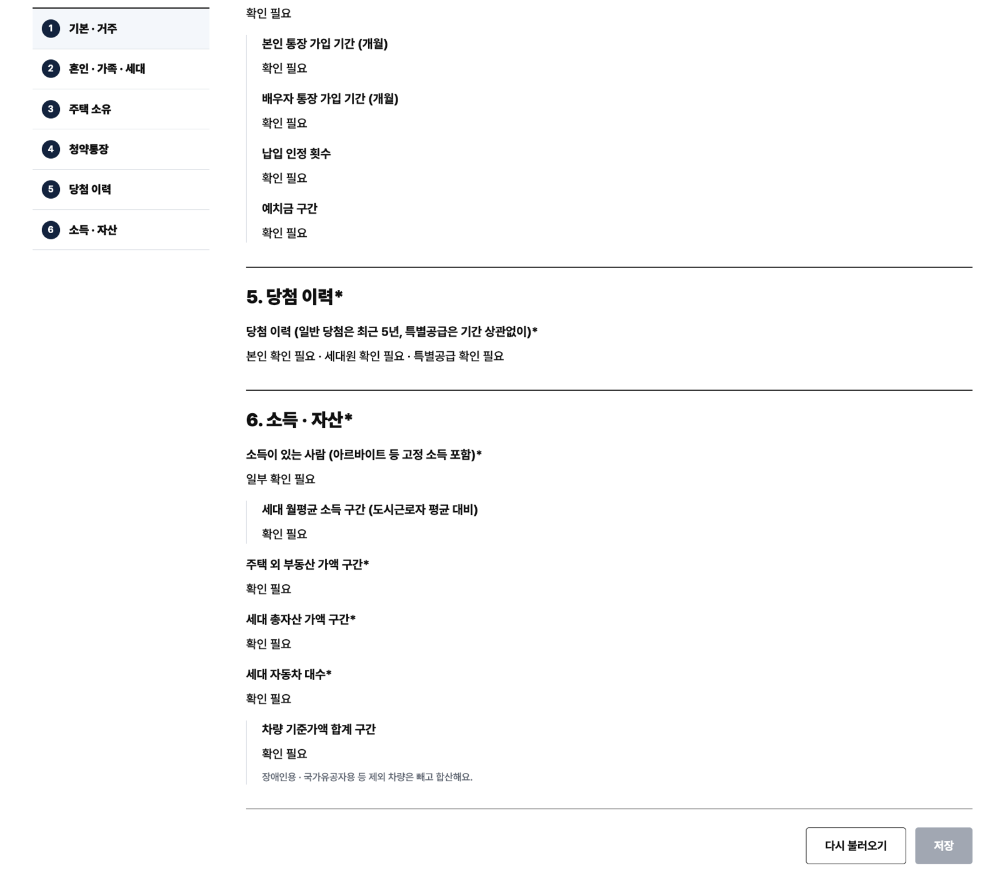
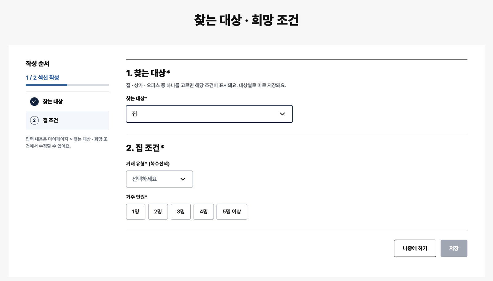
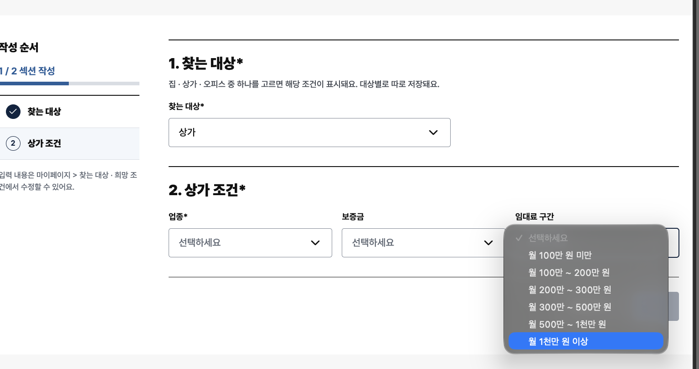
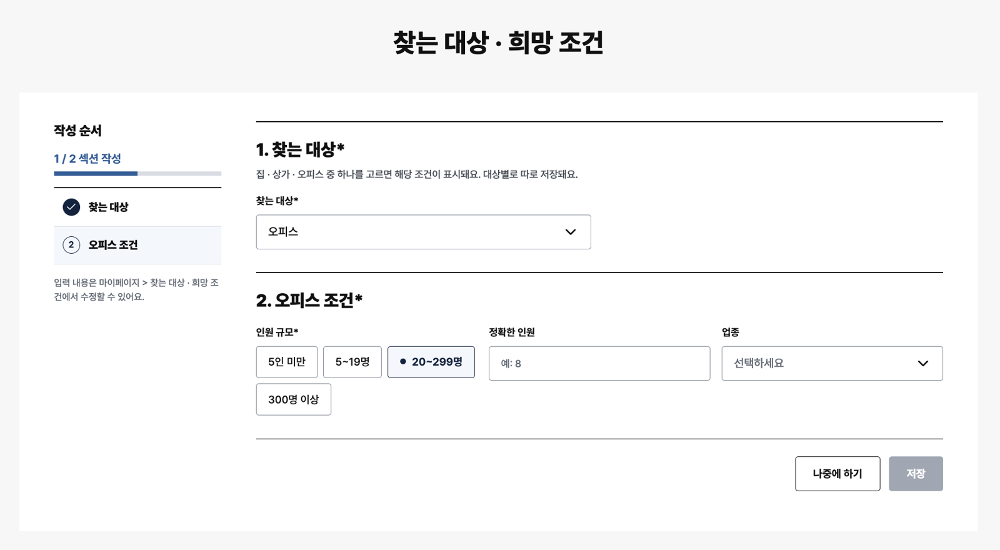
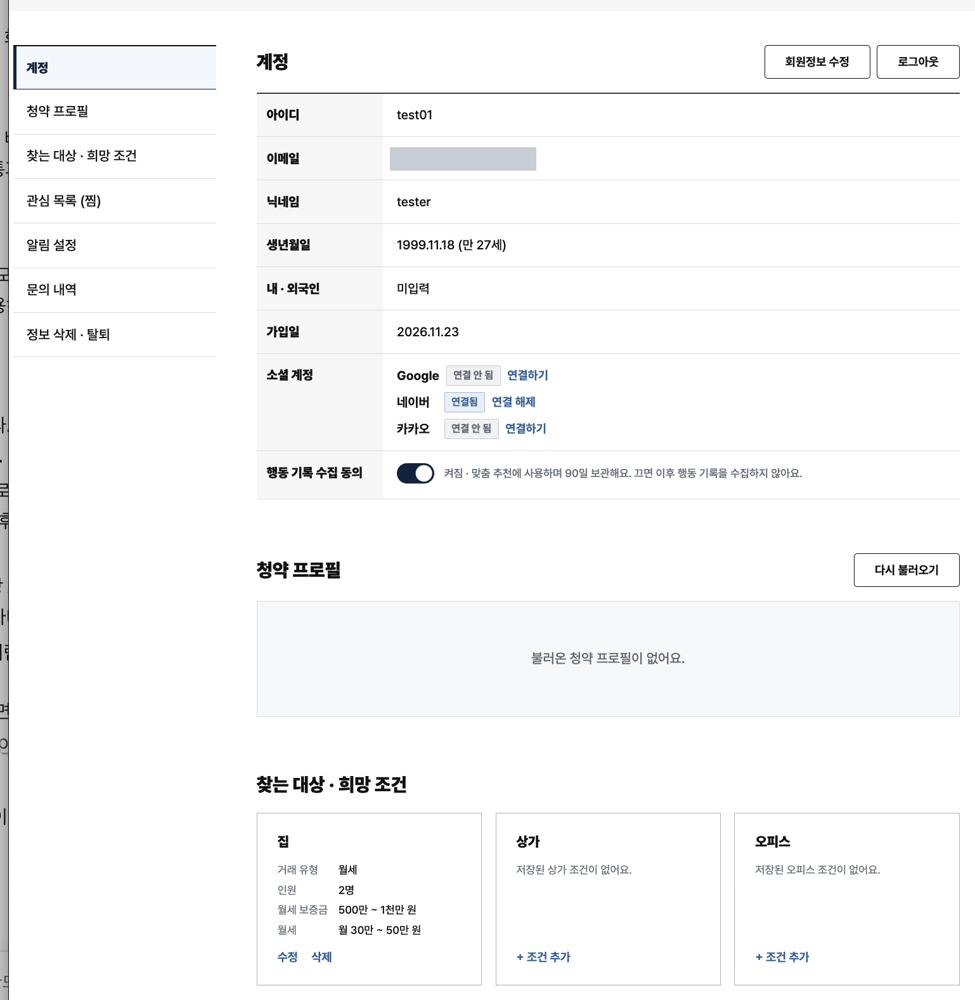

# DAY 98 — SpaceLink 맞춤 조건 설정: 청약 프로필 불러오기·희망 조건 저장·로그인 유지

> 2026-11-23 · Final Project, Spring Boot, Spring Session, MyBatis, React Router, 간편인증

가입을 마친 회원이 바로 **맞춤 청약 조건**을 설정하도록 흐름을 이었다. 간편인증으로 청약
프로필을 불러와 저장·수정하고, 찾는 대상(집·상가·오피스)별 희망 조건을 저장하는 API와 화면을
연결했다. 로그인 상태 유지와 로그인 후 원래 화면 복귀도 넣었다. 작업은 PR #5로 main에 병합했고,
관리자 화면은 아직 커밋 전이다.

> 실습 화면 20장 중 구현 화면 8장만 골랐다. 이메일은 가렸고, 실명·생년월일·휴대폰 번호가
> 보이는 화면과 Figma 시안·외부 사이트 참고 화면은 올리지 않았다.

## 오늘 커밋

| 커밋 | 내용 |
| --- | --- |
| `2932a9c` refactor | auth 패키지를 signup·verification·mail·recovery·social·account·withdrawal로 나눔 |
| `c88ebd0` feat (PR #4) | 찜 등록·해제 API와 마이페이지 찜 목록 연동 |
| `661d006` feat | 찾는 대상·희망 조건 API와 화면 |
| `735c79a` feat | 회원가입 직후 자동 로그인 → 맞춤 청약 조건 설정으로 이동 |
| `86f38b4` feat | 청약 프로필 간편인증·저장·수정 |
| `d71746c` feat | 로그인 상태 유지와 로그인 후 이전 화면 복귀 |
| `1e30623` feat | 1:1 문의 내역 조회 API와 화면 |

PR #3(마이페이지 행동 기록 동의 토글)도 오늘 함께 병합했다.

## 오늘의 흐름

```text
회원가입 완료 → 자동 로그인 → 맞춤 청약 조건 설정으로 이동
  ↓
기관·요청자료 선택 → 간편인증 → 기관별 자료 수신 → 청약 프로필 저장·수정
  ↓
찾는 대상(집·상가·오피스) 선택 → 대상별 희망 조건 저장
  ↓
마이페이지에서 저장된 조건 확인·수정
```

## 1. 가입 직후 자동 로그인 — `SessionLogin` 공통화

아이디 로그인, 계정 복구, 회원가입 직후에 같은 로그인 코드를 쓰도록 `SessionLogin`으로 모았다.
로그인할 때는 기존 세션을 버리고 새 세션에 인증 정보를 저장한 뒤 CSRF 토큰도 바꾼다.
로그인 전 세션 ID를 그대로 쓰는 **세션 고정 공격**을 막기 위해서다.

```java
public static void signIn(LoginMember member, HttpServletRequest request, HttpServletResponse response,
                          SecurityContextRepository contexts, CsrfTokenRepository csrfTokens) {
    if (request.getSession(false) != null) request.getSession(false).invalidate();
    var context = SecurityContextHolder.createEmptyContext();
    context.setAuthentication(UsernamePasswordAuthenticationToken.authenticated(member, null,
        AuthorityUtils.createAuthorityList("ROLE_" + member.role())));
    SecurityContextHolder.setContext(context);
    contexts.saveContext(context, request, response);
    csrfTokens.saveToken(null, request, response);
}
```

## 2. 청약 프로필 불러오기

자료를 받을 기관과 항목을 고른 뒤 간편인증을 거쳐 기관별 결과를 받는다.



간편인증은 KG이니시스 통합인증(포트원 테스트 채널)으로 붙였고, 네이버·뱅크샐러드는 모의 인증으로
처리했다. `SimpleAuthService`는 이름·생년월일·휴대폰 번호를 **SDK 결과와 대조할 때까지만**
세션에 보관하고, 성공하든 실패하든 바로 지운다. 인증이 끝나면 10분 동안만 기관 조회를 허용한다.



받아 온 결과가 없는 기관은 "주택 소유·당첨 이력이 없다"고 **단정하지 않고 '확인 필요'**로 둔다.
자료가 없다는 것과 이력이 없다는 것은 다르기 때문에, 그 항목은 비워 두고 자격 판정에서도
확인 필요로 다룬다. 실패한 기관이 하나도 없을 때만 저장할 수 있고, 실패가 있으면 그 기관만 다시 조회한다.



저장한 프로필은 직접 고칠 수 있다(`PUT /api/me/profile/subscription/values`). 비운 항목은 다시
'확인 필요'가 되고, 잘못된 값은 400으로 돌려준다. 화면에는 조회 기준 시각을 함께 보여 준다.



## 3. 찾는 대상·희망 조건 API

```text
GET    /api/me/preferences          전체 조회 (저장 안 한 대상은 null)
PUT    /api/me/preferences/house    집 조건 저장 (덮어쓰기)
PUT    /api/me/preferences/store    상가 조건 저장
PUT    /api/me/preferences/office   오피스 조건 저장
DELETE /api/me/preferences/{target} 삭제 (저장하지 않은 대상이어도 성공)
```

| 대상 | 입력 조건 |
| --- | --- |
| 집 | 거래 유형(매매·전세·월세 복수 선택), 거주 인원, 유형별 가격 구간 |
| 상가 | 업종, 보증금, 임대료 구간 |
| 오피스 | 인원 규모, 정확한 인원, 업종 |



### 금액 구간을 enum 하나로 관리

금액 구간은 공통코드 그룹이 없어서 `PriceRange` enum에 경계값만 적고, 코드를 `"최소_최대"`(만 원)
형식으로 자동 생성한다. 첫 구간은 `0_최대`(미만), 마지막 구간은 `최소_`(이상)이다. 화면의 구간
목록도 같은 값으로 맞췄고, 목록에 없는 코드가 들어오면 입력 오류로 막는다.

```java
public enum PriceRange {
    HOUSE_SALE("매매가", 10000, 20000, 30000, 40000, 50000, 60000, 90000, 120000, 150000),
    HOUSE_MONTHLY_RENT("월세", 30, 50, 70, 100, 150),
    BIZ_RENT("임대료", 100, 200, 300, 500, 1000);
    // ...

    PriceRange(String label, int... bounds) {
        List<String> list = new ArrayList<>();
        int from = 0;
        for (int b : bounds) { list.add(from + "_" + b); from = b; }
        list.add(from + "_");           // 예: 1000_ = 월 1천만 원 이상
        this.codes = List.copyOf(list);
    }
}
```





### 막혀 있던 `USER_TYPE` 해결

지난번 막힌 점이었던 **화면에 없는 필수 컬럼 `SEARCH_PREFERENCE.USER_TYPE`**은 서버가 계산해서
넣기로 했다. `UserTypeRule`이 청약 프로필 값(혼인 상태·자녀 수·세대원 수)으로 위에서부터 처음 맞는
유형을 고르고, 프로필이 없거나 맞는 유형이 없으면 만 나이로 정한다.

```java
public static String of(Integer age, String maritalStatus, Integer childCount, Integer householdSize) {
    boolean senior = age != null && age >= SENIOR_AGE;   // 만 65세 (노인복지법)
    boolean married = "MARRIED_7Y_IN".equals(maritalStatus) || "MARRIED_7Y_OVER".equals(maritalStatus);
    if (senior && householdSize != null && householdSize == 1) return SENIOR_SINGLE;
    if (senior && married) return ELDERLY_COUPLE;
    if (childCount != null && childCount >= 1) return CHILD_FAMILY;
    if ("MARRIED_7Y_IN".equals(maritalStatus) || "ENGAGED".equals(maritalStatus)) return NEWLYWED;
    if (age != null && age >= 19 && age <= 39 && "SINGLE".equals(maritalStatus)) return YOUTH;
    return byAge(age);
}
```

저장한 조건은 마이페이지에서 대상별 카드로 보여 주고, 목업 대신 서버 값을 쓴다.



## 4. 로그인 상태 유지 30일

로그인 상태 유지를 고르면 세션 유지 시간을 기본 30분에서 **30일**로 늘리고, 세션 쿠키를 브라우저를
닫아도 남는 쿠키로 바꾼다. 소셜 로그인은 로그인 성공 핸들러에서 같은 메서드를 부른다.

```java
public static final Duration REMEMBER_ME = Duration.ofDays(30);

public static void keepLoggedIn(HttpServletRequest request) {
    request.setAttribute(SpringSessionRememberMeServices.REMEMBER_ME_LOGIN_ATTR, true);
    request.getSession().setMaxInactiveInterval((int) REMEMBER_ME.toSeconds());
}
```

## 5. 로그인 후 원래 화면으로 돌아가기

로그인이 필요한 화면은 `RequireLogin`으로 감쌌다. 비회원이면 지금 경로를 `state.from`에 담아
로그인 화면으로 보내고, 로그인 뒤 그 경로로 돌아간다.

```jsx
export default function RequireLogin() {
  const { user, status } = useAuth();
  const location = useLocation();
  if (status === 'loading') return null;
  if (status === 'ready' && !user) {
    return <Navigate to={PATHS.LOGIN} replace state={{ from: currentPath(location) }} />;
  }
  return <Outlet />;
}
```

소셜 로그인은 제공자 화면을 거친 뒤 서버가 메인으로 보내기 때문에 `state`가 사라진다. 그래서
떠나기 전에 돌아올 경로를 `sessionStorage`에 남기고, 메인에 로그인 상태로 도착하면 꺼내 이동한다.
10분이 지난 값은 버린다. **사이트 안 경로만 허용**해서 외부 주소로 보내는 오픈 리다이렉트를 막았다.

```js
export function safeReturnPath(from) {
  if (typeof from !== 'string' || !from.startsWith('/') || from.startsWith('//') || from.startsWith('/\\')) return null;
  const path = from.split(/[?#]/)[0];
  return path === PATHS.LOGIN ? null : from;
}
```

## 6. 그 밖의 작업

- **찜(PR #4)**: `GET /api/me/favorites`, `PUT·DELETE /api/me/favorites/{targetId}`. 숨긴 대상은 빼고,
  끝난 공고는 목록 뒤로 보낸다. 마이페이지 찜 목록을 목업에서 서버 목록으로 바꿨다.
- **1:1 문의 내역**: 내 문의 목록·상세 API와 고객센터·마이페이지 최근 문의 화면을 연결했다.
- **auth 패키지 정리**: 기능별 하위 폴더로 나누고 mapper XML도 같은 구조로 옮겼다. 여러 패키지가 쓰는
  `LoginMember`·`CurrentMember`와 로그인·세션 코드만 `auth` 바로 아래에 남겼다.

## 진행 중 (커밋 전, `feature/admin`)

- **관리자 공통**: 상단바에 운영자 이름·역할 표시, 왼쪽 메뉴에 처리 대기 건수 표시
  (`GET /api/admin/counts`, `AdminSummaryController`), 일반 회원 접근 시 403 화면
- **UI-025 공고 수집·검토**: 목록 필터, 원문 대조, 최종값 수정, 승인·반려 API 연결.
  "수집 다시 실행" 버튼은 수집 API가 열리면 연결
- **UI-026 자격 규칙·가점표**: API 입력 항목에 맞춰 규칙 등록·수정 모달과 가점표 수정 모달 변경,
  규칙 목록·가점표·변경 이력 연결
- **마이페이지**: 회원정보 수정 화면의 현재 비밀번호 입력란을 항상 가려지게 수정

## 오늘의 정리

- 조회 결과가 없는 것과 실제로 이력이 없는 것은 다르다. 모르는 값은 '확인 필요'로 남긴다.
- 로그인할 때는 새 세션을 만들고 CSRF 토큰도 바꿔야 세션 고정 공격을 막을 수 있다.
- 로그인 후 돌아갈 주소는 사이트 안 경로만 허용해야 오픈 리다이렉트가 생기지 않는다.
- 경계값만 적고 코드를 만들어 내는 enum을 쓰면 금액 구간을 한 곳에서 관리할 수 있다.
