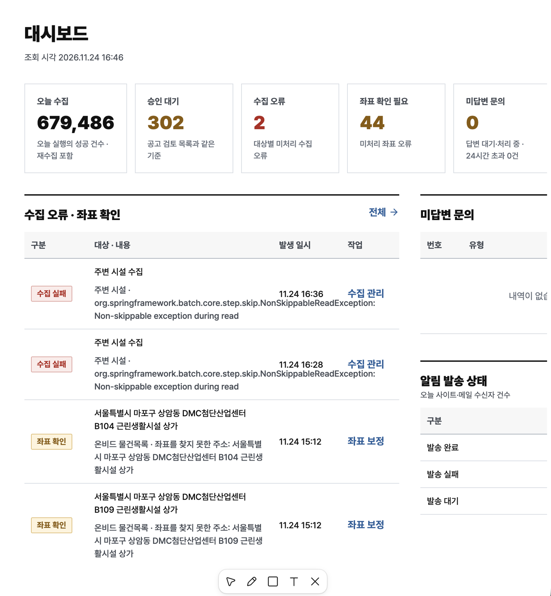
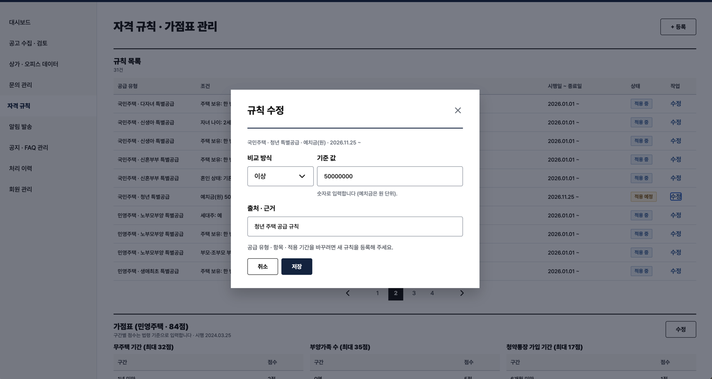
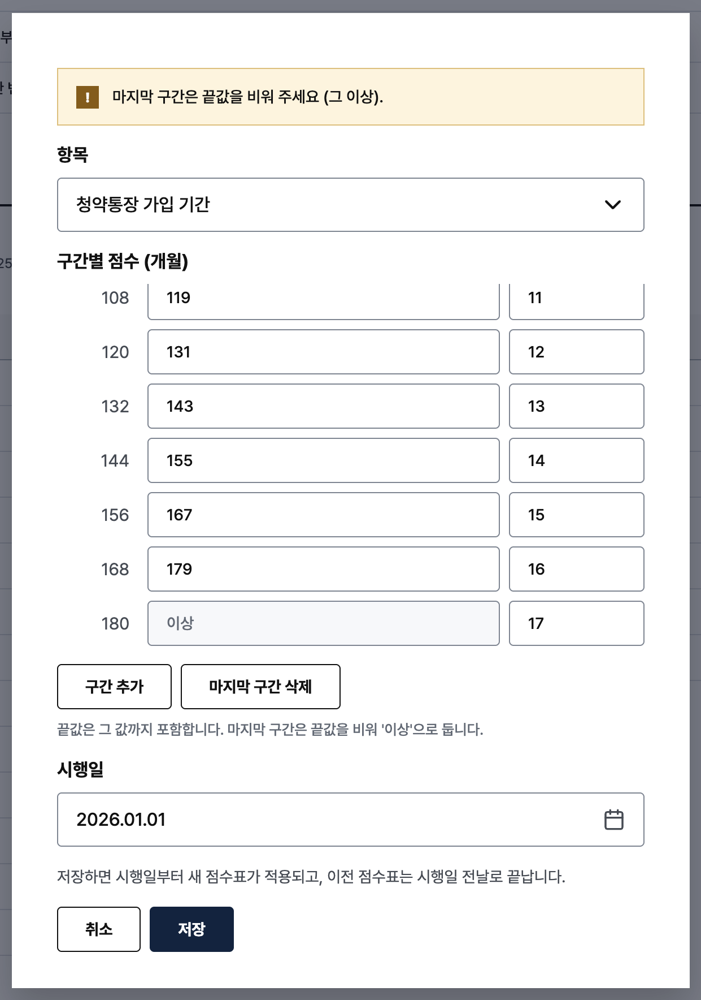
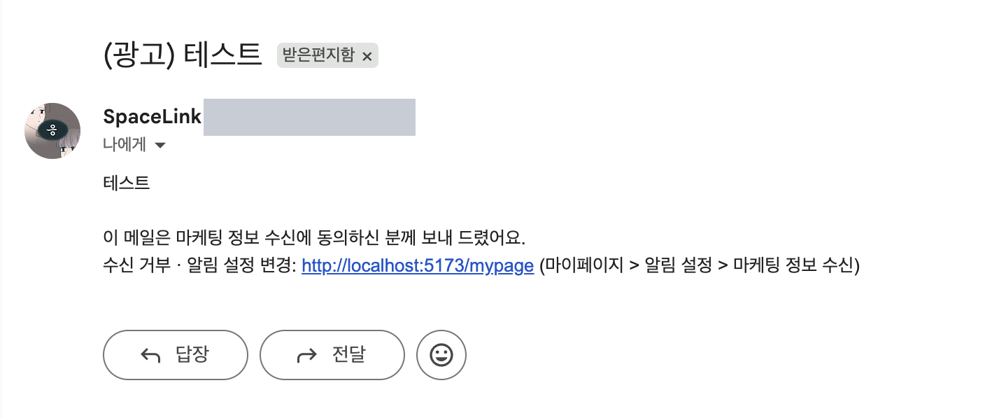
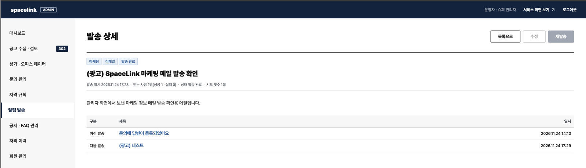
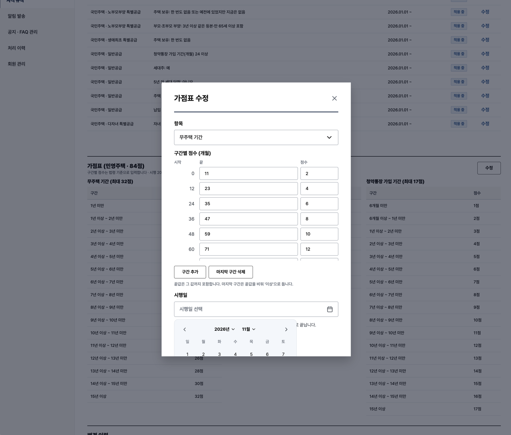
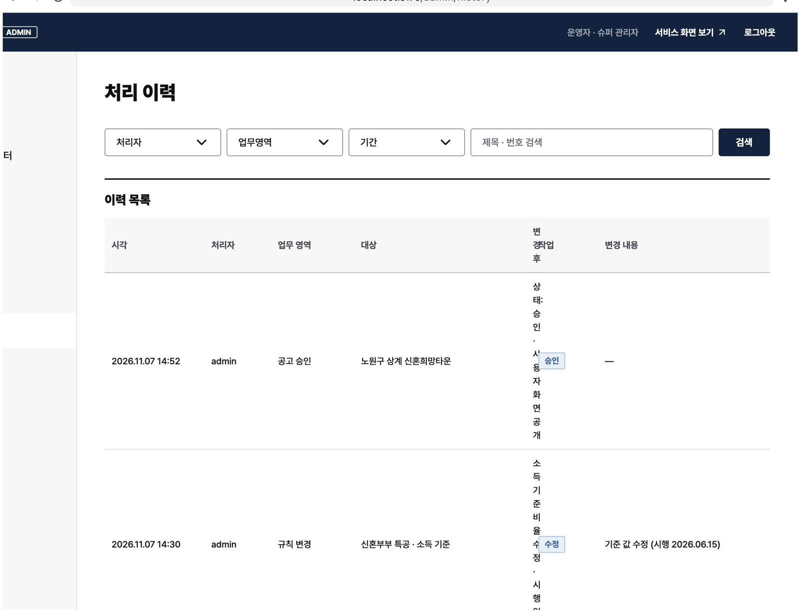
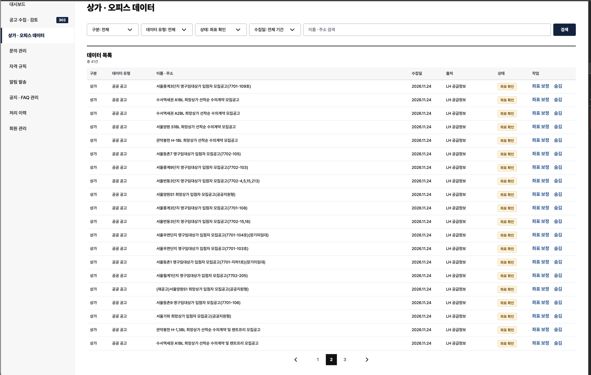

# DAY 99 — CI/CD와 EC2 배포 실습, SpaceLink 관리자 화면 API 연결

> 2026-11-24 · GitHub Actions, AWS(IAM·ECR·EC2), SSH, Spring Boot, React, 관리자 화면

수업에서는 **GitHub Actions로 빌드한 Docker 이미지를 AWS에 올리고 EC2에서 실행하는 배포 흐름**을
배웠고, EC2를 만들어 SSH로 접속하는 데까지 실습했다. 프로젝트에서는 SpaceLink **관리자 화면 전체를
API에 연결**하고(PR #6·#7), 알림함과 마케팅 메일 즉시·예약 발송을 만들었다.

> 실습 서버 주소·보안 그룹 ID·키 파일 내용이 보이는 화면과 강의 자료 그림은 올리지 않았다.
> 프로젝트 화면은 8장만 골랐고, 메일 주소는 가렸다.

## Part 1. 수업 — GitHub Actions CI/CD와 AWS EC2 배포

### 배포 흐름

```text
개발자 push / PR 병합 (main)
  ↓
GitHub Actions: 빌드 · 테스트 → Docker 이미지 빌드
  ↓
AWS ECR에 이미지 push (IAM 계정의 접근 키를 GitHub Secrets에 저장)
  ↓
EC2에 SSH 접속 → ECR에서 이미지 pull → docker compose로 실행
  ↓
사용자 ← 도메인(Route 53) ← EC2 (DB는 RDS, 파일은 S3)
```

- **GitHub Actions**: 저장소에 워크플로 파일(`.github/workflows/*.yml`)을 두면 push·PR 같은 이벤트마다
  빌드·테스트·배포를 자동으로 실행한다. 카카오 같은 회사도 쓰는 방식이라고 했다.
- **IAM**: AWS 리소스에 접근할 계정과 권한을 만든다. 배포용 계정은 ECR 관리 권한만 주는 식으로
  **필요한 권한만** 준다.
- **ECR**: AWS의 Docker 이미지 저장소. Actions가 만든 이미지를 여기에 올리고, EC2가 받아 간다.
- **GitHub Secrets**: 접근 키, 서버 주소, SSH 키 같은 값은 워크플로 파일에 직접 쓰지 않고 저장소의
  Secrets에 넣어 `${{ secrets.이름 }}`으로 꺼낸다.
- **Jenkins와 비교**: Jenkins를 쓰려면 Jenkins용 서버를 따로 띄워 관리해야 한다. GitHub Actions는
  GitHub가 실행 환경을 제공하므로 별도 서버가 필요 없다.

### EC2 만들고 접속하기

1. EC2 인스턴스(Ubuntu)를 만들고 **키 페어(.pem)**를 내려받는다.
2. **보안 그룹**에서 들어오는 규칙(SSH 22, 웹 포트)을 연다. SSH는 내 IP에서만 열어 두는 것이 안전하다.
3. 키 파일로 SSH 접속한다. 파일 전송은 FileZilla(SFTP)로 할 수 있다.

```bash
chmod 400 "키파일.pem"                      # macOS · Linux: 나만 읽을 수 있게
ssh -i "키파일.pem" ubuntu@<EC2 퍼블릭 DNS>
```

### 트러블슈팅 — Windows PowerShell에서 SSH 접속 거부

| 현상 | 원인 | 해결 |
| --- | --- | --- |
| `chmod : 'chmod' 용어가 ... 인식되지 않습니다` | `chmod`는 리눅스 명령이라 PowerShell에 없다 | Windows에서는 `icacls`로 파일 권한을 바꾼다 |
| `WARNING: UNPROTECTED PRIVATE KEY FILE!` → `Permission denied (publickey)` | 키 파일을 다른 사용자(`Authenticated Users`)도 읽을 수 있어서 ssh가 키를 무시함 | 상속 권한을 끊고 내 계정에만 읽기 권한을 준다 |
| `cd kosa` 경로 없음 | 관리자 PowerShell은 `C:\Windows\system32`에서 시작한다 | 절대 경로로 이동한다 (`cd C:\dev\...`) |

```powershell
icacls.exe "키파일.pem" /inheritance:r
icacls.exe "키파일.pem" /grant:r "$($env:USERNAME):(R)"
```

다른 방법으로 **PuTTY**를 썼다. PuTTYgen에서 `.pem`을 불러와 PuTTY용 `.ppk`로 저장한 뒤,
PuTTY의 SSH → Auth에 `.ppk`를 지정하고 `ubuntu@<EC2 주소>`로 접속한다.

> 개인 키(.pem·.ppk)는 저장소에 올리거나 다른 사람에게 보내면 안 된다. 잃어버리면 서버에 접속할 수
> 없으므로 안전한 곳에 따로 보관한다.

## Part 2. 프로젝트 — SpaceLink 관리자 화면 API 연결

오늘 커밋 33개(병합 제외)를 PR #6(마이페이지 마무리), PR #7(관리자·알림·마케팅)으로 main에 병합했다.

| 화면 | 오늘 만든 것 |
| --- | --- |
| 관리자 공통 | 공통 틀, 왼쪽 메뉴 처리 대기 건수 |
| 대시보드 | 오늘 수집·승인 대기·수집 오류·좌표 확인 필요·미답변 문의 집계 API, 수집 오류 재시도 |
| UI-025 공고 수집·검토 | 목록·원문 대조·최종값 수정·승인·반려 연결, **수집 다시 실행 API** |
| UI-026 자격 규칙·가점표 | 팀장 API 입력 항목에 맞춰 연결, **잘못 만든 규칙 삭제 API** |
| 문의 관리 | 문의 목록·상세·답변 저장 API |
| 공지·FAQ 관리 | 목록·상세·등록·수정·삭제 API |
| 회원 관리 | 이용 정지·해제, 관리자 승급·역할 변경·권한 회수 API |
| 처리 이력 | 관리자 작업 이력 조회 API |
| 알림 발송 | 발송 내역 조회, 실패 메일 재발송, **마케팅 메일 즉시·예약 발송** |
| 사용자 알림함 | 알림 목록·안 읽은 수·읽음 처리 API, 헤더 알림 배지 |



### 회원 관리 — 서버에서 다시 막는 규칙

권한 변경은 화면에서 버튼을 숨기는 것만으로는 부족해서 서버에서도 같은 규칙을 다시 검사한다.

- 본인 계정은 정지하거나 권한을 바꿀 수 없다.
- 관리자 권한이 있는 회원은 권한을 먼저 회수해야 정지할 수 있다.
- 승급·역할 변경·권한 회수는 슈퍼 관리자만 할 수 있다(`/api/admin/super/**` + 서비스에서 재확인).
- **마지막 슈퍼 관리자는 회수·강등할 수 없다.**
- 세션에서 꺼낸 `Long` 끼리는 `==`로 비교하지 않는다. 다른 객체라서 값이 같아도 `false`가 나올 수 있다.

### 자격 규칙 삭제 — 기록은 남기고 최신 버전만

규칙을 잘못 만들었을 때 지울 방법이 없어서(아래 화면) 삭제 API를 추가했다. 규칙은 시행일 기준으로
버전이 쌓이기 때문에, **가장 최근 버전만** 지울 수 있게 하고 끝난 버전은 기록으로 남긴다.

```java
@Transactional
public void delete(LoginMember me, long ruleId) {
    Rule before = rule(ruleId);
    if ("ENDED".equals(before.getState()))
        throw new BusinessException(ErrorCode.CONFLICT, "종료된 규칙은 기록으로 남겨 두어 지울 수 없습니다.");
    if (mapper.countNewerRules(before) > 0)
        throw new BusinessException(ErrorCode.CONFLICT, "더 나중에 시작하는 버전이 있습니다. 가장 최근 버전부터 지워 주세요.");
    mapper.deleteRule(ruleId);
    mapper.reopenPreviousRule(before);   // 이 버전 때문에 끝났던 바로 앞 버전을 다시 적용
    eligibility.clearAll();              // 자격 판정 캐시 비우기
    actions.log(adminId, "DELETE", RULE, ruleId, before, null);
}
```



가점표 구간은 시작값을 `0`부터 **앞 줄 끝값 + 1**로 자동으로 정하고, 마지막 줄은 끝값을 비워
'이상'으로 둔다. 마지막 구간에 끝값을 넣으면 안내 문구로 막는다.



### 마케팅 메일 즉시·예약 발송

- 받는 사람은 **보내는 순간 다시 고른다.** 예약 뒤에 동의를 끈 회원, 정지·탈퇴 회원은 빠진다.
  (정보통신망법상 광고성 정보는 사전 동의한 사람에게만 보낼 수 있고, 제목에 `(광고)`가 없으면 서버가 자동으로 붙인다.)
- 메일은 뒤에서 한 명씩 보내고 받는 사람마다 발송 기록을 남긴다.
- 예약은 1분 뒤 ~ 30일 안까지 받는다. 지금은 서버 메모리에 두고 30초마다 시각이 된 예약을 보내므로,
  **서버를 다시 켜면 예약이 사라지는 한계**가 있다.



보낸 메일 상세에서는 고칠 수 없는데 `수정` 버튼이 보여서 지웠다(`3bfdd3c`).



## Part 2 트러블슈팅

### 1. 모달 안의 날짜 달력이 잘림 (`f4b86eb`)

모달은 `overflow`로 내용이 잘리기 때문에 그 안에서 연 달력의 아래쪽이 보이지 않았다.



`DatePicker`가 열릴 때 입력칸 위치(`getBoundingClientRect`)와 화면 아래 남은 공간을 잰다.

- 공간이 충분하면 **`createPortal`로 `body`에 띄워** 모달 밖으로 나가게 하고, 스크롤·창 크기 변경 때
  위치를 다시 계산한다.
- 모자라면 입력칸 아래에 **끼워 넣어** 모달이 늘어나 스크롤되게 한다.

```jsx
const top = anchor.bottom + GAP;
if (top + cal.offsetHeight + EDGE > window.innerHeight) {
  setInline(anchor.left + cal.offsetWidth > box.right ? 'end' : 'start'); // 끼워 넣기
  return;
}
const left = Math.max(EDGE, Math.min(anchor.left, window.innerWidth - cal.offsetWidth - EDGE));
setPos({ top, left });                                                    // body에 띄우기
```

### 2. 처리 이력 표의 글자가 세로로 쪼개짐 (`728cc3e`)

칸 7개 중 5개에 고정 너비를 주다 보니 너비가 없는 `변경 후` 칸이 남는 공간을 거의 못 받아 한 글자씩
줄바꿈됐다. 고정 너비를 줄이고 `변경 후`에 너비를 주는 대신, 길이가 들쭉날쭉한 `대상`·`변경 내용`이
남는 너비를 나눠 쓰게 바꿨다.



### 3. 상가·오피스 데이터가 모두 '좌표 확인'으로 뜸

수집한 공고의 주소를 좌표로 바꾸지 못하면 지도에 핀을 찍을 수 없어 `좌표 확인` 상태가 된다.
관리자가 `좌표 보정`으로 고치거나 `숨김` 처리하도록 되어 있고, 대시보드의 '좌표 확인 필요' 건수도
같은 기준으로 센다.



## 남은 것

- 마케팅 예약을 DB에 저장해 서버를 다시 켜도 남게 하기
- 수집 다시 실행은 Data 서버 내부 API에 시작만 요청하므로, 결과는 수집 이력에서 확인하는 흐름 점검

## 오늘의 정리

- CI/CD는 "push하면 빌드·테스트·이미지·배포가 자동으로 이어지는 것"이고, 비밀값은 Secrets로 분리한다.
- SSH 개인 키는 권한이 넓으면 ssh가 아예 쓰지 않는다. Windows는 `chmod` 대신 `icacls`를 쓴다.
- 권한 규칙은 화면이 아니라 서버에서 지켜야 하고, 마지막 슈퍼 관리자처럼 시스템이 멈추는 경우를 막아야 한다.
- 모달 안의 팝업은 `overflow`에 잘리므로 포털로 띄우거나 공간에 맞춰 배치해야 한다.
