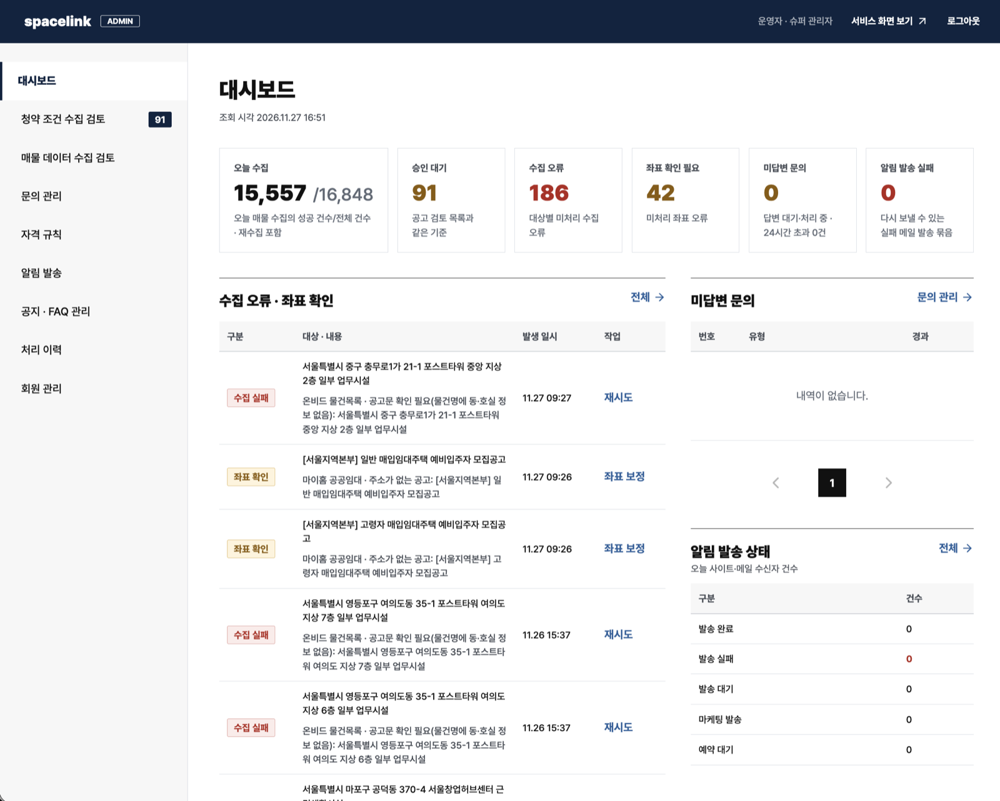
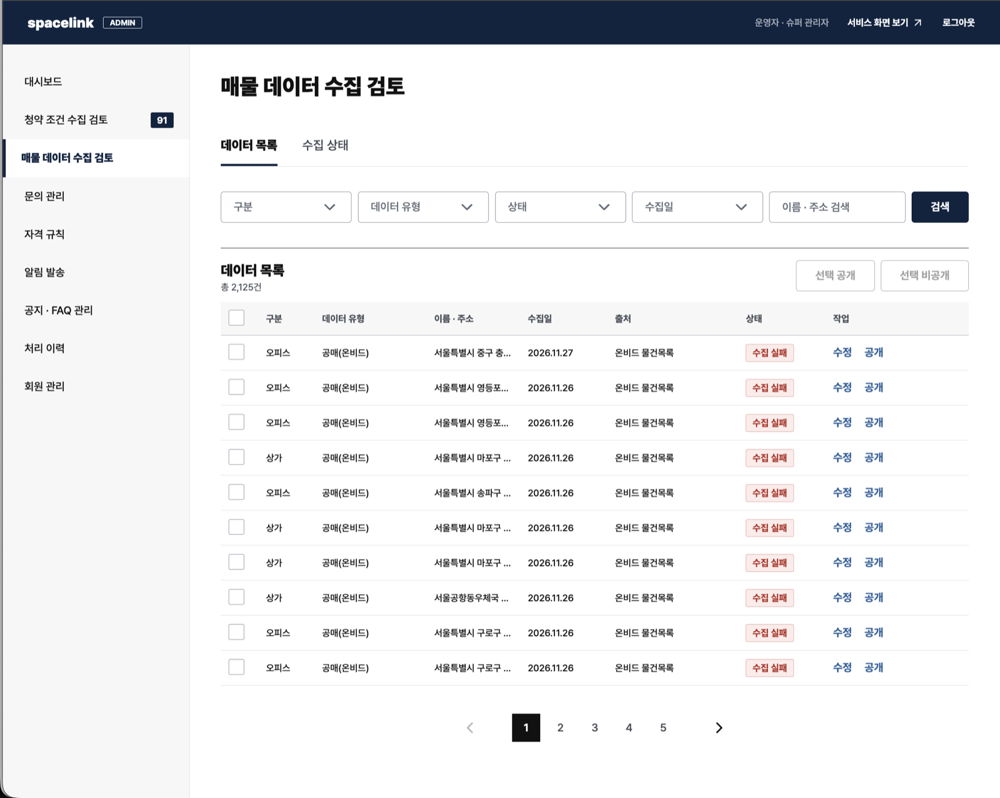
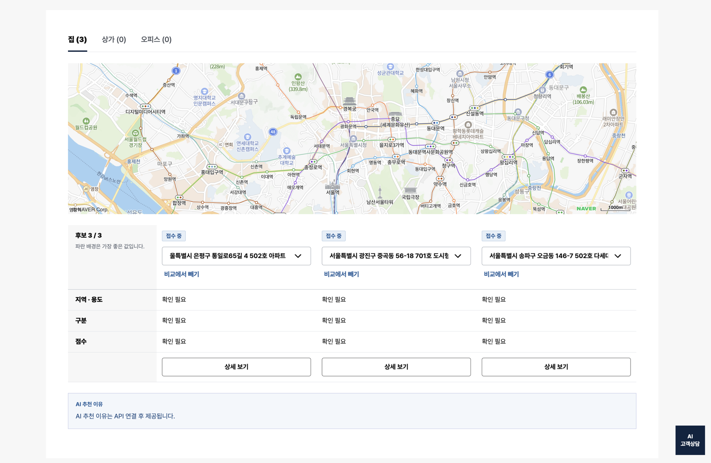

# DAY 102 — SpaceLink 관리자 검토와 매물 비교·문의 기능 보완

> 2026-11-27 · Final Project, React, Spring Boot, Admin Review

오늘은 SpaceLink의 수집 데이터를 관리자가 더 정확하게 검토할 수 있도록 흐름을 보완하고,
매물 비교·고객센터·알림·이용 안내 화면을 실제 서비스 기준에 맞게 정리했다.

> 작업 폴더의 화면 중 결과를 확인하기 좋은 3장만 선별했다. 개발자 도구, 개인 메일·협업 탭,
> 구현 전 메모가 보이는 화면과 프로젝트 원본 파일은 올리지 않았다.

## 1. 관리자 매물 수집·검토

수집 원본과 관리자가 수정한 값을 비교할 수 있도록 검토 화면을 개선했다. 매물 이름·주소·공매
건물 면적을 수정할 수 있고, 수정값을 삭제해 수집 원본으로 되돌릴 수 있도록 했다. 검토 후 저장한
매물만 공개할 수 있도록 공개 기준도 보완했다.

- 공매 가격·입찰 기간·묶인 물건·수집 오류 표시
- 수집 기록 페이지 처리와 오류 집계 기준 정리
- 오늘 갱신된 매물 수와 전체 매물 수를 대시보드에 표시

검토 목록은 필터와 검색을 한 흐름에서 사용할 수 있게 정리하고, 공개 가능한 데이터와 수집 오류가
있는 데이터를 구분해 확인할 수 있도록 했다.

## 2. 매물 비교 기능

매물 상세 API의 실제 응답으로 비교표를 구성하고, 청약 프로필·희망 조건·예상 자격에 맞는 항목을
강조했다. 비교표에서 매물을 선택하면 지도에서도 같은 매물로 이동하도록 연결했으며, 비회원이
접근하면 안내 후 로그인 화면으로 이동하도록 처리했다.

## 3. 고객센터·알림·이용 안내

- 문의 유형을 `서비스 이용`, `계정·탈퇴`로 정리하고 AI 상담 요약에도 같은 기준 적용
- 문의 작성 화면의 관련 공고 선택을 제거하되 기존 문의 데이터는 유지
- 비회원에게 회원 전용 문의 메뉴를 숨기고 직접 접근 시 로그인 안내 표시
- 관리자 답변 저장 시 문의 상태를 자동으로 `답변 완료`로 변경
- 마케팅 수신 동의 회원의 사이트·이메일 알림을 가입 시 활성화
- 제출서류를 공급 유형별로 묶고 공통 서류와 추가 서류를 구분
- 약관에 데이터 출처·제공 기관·갱신 주기를 추가하고 푸터 바로가기 연결

## 검증

- 프론트엔드 테스트 **461개 통과**
- 백엔드 테스트 **556개 통과**
- 프론트엔드 배포 빌드 통과
- DB 선택 실행 테스트 12개는 이번 검증에서 제외

## 남은 작업

- 매물 비교 결과의 AI 추천 문장 생성
- 관리자 검토 화면의 개별 재추출 기능 연결

## 오늘의 정리

- 수집 원본과 관리자 수정값을 분리하면 수정 이력을 확인하면서 안전하게 원본으로 복구할 수 있다.
- 비교표와 지도처럼 같은 대상을 다루는 화면은 선택 상태를 함께 동기화해야 사용 흐름이 자연스럽다.
- 완료 기능, 검증에서 제외한 항목, 남은 작업을 구분해 기록해야 현재 상태를 정확하게 전달할 수 있다.
