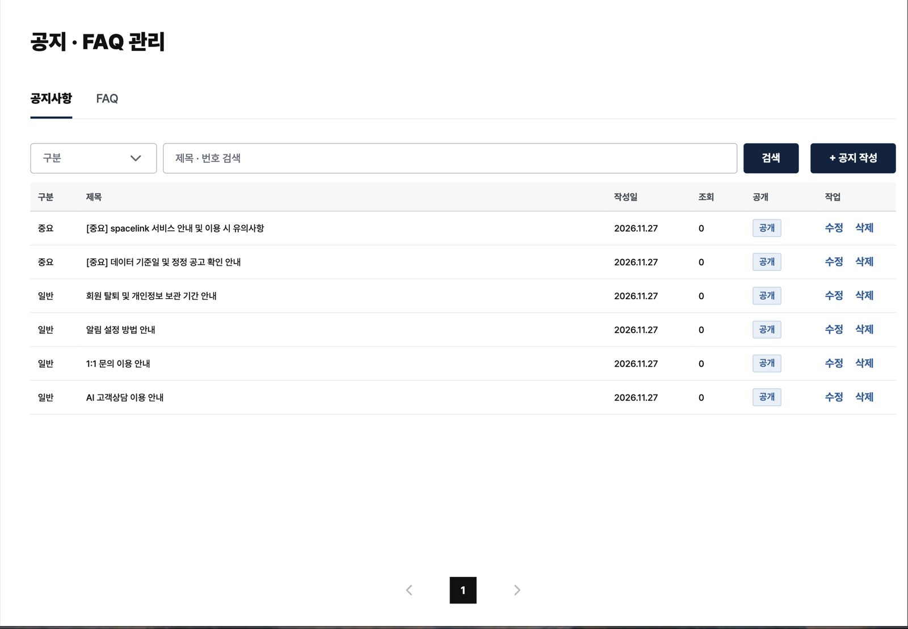

# DAY 103 — SpaceLink 서류 PDF로 청약 프로필 채우기와 메일 발송 복구

> 2026-11-28 · Final Project, Spring Boot, PDFBox, Redis, Bucket4j

오늘은 회원가입 뒤 청약 프로필을 서류 PDF로도 채울 수 있게 하고, 서버가 꺼졌다 켜져도 알림·마케팅 메일이
잘못 나가거나 사라지지 않도록 발송 흐름을 보완했다. 오전에는 AI 고객상담의 요청 제한과 장애 대응을,
오후에는 관리자 화면과 고객센터 화면을 정리했다. 작업 브랜치는 `feature/signup-marketing-notification`이고,
팀장님의 알림 매칭·SSE 작업을 먼저 받아 합친 뒤 `main`에 병합했다.

> 작업 폴더의 화면 중 손글씨 수정 메모, 개발자 도구, 바탕화면이 보이는 화면은 빼고 결과 화면 1장만 올렸다.

## 1. 청약 프로필 — 서류(PDF) 올리기

회원가입 다음 화면에서 청약 프로필을 채우는 방법을 두 가지 중에 고르게 했다.

- 본인인증 (테스트용 가상 응답)
- 서류 PDF 올리기

지원하는 서류는 7종이다.

| 서류 | 채우는 항목 묶음 |
| --- | --- |
| 주민등록표 등본 | 기본 · 거주 |
| 가족관계증명서 · 혼인관계증명서 | 가족 · 세대 |
| 지방세 세목별 과세증명서 | 주택 |
| 소득금액증명 | 소득 (본인 · 배우자) |
| 청약통장 순위확인서 | 청약통장 |
| 청약 당첨사실 조회 | 당첨 이력 |

- **서류 판별**: PDF 첫 몇 줄에서 공백을 뺀 제목 글자로 서류 종류를 찾는다(예: "주민등록표 (등본)" → 주민등록표등본).
- **AI 없이 규칙으로 읽기**: PDFBox로 글자를 뽑은 뒤 서류마다 정한 규칙으로 값을 찾는다. 서류 양식이 정해져 있어서
  AI보다 규칙이 결과가 일정하고 개인정보를 밖으로 보내지 않아도 된다.
- **파일은 남기지 않기**: 올린 파일은 서버에 저장하지 않는다. SHA-256 해시로 같은 파일을 다시 올렸는지만 확인한다.
- **읽은 값은 잠깐만**: AES로 암호화해 세션에 10분 동안만 두고, 사용자가 확인 후 저장하면 프로필에 반영한다.
- **테스트 샘플**: `backend/spacelink-api/src/test/resources/profile-documents/`에 서류별 샘플 PDF와
  값이 빠진 등본처럼 실패를 확인하는 파일을 두었다.

```text
PDF 업로드 → PDFBox 글자 추출 → 제목으로 서류 판별 → 규칙으로 값 찾기
          → SHA-256 중복 확인 → AES 암호화해 세션 10분 보관 → 확인 후 프로필 저장
```

## 2. 서버가 꺼졌다 켜질 때 메일 처리

### 알림 메일

- 보내기 직전에 공고가 아직 유효한지 다시 확인한다. 서버가 꺼진 동안 마감되거나 날짜가 지난 공고 알림은 보내지 않는다.
  - 기준은 알림을 만드는 조건(`NotificationMatchMapper.xml`)과 같게 맞췄다.
    접수 시작은 오늘, 마감 알림은 내일 마감, 당첨 발표는 오늘이다.
  - 두 조건이 따로 놀지 않도록 `NotificationMailMapper.xml`의 `stillValid` 한 곳에 모았다.
- 보낼 메일을 찾는 기간을 1일에서 7일로 늘렸다. 만료된 공고는 `stillValid`가 거르므로 늘려도 지난 알림이 나가지 않는다.
- 서버가 켜질 때 "발송 중"으로 멈춘 기록은 실패로 바꾼다. 관리자 화면에서 다시 보낼 수 있다.

### 마케팅 메일

- 예약을 서버 메모리 대신 Redis에 저장한다. 서버를 다시 켜도 예약이 남는다.
- 예약 시각이 6시간 넘게 지났으면 보내지 않고 "실패(서버 중단)"로 기록한다.
- 여러 명에게 보내다 서버가 꺼지면, 다시 켠 뒤 남은 사람에게 이어 보낸다.
  꺼질 때 보내던 한 명은 같은 광고가 두 번 가지 않도록 실패로 기록한다.

| Redis 키 | 용도 |
| --- | --- |
| `spacelink:marketing:reservations`, `reservation-seq` | 예약 |
| `spacelink:marketing:deliveries`, `delivery-seq` | 발송 진행 상태 |
| `spacelink:marketing:delivery-lease:*` | 지금 보내는 중인 한 명 표시 |

DB 구조와 공통 코드는 바꾸지 않았다. 이번 변경을 처음 배포할 때 그 시점 서버 메모리에 있던 마케팅 예약은
사라진다(한 번만 생기는 일).

## 3. AI 고객상담 보완 (오전)

- 요청 제한을 Bucket4j로 바꾸고, 이용자가 1만 명을 넘으면 혼잡 오류를 돌려준다. 혼잡하면 안내 후 홈으로 보낸다.
- 10분 동안 쓰지 않으면 9분에 미리 알리고 대화를 초기화한다.
- AI가 장애일 때는 가장 가까운 FAQ로 대신 답하고, FAQ와 같은 질문은 AI를 부르지 않고 바로 답한다.
- 참고 FAQ · 바로가기 정확도를 높이고, 답변 본문에 화면 경로가 그대로 보이지 않게 했다.
- 화면: 자주 묻는 질문을 인사말 아래로 옮기고, 대화를 질문마다 묶어 보이게 했다.

## 4. 관리자 · 고객센터 화면 정리

- 알림 발송 내역을 사이트 알림과 이메일 채널로 나눠 본다.
- 대시보드 표, 수집 문제 · 처리 이력 표, 문의 목록은 행을 누르면 상세나 해당 관리 화면으로 이동한다. 긴 글은 말줄임.
- 매물 데이터 목록, 수집 출처 표, 데이터 검토 창을 정리했다.
- 공지 · FAQ 관리와 회원 관리의 작성 · 검색 버튼을 검색 줄로 옮기고 탭 · 검색 줄 · 표 간격을 16px로 맞췄다.
- 문의 관리에 "AI 상담에서 전환" 필터를 추가했다.
- 1:1 문의 상세 답변을 담당자 · 답변 시각이 보이는 댓글 형태로 바꿨다.
- 고객센터 FAQ 첫 질문이 자동으로 펼쳐지지 않게 했다.



## 팀장님께 공유한 것

- 알림 조건을 바꾸면 `NotificationMailMapper.xml`의 `stillValid`도 같이 바꿔야 한다.
- Redis 키를 새로 썼다(위 표).
- 6시간 넘게 늦은 마케팅 예약은 실패로만 기록하고, 실패한 마케팅 메일은 관리자 화면에서 다시 보낼 수 없다.

## 오늘의 정리

- 양식이 정해진 공문서는 AI보다 텍스트 추출 + 규칙이 더 예측 가능하고, 개인정보를 외부로 보내지 않아도 된다.
- 파일 원본을 저장하지 않고 해시로 중복만 확인하면 보관 책임을 줄이면서도 같은 파일 재업로드를 막을 수 있다.
- 예약 · 발송 상태처럼 재시작 뒤에도 이어가야 하는 것은 메모리가 아니라 Redis 같은 외부 저장소에 둬야 한다.
- "보낼 때 다시 확인"을 넣으면 수집 기간을 넉넉히 잡아도 지난 알림이 나가지 않는다. 같은 조건은 한 곳에 모아 둔다.
- 중간에 끊긴 발송은 "다시 보내기"보다 "두 번 보내지 않기"를 먼저 지켜야 한다.
