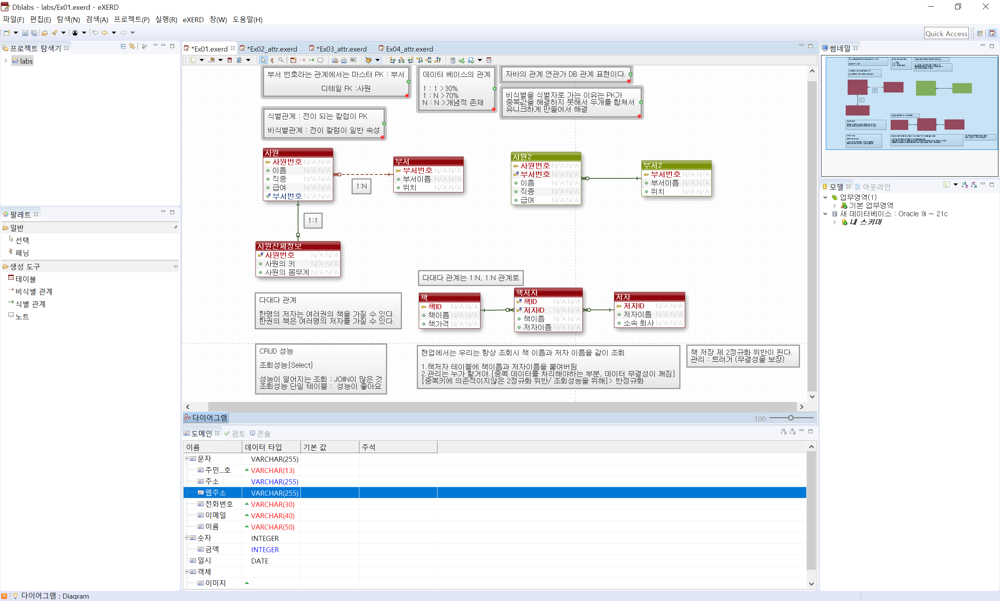
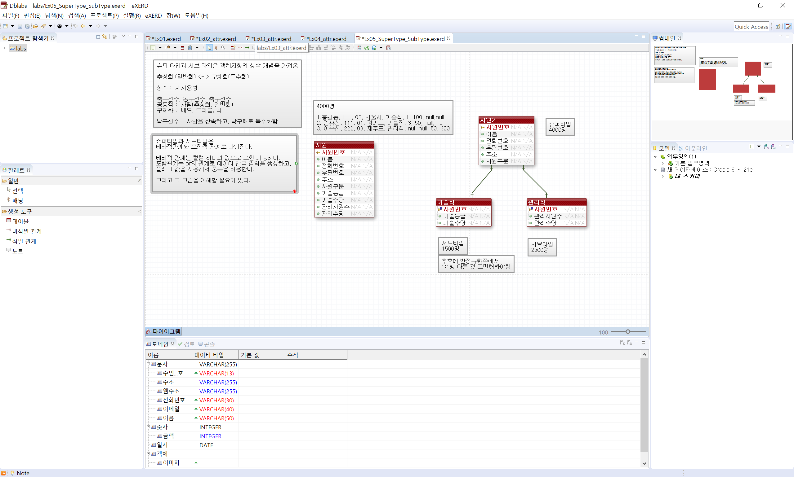
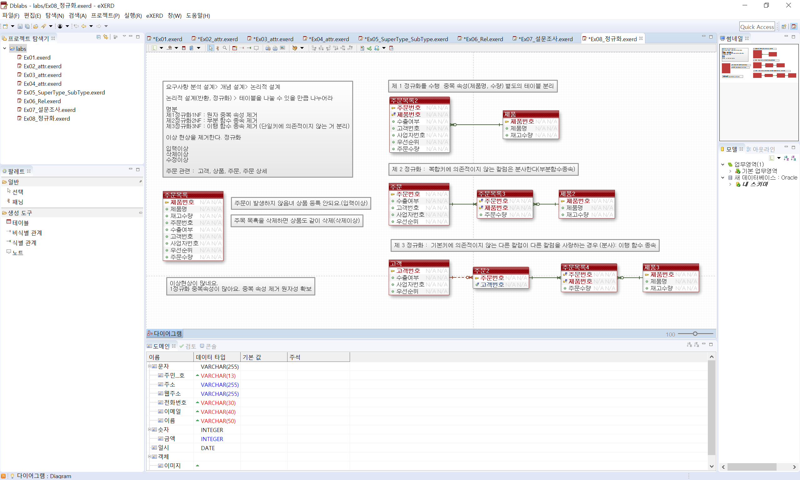
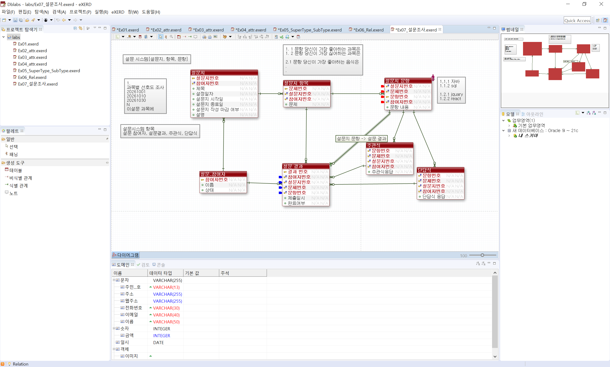
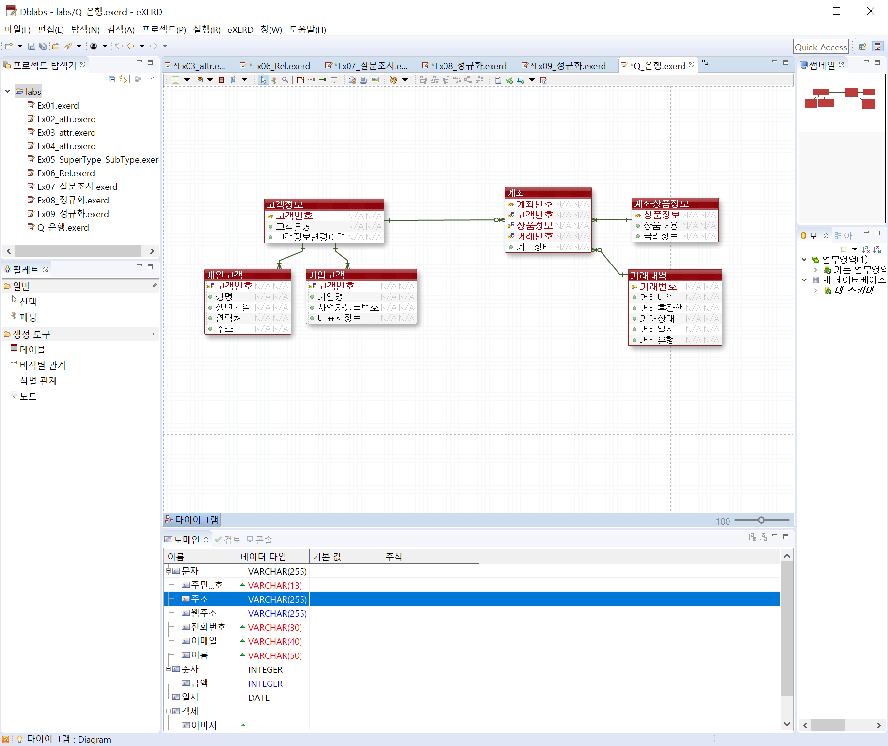

# DAY 75 — 데이터베이스 모델링: 관계·정규화와 설계 패턴

> 2026-10-26 · Database Modeling, eXERD, Normalization, OLTP·OLAP, Design Pattern

오늘은 eXERD로 엔티티·속성·관계를 표현하고, 식별·비식별 관계와 슈퍼타입·서브타입을
모델링했다. 주문·설문·은행 사례를 통해 반복 속성과 함수 종속을 정리하며
제1~제3정규화를 연습했다. 이어 OLTP·OLAP, 대량 데이터 페이징과 객체 생성·처리 흐름을
분리하는 디자인 패턴의 선택 기준을 비교했다.

## 오늘 학습 흐름

```text
요구사항 분석
  ↓
엔티티·속성·관계 도출
  ↓
카디널리티와 식별 관계 결정
  ↓
슈퍼타입·서브타입 및 이력 구조 설계
  ↓
제1~제3정규화로 이상 현상 제거
  ↓
조회 패턴·성능·확장성을 고려해 검토
```

## 1. 데이터베이스 모델링 단계

데이터베이스 모델링은 화면에 보이는 항목을 그대로 테이블로 옮기는 작업이 아니라, 업무 규칙과
데이터의 수명 주기를 구조로 표현하는 과정이다.

| 단계 | 핵심 질문 | 주요 산출물 |
| --- | --- | --- |
| 요구사항 분석 | 어떤 업무와 규칙을 저장해야 하는가? | 요구사항·업무 규칙 |
| 개념적 모델링 | 핵심 대상과 관계는 무엇인가? | 개념 ERD |
| 논리적 모델링 | 속성·식별자·관계를 어떻게 나눌 것인가? | 논리 ERD·정규화 결과 |
| 물리적 모델링 | 실제 DB에서 어떤 타입·키·인덱스를 사용할 것인가? | 테이블·제약조건·인덱스 |

- 엔티티(Entity): 업무에서 관리해야 하는 대상
- 속성(Attribute): 엔티티가 가진 구체적인 정보
- 관계(Relationship): 엔티티 사이의 업무 연결
- 식별자(Identifier): 각 인스턴스를 유일하게 구분하는 값

모델은 정답 하나를 찾는 것보다 예상 데이터량, 조회·변경 빈도, 이력 보존 요구와 확장 가능성을
근거로 선택하고 검증하는 것이 중요하다.

## 2. 관계와 키 설계

### 카디널리티와 선택성

- `1:1`: 한 행이 상대 테이블의 최대 한 행과 연결된다.
- `1:N`: 한 부모가 여러 자식을 가질 수 있고, 자식은 하나의 부모를 참조한다.
- `N:M`: 양쪽 모두 여러 행과 연결되므로 연결 엔티티로 두 개의 `1:N` 관계로 해소한다.
- 필수 관계와 선택 관계를 구분해 외래 키의 `NULL` 허용 여부와 제약조건을 결정한다.

### 식별 관계와 비식별 관계

- 식별 관계에서는 부모의 키가 자식의 기본 키 일부가 된다.
- 비식별 관계에서는 부모 키를 외래 키로만 사용하고 자식은 독립된 기본 키를 가진다.
- 업무적으로 자식의 식별이 부모에 완전히 종속되는지, 키가 지나치게 길어지지 않는지를 함께 본다.



> 실습 검토: 화면의 `책저자` 연결 엔티티에 책 이름과 저자 이름을 함께 저장하면 원본과 값이
> 달라질 수 있다. 연결 엔티티에는 두 엔티티의 식별자를 두고, 이름은 각 원본 엔티티에서
> 조회하는 정규화 구조가 기본이다. 조회 성능 때문에 값을 중복한다면 갱신 규칙까지 정해야 한다.

## 3. 속성과 이력 데이터

속성은 역할에 따라 구분하면 모델의 의미와 관리 기준이 선명해진다.

- 기본 속성: 이름·금액처럼 업무에서 직접 관리하는 값
- 설계 속성: 순번·상태 코드처럼 시스템 운영을 위해 추가한 값
- 파생 속성: 다른 값으로 계산할 수 있는 합계·평균 같은 값

Oracle의 가상 컬럼처럼 계산식을 정의해 조회 시 값을 만들 수도 있지만, 자주 변경되는 계산 결과를
중복 저장하면 원본과 불일치할 수 있다. 반대로 감사·이력 보존이 필요한 데이터는 현재 테이블의
컬럼을 계속 늘리기보다 별도의 이력 엔티티로 분리해 `발생 시점 + 순번 + 변경 내용`을 행으로 남긴다.

예를 들어 고객 방문일시를 `방문일시1`, `방문일시2`처럼 반복 컬럼으로 만들면 방문 횟수가 늘 때마다
스키마를 바꿔야 한다. 방문 엔티티로 분리하면 한 고객의 방문을 필요한 만큼 행으로 추가할 수 있다.

## 4. 슈퍼타입과 서브타입

여러 엔티티의 공통 속성은 슈퍼타입에 두고, 유형별 속성은 서브타입으로 분리할 수 있다. 사원의
공통 정보는 `사원`에 두고 기술직의 등급·수당과 관리직의 관리 인원·수당을 각각 별도 타입으로
관리하는 방식이다.

- 배타적 관계: 하나의 슈퍼타입 인스턴스가 한 서브타입에만 속한다.
- 포괄적 관계: 하나의 인스턴스가 여러 서브타입에 동시에 속할 수 있다.
- 공통 속성을 한곳에 모아 중복을 줄이되, 조회 방식과 유형 변경 가능성까지 고려해야 한다.



> 이 화면은 구조를 바꿔 보던 중간 단계다. 슈퍼타입에 남아 있는 기술직·관리직 전용 속성은
> 각 서브타입으로 옮기고, 서브타입에서는 사원의 식별자를 공유하도록 보완해야 한다.

## 5. 정규화와 이상 현상

정규화는 함수 종속을 기준으로 테이블을 나눠 데이터 중복과 변경 오류를 줄이는 과정이다.

| 단계 | 제거하는 문제 | 핵심 기준 |
| --- | --- | --- |
| 제1정규형(1NF) | 반복 그룹과 다중 값 | 한 칸에는 하나의 원자값만 저장 |
| 제2정규형(2NF) | 부분 함수 종속 | 복합 키의 일부에만 의존하는 속성 분리 |
| 제3정규형(3NF) | 이행 함수 종속 | 기본 키가 아닌 속성 사이의 이행 종속을 분리 |

정규화되지 않은 테이블에서는 다음 이상 현상이 생길 수 있다.

- 삽입 이상: 다른 정보가 없어 필요한 데이터만 추가할 수 없다.
- 갱신 이상: 같은 값을 여러 행에서 수정해야 해 일부 값이 달라진다.
- 삭제 이상: 한 정보를 지우면서 유지해야 할 다른 정보까지 사라진다.

주문 목록을 주문·주문 상세·제품·고객으로 분리하면 중복을 줄이고 각 데이터의 책임을 명확히 할
수 있다. 반정규화는 먼저 정규화한 뒤 실제 조회 성능을 측정하고, 무결성 유지 방법이 있을 때
의도적으로 적용해야 한다.



## 6. OLTP·OLAP와 대량 데이터 페이징

| 구분 | OLTP | OLAP |
| --- | --- | --- |
| 목적 | 일상 업무의 빠른 등록·수정·조회 | 누적 데이터의 집계·분석 |
| 처리 | 짧고 빈번한 트랜잭션 | 넓은 범위의 조회와 통계 |
| 모델 | 무결성과 갱신 효율 중심 | 분석 편의와 조회 성능 중심 |

운영 서버의 대량 통계가 일반 거래에 영향을 주지 않도록 분석용 저장소나 집계 구조를 분리할 수 있다.
통계 기능을 설계할 때는 충분한 양의 테스트 데이터를 준비해 실제 조회 계획과 응답 시간을 확인해야
한다.

Oracle에서 페이지를 나눌 때는 정렬 기준이 항상 같아야 중복·누락을 피할 수 있다.

```sql
SELECT transaction_id, account_id, traded_at, amount
FROM transaction_history
ORDER BY traded_at DESC, transaction_id DESC
OFFSET :offset ROWS FETCH NEXT :page_size ROWS ONLY;
```

- 동률을 구분할 수 있도록 고유한 보조 정렬 키를 함께 사용한다.
- 정렬·검색 조건과 맞는 인덱스가 있는지 실행 계획으로 확인한다.
- 페이지가 깊어질수록 큰 `OFFSET`의 비용이 커질 수 있어 마지막 조회 키를 이용한 방식도 고려한다.

## 7. 템플릿 메서드·팩토리 메서드·추상 팩토리

세 패턴은 모두 변경 지점을 분리하지만 해결하려는 문제가 다르다.

| 패턴 | 고정하는 것 | 바꾸는 것 | 적합한 상황 |
| --- | --- | --- | --- |
| 템플릿 메서드 | 알고리즘의 전체 순서 | 일부 처리 단계 | 결제·배치·문서 변환처럼 흐름이 같은 경우 |
| 팩토리 메서드 | 객체를 사용하는 인터페이스 | 생성할 구체 객체 하나 | 알림 채널·파서·저장소 선택 |
| 추상 팩토리 | 함께 사용하는 제품군의 규칙 | 호환되는 객체 묶음 | DB별 DAO, OS별 UI, 테마 세트 |

템플릿 메서드는 상속을 통해 처리 흐름을 공통화한다. 팩토리 메서드는 호출부가 구체 클래스의 생성에
직접 의존하지 않게 하고, 추상 팩토리는 서로 호환되어야 하는 객체들이 섞이지 않도록 한 묶음으로
생성한다. 실제 설계에서는 공통 처리 순서는 템플릿 메서드로, 단계에서 필요한 객체는 팩토리로
생성하는 식으로 함께 사용할 수 있다.

## 8. 설문과 은행 도메인 모델링 실습

### 설문 시스템

설문지·문항·문항 선택지, 참여자와 설문 결과를 각각 엔티티로 분리했다. 문항 순서나 주관식·단답식
응답처럼 형식에 따라 달라지는 정보도 반복 컬럼이 아니라 관계와 행으로 표현했다.



### 은행 시스템

고객의 공통 정보와 개인·기업 고객의 고유 정보를 슈퍼타입·서브타입으로 나누고, 고객·계좌·상품·
거래 이력의 관계를 초안으로 표현했다. 해지 계좌도 거래 이력과 내부 기록을 보존해야 하므로 물리
삭제보다 상태와 이력으로 관리하는 요구사항을 검토했다.



> 실습 검토: 화면은 완성 모델이 아닌 초안이다. 다음 수정에서는 `거래번호`를 계좌의 식별자에서
> 제외하고, 거래 이력에 `계좌번호` 외래 키를 두어 계좌와 거래를 `1:N`으로 연결해야 한다.

## 공개 전 점검

- 실제 고객 정보·계좌번호·연락처 같은 개인정보 값은 포함하지 않았다.
- 화면에는 실습용 엔티티와 속성 구조만 있으며 계정·비밀번호·접속 정보가 없다.
- 공개용 화면은 다시 저장하고 로컬 파일의 확장 속성을 정리했다.
- 내부 내용을 완전히 검토하기 어려운 eXERD 바이너리 원본과 원문 메모는 공개하지 않았다.

## 오늘의 정리

- 업무 규칙을 엔티티·속성·관계와 카디널리티로 옮기는 과정을 연습했다.
- 식별·비식별 관계와 슈퍼타입·서브타입의 선택 기준을 비교했다.
- 반복 컬럼과 함수 종속을 찾아 제1~제3정규형으로 분리했다.
- OLTP와 OLAP의 목적을 구분하고 대량 조회에서 안정적인 페이징 기준을 정리했다.
- 처리 절차와 객체 생성 책임에 따라 세 가지 디자인 패턴을 구분했다.
- 설문과 은행 요구사항을 ERD로 표현하며 이력 보존과 확장성을 고려했다.
