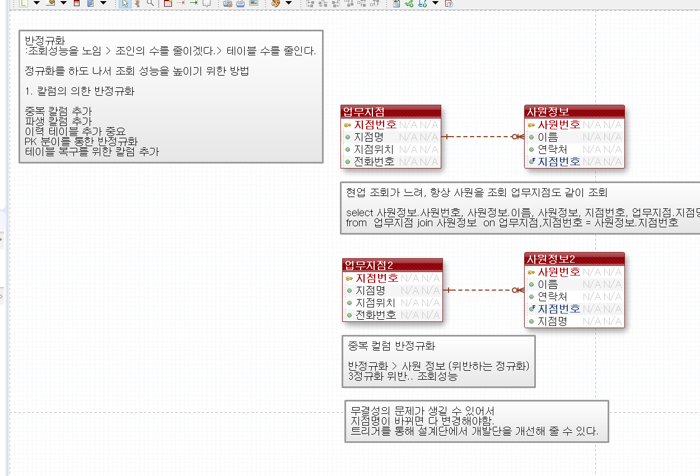
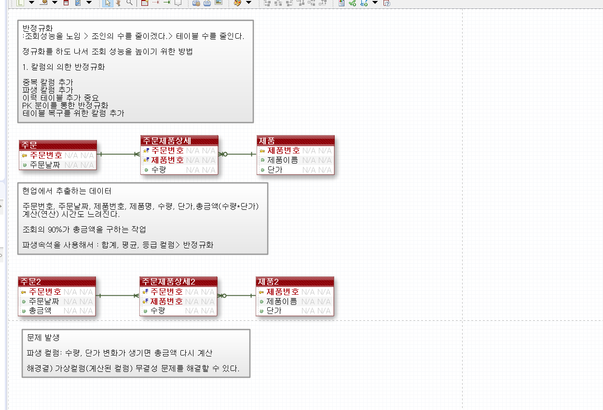
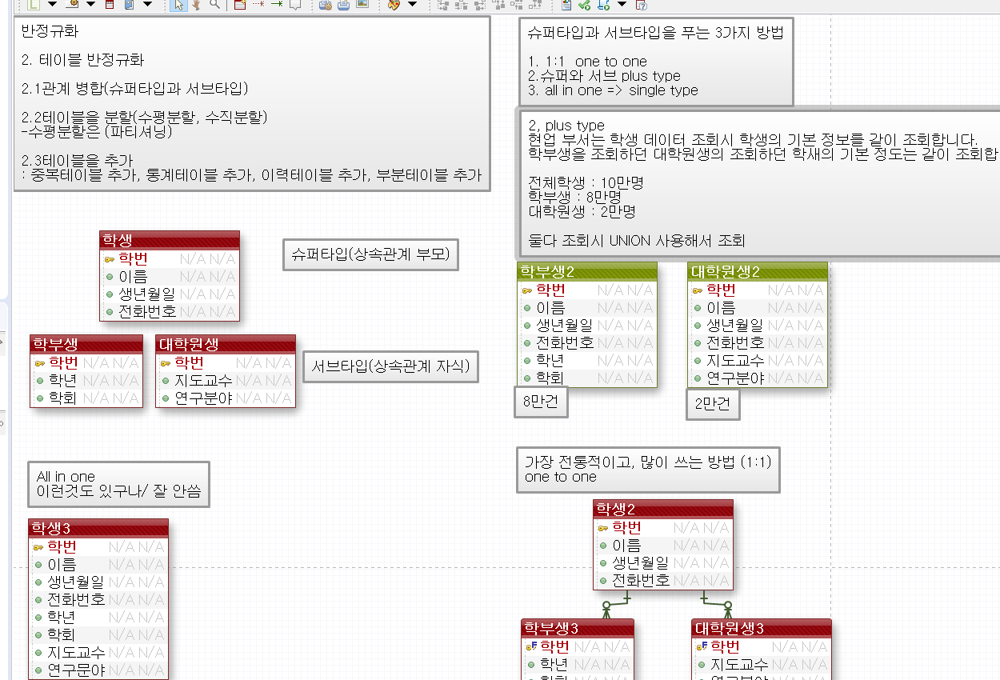
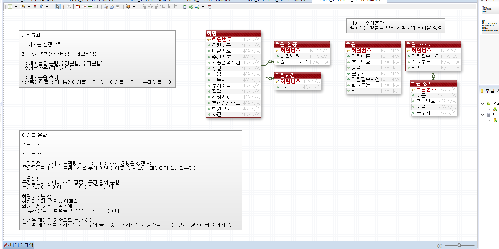
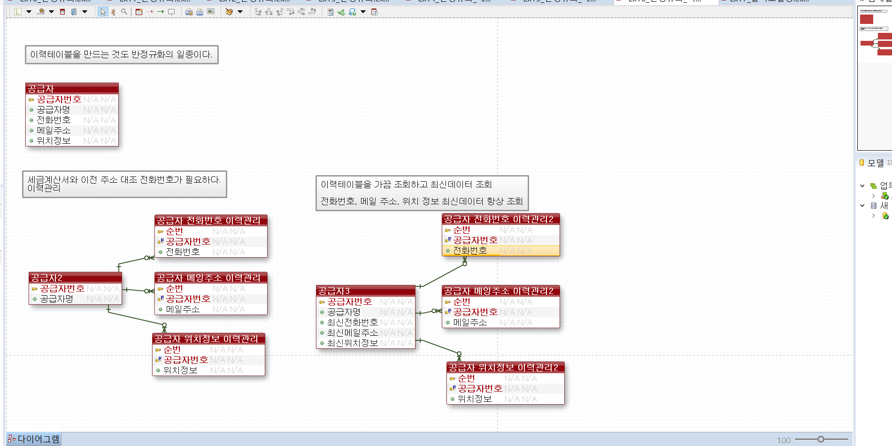
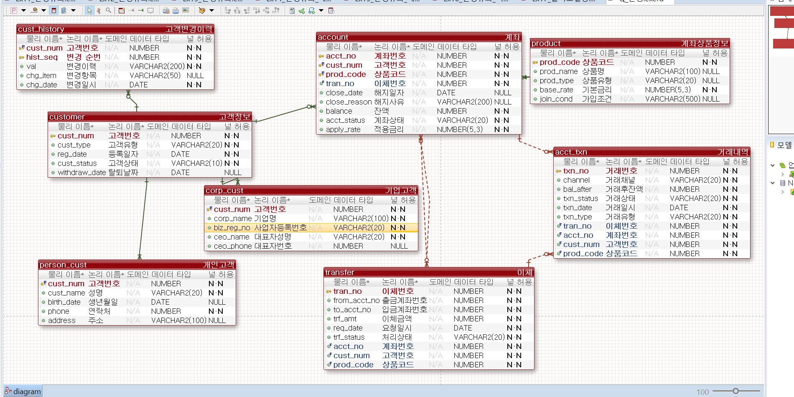

# DAY 76 — 데이터베이스 설계 심화: 반정규화와 물리 모델링

> 2026-10-27 · Denormalization, Physical Modeling, Oracle SQL, UML

오늘은 정규화된 논리 모델을 바탕으로 조회 성능과 운영 편의를 높이기 위한 반정규화 방법을
실습했다. 중복·파생 컬럼, 슈퍼타입·서브타입의 테이블 구현, 테이블 분할과 이력 테이블을 비교하고,
각 선택이 데이터 정합성과 변경 비용에 미치는 영향도 함께 살펴봤다. 이어 eXERD 모델을 물리
모델로 구체화하며 키·제약조건·인덱스·파티션을 확인하고, UML과 CRUD 매트릭스의 역할을 정리했다.

## 오늘 학습 흐름

```text
정규화된 논리 모델 확인
  ↓
조회 패턴과 성능 문제 분석
  ↓
반정규화 방법과 정합성 유지 방안 선택
  ↓
물리명·자료형·키·제약조건·인덱스 결정
  ↓
SQL과 DB 객체로 구현·확인
```

## 1. 반정규화의 목적과 전제

반정규화는 정규화를 되돌리는 작업 자체가 목적이 아니다. 정규화된 모델에서 반복되는 조인이나
집계가 실제 병목으로 확인됐을 때, 조회 성능 또는 운영 편의를 위해 중복을 의도적으로 허용하는
설계 선택이다.

| 방법 | 기대 효과 | 함께 관리할 위험 |
| --- | --- | --- |
| 중복 컬럼 추가 | 반복 조인 감소 | 원본과 복사 값의 불일치 |
| 파생 컬럼 추가 | 집계·계산 비용 감소 | 원본 값 변경 시 재계산 필요 |
| 테이블 병합 | 조회 경로 단순화 | `NULL` 증가와 유형별 규칙 약화 |
| 테이블 분할 | 필요한 행·컬럼만 접근 | 조회 시 결합과 라우팅 로직 증가 |
| 조회용 이력 구조 추가 | 변경 추적과 최신 값 조회 용이 | 원본·이력의 기준과 보관 정책 필요 |

적용 전후의 쿼리 비용을 측정하고, 트리거·애플리케이션 로직·배치 중 어떤 방식으로 중복 값을
동기화할지 먼저 정해야 한다.

## 2. 중복 컬럼과 파생 컬럼

사원 목록을 조회할 때마다 업무 지점과 조인해야 한다면 사원 테이블에 지점명을 중복해서 둘 수
있다. 조회는 단순해지지만 지점명이 바뀔 때 모든 중복 값도 함께 변경해야 한다.



주문 총액처럼 `수량 × 단가`로 계산되는 값도 파생 컬럼으로 저장할 수 있다. 계산이 매우 자주
반복될 때는 도움이 되지만, 수량이나 단가가 바뀌면 총액도 같은 트랜잭션에서 갱신해야 한다.



## 3. 슈퍼타입·서브타입의 테이블 구현

논리 모델의 상속 구조를 물리 테이블로 옮기는 방법은 조회 방식과 데이터 분포에 따라 달라진다.

| 방식 | 구조 | 특징 |
| --- | --- | --- |
| 슈퍼타입 + 서브타입 | 공통 테이블과 유형별 테이블을 `1:1`로 연결 | 중복이 적지만 조회 시 조인이 필요 |
| 서브타입별 통합 | 각 유형 테이블에 공통 속성도 저장 | 유형별 조회가 단순하지만 공통 속성이 중복 |
| 전체 통합 | 모든 유형을 한 테이블과 구분자로 관리 | 구조가 단순하지만 사용하지 않는 컬럼이 늘 수 있음 |



## 4. 수평·수직 분할

- 수평 분할: 기간·지역·상태처럼 행의 조건을 기준으로 나눈다.
- 수직 분할: 자주 사용하는 컬럼과 크거나 드물게 사용하는 컬럼을 분리한다.

회원의 로그인 정보, 사진, 상세 정보를 분리하면 핵심 목록 조회에서 읽는 데이터 크기를 줄일 수
있다. 반면 여러 조각을 한 번에 조회할 때는 다시 조인해야 하므로 실제 접근 패턴을 기준으로
결정해야 한다.



## 5. 이력 테이블과 그룹별 최신 데이터

전화번호·이메일·위치처럼 값의 변경 과정을 보존해야 한다면 현재 테이블에 과거 컬럼을 계속
추가하기보다 이력 테이블로 분리한다. 이력에는 대상 식별자와 순번 또는 적용 기간을 두고, 최신
값을 빠르게 찾을 수 있는 인덱스도 함께 검토한다. 이력 테이블은 일반적인 이력 모델링일 수도
있으며, 조회 편의를 위해 원본과 중복된 최신·요약 이력을 추가할 때 반정규화의 성격을 갖는다.



직원별 가장 최근 등록 차량 한 대를 찾는 실습에서는 분석 함수로 그룹 안의 순서를 매겼다.

```sql
SELECT 차량번호, 연식, 차종, 등록일자, 직원번호
FROM (
    SELECT 차량번호,
           연식,
           차종,
           등록일자,
           직원번호,
           ROW_NUMBER() OVER (
               PARTITION BY 직원번호
               ORDER BY 등록일자 DESC, 차량번호 DESC
           ) AS rn
    FROM 차량테이블
)
WHERE rn = 1;
```

- `PARTITION BY 직원번호`는 직원별로 순위를 다시 시작한다.
- `rn = 1`은 그룹별 최신 한 건이며, 상위 N건은 `rn <= N`으로 확장한다.
- 등록일자가 같을 때도 결과가 일정하도록 고유한 보조 정렬 기준을 둔다.

## 6. 복합키와 대체키

연결 엔티티에서 두 업무 식별자의 조합이 한 번만 존재하고 안정적이라면 복합키를 기본 키로 사용할
수 있다. 반복 이력이 있거나 독립적인 식별이 필요하면 별도의 순번 대체키를 두고, 중복을 막아야
하는 원래 업무 키 조합에는 `UNIQUE` 제약조건을 적용할 수 있다.

키를 선택할 때는 다음을 함께 확인한다.

- 업무 식별자가 변경될 가능성
- 다른 테이블에서 참조하는 빈도와 키 길이
- 중복을 막아야 하는 업무 규칙
- 조인·인덱스 크기와 입력 성능

## 7. 재귀 관계와 셀프 조인

조직도·카테고리·직원 상하 관계처럼 한 엔티티가 같은 엔티티의 다른 행을 참조하면 재귀 관계로
모델링한다. 테이블에는 상위 행의 키를 가리키는 자기 참조 외래 키를 두고, 셀프 조인이나 계층형
쿼리로 탐색한다.

Redis 같은 캐시는 자주 읽는 계층 결과를 빠르게 제공할 수 있지만, 재귀 관계의 원본 구조와
무결성을 대신하지는 않는다. 먼저 관계형 모델을 정확하게 설계한 뒤 측정 결과에 따라 캐시를
추가해야 한다.

## 8. UML과 CRUD 매트릭스

### UML 기초

- 유스케이스 다이어그램: 사용자와 시스템 기능의 범위를 표현한다.
- 시퀀스 다이어그램: 객체·컴포넌트 사이의 호출을 시간 순서로 표현한다.
- 클래스 다이어그램: 클래스의 속성·행위와 상속·연관 관계를 표현한다.

### CRUD 매트릭스

CRUD 매트릭스는 업무 프로세스를 행, 엔티티 또는 테이블을 열에 두고 `Create`, `Read`, `Update`,
`Delete` 관계를 표시한다. 요구사항에서 빠진 데이터 처리, 사용되지 않는 엔티티, 한 기능에 몰린
책임을 확인하는 데 활용할 수 있다.

## 9. 논리 모델에서 물리 모델로

물리 모델링에서는 논리 이름을 실제 DB 객체로 바꾸고 다음 항목을 결정한다.

- 테이블·컬럼의 물리명과 자료형
- `NULL` 허용 여부와 기본값
- 기본 키·외래 키·고유 키와 검사 제약조건
- 시퀀스·Identity 등 식별자 생성 방식
- 조회 조건과 정렬에 맞는 인덱스
- 데이터량과 관리 주기를 고려한 파티션

은행 예제에서는 고객·개인/기업 고객·계좌·상품·거래·이체·변경 이력의 관계에 Oracle 자료형과
키를 적용한 물리 모델 초안을 만들었다. 화면의 고객번호·계좌번호 등은 컬럼 구조이며 실제 고객
값은 포함하지 않았다.



> 실습 검토: 화면은 완성본이 아닌 초안이다. 계좌와 거래의 참조 방향, 거래 테이블에 중복된
> 고객·상품 키의 필요성, 이체의 출금·입금 계좌 외래 키를 다음 단계에서 다시 검증해야 한다.

범위 파티션은 키의 구간에 따라 데이터를 나눠 관리하는 물리 설계 방법이다.

```sql
CREATE TABLE sales (
    sales_no      NUMBER,
    sales_year    NUMBER,
    customer_name VARCHAR2(30),
    price          NUMBER
)
PARTITION BY RANGE (sales_no) (
    PARTITION sales_p1 VALUES LESS THAN (3),
    PARTITION sales_p2 VALUES LESS THAN (5),
    PARTITION sales_p3 VALUES LESS THAN (MAXVALUE)
);
```

`VALUES LESS THAN`의 상한값은 해당 파티션에 포함되지 않는다. 검색 조건에 파티션 키가 포함되면
필요한 파티션만 읽는 파티션 프루닝을 기대할 수 있지만, 파티션이 모든 쿼리를 자동으로 빠르게
만드는 것은 아니다. 파티션은 반정규화와 다른 물리 저장 전략이므로 데이터 분포와 운영 기준을
근거로 별도 판단한다.

## 다음 학습 계획

React에서 서버 데이터를 다루기 위해 JavaScript 비동기 처리의 `Promise`, `async/await`,
`fetch`, Axios를 추가로 공부할 예정이다. 이 항목은 오늘 완료한 실습이 아니라 다음 학습 주제로
구분했다.

## 공개 전 점검

- 비밀번호·토큰·접속 주소가 보이는 연결 설정 화면은 제외했다.
- 실제 개인정보나 계좌 값 없이 엔티티·컬럼 구조만 담긴 화면을 선택했다.
- 공개용 이미지는 필요한 모델 영역만 잘라 다시 저장했다.
- 내부 검토가 어려운 eXERD 바이너리 원본과 원문 메모는 공개하지 않았다.

## 오늘의 정리

- 반정규화는 측정된 조회 문제와 정합성 유지 방안을 함께 고려해야 한다.
- 중복·파생 컬럼, 테이블 병합·분할, 이력 테이블의 장단점을 비교했다.
- `ROW_NUMBER()`로 그룹별 최신 행과 상위 N건을 구분했다.
- 복합키·대체키, 재귀 관계, UML과 CRUD 매트릭스의 역할을 정리했다.
- 논리 모델에 자료형·키·제약조건·인덱스·파티션을 적용해 물리 모델로 구체화했다.
