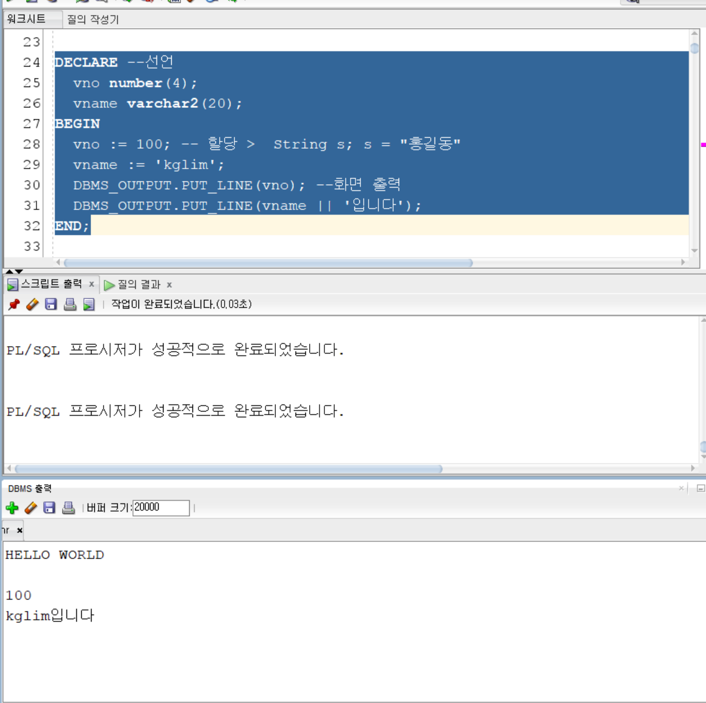
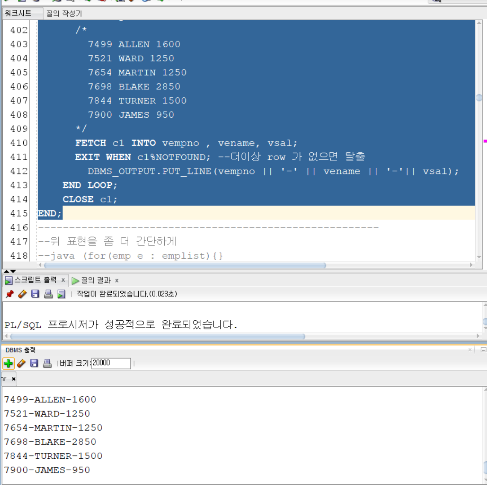
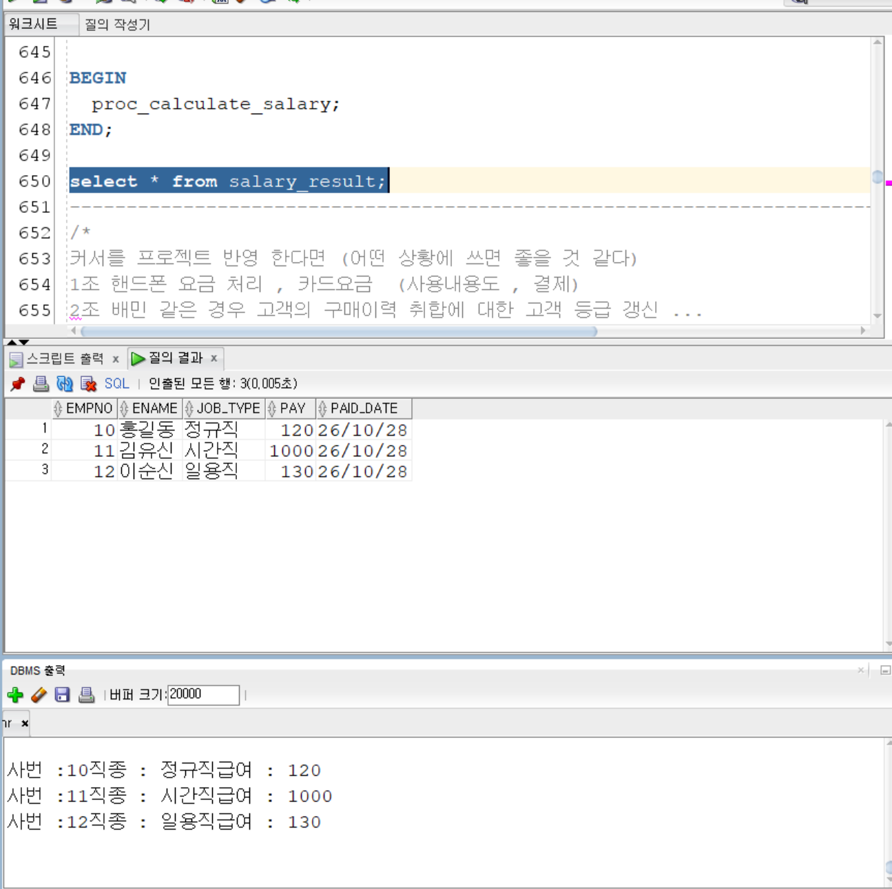
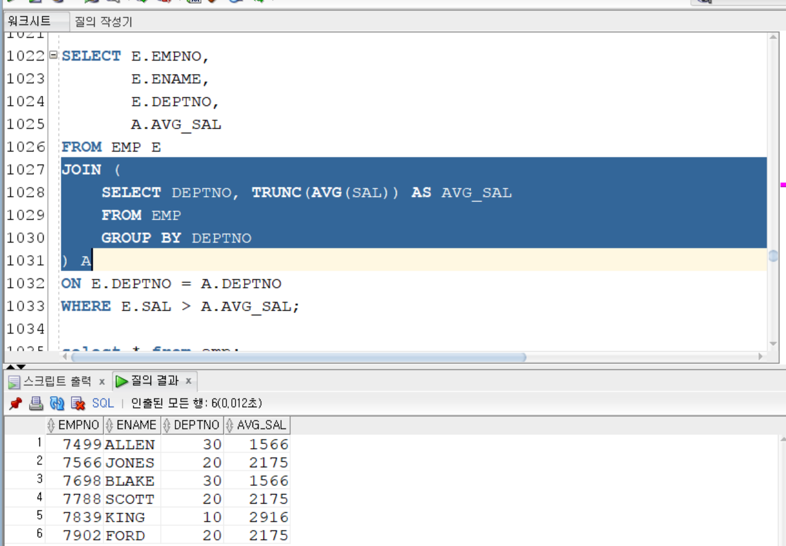
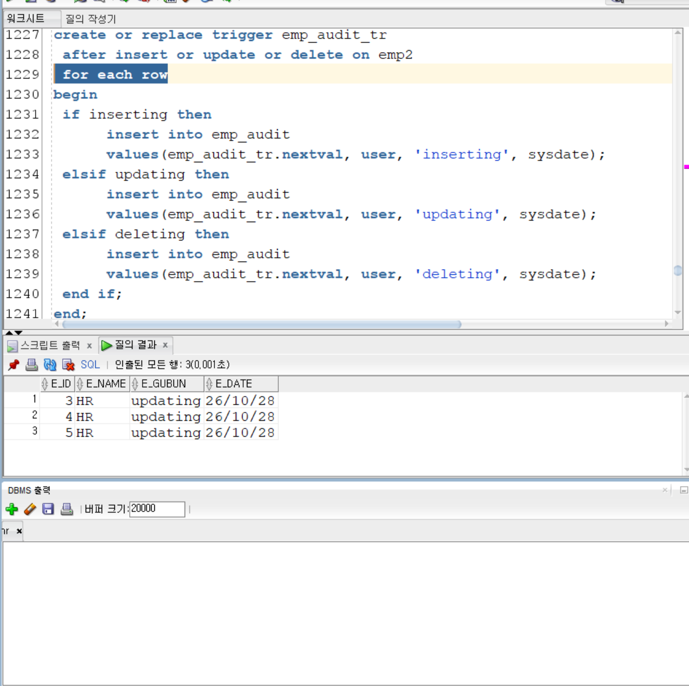
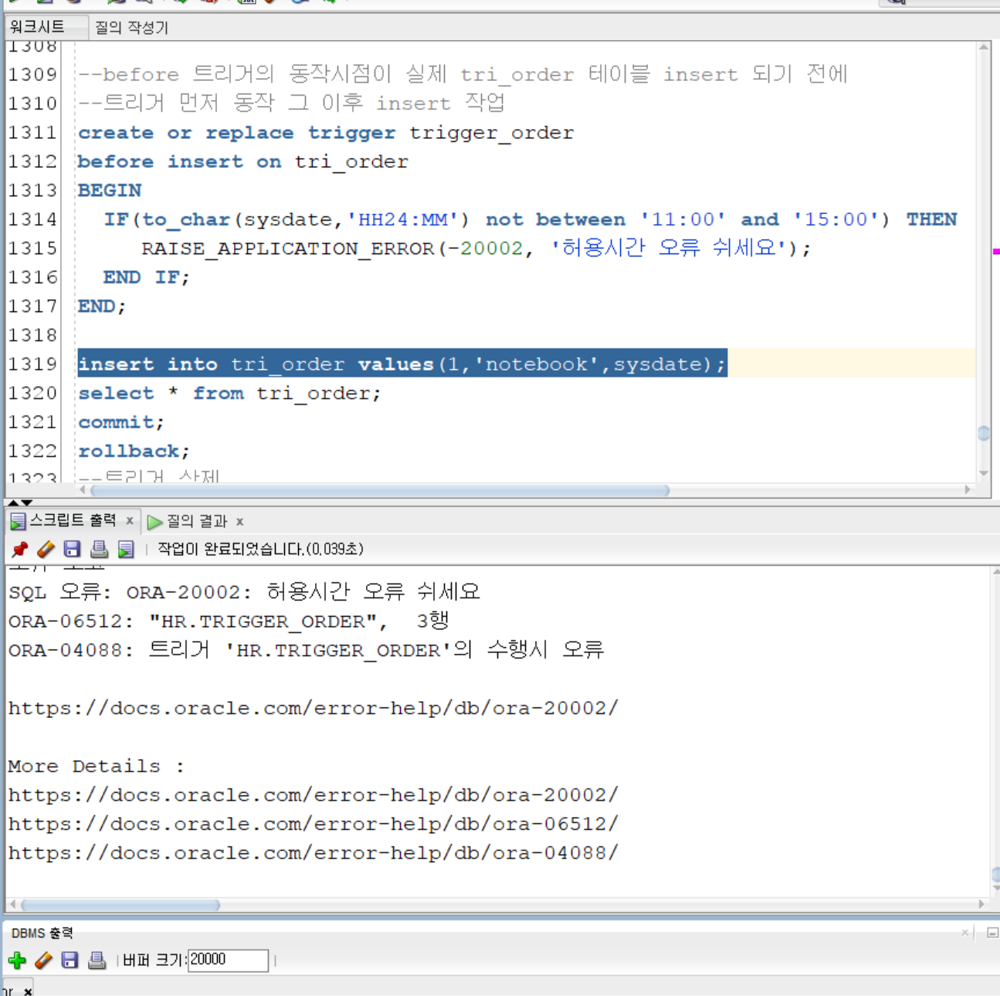

# DAY 77 — Oracle PL/SQL: 커서·프로시저·트리거 실습

> 2026-10-28 · Oracle PL/SQL, Cursor, Procedure, Function, Trigger

오늘은 SQL Developer의 `hr` 접속에 준비된 `EMP`, `DEPT`와 실습용 테이블을 사용해
Oracle PL/SQL을 연습했다. 익명 블록에서 변수와 제어문을 다룬 뒤, 여러 행을 순서대로
처리하는 커서, 재사용할 수 있는 프로시저·함수, DML 이벤트에 자동으로 반응하는 트리거까지
실행 결과를 확인했다.

> 이번 실습의 `hr`는 접속 이름이다. Oracle 표준 HR 샘플 스키마의 `EMPLOYEES`,
> `DEPARTMENTS`가 아니라, 해당 접속에 별도로 준비된 `EMP`, `DEPT` 실습 테이블을 사용했다.

## 오늘 학습 흐름

```text
PL/SQL 블록·변수
  ↓
조건문·반복문·예외 처리
  ↓
명시적 커서로 여러 행 처리
  ↓
프로시저·함수로 로직 저장
  ↓
트리거로 검증·감사 작업 자동화
```

## 1. PL/SQL 블록과 변수

PL/SQL은 SQL에 변수, 조건문, 반복문과 예외 처리를 더한 Oracle의 절차형 언어다. 기본
블록은 선언부, 실행부, 예외 처리부로 나뉘며 선언부와 예외 처리부는 필요할 때만 작성한다.

```sql
DECLARE
    v_empno EMP.EMPNO%TYPE;
    v_ename EMP.ENAME%TYPE;
BEGIN
    SELECT EMPNO, ENAME
      INTO v_empno, v_ename
      FROM EMP
     WHERE EMPNO = 7788;

    DBMS_OUTPUT.PUT_LINE(v_empno || ' / ' || v_ename);
EXCEPTION
    WHEN NO_DATA_FOUND THEN
        DBMS_OUTPUT.PUT_LINE('조회 결과가 없습니다.');
END;
/
```

- `%TYPE`은 테이블 컬럼의 자료형을 변수에 그대로 연결한다.
- `%ROWTYPE`은 한 행의 전체 컬럼 구조를 레코드 변수로 가져온다.
- `SELECT ... INTO`는 기본적으로 정확히 한 행을 기대한다.
- `&empno` 같은 표기는 PL/SQL 매개변수가 아니라 SQL Developer가 실행 전에 값을 바꾸는
  대체 변수다.
- `DBMS_OUTPUT.PUT_LINE`의 결과는 DBMS 출력 창에서 확인한다.



## 2. 조건문과 반복문

조회한 부서번호나 급여를 변수에 담아 `IF`, `ELSIF`, `ELSE`와 `CASE`로 분기했다. 반복
처리에서는 기본 `LOOP`, `WHILE`, `FOR`와 `EXIT WHEN`, `CONTINUE`의 동작을 비교했다.

```sql
DECLARE
    v_total NUMBER := 0;
BEGIN
    FOR i IN 1..100 LOOP
        v_total := v_total + i;
    END LOOP;

    DBMS_OUTPUT.PUT_LINE('1부터 100까지의 합: ' || v_total);
END;
/
```

`CASE`는 한 값을 여러 조건으로 분류할 때 읽기 쉬웠고, `FOR` 반복문은 반복 횟수가 정해진
누적 계산을 간결하게 표현할 수 있었다.

## 3. 여러 행을 처리하는 커서

일반적인 `SELECT INTO`는 한 행을 변수에 담지만, 커서는 여러 행을 한 행씩 가져와 각각 다른
처리를 할 수 있다. 명시적 커서는 다음 순서로 사용했다.

```text
CURSOR 선언 → OPEN → FETCH → 종료 조건 확인 → CLOSE
```

```sql
DECLARE
    v_empno EMP.EMPNO%TYPE;
    v_ename EMP.ENAME%TYPE;
    v_sal   EMP.SAL%TYPE;

    CURSOR c_emp IS
        SELECT EMPNO, ENAME, SAL
          FROM EMP
         WHERE DEPTNO = 30;
BEGIN
    OPEN c_emp;
    LOOP
        FETCH c_emp INTO v_empno, v_ename, v_sal;
        EXIT WHEN c_emp%NOTFOUND;
        DBMS_OUTPUT.PUT_LINE(v_empno || ' - ' || v_ename || ' - ' || v_sal);
    END LOOP;
    CLOSE c_emp;
END;
/
```



커서 `FOR` 반복문을 사용하면 Oracle이 열기·가져오기·닫기를 자동으로 처리한다.

```sql
BEGIN
    FOR employee IN (
        SELECT EMPNO, ENAME, SAL
          FROM EMP
         WHERE DEPTNO = 20
    ) LOOP
        DBMS_OUTPUT.PUT_LINE(employee.EMPNO || ' / ' || employee.ENAME);
    END LOOP;
END;
/
```

따라서 커서 `FOR` 반복문 안에서는 별도의 `FETCH`, `%NOTFOUND`, `CLOSE`가 필요하지 않다.
명시적 커서는 가져오는 시점을 직접 제어해야 할 때, 커서 `FOR` 반복문은 전체 결과를 순차
처리할 때 적합하다.

### 커서 속성

| 속성 | 의미 |
| --- | --- |
| `%ROWCOUNT` | 지금까지 가져오거나 최근 SQL로 처리된 행 수 |
| `%FOUND` | 최근 작업에서 행을 찾았으면 `TRUE` |
| `%NOTFOUND` | 더 이상 가져올 행이 없으면 `TRUE` |
| `%ISOPEN` | 명시적 커서가 열려 있는지 확인 |

## 4. 예외 처리와 트랜잭션

PL/SQL 블록의 `EXCEPTION` 영역에서 조회 결과와 실행 오류를 구분해 처리했다.

- `NO_DATA_FOUND`: `SELECT INTO` 결과가 없는 경우
- `TOO_MANY_ROWS`: 한 행을 기대했지만 여러 행이 반환된 경우
- `OTHERS`: 앞에서 처리하지 않은 예외
- `SQLCODE`, `SQLERRM`: 오류 번호와 메시지 확인
- `RAISE_APPLICATION_ERROR`: `-20000`부터 `-20999` 범위의 사용자 정의 오류 발생

프로시저나 트리거 안의 DML도 같은 트랜잭션에 참여한다. 오류가 발생하면 관련 작업을 함께
되돌릴 수 있으므로 `COMMIT`과 `ROLLBACK`의 위치를 업무 단위에 맞게 결정해야 한다.

## 5. 커서와 저장 프로시저

프로시저는 반복해서 사용할 로직을 데이터베이스 객체로 저장해 이름으로 호출하는 기능이다.
`IN` 매개변수로 값을 받고 `OUT` 매개변수로 처리 결과를 돌려줄 수 있다.

실습에서는 고용 형태별 계산 규칙을 커서로 적용한 뒤, 계산 결과를 `SALARY_RESULT` 테이블에
저장하는 프로시저를 작성했다. 정규직·시간직·일용직 계산식은 PL/SQL 흐름을 익히기 위한
교육용 예제이며 실제 급여 규칙을 의미하지 않는다.

```sql
BEGIN
    PROC_CALCULATE_SALARY;
END;
/

SELECT EMPNO, ENAME, JOB_TYPE, PAY, PAID_DATE
  FROM SALARY_RESULT;
```



프로시저는 여러 SQL을 한곳에 모아 재사용하고 애플리케이션과 데이터베이스 사이의 왕복을 줄일
수 있다. 권한을 프로시저 단위로 제한하는 설계도 가능하지만, 프로시저를 사용한다고 보안이나
성능이 자동으로 해결되는 것은 아니므로 실행 계획·권한·트랜잭션을 함께 검토해야 한다.

## 6. 사용자 정의 함수와 인라인 뷰

사용자 정의 함수는 매개변수를 받아 하나의 값을 반환한다. 부서별 최고 급여나 사번에 해당하는
부서명을 반환하는 함수를 만들고, 일반 Oracle 함수처럼 `SELECT`에서 호출했다.

인라인 뷰 실습에서는 부서별 평균 급여를 먼저 계산한 뒤 사원 테이블과 조인해, 자신이 속한
부서의 평균보다 높은 급여를 받는 사원을 조회했다.

```sql
SELECT E.EMPNO,
       E.ENAME,
       E.DEPTNO,
       A.AVG_SAL
  FROM EMP E
  JOIN (
        SELECT DEPTNO, TRUNC(AVG(SAL)) AS AVG_SAL
          FROM EMP
         GROUP BY DEPTNO
       ) A
    ON E.DEPTNO = A.DEPTNO
 WHERE E.SAL > A.AVG_SAL;
```



함수를 행마다 호출하면 데이터가 많을 때 비용이 커질 수 있으므로, 조인·인라인 뷰와 함수 중
어떤 방식이 적합한지는 실행 계획과 실제 처리량으로 판단해야 한다.

## 7. 트리거로 감사 이력과 입력 규칙 처리

트리거는 특정 테이블에서 `INSERT`, `UPDATE`, `DELETE`가 발생할 때 자동으로 실행되는 저장
프로그램이다.

| 구분 | 동작 |
| --- | --- |
| `BEFORE` | 원래 DML이 실행되기 전에 값이나 조건을 검사 |
| `AFTER` | 원래 DML이 성공한 뒤 후속 작업 수행 |
| 문장 레벨 | DML 문장 한 번에 한 번 실행 |
| `FOR EACH ROW` | 영향을 받은 각 행마다 실행 |

행 레벨 트리거에서는 `:OLD`와 `:NEW`로 변경 전후 값을 확인한다.

| DML | `:OLD` | `:NEW` |
| --- | --- | --- |
| `INSERT` | 없음 | 삽입될 값 |
| `UPDATE` | 변경 전 값 | 변경 후 값 |
| `DELETE` | 삭제 전 값 | 없음 |

### 행 단위 감사 이력

`EMP2`의 입력·수정·삭제를 감지해 작업 종류와 실행 사용자, 시간을 감사 테이블에 기록했다.
`FOR EACH ROW`를 사용하자 한 문장으로 여러 사원이 수정됐을 때 변경된 행 수만큼 이력이
생성되는 것을 확인했다.



### 입력 전 검증

`BEFORE INSERT` 트리거로 주문 허용 시간을 검사하고, 조건을 만족하지 않으면
`RAISE_APPLICATION_ERROR`로 입력을 중단하는 흐름을 확인했다. 다만 화면의 포맷 모델
`HH24:MM`에서 `MM`은 월을 뜻하므로, 분 단위 비교를 하려면 `HH24:MI`로 수정해야 한다.
화면의 `ORA-20002`는 트리거가 입력을 차단한 결과이며, 포맷 모델은 복습 과정에서 바로잡았다.



트리거 내부 작업은 원래 DML과 같은 트랜잭션에서 실행된다. 숨은 부작용, 실행 순서, 락과
롤백 범위가 복잡해질 수 있으므로 자동화가 꼭 필요한 규칙에 제한하고 로직을 문서화해야 한다.

## 실습하며 바로잡은 점

- `SELECT INTO`는 한 행을 기대하므로 0건과 여러 건을 각각 예외 처리한다.
- SQL Developer의 `&변수`와 프로시저의 `IN` 매개변수는 서로 다른 기능이다.
- 커서 `FOR` 반복문은 커서를 자동으로 닫으므로 다시 `CLOSE`하지 않는다.
- Oracle 날짜 포맷에서 월은 `MM`, 분은 `MI`이므로 시간 비교에는 `HH24:MI`를 사용한다.
- 프로시저 실행을 반복해도 결과가 중복되지 않도록 키와 처리 기준일을 설계해야 한다.
- 트리거가 별도의 락을 무조건 거는 것이 아니라, 트리거의 SQL이 원래 DML과 같은 트랜잭션에서
  필요한 락을 사용하고 실패 시 함께 롤백된다.

## 공개 전 점검

- 원본 TXT와 SQL 전체는 강의 스크립트 성격의 대량 코드이므로 공개하지 않았다.
- 실행 화면은 코드·결과 영역만 남기고 접속 목록과 시스템 사용자 목록을 잘랐다.
- 비밀번호·토큰·접속 문자열·IP·로컬 경로가 없는지 확인했다.
- 공개용 이미지는 다시 저장해 파일 메타데이터를 최소화했으며, 로컬 확장 속성은 Git에
  포함되지 않는다.

## 오늘의 정리

- PL/SQL 블록에서 변수·조건문·반복문·예외 처리를 실행했다.
- 명시적 커서와 커서 `FOR` 반복문의 차이를 이해했다.
- 커서 로직을 프로시저에 저장하고 `IN`·`OUT` 매개변수의 역할을 확인했다.
- 사용자 정의 함수와 인라인 뷰로 조회 로직을 재사용하고 조합했다.
- 문장·행 레벨 트리거, `BEFORE`·`AFTER`, `:OLD`·`:NEW`의 차이를 실습했다.
