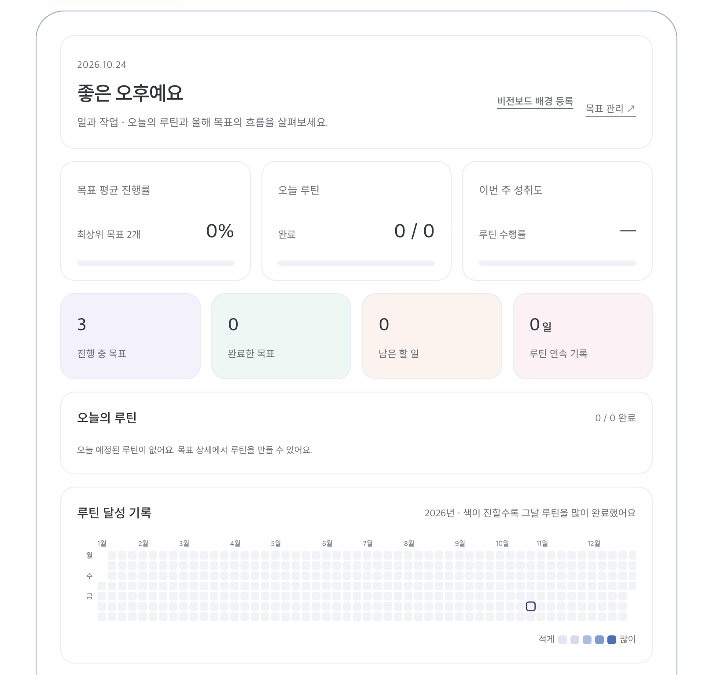
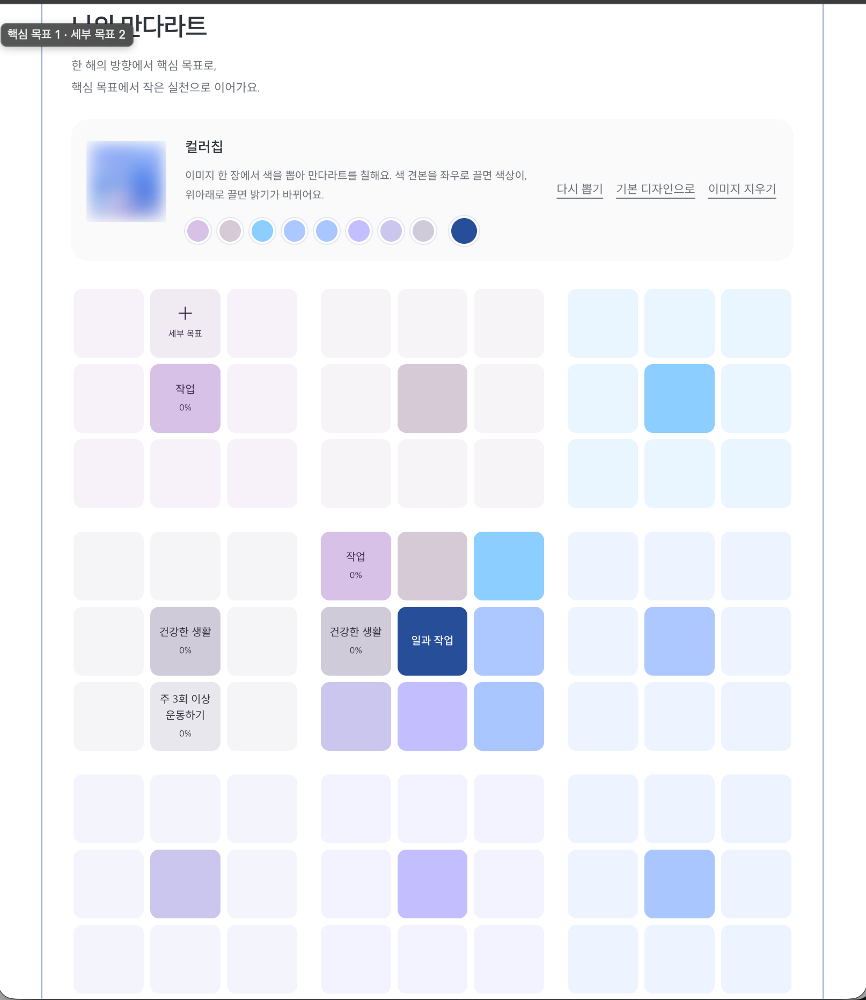

# DAY 74 — 개인 프로젝트 고도화: 목표 관리 UI와 케어 사용 통계

> 2026-10-24 · Personal Project, Spring Boot, Security, UI, MySQL, Testing

오늘은 별도의 수업 없이 각자 개인 작업을 진행했다. 비공개 개인 프로젝트에 실제로 푸시한
변경을 기준으로, 목표·루틴 관리 프로젝트의 공통 오류 처리와 로그인 보안·코드 품질·데스크톱
화면을 다듬었다. 생활 관리 프로젝트에서는 기능 중심의 MVC 구조를 정리하고 제품의 사용 과정을
기록하는 케어 기능과 사용 통계 화면·API를 확장했다.

텍스트 작업 요약은 오늘 푸시한 주요 변경을 기준으로 작성했고, 이미지는 오늘의 작업 결과를
기록하기 위해 직접 제공한 화면만 첨부했다. 공개 일지에는 비공개 저장소의 이름과 링크, 원본 코드,
내부 파일 경로와 환경 설정값을 넣지 않았다.

## 오늘 작업의 큰 흐름

```text
목표·루틴 관리 프로젝트
공통 오류 처리·로그인 보안 → 코드 포맷 자동화 → 데스크톱 UI 개선

생활 관리 프로젝트
기능 중심 MVC 정리 → 케어 기록 확장 → 사용 통계 구현 → 테스트 보강
```

## 1. 목표·루틴 관리 프로젝트 품질과 UI 개선

### 공통 처리와 로그인 보안

- 반복되는 코드를 줄이기 위해 Lombok을 적용하고 모델 코드를 정돈했다.
- API 오류 응답 형식을 통일하고, 프론트엔드에서도 오류 메시지를 일관되게 보여주도록 공통 처리를
  정리했다.
- 반복 로그인 실패를 제한하고 세션·보안 헤더·CSRF 기본 동작을 확인하는 테스트를 보강했다.
- 실제 제한 횟수나 보안 설정값은 공개하지 않고 구현 목적과 검증 항목만 기록했다.

### 코드 포맷과 데스크톱 화면

- 프론트엔드에는 Prettier, 백엔드에는 Spotless를 연결해 코드 형식을 자동으로 맞췄다.
- 화면의 여백·줄 간격·글자 간격을 조정해 정보의 위계를 더 쉽게 파악하도록 했다.
- 넓은 화면에서 카드와 콘텐츠가 지나치게 퍼지지 않도록 데스크톱 레이아웃의 폭과 배치를 다듬었다.
- 포맷 도구 적용 커밋은 기능 변경보다 코드 스타일을 일관되게 유지하는 데 목적이 있다.

### 오늘 작업 화면 기록

목표 진행률, 오늘의 루틴, 주간 성취도와 연간 루틴 기록을 한 화면에서 확인할 수 있는 대시보드를
점검했다. 정보 카드와 기록 영역의 간격을 통일해 현재 상태를 빠르게 읽을 수 있도록 구성했다.



핵심 목표를 세부 목표로 나누는 만다라트 화면에서는 이미지에서 추출한 색을 보드에 적용하는 흐름과
목표 카드의 시각적 구분을 확인했다.



## 2. 기능 중심 MVC 구조로 재정리

기존 코드를 기술 계층만으로 나누는 대신, 서로 관련된 화면·업무 규칙·데이터 접근 코드를 기능별로
가까이 모았다. 각 기능 안에서 `Controller → Service → Repository`의 책임은 유지하고, 여러 기능이
함께 사용하는 보안·이미지·설정 코드는 공통 영역으로 분리했다.

- Controller: 요청을 받고 입력값을 확인한 뒤 Service에 전달
- Service: 사용 주기 변경, 통계 계산과 같은 업무 규칙 처리
- Repository: 회원이 소유한 데이터만 조회·저장하도록 DB 접근 담당
- Model·DTO: 저장할 데이터와 요청·응답 형태 구분
- Common: 보안 설정, 이미지 저장처럼 여러 기능이 공유하는 코드 관리

기능 단위로 코드를 찾기 쉬워졌고, 케어 기능을 수정할 때 다른 영역까지 확인해야 하는 범위를 줄일
수 있었다. 구조를 옮기는 과정에서는 기존 주소와 동작이 바뀌지 않도록 관련 참조와 테스트 위치도
함께 정리했다.

## 3. 제품 사용 과정을 기록하는 케어 기능

제품을 단순히 보유 목록에 저장하는 데서 끝내지 않고, 실제로 언제 사용을 시작하고 어떤 경험을
했는지 시간의 흐름에 따라 남길 수 있도록 확장했다.

### 사용 주기

```text
사용 전 → 사용 중 ⇄ 일시 중단 → 사용 완료
                         └──────→ 중도 중단
```

- 구매일·개봉일·사용 시작일과 종료일 기록
- 사용 중단·재개·완료 등 상태 변경과 타임라인 관리
- 구매 가격, 구매 장소, 최종 만족도와 재구매 의향 기록
- 본인 데이터만 조회·수정할 수 있도록 소유권 확인
- 오래된 화면의 값으로 새 변경을 덮어쓰지 않도록 수정 충돌 확인

### 평가·반응·루틴

- 첫인상·사용 중·최종 단계별로 만족도와 장단점 기록
- 사용 중 경험한 반응의 종류·강도·발생일과 해결 여부 기록
- 아침·저녁 등 반복 사용하는 제품 순서를 루틴으로 구성
- 실제로 수행한 루틴과 사용한 제품을 별도 기록으로 보존
- 오늘 해야 할 기록과 최근 활동을 한 화면에서 확인
- 달력에서 날짜별 평가·반응·루틴 실행 내역 확인

## 4. 의류와 구매 후보 관리 보완

기존 의류 관리 영역도 실제 사용 기록을 남길 수 있도록 함께 보완했다.

- 옷을 입은 날짜와 메모를 등록·수정·삭제
- 최근 착용일과 일정 기간 기록이 없는 항목을 기준으로 필터링
- 사진 주소 입력과 로그인 회원 전용 로컬 이미지 업로드 지원
- 구매 후보의 진행 상태, 검색 조건과 관리 이력 보강
- 구매 후보와 저장된 스타일 취향을 비교하는 화면 연결
- 관리 예정 항목의 필터와 수정 흐름 정리

## 5. 기록을 활용하는 케어 사용 통계

기록 기능을 만든 뒤에는 기존 데이터를 다시 활용할 수 있도록 개인 통계 화면과 JSON API를
추가했다. 통계를 위해 같은 데이터를 중복 저장하는 테이블을 새로 만들기보다, 로그인한 회원의
기존 사용 기록을 조회해 필요한 값을 계산하도록 구성했다.

| 통계 | 확인할 수 있는 내용 |
| --- | --- |
| 상태 요약 | 사용 전·사용 중·중단·완료 등 상태별 사용 주기 수 |
| 사용 기간 | 다 쓴 제품을 실제로 사용한 평균 일수 |
| 1일 사용 비용 | 구매 가격을 사용 일수로 나눈 참고 비용 |
| 만족도 | 기록된 최종 평가의 평균과 표본 수 |
| 재구매 | 재구매 의향과 같은 제품을 다시 사용한 기록 |
| 중도 중단 | 완료 전에 그만둔 비율과 주요 사유 |
| 제품 종류 | 종류별 사용 주기·기간·비용·만족도 요약 |
| 반응 기록 | 사용자가 남긴 반응 종류별 횟수 |

```text
1일 사용 비용 = 구매 가격 ÷ (사용 종료일 - 사용 시작일 + 1일)
```

통계 숫자가 실제 의미보다 크게 해석되지 않도록 다음 기준도 화면에 함께 안내했다.

- 표본이 적으면 평균값은 참고용으로만 본다.
- 일시 중단 기간도 전체 사용 기간에 포함한다.
- 반응 기록은 사용자의 경험을 센 값이며 특정 제품과의 인과관계를 증명하지 않는다.
- 기록이 없는 값은 0으로 단정하지 않고 집계 대상에서 구분한다.

## 6. 검증한 내용

### 목표·루틴 관리 프로젝트

- 공통 오류 응답과 화면 오류 메시지 처리 확인
- 로그인 반복 실패 제한과 세션·보안 헤더·CSRF 기본 동작 테스트
- Prettier·Spotless를 통한 프론트엔드·백엔드 형식 검사

### 생활 관리 프로젝트

- 빈 기록·기간 계산·반올림·정렬·표본 제한을 서비스 단위 테스트로 확인
- 로그인하지 않은 요청 차단과 본인 기록만 집계되는지 확인
- 화면 출력 시 사용자 입력이 HTML로 실행되지 않도록 이스케이프 확인
- 페이지와 JSON 응답이 같은 통계 결과를 제공하는지 웹 계층 테스트
- 실제 MySQL 검증은 임시 데이터를 트랜잭션 안에서 만들고 종료 후 롤백

## 공개 전 보안 점검

- 비공개 원본 저장소의 이름·주소와 커밋 링크를 공개하지 않았다.
- 원본 Java·HTML·SQL 코드와 내부 파일 구조를 복사하지 않았다.
- 로컬 사용자 경로, 환경 변수명·값, DB 접속 정보와 테스트 계정을 제외했다.
- 첨부 화면에서 개인정보·인증정보·내부 주소가 보이지 않는지 확인했다.
- 이미지 파일은 설명형 영문 이름으로 저장하고 불필요한 메타데이터를 제거했다.
- 일지를 작성하면서 비공개 프로젝트 저장소에는 어떠한 변경도 하지 않았다.
- 텍스트에는 오늘 푸시한 변경만 정리하고, 이미지는 별도의 작업 화면 기록으로 구분했다.

## 오늘의 정리

- 공통 오류 처리와 로그인 보안 테스트를 보강하고 코드 포맷을 자동화했다.
- 목표·루틴 대시보드와 만다라트 보드의 데스크톱 UI를 정돈했다.
- 기능 중심 구조로 패키지를 재정리해 관련 코드의 응집도와 탐색성을 높였다.
- 제품의 사용 시작부터 평가·반응·루틴·종료까지 이어지는 기록 흐름을 구성했다.
- 의류 착용과 구매 후보 관리 기능을 실제 사용 기록 중심으로 보완했다.
- 쌓인 기록에서 사용 기간·비용·만족도·재구매와 중단 사유를 확인하는 통계를 구현했다.
- 단위·웹·DB 테스트를 나눠 주요 기능과 데이터 격리를 확인했다.
