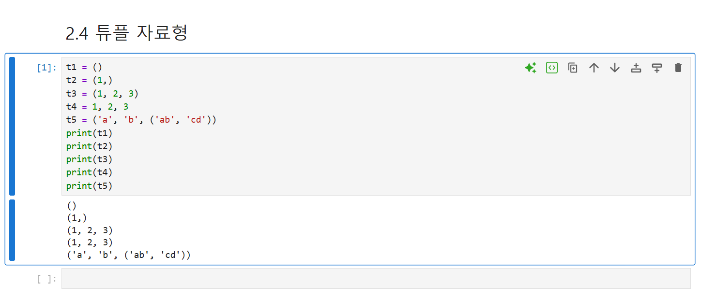
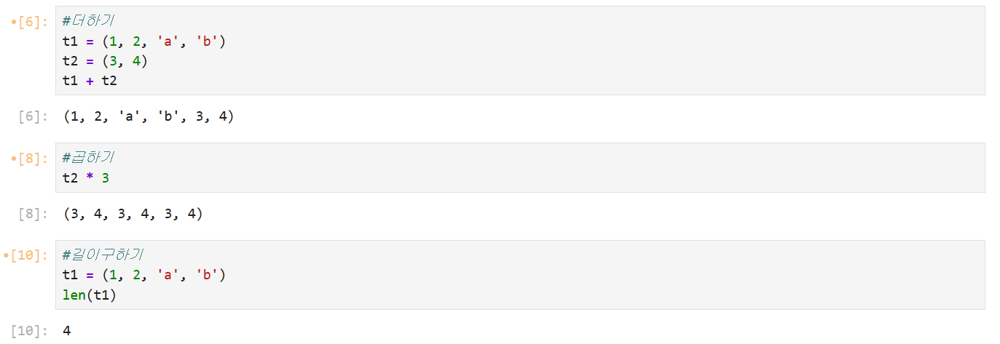
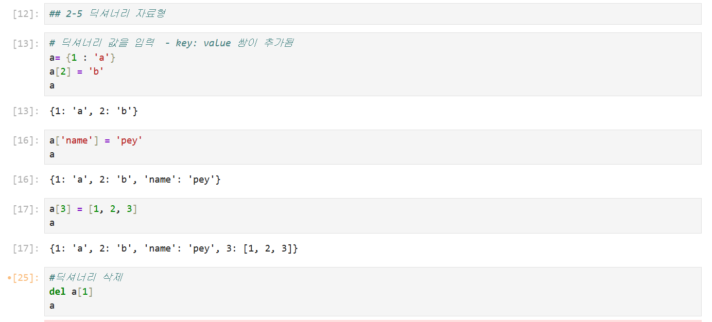
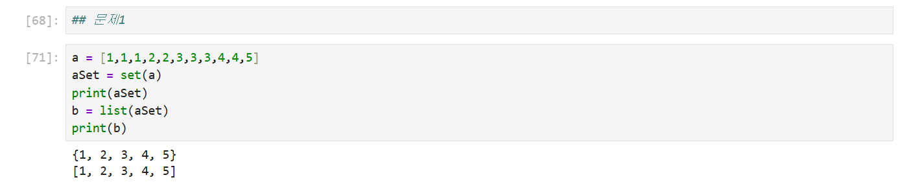
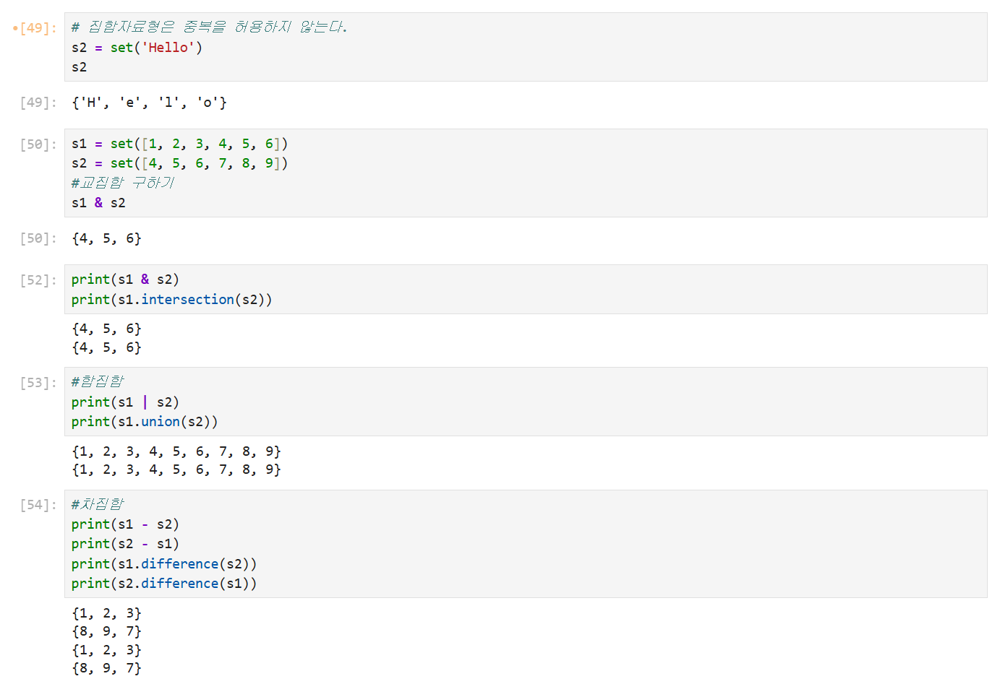
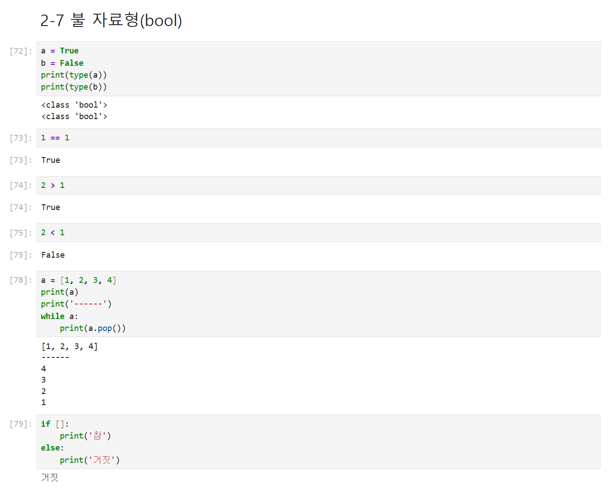
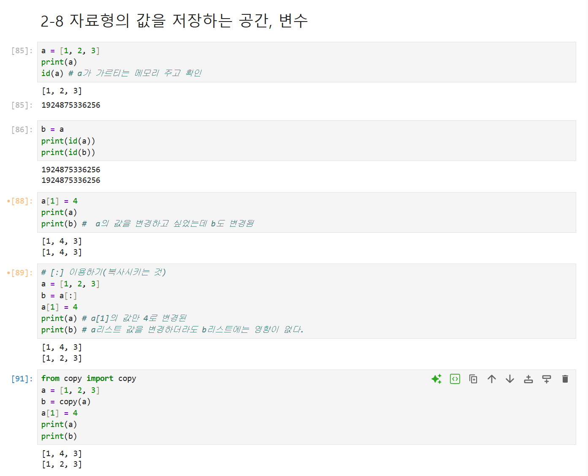
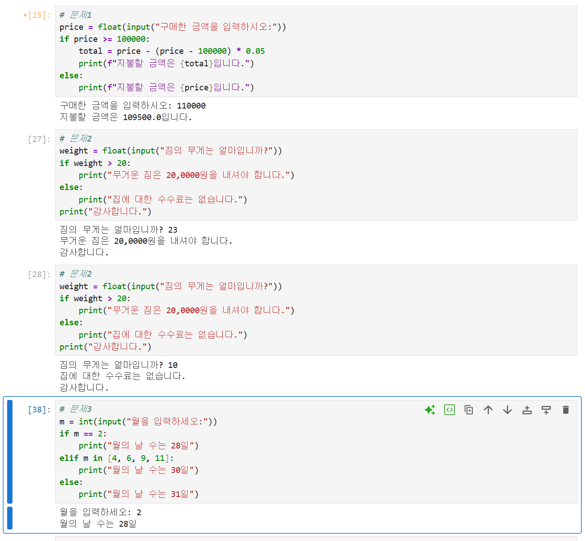

# DAY 63 — CBTfy 최종 발표와 Python 자료형·조건문 기초

> 2026-10-12 · CBTfy 발표, Python, tuple, dictionary, set, bool, 변수, if문

오늘은 미니프로젝트 II에서 완성한 CBTfy 서비스를 최종 발표했다. 프로젝트의 문제 풀이와
AI 복습 흐름, 설계와 구현 과정, 성능 개선 및 배포 경험을 팀원들과 함께 설명했다. 발표를
마친 뒤에는 Python의 튜플·딕셔너리·집합·불 자료형을 학습하고 변수의 참조와 복사, 조건문을
직접 실행하며 익혔다.

## 1. CBTfy 최종 발표

CBTfy는 정보처리기사 필기·실기 문제를 시험 모드와 학습 모드로 풀고, 오답·헷갈림·메모를
AI 복습에 활용하는 학습 서비스다. 최종 발표에서는 다음 내용을 중심으로 프로젝트 전 과정을
정리했다.

- 문제 풀이, 학습 기록과 AI 복습으로 이어지는 서비스 흐름
- React·TypeScript 프론트엔드와 Spring Boot 백엔드의 연결 구조
- 필기·실기 문제의 공통 응시 구조와 유형별 채점 규칙
- 답안 저장 충돌 처리와 반복 조회·대량 등록 성능 개선
- AI 프롬프트 비교 검증과 GitHub Actions 기반 CI/CD
- 개발 DB와 운영 DB의 적용 순서, 배포 후 점검 항목과 후속 과제

내가 담당한 학습 홈·응시·채점 흐름, Google 계정 연결과 Drive 내보내기, 초기 학습 표시와
반응형 화면도 역할 분담과 함께 소개했다. 기능 구현뿐 아니라 어떤 문제를 발견했고 어떻게
검증했는지를 설명하면서 프로젝트의 설계 의도를 다시 정리할 수 있었다.

## 2. 튜플 자료형

튜플은 여러 값을 순서대로 저장하지만 생성한 뒤에는 요소를 변경하거나 삭제할 수 없는
자료형이다. 괄호를 생략해도 튜플을 만들 수 있으며, 요소가 하나뿐인 튜플은 값 뒤에 쉼표를
붙여야 한다.

```python
empty = ()
one = (1,)
numbers = (1, 2, 3)
mixed = 1, 2, "Python"
```



튜플도 인덱싱과 슬라이싱을 사용할 수 있다. 두 튜플을 `+`로 연결하거나 `*`로 반복하면
원본을 바꾸지 않고 새로운 튜플을 만든다.

```python
left = (1, 2, "a", "b")
right = (3, 4)

print(left[0])       # 1
print(left[2:])      # ('a', 'b')
print(left + right)  # (1, 2, 'a', 'b', 3, 4)
print(right * 3)     # (3, 4, 3, 4, 3, 4)
```



## 3. 딕셔너리 자료형

딕셔너리는 `key: value` 쌍으로 데이터를 저장한다. 키는 중복될 수 없으며 같은 키에 값을
다시 대입하면 기존 값이 바뀐다. 키를 이용한 조회와 추가·수정·삭제를 직접 실습했다.

```python
student = {
    "number": "1000",
    "name": "이코사",
    "major": "인공지능학과",
}

student["grade"] = 1
student["major"] = "전자공학과"
print(student.get("major"))
del student["grade"]
```

`keys()`, `values()`, `items()`로 키와 값 또는 전체 쌍을 확인하고, `in`으로 특정 키의 존재
여부를 검사할 수 있다. `get()`은 키가 없어도 오류 대신 `None`이나 지정한 기본값을 돌려준다.



## 4. 집합 자료형

집합은 중복을 허용하지 않고 순서가 없는 자료형이다. 리스트에 중복된 값이 있을 때 `set()`으로
변환하면 중복을 제거할 수 있다.

```python
values = [1, 1, 1, 2, 2, 3, 3, 4, 4, 5]
unique_values = list(set(values))
print(unique_values)
```



두 집합의 공통값은 교집합, 모든 값은 합집합, 한쪽에만 있는 값은 차집합으로 구했다.

```python
left = {1, 2, 3, 4, 5, 6}
right = {4, 5, 6, 7, 8, 9}

print(left & right)  # 교집합: {4, 5, 6}
print(left | right)  # 합집합
print(left - right)  # 차집합: {1, 2, 3}
```



집합의 요소를 관리하는 `add()`, `update()`, `remove()`, `discard()`, `clear()`도 비교했다.
`remove()`는 값이 없으면 오류가 발생하지만 `discard()`는 값이 없어도 오류가 나지 않는다.
집합을 비울 때는 메서드 이름만 쓰지 않고 `clear()`처럼 괄호까지 호출해야 한다.

## 5. 불 자료형과 참·거짓 판정

`bool`은 `True`와 `False`를 표현한다. 비교식의 결과도 불 값이며, Python은 조건식에서
빈 문자열·빈 컬렉션과 숫자 `0`을 거짓으로 판단한다. 값이 있는 문자열·컬렉션과 0이 아닌
숫자는 참으로 판단한다.

```python
print(1 == 1)   # True
print(2 < 1)    # False
print(bool([])) # False
print(bool([1]))# True
```



## 6. 변수의 참조와 복사

변수는 자료형의 값을 가리키는 이름이다. 리스트처럼 변경 가능한 객체를 다른 변수에 그대로
대입하면 두 변수가 같은 객체를 참조하므로 한쪽의 변경이 다른 쪽에도 보인다.

```python
a = [1, 2, 3]
b = a
a[1] = 4

print(a)  # [1, 4, 3]
print(b)  # [1, 4, 3]
```

독립된 리스트가 필요할 때는 전체 슬라이싱이나 `copy()`를 사용한다.

```python
a = [1, 2, 3]
b = a[:]
c = a.copy()
```



## 7. if·elif·else 조건문

조건문은 조건의 참·거짓에 따라 실행할 코드를 나눈다. 여러 조건을 검사할 때는 `elif`를
사용하고, 실행할 내용이 아직 없을 때는 `pass`를 사용할 수 있다. Python에서는 중괄호 대신
들여쓰기로 코드 블록을 구분하므로 들여쓰기를 일정하게 맞춰야 한다.

```python
month = int(input("월을 입력하세요: "))

if month == 2:
    days = 28
elif month in [4, 6, 9, 11]:
    days = 30
else:
    days = 31

print(f"월의 날 수는 {days}일")
```



실습 중 문자열과 숫자를 `+`로 바로 연결하면 `TypeError`가 발생하는 것도 확인했다. 숫자를
`str()`로 변환하거나 f-string을 사용하면 자료형 충돌 없이 결과를 출력할 수 있다.

## 오늘의 정리

- CBTfy의 서비스 흐름, 설계·구현과 검증 결과를 최종 발표로 정리했다.
- 튜플의 불변성과 인덱싱·슬라이싱·연결·반복을 익혔다.
- 딕셔너리의 키·값 구조와 조회·추가·수정·삭제 메서드를 연습했다.
- 집합으로 중복을 제거하고 교집합·합집합·차집합을 계산했다.
- 불 자료형의 참·거짓 판정과 변수의 참조·복사 차이를 확인했다.
- `if`·`elif`·`else`, 멤버십 연산자와 입력값 형 변환을 이용해 조건별 결과를 출력했다.
- 오타, 메서드 호출 괄호, 들여쓰기와 자료형이 오류의 원인이 될 수 있음을 확인했다.

> 발표 PPT에는 공개하면 안 되는 테스트 계정 정보가 포함되어 있어 파일과 발표 화면을
> 저장소에 올리지 않았다. Python 캡처도 연락처 형태의 예제값이 보이는 화면, 오타·미완성
> 코드가 남은 화면과 원본 메모는 제외하고 코드와 결과가 명확한 화면만 선별했다.
