# DAY 64 — 발표 마무리와 Python 반복문·함수·파일·클래스

> 2026-10-13 · 프로젝트 발표, Python, while, for, 함수, 파일 입출력, 클래스, 상속

오늘은 프로젝트 발표를 진행하고 그동안의 작업을 마무리했다. 발표를 마친 뒤에는 Python의
반복문부터 함수와 파일 입출력, 클래스·상속까지 학습했다. 개념을 확인하는 데 그치지 않고
커피 자판기와 주문 처리 예제를 직접 실행하며 여러 문법을 하나의 흐름으로 연결했다.

## 1. 프로젝트 발표 마무리

완성한 프로젝트를 발표하며 구현한 기능과 작업 과정을 정리했다. 오늘 폴더에는 발표 자료가
포함되어 있지 않아 세부 내용은 추정하지 않고, 발표를 진행했다는 사실과 이후 Python 학습을
이어 갔다는 흐름만 기록했다.

## 2. while 반복문과 흐름 제어

`while`문은 조건이 참인 동안 코드 블록을 반복한다. 반복 횟수를 관리하는 변수의 값을
갱신하지 않으면 무한 반복이 될 수 있으므로 종료 조건을 분명하게 작성해야 한다.

```python
tree_hit = 0

while tree_hit < 10:
    tree_hit += 1
    print(f"나무가 {tree_hit}번 찍혔습니다.")
    if tree_hit == 10:
        print("나무가 넘어갑니다.")
```

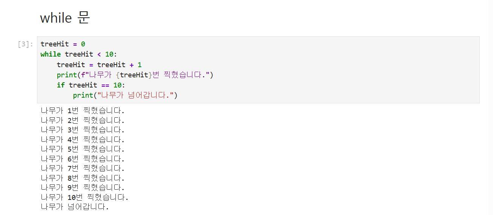

`break`는 반복문을 즉시 끝내고, `continue`는 현재 반복의 남은 코드를 건너뛰고 다음 반복으로
이동한다. 커피 자판기 예제에서는 입력한 금액에 따라 동작을 나누고 재고가 0이 되면
`break`로 판매를 종료했다.

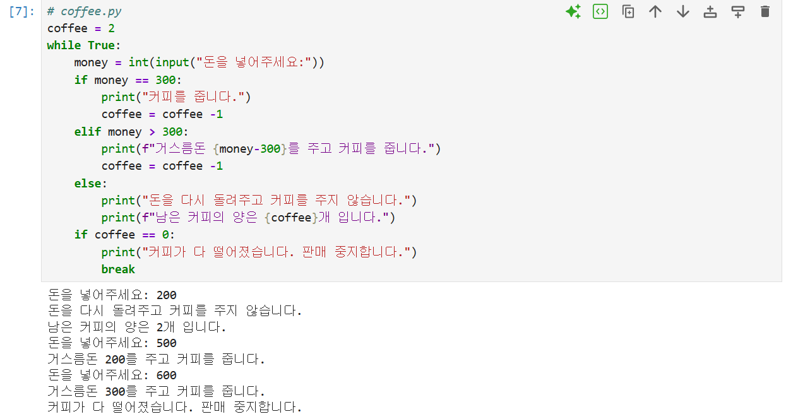

## 3. for·range와 리스트 컴프리헨션

`for`문은 리스트·튜플·문자열과 같은 반복 가능한 객체의 값을 차례로 꺼내 처리한다.
`range()`를 사용하면 시작값·끝값·증가값을 정해 숫자 범위를 만들 수 있다. 성적 목록을
순회하며 합격 여부를 출력하고, `continue`로 조건에 맞지 않는 항목을 건너뛰는 연습을 했다.

```python
marks = [90, 25, 67, 45, 80]

for number in range(len(marks)):
    if marks[number] < 60:
        continue
    print(f"{number + 1}번 학생은 합격입니다.")
```

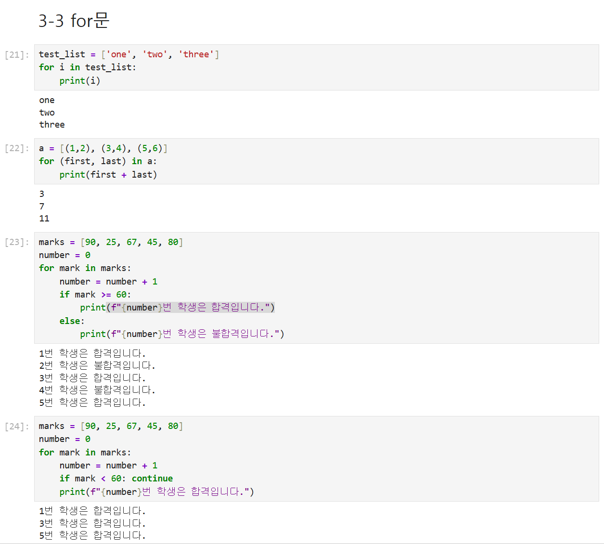

중첩 `for`문으로 구구단을 출력하고, 반복문으로 새 리스트를 만드는 과정과 리스트
컴프리헨션을 비교했다. 조건식도 함께 사용해 필요한 값만 결과에 포함할 수 있었다.

```python
numbers = [1, 2, 3, 4]
result = [number * 3 for number in numbers if number % 2 == 0]
print(result)  # [6, 12]
```

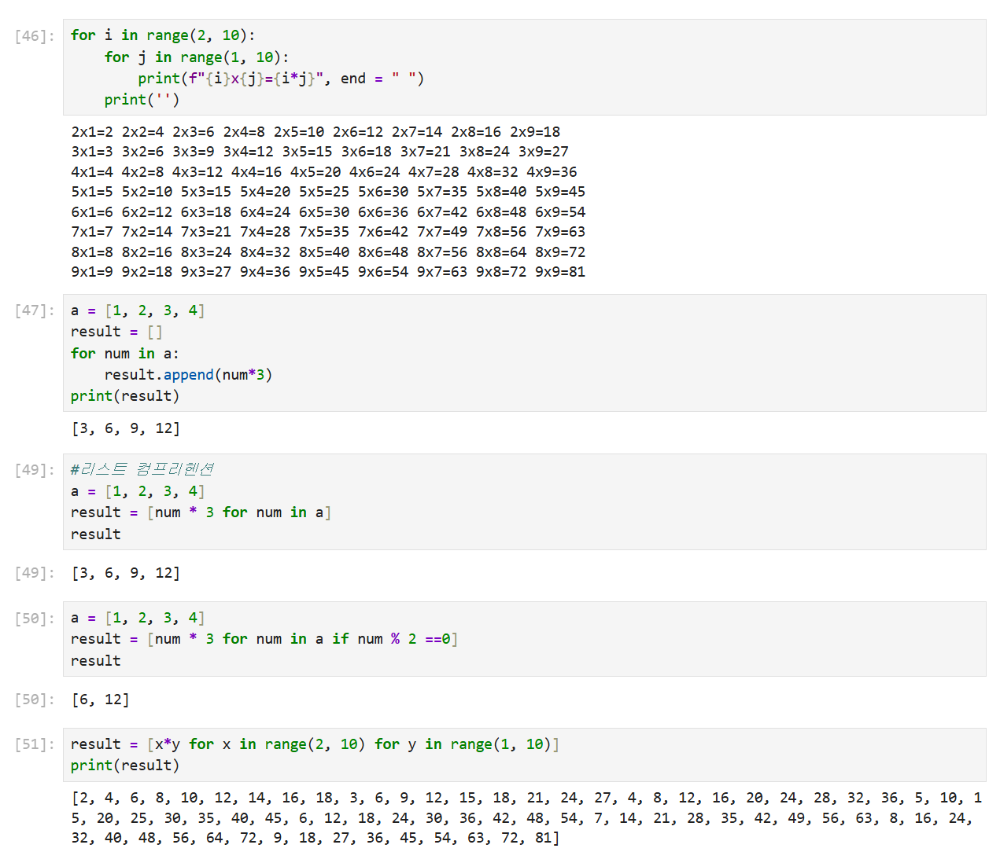

## 4. 함수와 인자

함수는 `def`로 정의하고 필요할 때 호출한다. 입력값과 반환값의 유무에 따라 여러 형태로
작성할 수 있으며, `return`이 없는 함수의 결과를 변수에 담으면 `None`이 된다.

```python
def add(a, b):
    return a + b

print(add(4, 10))
```

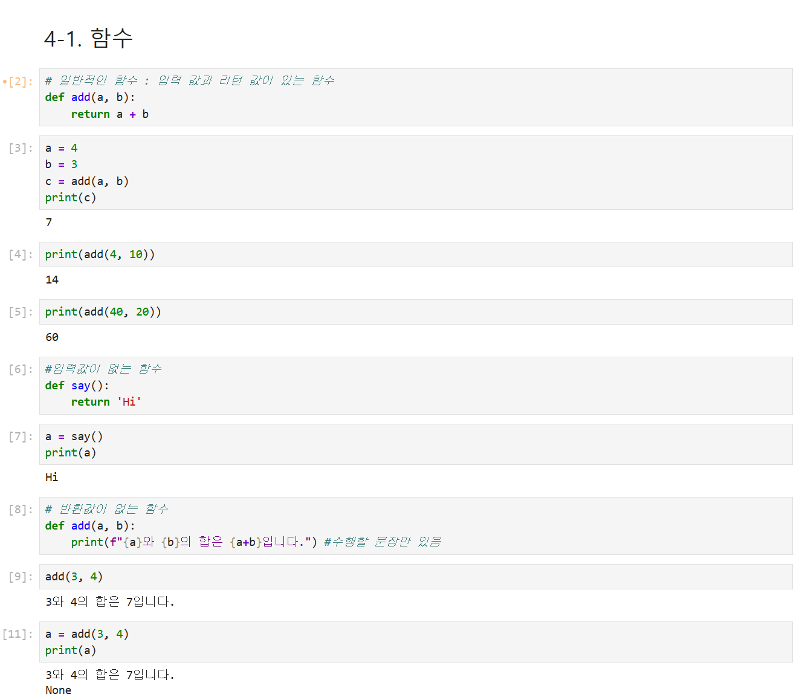

위치 인자와 키워드 인자, 기본값을 가진 매개변수를 연습했다. 개수가 정해지지 않은 위치
인자는 `*args`, 키워드 인자는 `**kwargs`로 받을 수 있다.

```python
def calculate(choice, *numbers):
    result = 0 if choice == "add" else 1

    for number in numbers:
        result = result + number if choice == "add" else result * number

    return result
```

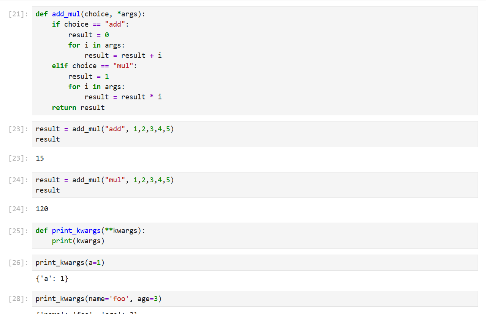

함수 안에서 만든 변수의 범위와 `global`의 동작을 확인하고, 짧은 함수를 표현하는
`lambda` 문법도 일반 함수와 비교했다.

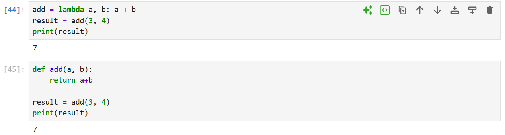

## 5. 파일 읽기와 쓰기

`open()`에 모드를 지정해 텍스트 파일을 열었다. `w`는 새로 쓰기, `r`은 읽기, `a`는 기존
내용 뒤에 추가하기 모드다. `readline()`, `readlines()`, `read()`의 반환 형태를 비교하고
반복문으로 파일 끝까지 읽는 방법도 실습했다.

```python
with open("sample.txt", "w", encoding="utf-8") as file:
    for number in range(1, 11):
        file.write(f"{number}번째 줄입니다.\n")

with open("sample.txt", "r", encoding="utf-8") as file:
    for line in file:
        print(line.strip())
```

`with`문을 사용하면 블록을 벗어날 때 파일이 자동으로 닫혀 `close()` 호출을 빠뜨릴 위험을
줄일 수 있다.

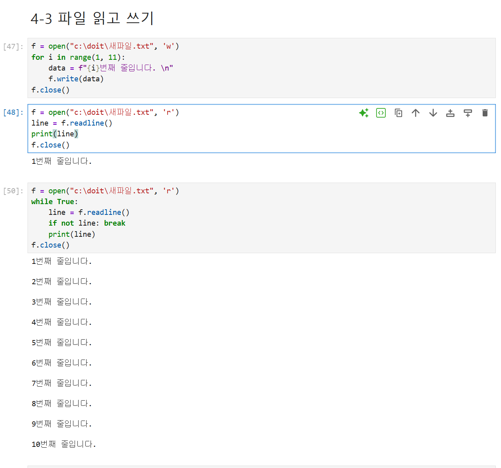

## 6. 클래스·생성자와 인스턴스

클래스는 데이터와 기능을 하나의 설계도로 묶고, 인스턴스는 그 설계도로 만든 각각의
객체다. 메서드의 첫 번째 매개변수 `self`는 호출한 인스턴스 자신을 가리킨다.
`__init__()`은 인스턴스가 만들어질 때 자동으로 실행되어 초기 필드값을 설정한다.

```python
class FourCalculator:
    def __init__(self, first, second):
        self.first = first
        self.second = second

    def add(self):
        return self.first + self.second

calculator = FourCalculator(4, 2)
print(calculator.add())
```

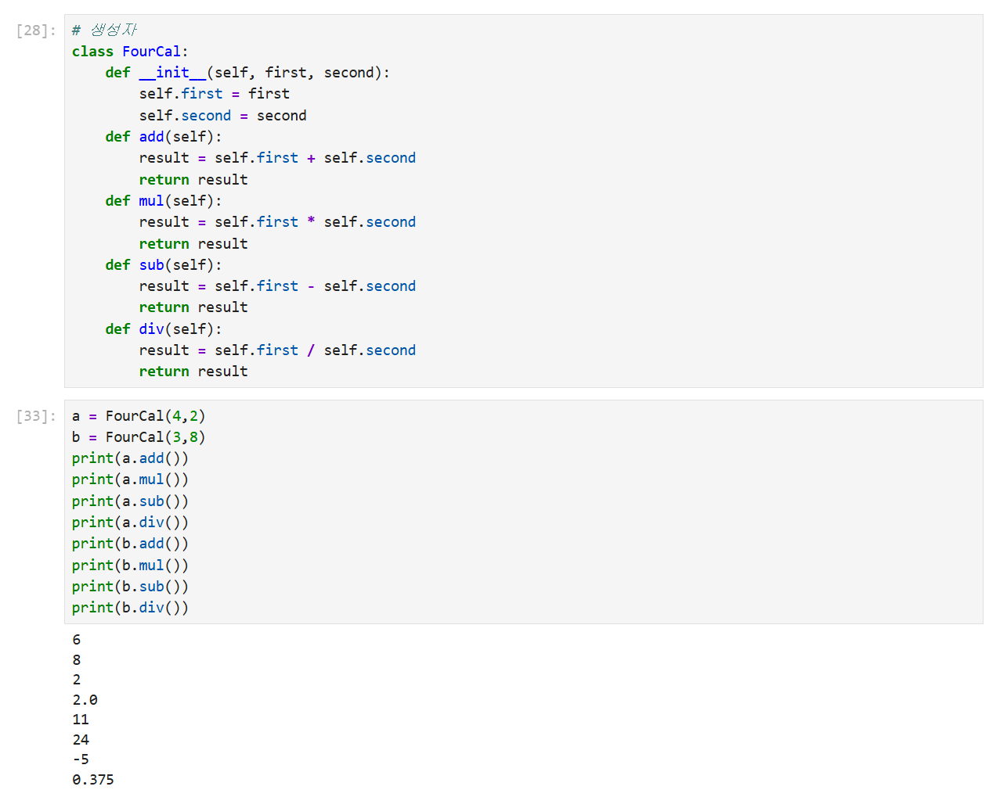

## 7. 상속과 메서드 오버라이딩

상속을 사용하면 기존 클래스의 기능을 물려받아 재사용하고 새로운 기능을 추가할 수 있다.
계산기 클래스를 상속해 제곱 메서드를 더한 뒤, 나눗셈 메서드를 다시 정의해 0으로 나누는
상황을 안전하게 처리했다.

```python
class SafeCalculator(FourCalculator):
    def divide(self):
        if self.second == 0:
            return 0
        return self.first / self.second
```

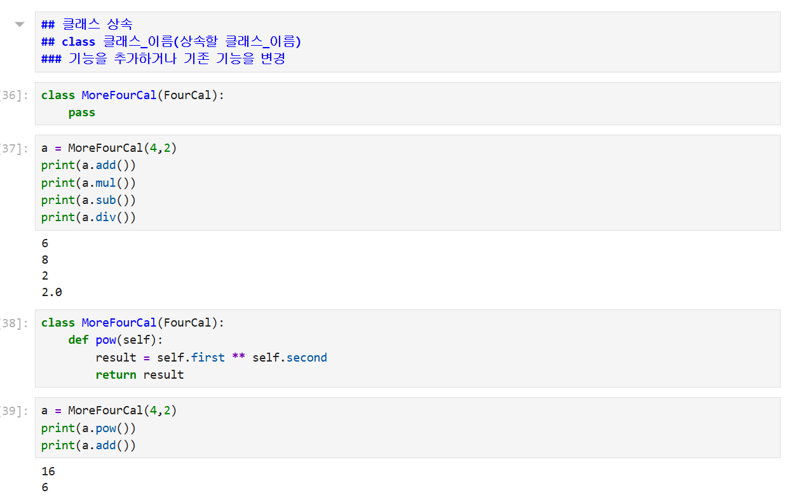

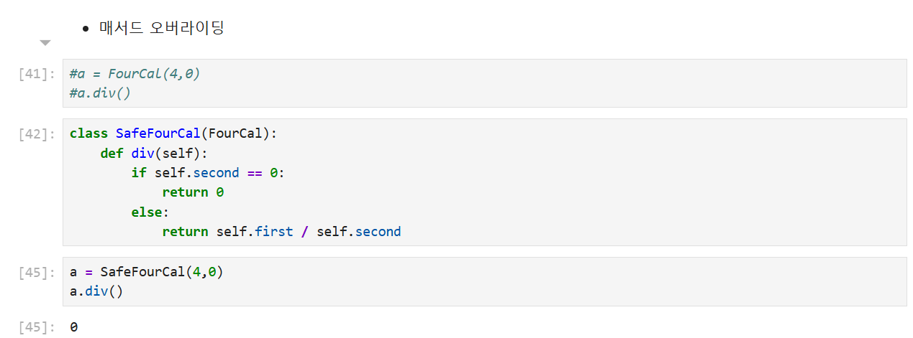

## 8. 함수와 반복문을 합친 주문 실습

마지막으로 커피 종류별 동작을 함수로 분리하고 `for`문으로 네 번의 주문을 처리했다. 함수의
매개변수로 선택값을 전달하고 조건문으로 메뉴를 나누면서 함수·반복문·조건문을 함께 적용했다.

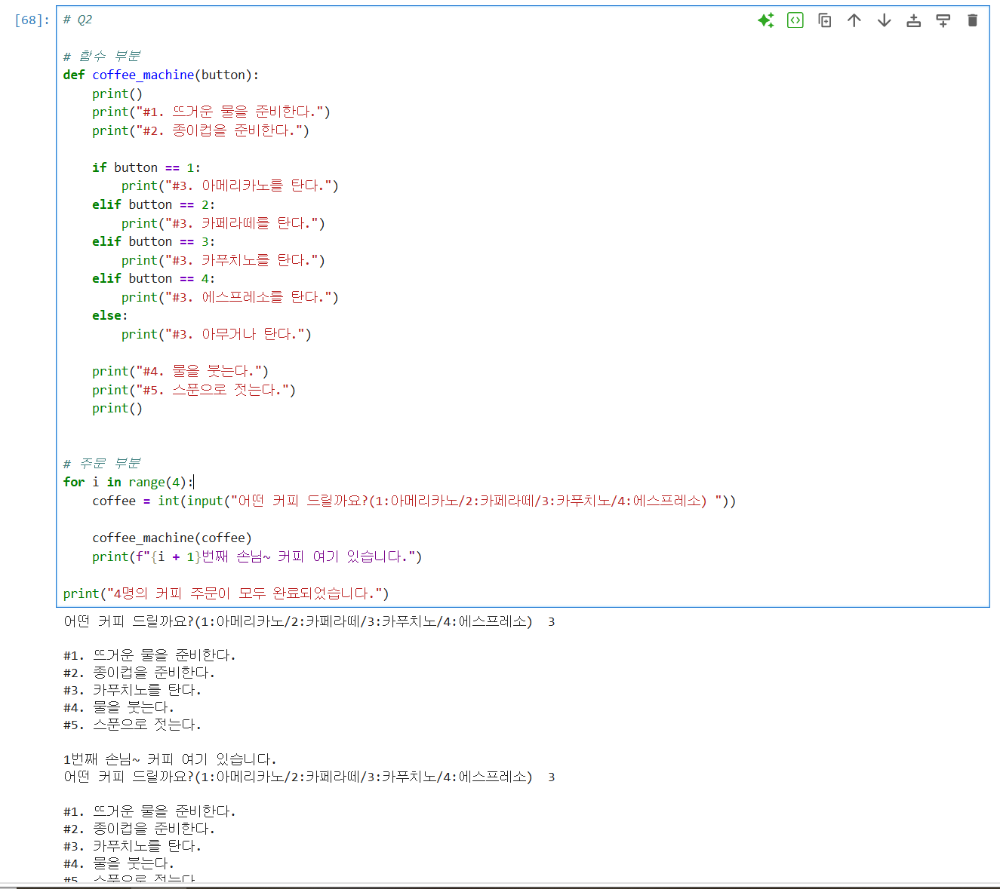

## 오늘의 정리

- 프로젝트 발표를 진행하고 작업 과정을 마무리했다.
- `while`과 `for`의 반복 조건, `break`와 `continue`의 차이를 익혔다.
- `range()`, 중첩 반복문과 리스트 컴프리헨션으로 반복 코드를 간결하게 작성했다.
- 함수의 입력·반환 형태, 가변 인자, 변수 범위와 `lambda`를 실습했다.
- 파일 열기 모드와 여러 읽기 메서드, `with`문의 자동 종료를 이해했다.
- 클래스와 인스턴스, 생성자, 상속과 메서드 오버라이딩을 계산기 예제로 확인했다.
- 함수·조건문·반복문을 결합해 커피 주문 흐름을 완성했다.

> 공개 저장소에는 무한루프·문법 오류 화면, 실명처럼 보이는 예제, 장문 가사와 로컬 사용자
> 경로가 포함된 캡처를 제외했다. 원본 Jupyter Notebook도 해당 내용이 섞여 있어 올리지 않고,
> 코드와 실행 결과가 명확한 안전한 화면만 선별했다.
