# DAY 65 — Python 모듈·예외 처리와 Pandas 데이터프레임 기초

> 2026-10-14 · Python, 모듈, 예외 처리, 내장 함수, Pandas, Series, DataFrame

오늘은 Python 코드를 파일 단위로 나누어 재사용하는 모듈부터 예외 처리, 내장 함수와 외부
패키지까지 학습했다. 이어서 Pandas로 TSV 데이터를 불러와 구조를 확인하고, 필요한 행과 열을
선택하고 집계·가공·저장하는 데이터 분석의 기본 흐름을 실습했다.

## 1. 모듈과 실행 진입점

모듈은 함수·변수·클래스를 모아 둔 Python 파일이다. 자주 사용하는 기능을 별도 파일로
분리하면 여러 프로그램에서 가져와 재사용할 수 있다.

```python
# calculator.py
def add(a, b):
    return a + b

def sub(a, b):
    return a - b
```

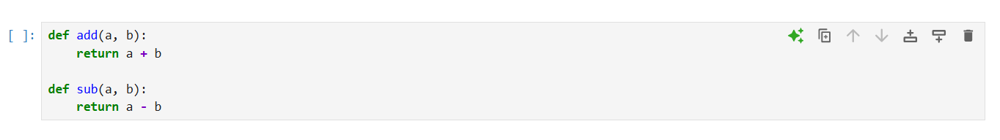

모듈 전체를 가져오거나 필요한 이름만 선택해 불러올 수 있다.

```python
import calculator
from calculator import add

print(calculator.sub(7, 3))
print(add(4, 2))
```

`if __name__ == "__main__":` 블록은 파일을 직접 실행할 때만 동작하고, 다른 파일에서
`import`할 때는 실행되지 않는다. 모듈의 간단한 테스트 코드와 실제 제공 기능을 분리할 때
유용하다.

## 2. 예외 처리

파일이 없거나 0으로 나누는 등 실행 중 발생하는 문제는 예외로 표현된다. `try`에는 예외가
발생할 수 있는 코드를, `except`에는 해당 예외를 처리할 코드를 작성한다. `finally`는 성공과
실패 여부와 관계없이 항상 실행되므로 파일이나 연결을 정리할 때 사용할 수 있다.

```python
try:
    number = int(input("숫자: "))
    print(10 / number)
except ValueError as error:
    print("숫자로 변환할 수 없습니다.", error)
except ZeroDivisionError:
    print("0으로 나눌 수 없습니다.")
else:
    print("계산을 정상적으로 마쳤습니다.")
finally:
    print("프로그램을 종료합니다.")
```

여러 예외를 각각 처리할 수도 있고, 처리 방법이 같다면 튜플로 묶을 수도 있다. 모든 오류를
막연히 잡는 `except:`보다 예상 가능한 예외 종류를 명시하면 원인을 파악하기 쉽다.

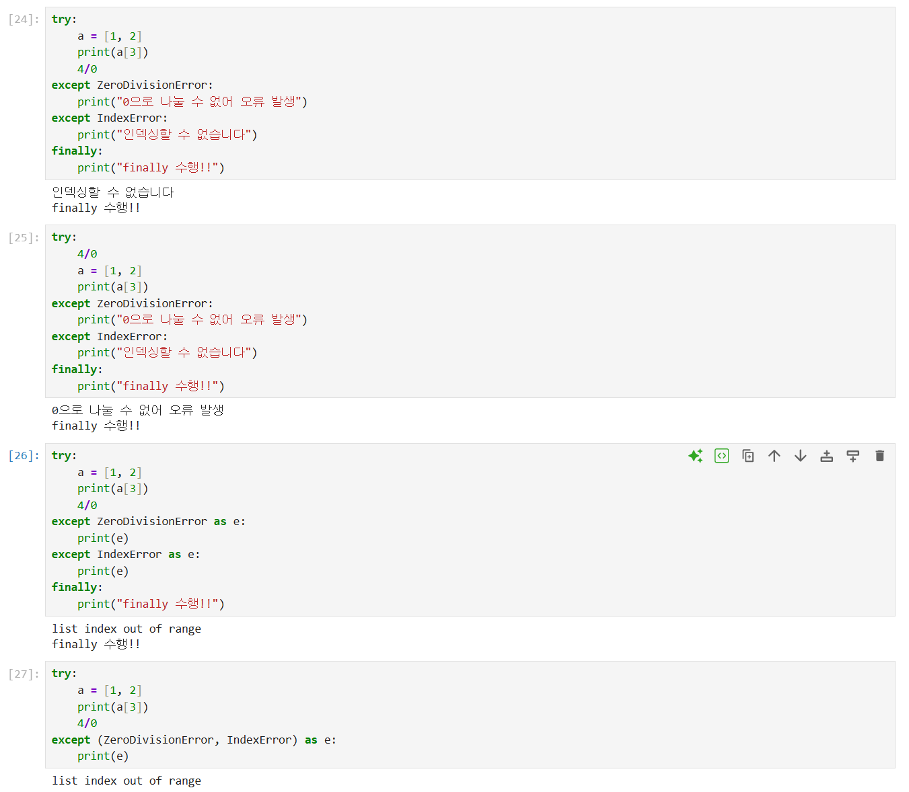

## 3. 내장 함수와 외부 패키지

Python은 별도 설정 없이 사용할 수 있는 다양한 내장 함수를 제공한다.

- `enumerate()`는 값과 순번을 함께 반환한다.
- `divmod()`는 몫과 나머지를 한 번에 반환한다.
- `zip()`은 여러 반복 가능한 객체의 같은 위치 값을 묶는다.
- `eval()`은 문자열을 Python 표현식으로 실행하지만, 신뢰할 수 없는 입력에 사용하면 임의
  코드가 실행될 수 있으므로 사용자 입력에는 사용하지 않는다.

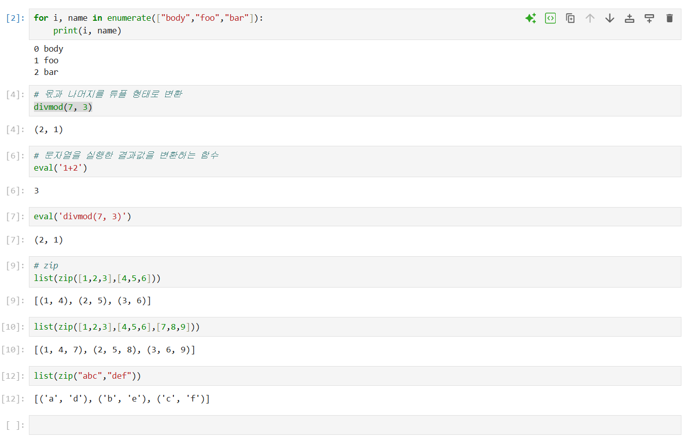

표준 라이브러리에 없는 기능은 패키지를 설치한 뒤 `import`해서 사용할 수 있다. 오늘은
`Faker`로 테스트용 가상 데이터를 만드는 방법도 확인했다. 실제 개인정보처럼 보일 수 있는
이름과 주소가 포함된 실행 화면은 공개 자료에서 제외했다.

## 4. Pandas로 데이터 불러오기

Pandas는 표 형태 데이터를 다루는 데이터 분석 라이브러리다. `read_csv()`는 CSV뿐 아니라
구분자를 지정해 TSV도 읽을 수 있다.

```python
import pandas as pd

df = pd.read_csv("gapminder.tsv", sep="\t")
```

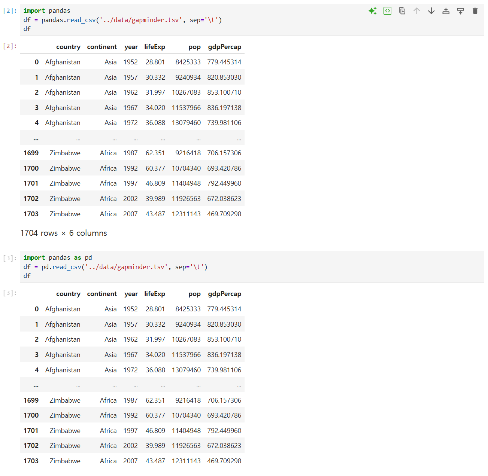

데이터를 불러온 뒤에는 전체를 바로 출력하기보다 구조부터 확인하는 습관이 중요하다.

- `shape`: 행과 열의 개수
- `columns`: 열 이름
- `dtypes`: 열별 자료형
- `info()`: 결측치와 메모리 사용량을 포함한 요약
- `head()`·`tail()`: 앞부분과 뒷부분 일부 행

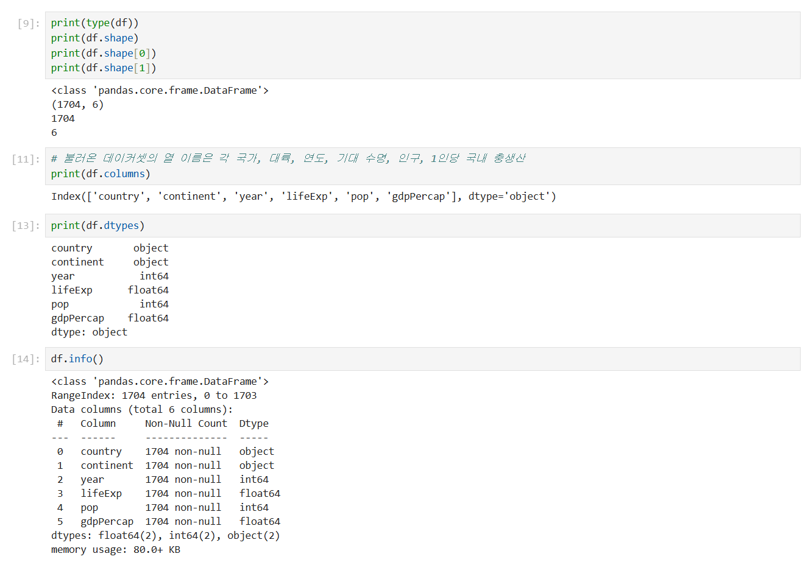

## 5. Series와 DataFrame

`DataFrame`은 행과 열로 이루어진 2차원 표이고, `Series`는 한 열과 같은 1차원 자료다.
대괄호 하나로 열 이름 하나를 선택하면 `Series`, 열 이름 목록을 전달하면 `DataFrame`이
반환된다.

```python
country = df["country"]
subset = df[["country", "continent", "year"]]
```

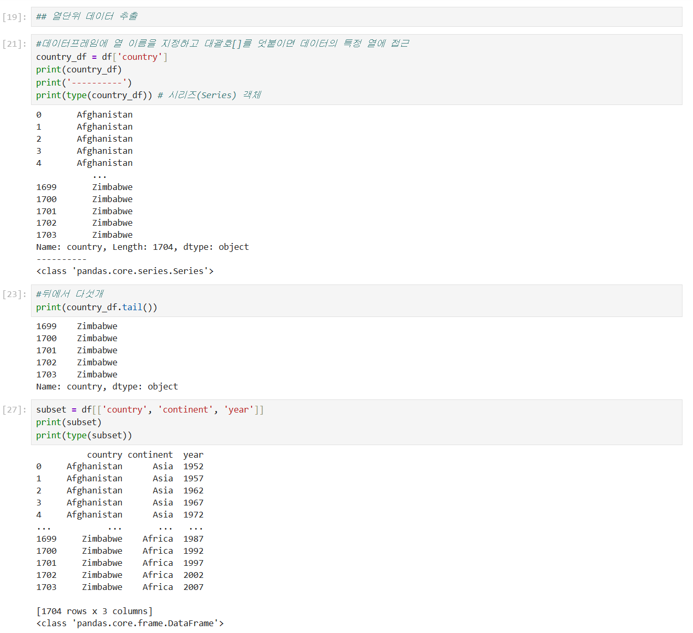

## 6. loc와 iloc으로 행·열 선택하기

`loc`는 행·열의 **레이블**, `iloc`는 정수 **위치**를 기준으로 데이터를 선택한다. 필요한
행과 열을 동시에 지정하면 큰 데이터에서 분석 대상만 간결하게 추릴 수 있다.

```python
by_label = df.loc[[0, 99], ["country", "lifeExp"]]
by_position = df.iloc[[0, 99], [0, 3]]
```

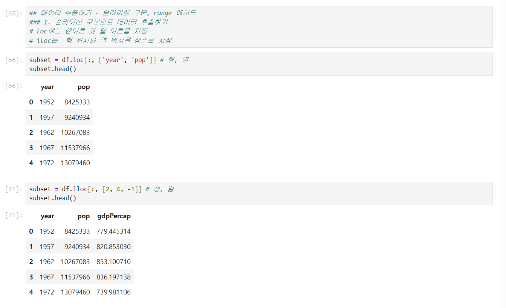

레이블 슬라이스인 `loc[10:13]`은 끝 레이블인 `13`을 포함하지만, 위치 슬라이스인
`iloc[10:13]`은 일반 Python 슬라이스처럼 끝 위치 `13`을 포함하지 않는 차이도 확인했다.

## 7. 그룹 집계와 시각화

`groupby()`로 같은 연도에 속한 행을 묶고 평균을 계산했다. 집계 결과인 Series에는
`plot()`을 바로 연결해 값의 변화를 선 그래프로 확인할 수 있다.

```python
yearly_life = df.groupby("year")["lifeExp"].mean()
yearly_life.plot()
```

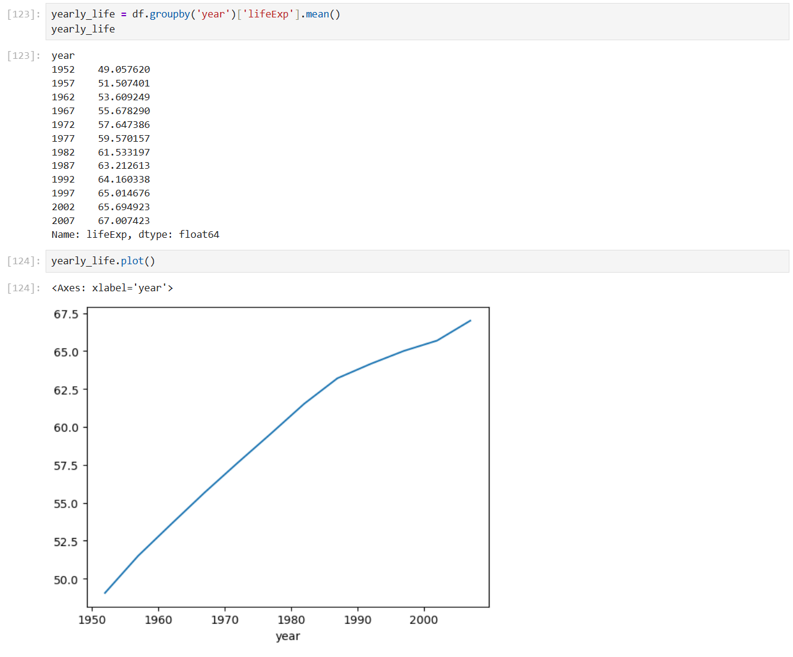

`mean()`, `count()`, `nunique()`, `value_counts()`를 사용해 평균·개수·고유값 수·범주별 빈도를
계산하고, `reset_index()`로 그룹 결과를 다시 일반 DataFrame 형태로 바꾸는 방법도 익혔다.

## 8. 조건 필터링과 날짜 계산

비교 연산의 결과는 각 행이 조건을 만족하는지를 나타내는 불리언 Series가 된다. 이를
DataFrame의 행 선택 조건으로 사용해 평균보다 큰 값만 추출했다.

```python
ages = scientists["Age"]
older_than_mean = scientists[ages > ages.mean()]
```

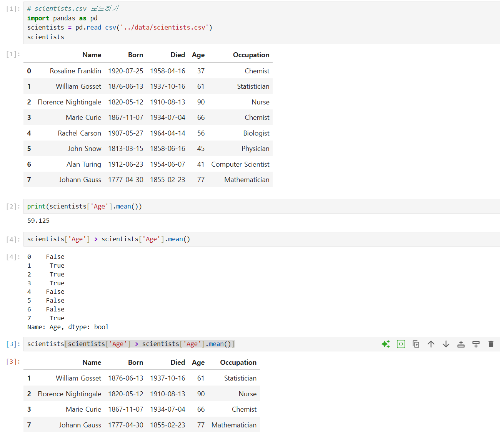

문자열 날짜는 `pd.to_datetime()`으로 변환한 뒤 서로 빼면 날짜 간 차이를 계산할 수 있다.

```python
scientists["Born_dt"] = pd.to_datetime(scientists["Born"], format="%Y-%m-%d")
scientists["Died_dt"] = pd.to_datetime(scientists["Died"], format="%Y-%m-%d")
scientists["Age_days_dt"] = scientists["Died_dt"] - scientists["Born_dt"]
```

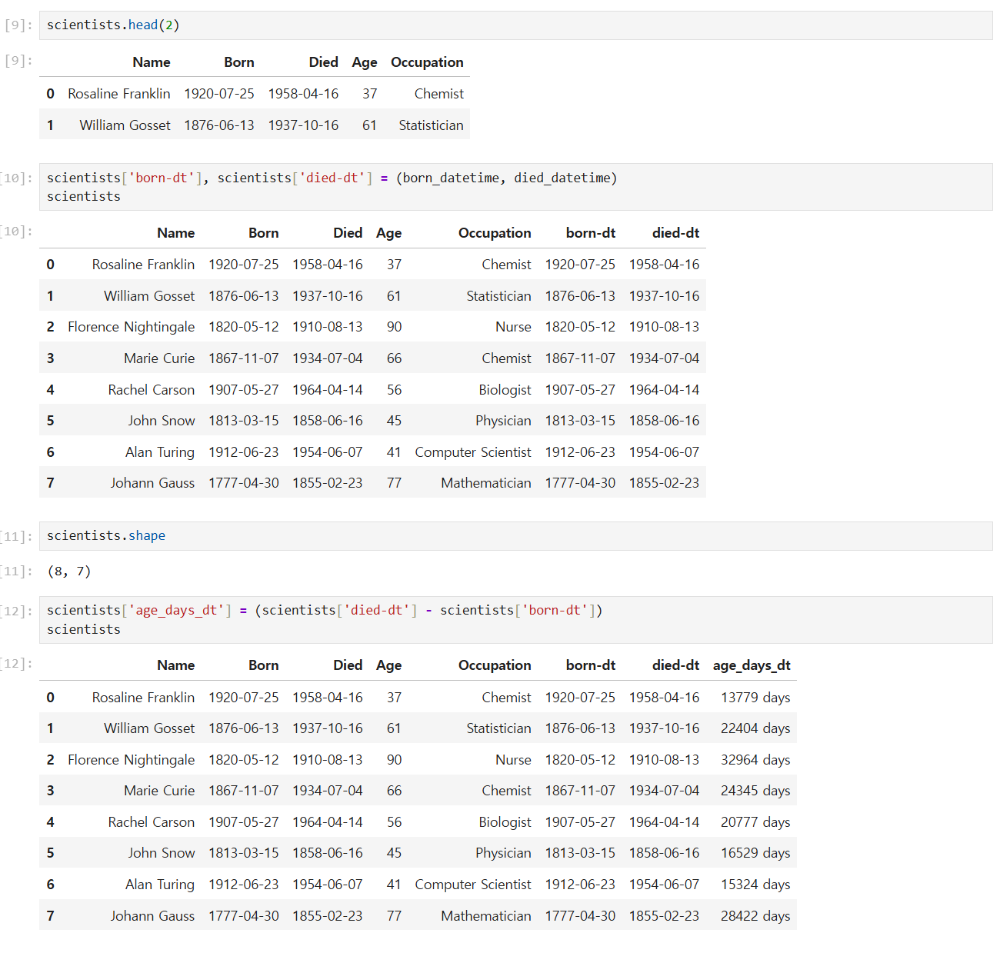

`drop()`은 지정한 행이나 열을 제거한 새 객체를 반환한다. 원본을 유지하려면 결과를 다른
변수에 담고, 원본을 직접 바꿔야 할 때만 `inplace=True` 사용을 검토한다.

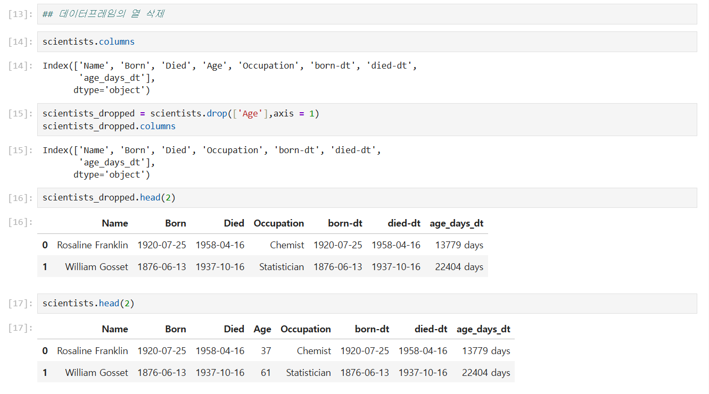

## 9. 데이터 저장 형식

가공한 DataFrame은 목적에 따라 여러 형식으로 저장할 수 있다.

```python
scientists.to_csv("scientists.csv", index=False)
scientists.to_csv("scientists.tsv", sep="\t", index=False)
scientists.to_pickle("scientists.pickle")
```

CSV와 TSV는 다른 도구에서도 열기 쉬운 텍스트 형식이다. Pickle은 Python 객체를 그대로
저장하고 불러오기 편하지만, 파일 크기가 항상 더 작아지는 것은 아니다. 또한 신뢰할 수 없는
Pickle 파일을 열면 악성 코드가 실행될 수 있으므로 출처가 확실한 파일만 불러와야 한다.

## 10. 서울시 CCTV 데이터 선택 실습

마지막에는 서울시 CCTV 데이터를 이용해 데이터의 앞·뒤 행, 크기와 열 이름을 확인하고
`loc`·`iloc`로 특정 행과 열을 선택하는 문제를 풀었다. 단순히 코드를 따라 쓰는 데 그치지
않고 질문에 맞는 선택 기준이 레이블인지 위치인지 판단하는 연습이 되었다.

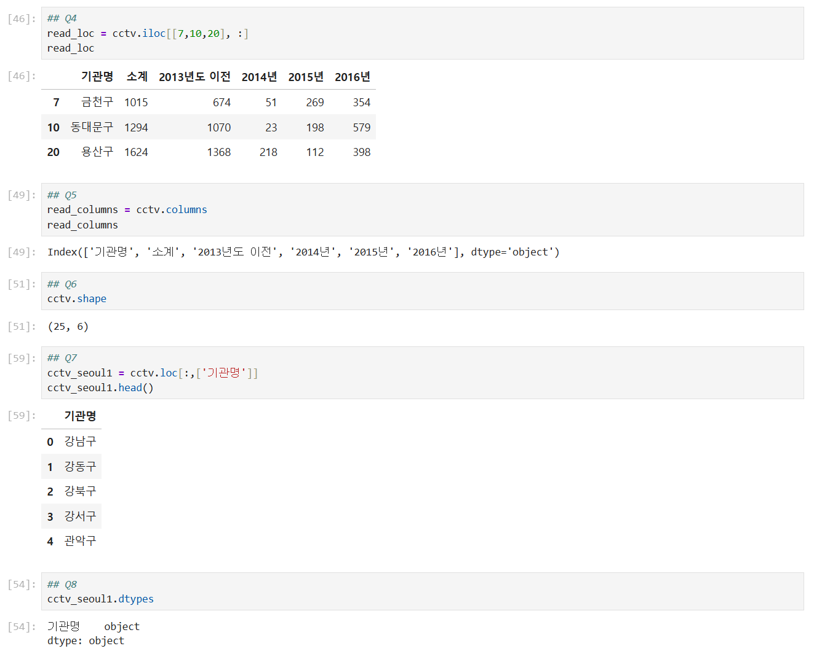

## 오늘의 정리

- Python 파일을 모듈로 나누고 다양한 `import` 방식과 실행 진입점을 이해했다.
- `try`·`except`·`else`·`finally`의 역할과 여러 예외를 처리하는 방법을 익혔다.
- 주요 내장 함수와 외부 패키지의 사용 방법, `eval()` 사용 시 주의점을 확인했다.
- Pandas로 TSV를 불러오고 데이터의 크기·열·자료형·요약 정보를 점검했다.
- Series와 DataFrame의 차이, `loc`와 `iloc`의 선택 기준을 구분했다.
- 그룹 집계와 그래프, 불리언 필터, 날짜 계산과 열 삭제를 실습했다.
- CSV·TSV·Pickle 저장 방식의 차이와 Pickle의 보안 주의점을 정리했다.
- 서울시 CCTV 데이터 문제로 필요한 행과 열을 직접 선택했다.

> 공개 저장소에는 교재 PDF, 원본 Jupyter Notebook과 메모 파일을 올리지 않았다. 로컬 사용자
> 경로, 실행 오류, 실제 개인정보처럼 보일 수 있는 Faker 결과가 보이는 화면도 제외하고,
> 학습 개념과 실행 결과가 명확한 안전한 캡처만 선별했다.
