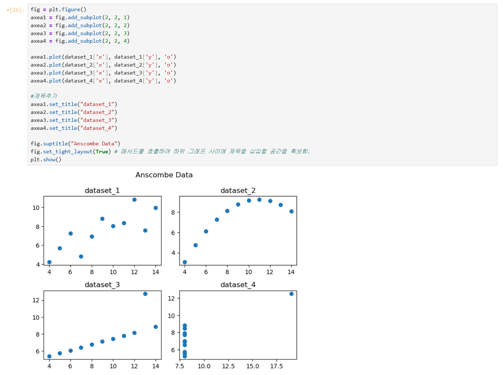
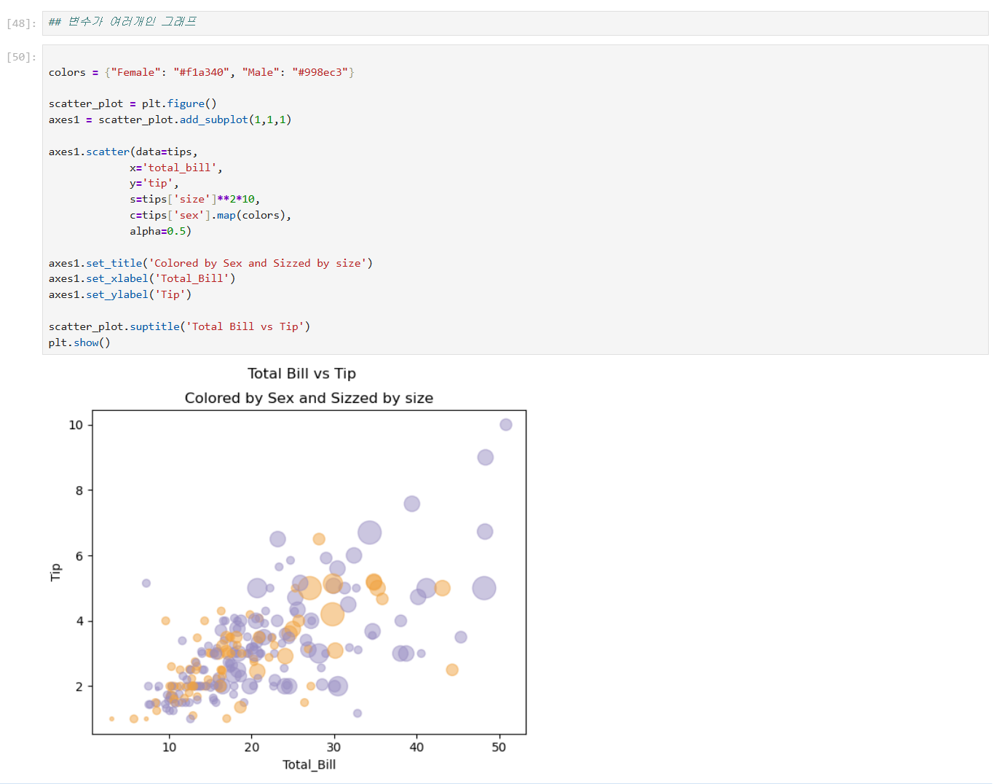
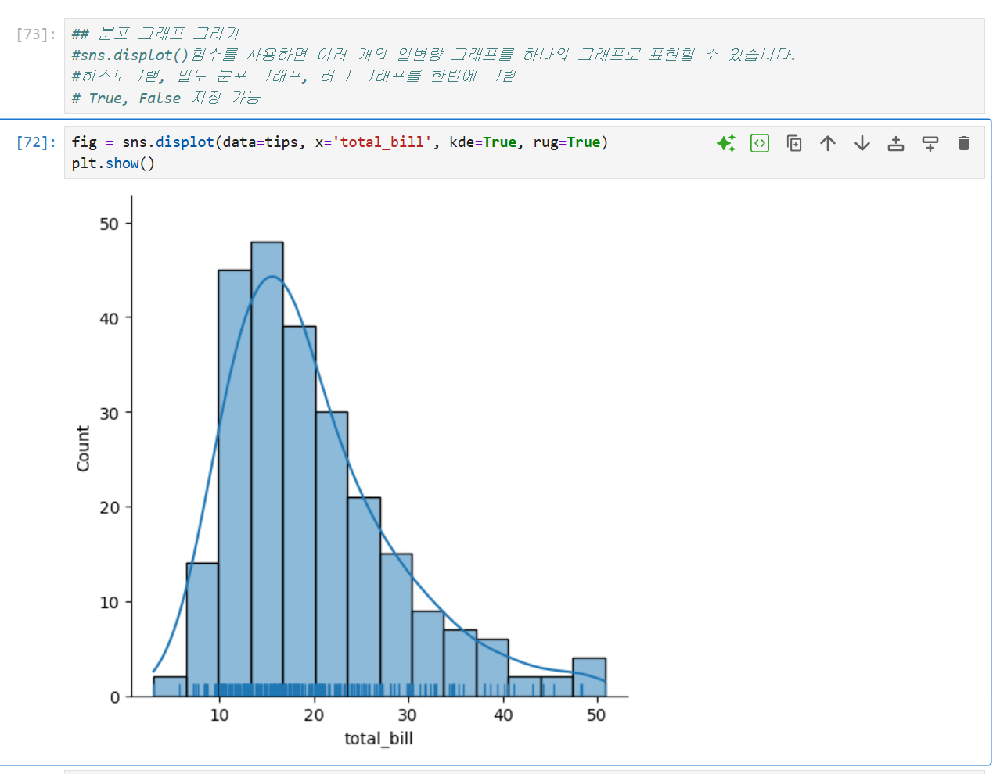
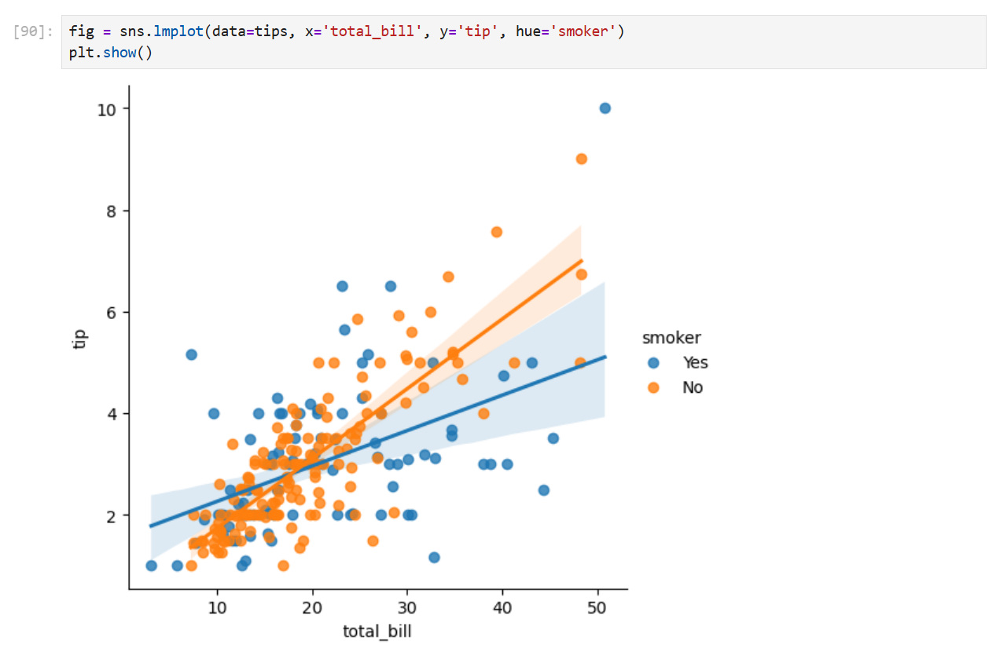
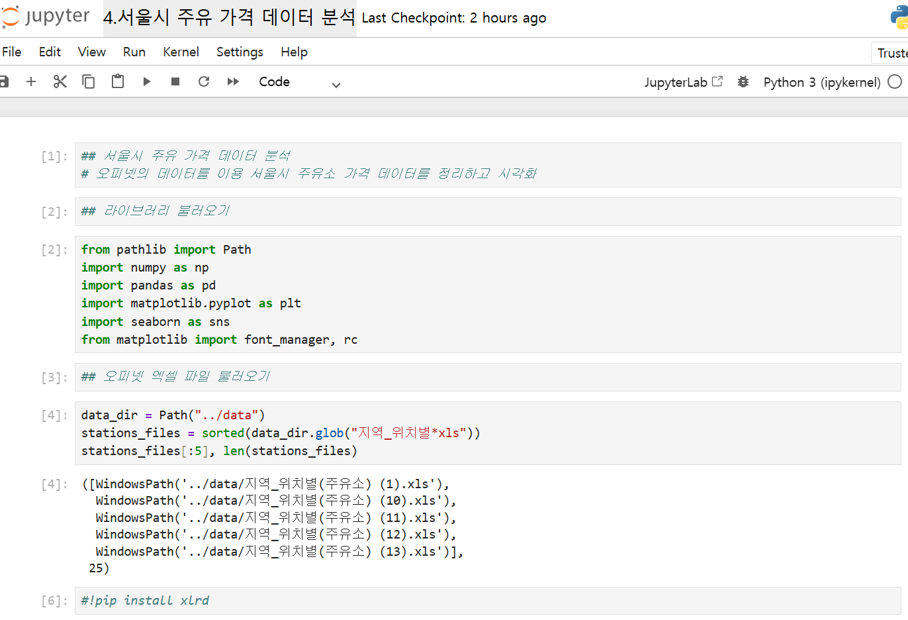
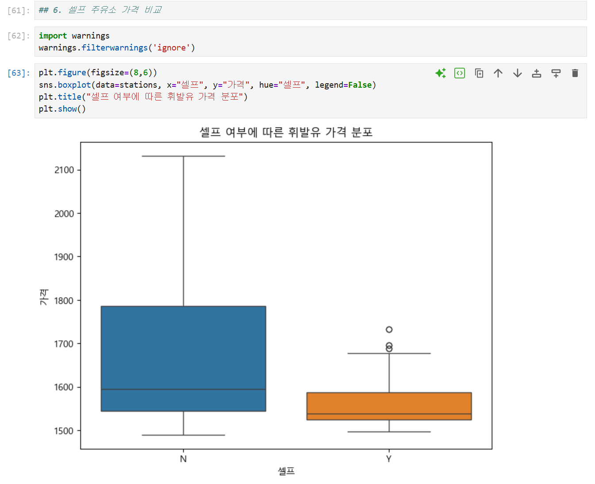
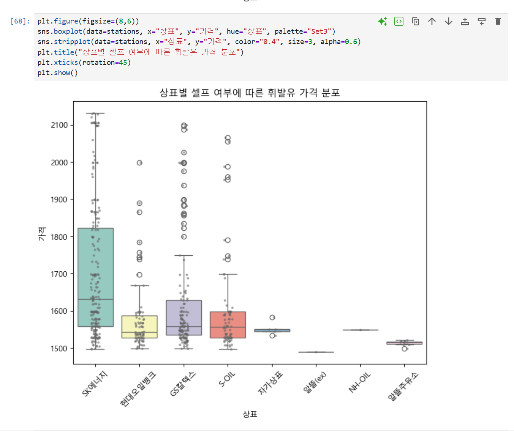
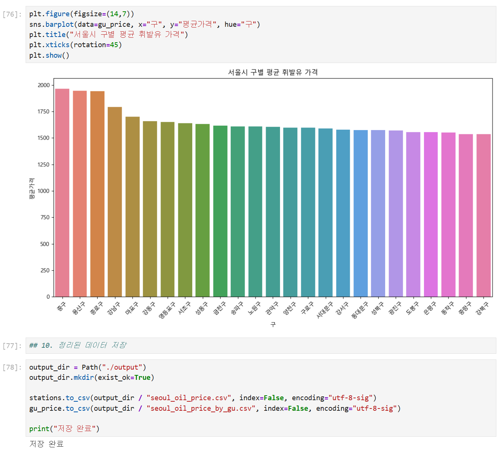
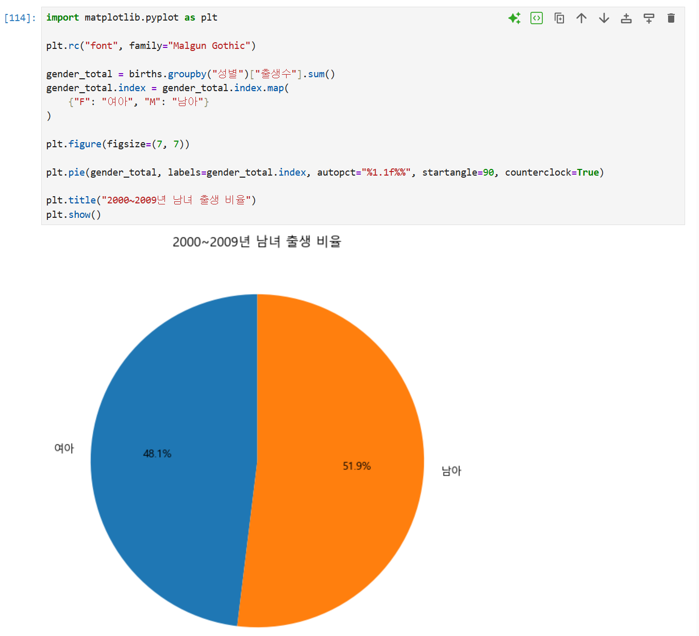
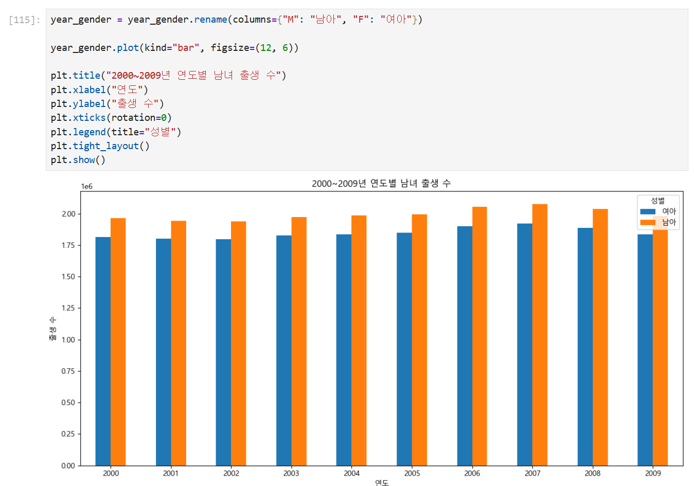

# DAY 66 — Matplotlib·Seaborn 시각화와 Pandas 데이터 분석

> 2026-10-15 · Python, Matplotlib, Seaborn, Pandas, 데이터 시각화, 데이터 전처리

오늘은 같은 통계값을 가진 데이터도 분포와 관계가 다를 수 있다는 점을 확인하고, Matplotlib과
Seaborn으로 데이터를 시각화하는 방법을 학습했다. 이어서 여러 파일로 나뉜 서울시 주유 가격
데이터를 Pandas로 합치고 정리한 뒤 셀프 주유 여부·상표·지역별 가격 차이를 그래프로 비교했다.

## 1. 그래프로 데이터를 확인해야 하는 이유

Anscombe quartet은 네 데이터 그룹의 평균과 분산, 상관계수가 거의 같지만 실제 분포는 서로
다른 대표적인 예제다. 숫자 요약만 확인하면 놓칠 수 있는 이상치와 관계를 그래프로 확인했다.

```python
import seaborn as sns

anscombe = sns.load_dataset("anscombe")
print(anscombe.groupby("dataset").mean(numeric_only=True))
```

`Figure`는 전체 그림판, `Axes`는 실제 그래프가 그려지는 영역이다. `plt.subplots(2, 2)`로
네 개의 Axes를 만들고 각 데이터 그룹을 같은 화면에 배치해 차이를 비교했다.



## 2. Matplotlib 기본 그래프와 표현 속성

Matplotlib으로 선 그래프와 점 그래프를 그리고 마커 모양·색·선 종류를 조정했다. 하나의
그래프에 정보를 너무 많이 넣기보다 제목과 축 이름을 명확히 하고, 비교할 항목은 subplot으로
나누는 방법을 익혔다.

`tips` 데이터에서는 변수의 성격에 따라 그래프를 선택했다.

- 히스토그램: 한 수치형 변수의 분포와 구간별 빈도
- 산점도: 두 수치형 변수 사이의 관계
- 박스플롯: 중앙값·사분위 범위·이상치 비교
- 다변량 산점도: 색·크기·투명도로 범주와 수치를 함께 표현



색상과 크기는 추가 정보를 전달하지만, 범례가 없거나 요소가 겹치면 해석이 어려워진다.
따라서 분석 목적에 필요한 변수만 사용하고 `alpha`로 점의 겹침을 조절하는 것이 중요하다.

## 3. Seaborn으로 분포와 관계 표현하기

Seaborn은 Matplotlib을 기반으로 하면서 DataFrame의 열 이름을 바로 지정할 수 있어 통계
그래프를 간결하게 작성할 수 있다.

```python
sns.displot(data=tips, x="total_bill", kde=True, rug=True)
```

히스토그램은 구간별 빈도, KDE는 부드러운 밀도 추정, rug plot은 개별 관측값의 위치를
보여준다. 세 그래프를 함께 사용해 전체 분포와 실제 데이터가 모인 위치를 동시에 확인했다.



범주별 개수는 `countplot()`, 두 수치형 변수의 관계는 `scatterplot()`으로 표현했다.
`regplot()`과 `lmplot()`으로 회귀선을 더하고 `hue`를 지정해 흡연 여부처럼 범주가 다른
그룹의 경향도 비교했다.



## 4. 여러 파일을 하나의 DataFrame으로 합치기

실습 데이터는 지역별 파일로 나뉘어 있어 `Path.glob()`으로 대상 파일을 찾고, 각 파일을
DataFrame으로 읽은 뒤 `pd.concat()`으로 하나의 표로 합쳤다.

```python
from pathlib import Path
import pandas as pd

data_dir = Path("../data")
frames = [pd.read_excel(path) for path in data_dir.glob("*.xls")]
stations = pd.concat(frames, ignore_index=True)
```



파일을 합친 뒤에는 분석에 필요한 열만 선택하고 이해하기 쉬운 이름으로 바꿨다. 주소에서
자치구를 추출하고 잘못된 구 이름을 보정했으며, 가격 열의 `-` 값을 결측치로 처리한 뒤 숫자
형식으로 변환했다. 마지막에는 `dropna()`와 `reset_index()`로 분석 가능한 형태를 만들었다.

## 5. 셀프 주유 여부와 상표별 가격 비교

가격 데이터는 평균 하나만 보기보다 그룹별 분포를 함께 확인했다. 박스플롯으로 셀프 주유소와
일반 주유소의 가격 범위·중앙값·이상치를 비교했다.



상표별 가격도 박스플롯으로 비교하고, 실제 관측값의 퍼짐을 확인하기 위해 strip plot을
겹쳐 표현했다. 이를 통해 같은 상표 안에서도 주유소별 가격 편차가 있다는 점을 확인했다.



## 6. 자치구별 집계와 시각화

`groupby()`와 `agg()`를 사용해 자치구별 평균 가격과 주유소 수를 한 번에 집계하고, 평균
가격이 높은 순서로 정렬했다.

```python
district_price = (
    stations.groupby("구", as_index=False)
    .agg(평균가격=("가격", "mean"), 주유소수=("주유소", "count"))
    .sort_values("평균가격", ascending=False)
)
```

집계 결과를 막대그래프로 표현해 지역별 차이를 한눈에 비교했다. 분석 결과를 CSV로 저장하는
방법도 실습했지만, 공개 일지에는 출처와 재배포 조건을 별도로 확인해야 하는 원본·가공 CSV를
포함하지 않았다.



## 7. 출생 이름 데이터로 파이·막대그래프 연습

마지막에는 연도별 이름 데이터를 반복해서 불러와 하나의 DataFrame으로 합치고, 파일 이름에서
연도를 추출해 새 열로 추가했다. 성별 출생 수 합계를 파이 차트로 표현하고, 연도·성별로 다시
집계해 나란한 막대그래프로 비교했다.





파이 차트는 전체에서 각 범주가 차지하는 비율을 보여주기 좋고, 연도별 변화처럼 여러 시점의
값을 비교할 때는 막대그래프가 더 읽기 쉽다는 차이도 확인했다.

## 오늘의 정리

- Anscombe quartet으로 통계 요약과 시각화를 함께 확인해야 하는 이유를 이해했다.
- Matplotlib의 Figure·Axes·subplot 구조와 선·산점도·히스토그램·박스플롯을 익혔다.
- Seaborn의 분포 그래프와 회귀 그래프로 범주별 관계를 비교했다.
- 여러 파일을 합치고 열 선택·이름 변경·문자열 추출·결측치 처리로 데이터를 전처리했다.
- 셀프 주유 여부·상표·자치구별 가격 분포와 평균을 집계하고 시각화했다.
- 반복 파일 로딩과 `groupby()`를 응용해 성별 비율과 연도별 출생 수를 그래프로 표현했다.

> 공개 저장소에는 교재 PDF, 원본 Jupyter Notebook, 원본·가공 CSV를 올리지 않았다. 개인 PC의
> 사용자 경로, 실행 오류, 주유소의 상세 주소·전화번호가 보이는 화면도 제외하고 집계 결과와
> 학습 개념을 확인할 수 있는 안전한 캡처만 선별했다.
