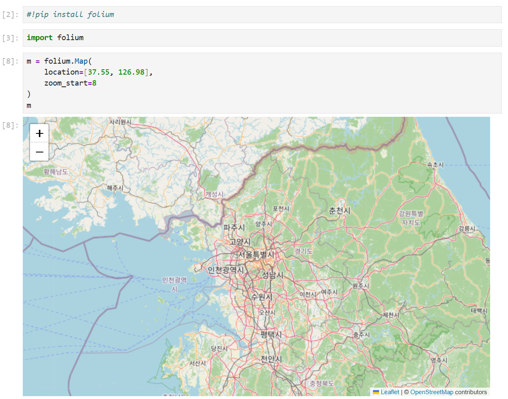
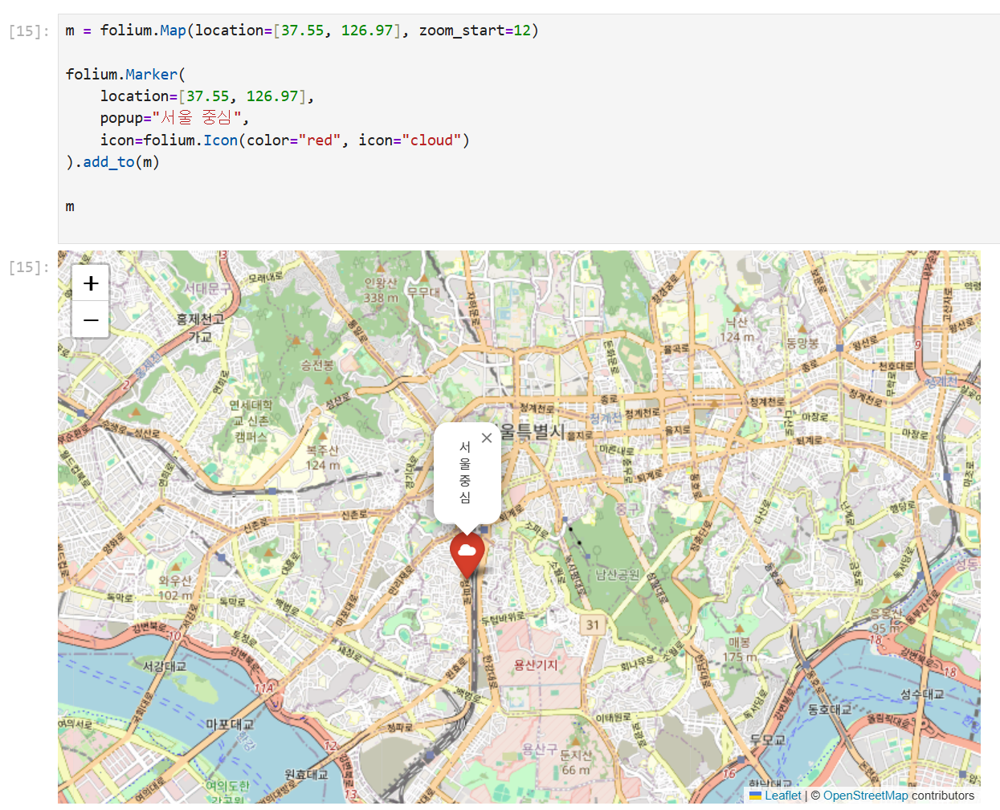
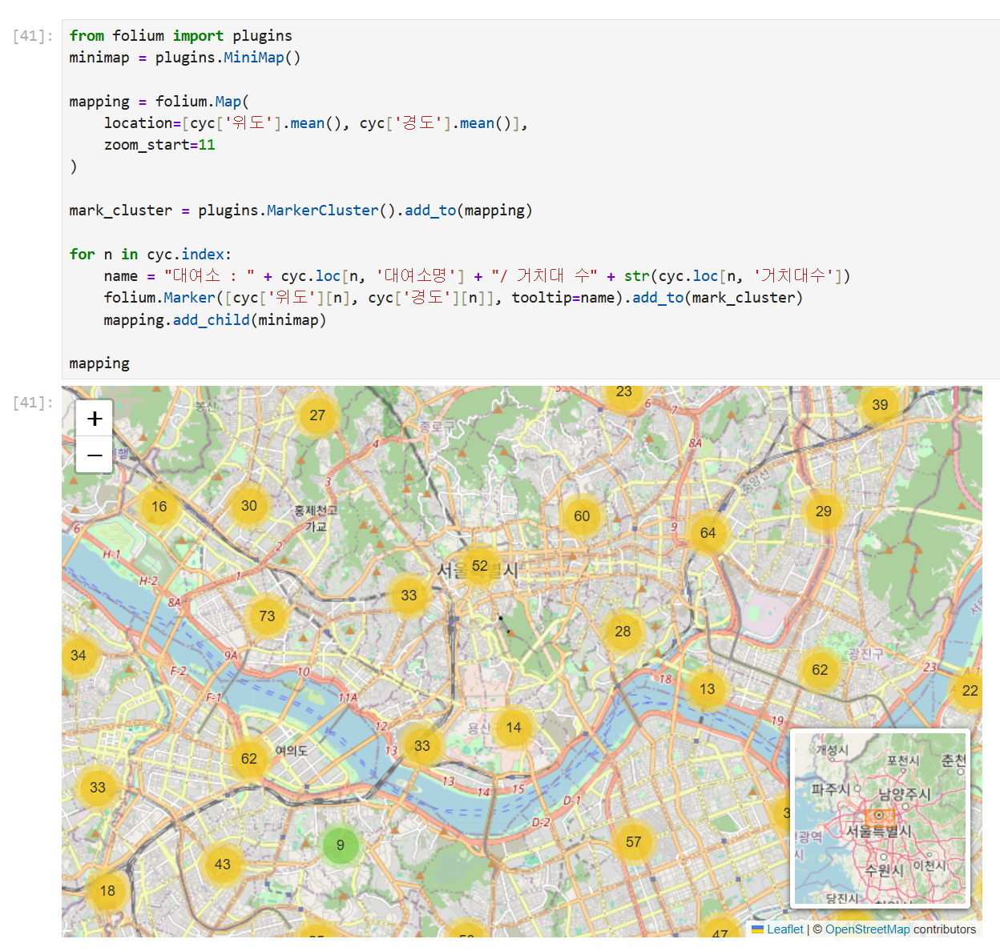
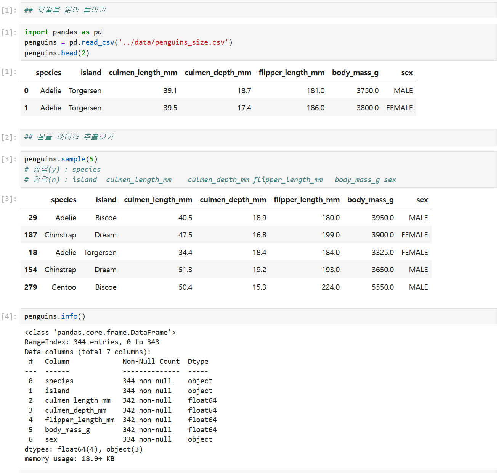
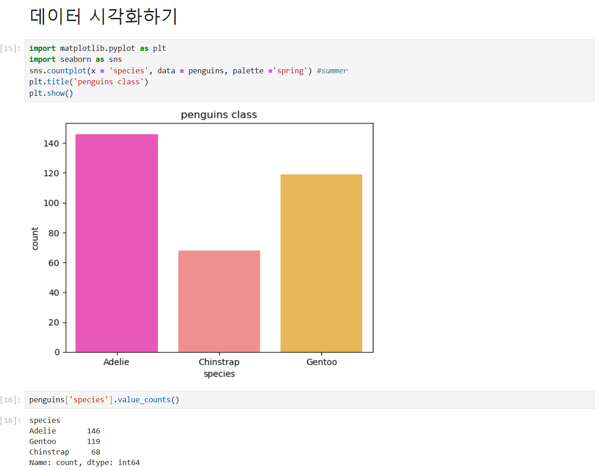
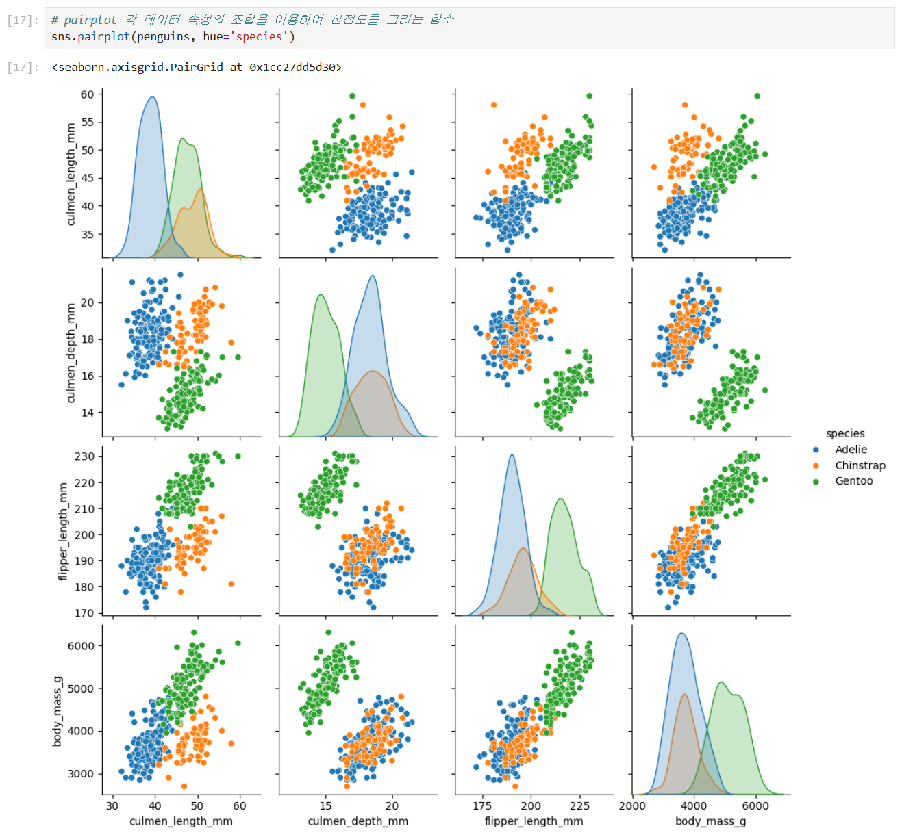
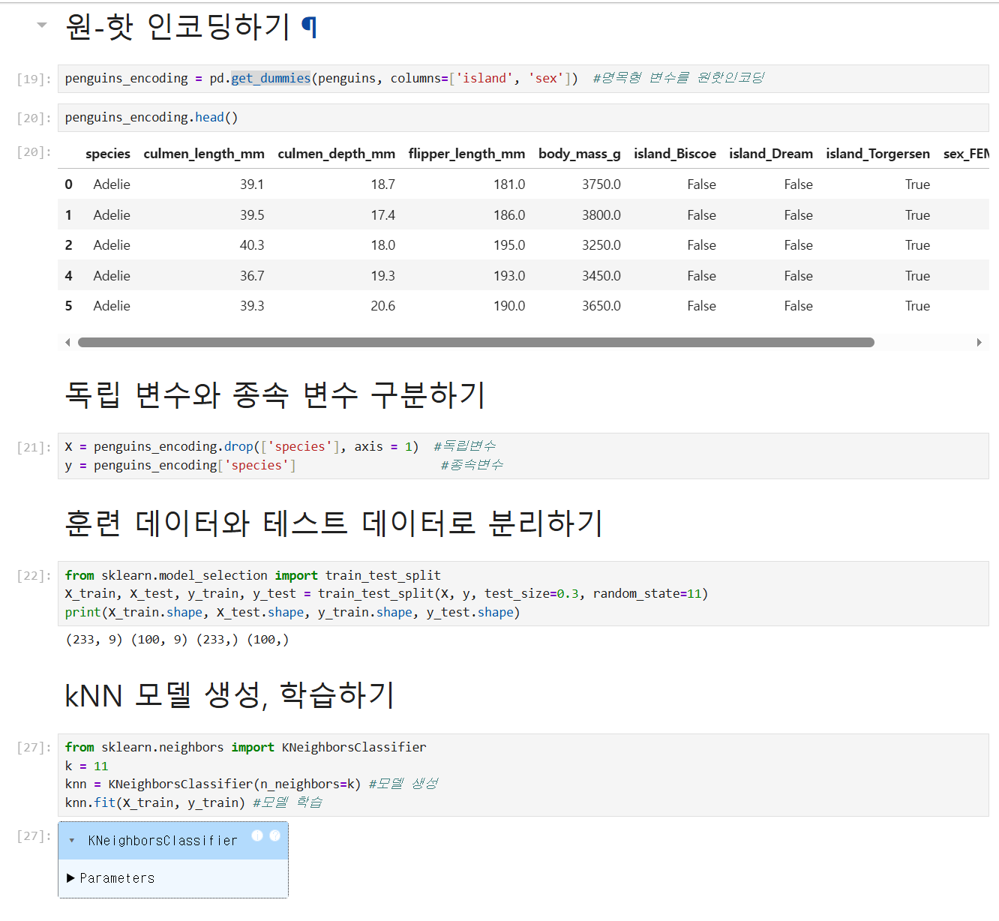
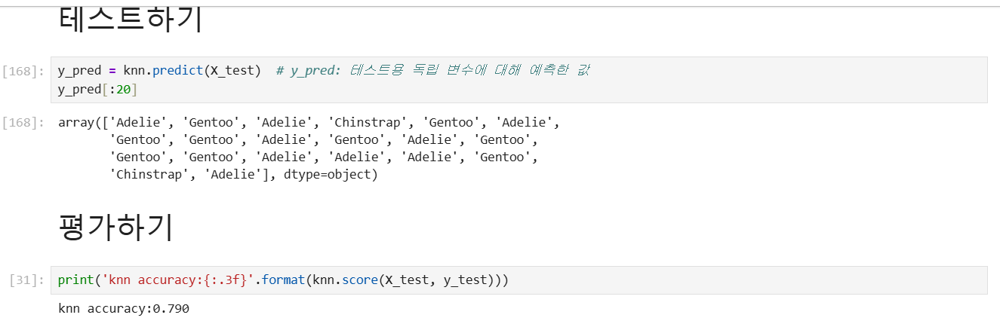
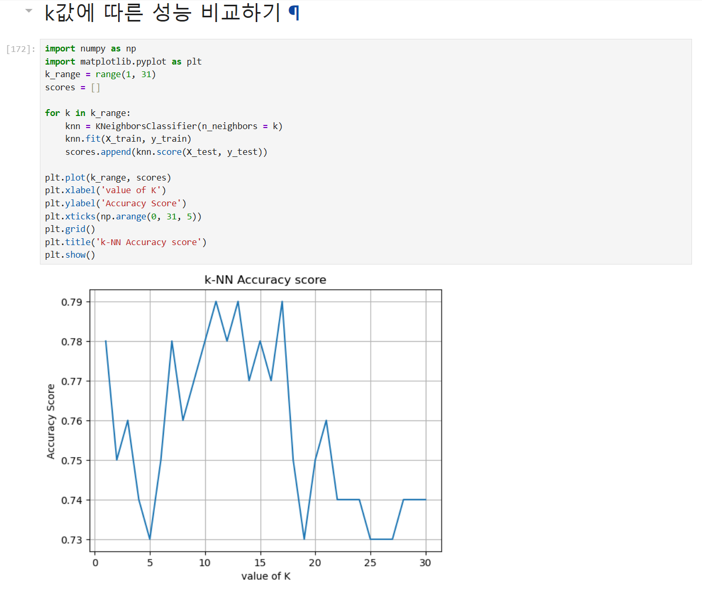
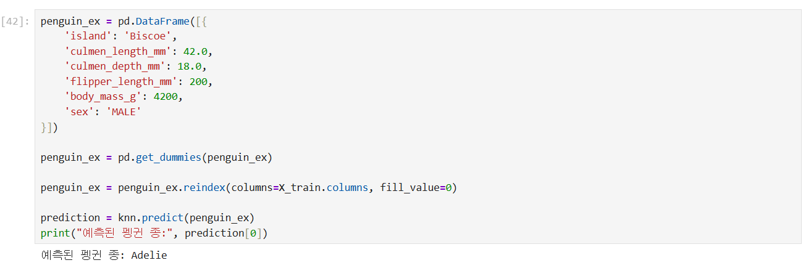

# DAY 67 — Folium 지도 시각화와 k-NN 펭귄 분류

> 2026-10-16 · Python, Folium, 머신러닝, 데이터 전처리, k-Nearest Neighbors

오늘은 Folium으로 지도를 만들고 마커·팝업·클러스터를 표시하는 방법을 학습했다. 이어서
머신러닝의 학습 유형과 학습·예측 흐름을 정리하고, 펭귄 데이터를 전처리·시각화한 뒤
k-Nearest Neighbors(k-NN) 분류 모델을 학습하고 평가했다.

## 1. 인터랙티브 데이터 시각화 도구

수업에서 소개받은 Plotly는 웹에서 확대·축소와 툴팁 같은 상호작용이 가능한 차트를 만드는
도구다. 오늘 실제 실습의 중심은 Leaflet 기반의 Python 지도 라이브러리인 Folium이었다.

```python
%pip install folium

import folium

seoul_map = folium.Map(
    location=[37.5665, 126.9780],
    zoom_start=12,
)
seoul_map
```

Jupyter Notebook에서는 현재 커널 환경에 설치되도록 `%pip`를 사용하는 편이 안전하다.
Folium의 기본 지도는 OpenStreetMap 타일을 사용하며, 공개 화면에서도 지도 하단의 저작자
표시를 유지했다.



## 2. 지도에 위치와 설명 표시하기

`Marker`에 위도·경도 좌표를 전달하고 아이콘과 팝업을 지정해 특정 위치를 표시했다.
`CircleMarker`를 사용하면 반지름·테두리·채움색을 조절해 위치의 범위나 값을 더 눈에 띄게
표현할 수 있다.

```python
folium.Marker(
    [37.5665, 126.9780],
    popup="서울 중심",
    icon=folium.Icon(color="red", icon="star"),
).add_to(seoul_map)
```



## 3. 공공자전거 대여소를 한눈에 보기

서울 공공자전거 대여소처럼 지점이 많은 데이터는 모든 마커를 한 번에 표시하면 서로
겹치기 쉽다. `MarkerCluster`로 가까운 마커를 묶고 `MiniMap`을 추가해 현재 보고 있는 지역의
위치를 함께 확인했다.

```python
from folium.plugins import MarkerCluster, MiniMap

cluster = MarkerCluster().add_to(seoul_map)

for _, station in bike_stations.iterrows():
    folium.Marker(
        [station["위도"], station["경도"]],
        tooltip=station["대여소명"],
    ).add_to(cluster)

MiniMap().add_to(seoul_map)
```



구별 값을 색으로 비교하는 `Choropleth`도 실습했다. 다만 원본 GeoJSON과 상세 대여소
데이터는 재배포 조건을 확인하지 않아 공개 저장소에는 포함하지 않았다.

## 4. 머신러닝과 딥러닝의 관계

머신러닝은 데이터에서 규칙을 학습하고, 그 규칙을 새로운 데이터에 적용해 분류하거나 값을
예측하는 기술이다. 딥러닝은 여러 층의 인공신경망을 활용하는 머신러닝의 하위 분야다.

머신러닝의 대표적인 학습 방식은 다음과 같이 구분할 수 있다.

- 지도학습: 정답 레이블이 있는 데이터로 학습하며 분류와 회귀가 대표적이다.
- 비지도학습: 정답 레이블 없이 데이터의 구조나 패턴을 찾으며 군집화가 대표적이다.
- 강화학습: 환경과 상호작용하며 누적 보상이 커지도록 행동 정책을 학습한다.

모델이 데이터에서 스스로 학습하는 값을 **모델 파라미터**, 학습 전에 사람이 정하는 설정을
**하이퍼파라미터**라고 한다. k-NN의 `k`가 하이퍼파라미터의 예다. 설정값을 바꾸는 것만큼
결측치·이상값·형식·특성 범위를 정리해 학습에 알맞은 데이터를 만드는 과정도 중요하다.

## 5. 학습과 예측의 기본 흐름

전체 데이터를 바로 모델에 학습시키면 처음 보는 데이터에서의 성능을 확인할 수 없다.
오늘은 펭귄 데이터를 훈련 데이터 70%, 테스트 데이터 30%로 나눠 학습과 평가를 분리했다.

1. 데이터를 수집하고 분석 목적에 맞게 정제한다.
2. 입력 특성 `X`와 정답 레이블 `y`를 구분한다.
3. 훈련 데이터로 모델을 학습한다.
4. 학습에 사용하지 않은 데이터로 예측 결과를 평가한다.
5. 확정한 모델에 새로운 데이터를 입력해 예측한다.

하이퍼파라미터를 고를 때 테스트 데이터의 점수를 반복해서 참고하면 테스트 데이터에 맞춰질
수 있다. 실전에서는 훈련 데이터 안에 검증 데이터를 두거나 교차검증으로 설정을 고르고,
테스트 데이터는 마지막 성능 확인에 한 번 사용하는 것이 좋다.

Kaggle은 데이터셋·Notebook·머신러닝 대회와 학습 자료를 제공하는 플랫폼으로 소개받았다.
오늘 일지에는 실제로 실행한 로컬 펭귄 분류 실습만 기록했다.

## 6. 펭귄 데이터 확인과 전처리

펭귄 데이터의 행과 열, 자료형, 결측치와 기초 통계량을 먼저 확인했다. 종(`species`)을
예측하기 위해 부리 길이·부리 깊이·날개 길이·몸무게 같은 수치형 특성과 섬·성별 같은
범주형 특성을 살펴봤다.



성별에 잘못 입력된 `.` 값을 제거하고, 수치형 결측치는 평균으로 대체했다. 남아 있는 일부
범주형 결측 행도 제거해 모델이 학습할 수 있는 형태로 정리했다. 실제 프로젝트에서는 평균
대체가 항상 최선인 것은 아니므로 결측 발생 원인과 데이터 분포를 함께 확인해야 한다.

종별 개수를 `countplot`으로 확인해 클래스 분포를 비교했다.



## 7. 특성 관계를 그래프로 탐색하기

`pairplot`으로 여러 수치형 특성의 조합을 한 화면에서 비교했다. 점의 색을 종별로 구분하니
Gentoo·Adelie·Chinstrap이 어떤 특성에서 잘 나뉘고 서로 겹치는지 확인할 수 있었다.



그래프에서 클래스가 어느 정도 구분되는지 먼저 살펴보면 모델에 사용할 특성을 선택하고
예측 결과를 해석하는 데 도움이 된다.

## 8. 원-핫 인코딩과 k-NN 학습

문자 범주인 섬과 성별을 `pd.get_dummies()`로 원-핫 인코딩하고, 종을 정답 `y`로 분리했다.
이후 같은 분할 결과를 재현할 수 있도록 `random_state=11`을 지정해 훈련·테스트 데이터를
70:30으로 나눴다.

```python
from sklearn.model_selection import train_test_split
from sklearn.neighbors import KNeighborsClassifier

penguins_encoding = pd.get_dummies(penguins, columns=["island", "sex"])
X = penguins_encoding.drop(columns="species")
y = penguins_encoding["species"]

X_train, X_test, y_train, y_test = train_test_split(
    X, y, test_size=0.3, random_state=11
)

knn = KNeighborsClassifier(n_neighbors=11)
knn.fit(X_train, y_train)
```



k-NN은 새로운 데이터와 거리가 가까운 `k`개의 훈련 데이터를 찾아 다수의 클래스로
분류한다. 거리 기반 알고리즘이므로 몸무게처럼 값의 범위가 큰 특성이 거리에 지나치게 큰
영향을 주지 않도록 표준화나 정규화를 검토해야 한다.

## 9. 예측 결과와 k값 비교

테스트 데이터로 예측한 결과와 실제 종을 비교하고, 이번 단일 분할에서 정확도 `0.790`을
확인했다. 이 수치는 오늘 사용한 전처리·분할·특성·k값에 대한 실습 결과이며, 일반적인 모델
성능을 의미하지는 않는다.



`k=1`부터 `k=30`까지 바꾸며 정확도의 변화를 그래프로 비교했다. 작은 k는 주변의 잡음에
민감해질 수 있고, 너무 큰 k는 서로 다른 클래스의 경계를 지나치게 단순화할 수 있다.



이진 분류에서 홀수 k를 사용하면 표가 같은 동률 가능성을 줄일 수 있지만, 모든 문제에서
반드시 홀수여야 하는 것은 아니다. 다중 분류에서는 홀수 k로도 동률이 생길 수 있으므로
검증 데이터나 교차검증 결과를 바탕으로 적절한 k를 선택해야 한다.

마지막에는 새 펭귄 한 마리의 특성을 학습 데이터와 같은 열 구조로 맞춘 뒤 종을 예측했다.



## 오늘의 정리

- Folium으로 기본 지도와 마커·아이콘·팝업·원형 마커를 만들었다.
- MarkerCluster와 MiniMap으로 공공자전거 대여소를 보기 쉽게 표현했다.
- 지도·비지도·강화학습과 분류·회귀·군집화의 차이를 구분했다.
- 펭귄 데이터의 결측치와 잘못된 값을 정리하고 종별 특성 분포를 시각화했다.
- 범주형 변수를 원-핫 인코딩하고 훈련·테스트 데이터로 분리했다.
- k-NN 모델을 학습·평가하고 k값에 따른 성능 변화를 비교했다.
- 거리 기반 모델에서 특성 스케일링과 올바른 검증 절차가 중요하다는 점을 확인했다.

> 공개 저장소에는 교재 PDF, 원본 Jupyter Notebook, 원본 CSV·TXT·GeoJSON을 올리지 않았다.
> 특히 API 키 형태의 값이 들어 있는 원본 텍스트와 개인 PC 사용자 경로가 보이는 설치·경고
> 화면은 제외했다. 공개 가능한 코드와 결과만 담긴 화면을 선별하고 지도 저작자 표시를
> 그대로 유지했다.
