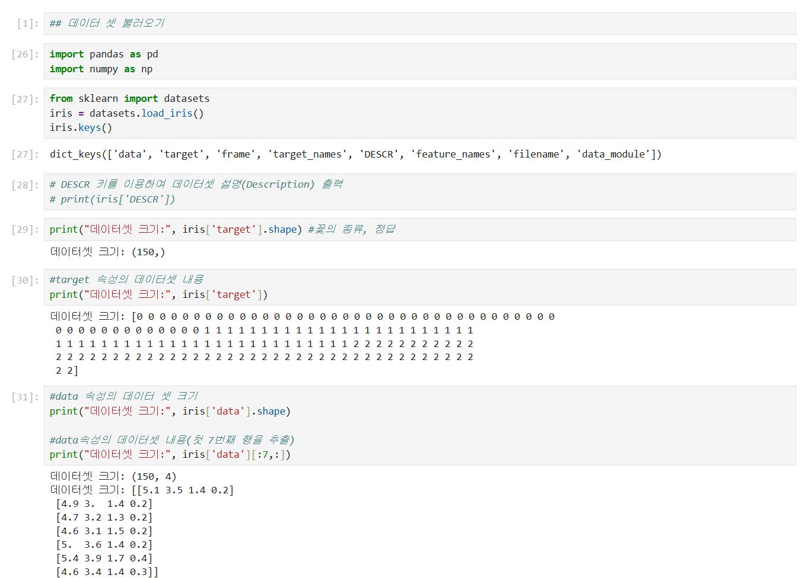
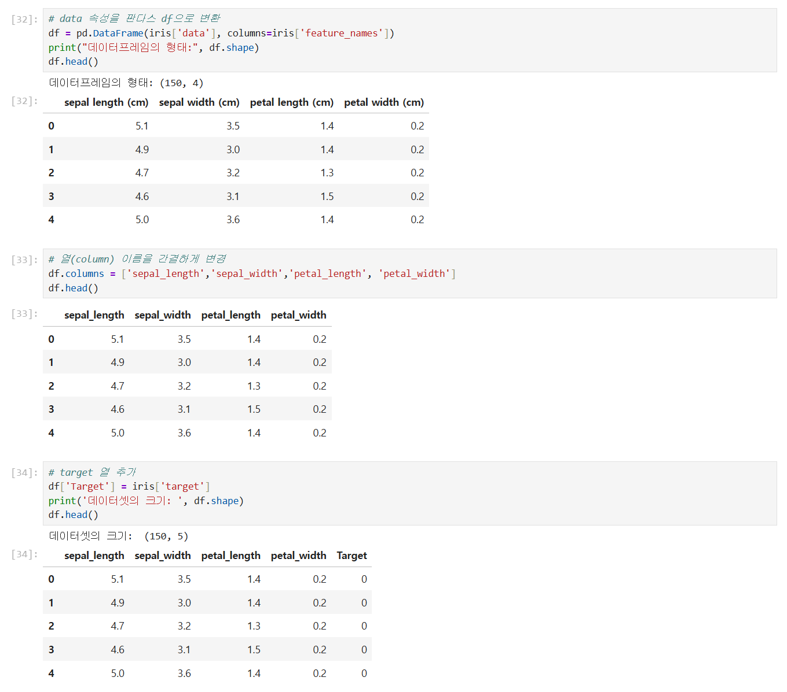
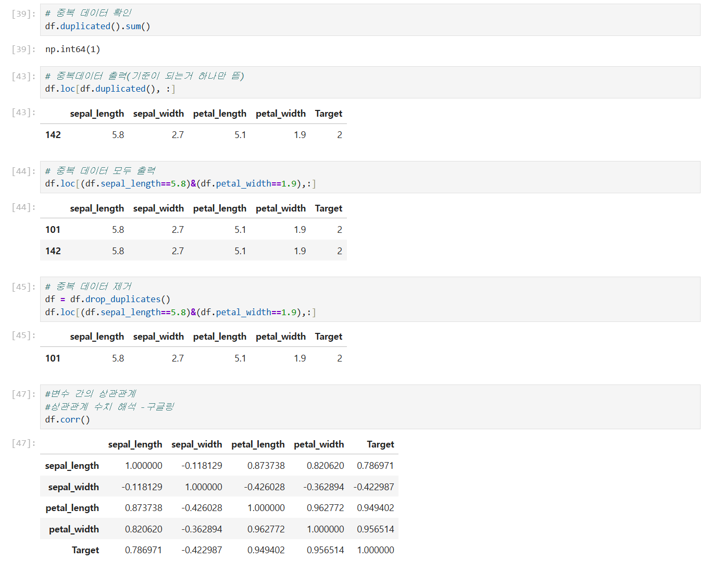
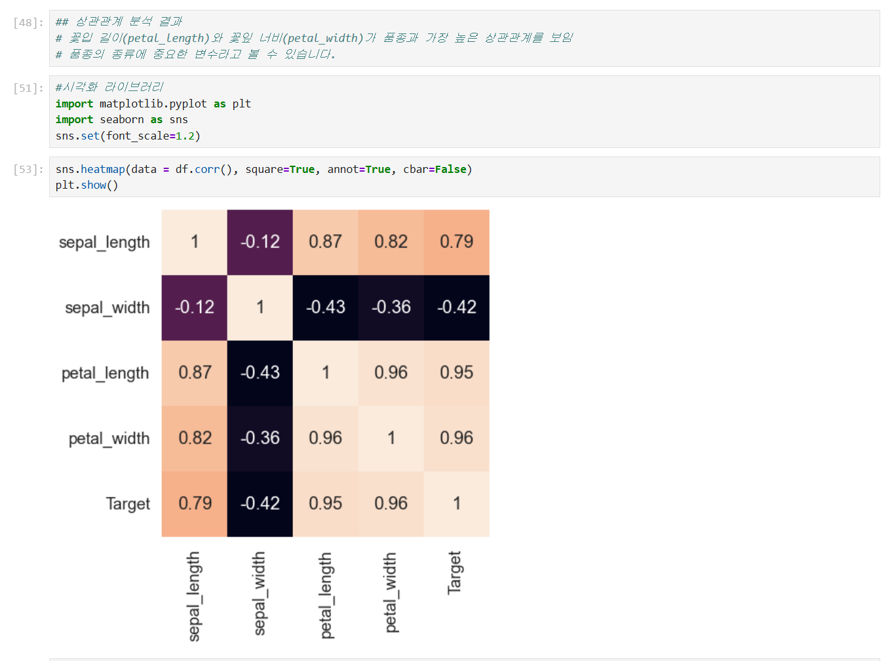
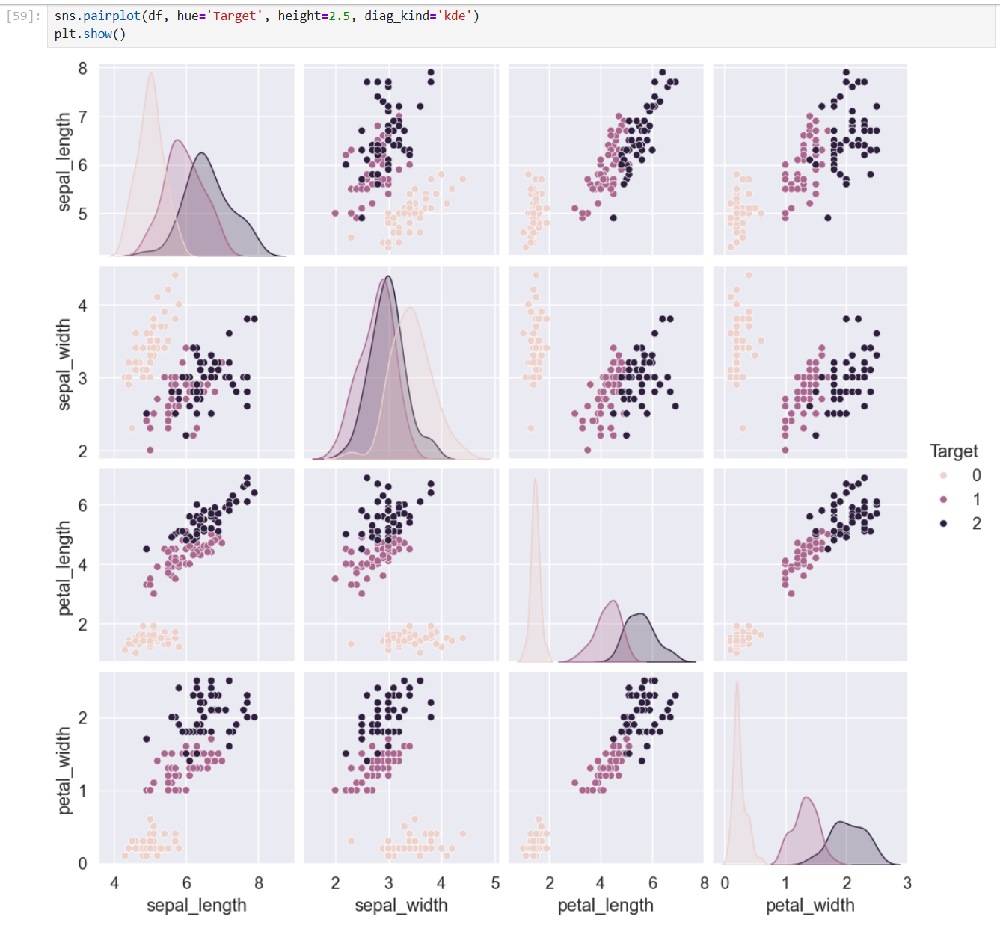
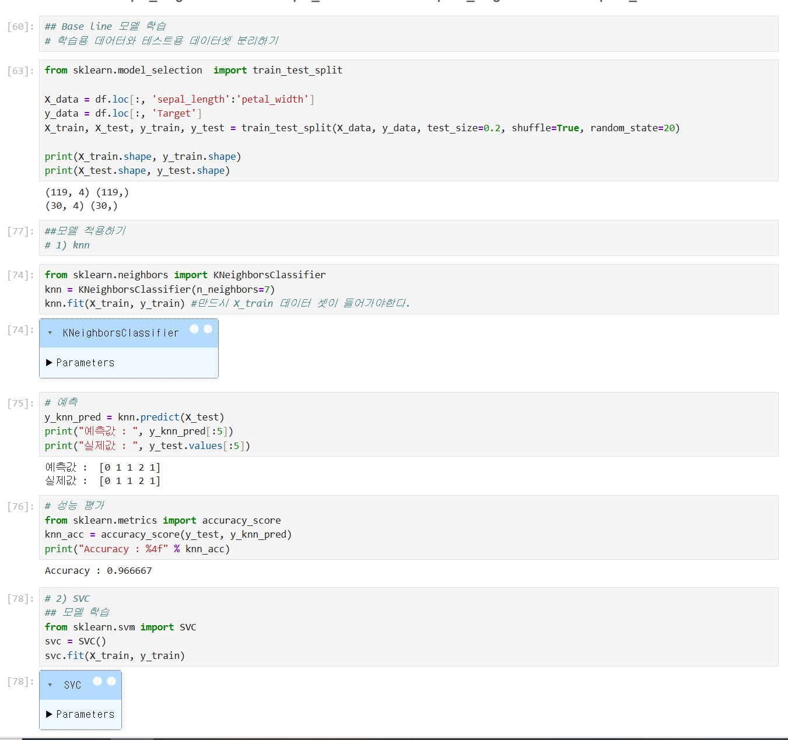
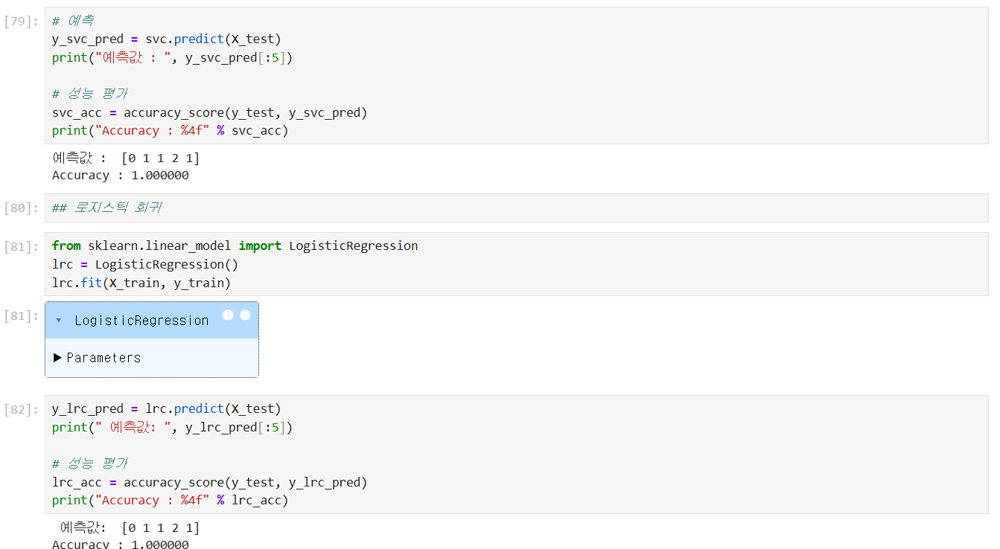
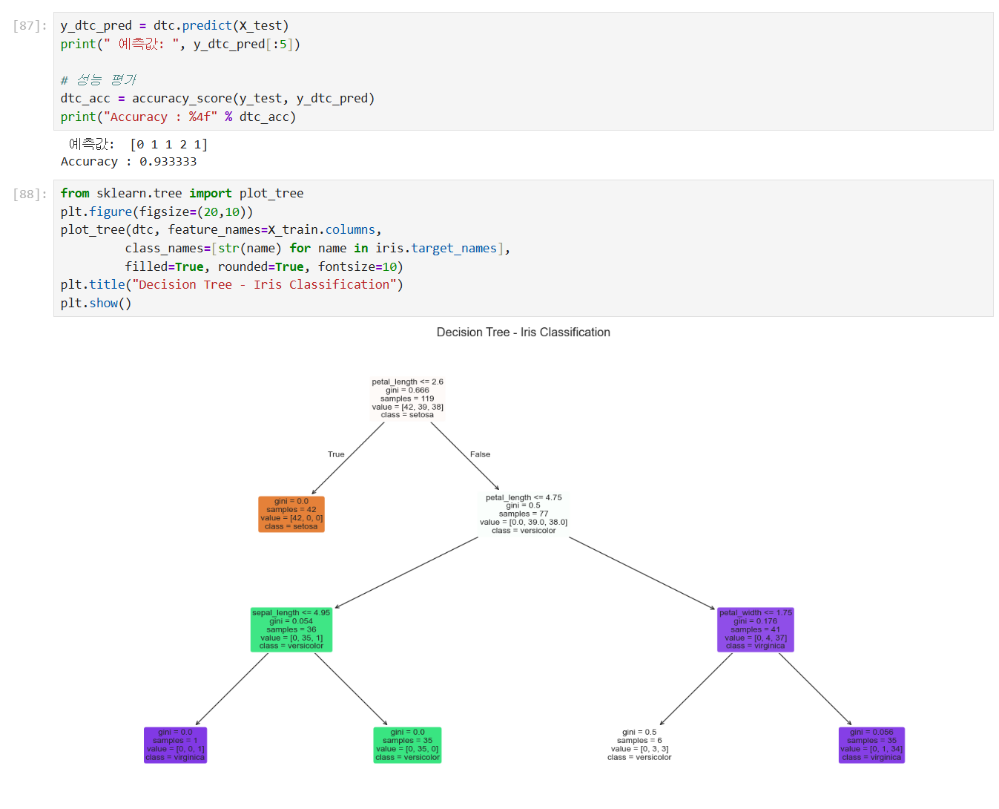

# DAY 68 — Iris 데이터 탐색과 머신러닝 분류 모델 비교

> 2026-10-17 · Python, 머신러닝, 분류, scikit-learn, Iris

오늘은 인공지능·머신러닝·딥러닝의 관계와 지도학습의 분류 알고리즘을 정리했다. 이어서
scikit-learn의 Iris 데이터를 DataFrame으로 구성하고 데이터의 품질과 분포를 탐색한 뒤,
k-NN·SVM·로지스틱 회귀·의사결정나무를 같은 훈련·테스트 데이터로 학습해 결과를 비교했다.

## 1. 인공지능·머신러닝·딥러닝의 관계

인공지능은 사람이 수행하는 인식·추론·판단 같은 지능적 작업을 컴퓨터가 수행하도록 만드는
기술을 넓게 가리킨다. 머신러닝은 명시적인 규칙을 일일이 작성하는 대신 데이터에서 패턴을
학습하고, 새로운 데이터의 값이나 범주를 예측하는 인공지능의 한 분야다. 딥러닝은 여러 층의
인공신경망으로 복잡한 특징을 학습하는 머신러닝의 하위 분야다.

수업에서 다룬 **강인공지능**과 **약인공지능**은 인공지능의 범위를 설명하는 개념적 구분이다.
현재 실제 서비스에서 사용하는 번역·추천·이미지 인식 시스템은 특정 과제에 특화된
약인공지능 또는 좁은 인공지능에 해당한다.

## 2. 머신러닝의 학습 방식과 과적합

- 지도학습: 정답 레이블이 있는 데이터로 학습하며 분류와 회귀가 대표적이다.
- 비지도학습: 정답 없이 데이터의 구조를 찾으며 군집화와 차원 축소가 대표적이다.
- 강화학습: 환경과 상호작용하며 누적 보상이 커지도록 행동 정책을 학습한다.

오늘 실습한 Iris 품종 예측은 꽃받침과 꽃잎의 길이·너비를 입력으로 사용하고 품종을 정답으로
학습하는 **지도학습 분류 문제**다. 모델이 훈련 데이터의 세부 특징과 잡음까지 외워 새로운
데이터에서 성능이 떨어지는 현상을 과적합이라고 한다. 이를 줄이려면 데이터 품질을 먼저
확인하고, 학습에 사용하지 않은 데이터로 성능을 평가하며 모델의 복잡도를 조절해야 한다.

## 3. 오늘 비교한 네 가지 분류 알고리즘

| 알고리즘 | 핵심 아이디어 | 실습에서 확인한 점 |
| --- | --- | --- |
| k-NN | 가까운 `k`개 이웃의 다수 클래스로 분류 | `k=7`로 학습했으며 거리 계산을 사용한다. |
| SVM | 클래스 사이의 여백이 큰 결정 경계를 찾음 | 기본 `SVC` 모델을 사용했다. |
| 로지스틱 회귀 | 각 클래스에 속할 확률을 계산해 분류 | `predict_proba()`로 클래스별 확률도 확인했다. |
| 의사결정나무 | 특성 조건으로 데이터를 반복 분할 | `max_depth=3`으로 깊이를 제한하고 구조를 시각화했다. |

k-NN의 `k`는 그룹 수가 아니라 판단에 사용할 **최근접 이웃의 수**다. 거리 기반인 k-NN과
SVM은 특성의 단위와 범위에 영향을 받을 수 있으므로 실제 모델 비교에서는 표준화를 포함한
파이프라인도 함께 검토해야 한다.

## 4. Iris 데이터 불러오기

scikit-learn에 포함된 Iris 데이터는 세 품종의 붓꽃 150개와 네 개의 수치형 특성으로
구성된다. 데이터와 정답의 크기, 품종 이름을 먼저 확인했다.

```python
from sklearn.datasets import load_iris

iris = load_iris()

print(iris.data.shape)    # (150, 4)
print(iris.target.shape)  # (150,)
print(iris.target_names)  # setosa, versicolor, virginica
```



## 5. DataFrame 구성과 데이터 품질 확인

네 특성의 이름을 이해하기 쉬운 열 이름으로 바꾸고 `Target` 열을 추가했다. `info()`,
`describe()`, `isnull()`로 자료형·기초 통계·결측값을 확인한 결과 결측값은 없었다.

```python
import pandas as pd

iris_df = pd.DataFrame(
    iris.data,
    columns=["sepal_length", "sepal_width", "petal_length", "petal_width"],
)
iris_df["Target"] = iris.target
```



완전히 같은 값을 가진 행 한 개를 확인하고 오늘 실습에서는 중복으로 판단해 제거하여
149행을 사용했다. 다만 값이 같다는 이유만으로 항상 잘못된 데이터인 것은 아니다. 실제
프로젝트에서는 서로 다른 표본이 우연히 같은 측정값을 가질 수 있으므로 식별자와 수집 과정을
함께 확인한 뒤 제거해야 한다.



## 6. 분포와 특성 관계 탐색

상관계수 히트맵과 히스토그램·KDE 그래프로 특성의 분포를 확인했다. 꽃잎 길이와 꽃잎 너비는
서로 강한 양의 관계를 보였고, 품종별 분포에서도 비교적 뚜렷하게 구분되는 모습을 확인했다.



`pairplot`에서는 네 특성의 모든 조합을 품종별 색으로 나누어 비교했다. Setosa는 여러 조합에서
뚜렷하게 분리되었고, Versicolor와 Virginica는 일부 영역에서 겹쳤다.



`Target`의 0·1·2는 품종에 임의로 부여한 범주 코드다. 따라서 `Target`과의 Pearson
상관계수가 높다는 사실만으로 특성 중요도를 판단하면 안 된다. 품종별 분포와 시각화,
교차검증 및 모델 기반 중요도를 함께 살펴야 한다.

## 7. 훈련 데이터와 테스트 데이터 분리

입력 특성 `X`와 정답 `y`를 나눈 뒤 데이터를 80:20으로 분리했다. `random_state=20`을
지정해 같은 분할을 재현할 수 있게 했고, 중복 제거 후 훈련 데이터 119개와 테스트 데이터
30개가 만들어졌다.

```python
from sklearn.model_selection import train_test_split

X = iris_df.drop(columns="Target")
y = iris_df["Target"]

X_train, X_test, y_train, y_test = train_test_split(
    X,
    y,
    test_size=0.2,
    shuffle=True,
    random_state=20,
)
```

## 8. k-NN 학습과 평가

최근접 이웃 수를 7로 지정해 k-NN을 학습하고 테스트 정확도를 계산했다. 이번 분할에서
정확도는 약 `0.9667`이었다.

```python
from sklearn.metrics import accuracy_score
from sklearn.neighbors import KNeighborsClassifier

knn = KNeighborsClassifier(n_neighbors=7)
knn.fit(X_train, y_train)
knn_pred = knn.predict(X_test)

print(accuracy_score(y_test, knn_pred))
```



## 9. SVM과 로지스틱 회귀 비교

같은 훈련·테스트 데이터에 기본 `SVC`와 `LogisticRegression`을 학습했다. 두 모델 모두 이번
테스트셋에서 정확도 `1.0000`을 기록했다. 로지스틱 회귀에서는 각 표본이 세 품종에 속할
확률도 함께 확인했다.

```python
from sklearn.linear_model import LogisticRegression
from sklearn.svm import SVC

svc = SVC()
svc.fit(X_train, y_train)

logistic = LogisticRegression()
logistic.fit(X_train, y_train)
class_probabilities = logistic.predict_proba(X_test)
```



## 10. 의사결정나무 학습과 시각화

의사결정나무는 깊이를 3으로 제한해 학습했고 정확도는 약 `0.9333`이었다. 트리를 그려 어떤
특성의 어떤 기준으로 품종이 나뉘는지 확인했다.

```python
from sklearn.tree import DecisionTreeClassifier, plot_tree

tree = DecisionTreeClassifier(max_depth=3, random_state=20)
tree.fit(X_train, y_train)
tree_pred = tree.predict(X_test)
```



## 11. 오늘의 모델 결과 비교

| 모델 | 설정 | 테스트 정확도 |
| --- | --- | ---: |
| k-NN | `n_neighbors=7` | 0.9667 |
| SVM | `SVC()` 기본값 | 1.0000 |
| 로지스틱 회귀 | 기본 설정 | 1.0000 |
| 의사결정나무 | `max_depth=3` | 0.9333 |

이 결과는 단 30개의 테스트 표본과 한 번의 무작위 분할에서 얻은 값이다. 따라서 SVM이나
로지스틱 회귀가 언제나 가장 좋은 모델이라고 일반화할 수 없다. 다음에는 층화 분할,
교차검증, 혼동행렬과 정밀도·재현율·F1 점수를 함께 사용해 비교할 필요가 있다.

## 12. 새 꽃의 품종 예측

꽃받침과 꽃잎의 측정값 두 개를 입력했을 때 k-NN과 의사결정나무 모두 첫 번째 표본을
Setosa, 두 번째 표본을 Virginica로 예측했다. 학습 때 사용한 열 이름을 그대로 지정한
DataFrame을 입력하면 배열만 전달했을 때 발생할 수 있는 특성 이름 경고도 피할 수 있다.

```python
new_flowers = pd.DataFrame(
    [
        [5.1, 3.5, 1.4, 0.2],
        [6.3, 3.3, 6.0, 2.5],
    ],
    columns=X_train.columns,
)

print(iris.target_names[knn.predict(new_flowers)])
print(iris.target_names[tree.predict(new_flowers)])
```

## 오늘의 정리

- 인공지능·머신러닝·딥러닝의 관계와 지도·비지도·강화학습을 구분했다.
- k-NN·SVM·로지스틱 회귀·의사결정나무의 분류 방식을 비교했다.
- Iris 데이터를 DataFrame으로 구성하고 결측값·중복값·기초 통계를 확인했다.
- 히트맵·분포 그래프·pairplot으로 특성과 품종의 관계를 탐색했다.
- 데이터를 80:20으로 나누고 네 가지 분류 모델을 같은 테스트셋에서 평가했다.
- 한 번의 정확도만으로 모델의 우열을 단정할 수 없으며 더 신뢰도 높은 검증이 필요함을 확인했다.

> 공개 저장소에는 저작권이 있는 교재 PDF, 원본 Jupyter Notebook과 수업 메모를 올리지 않았다.
> 또한 개인 PC의 사용자 경로가 나타난 경고 화면과 미완성 코드 화면은 제외하고, 계정·키·경로가
> 노출되지 않은 실습 결과 화면만 선별했다.
