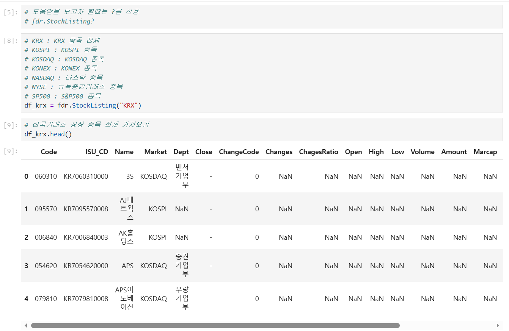
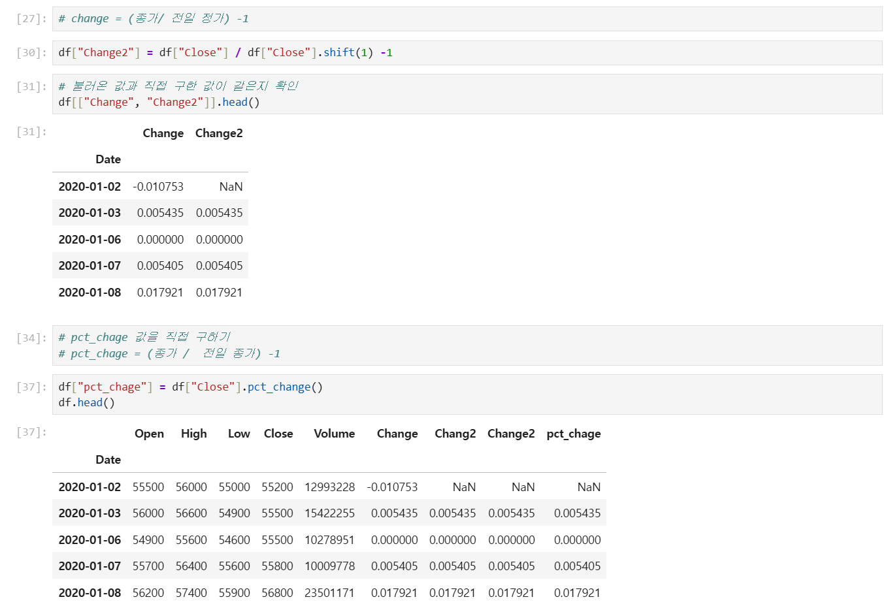
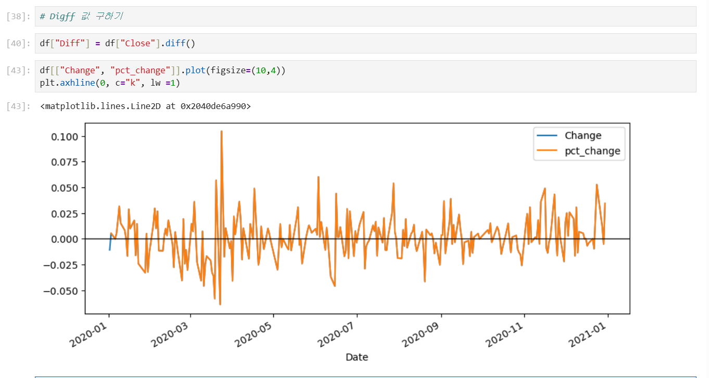
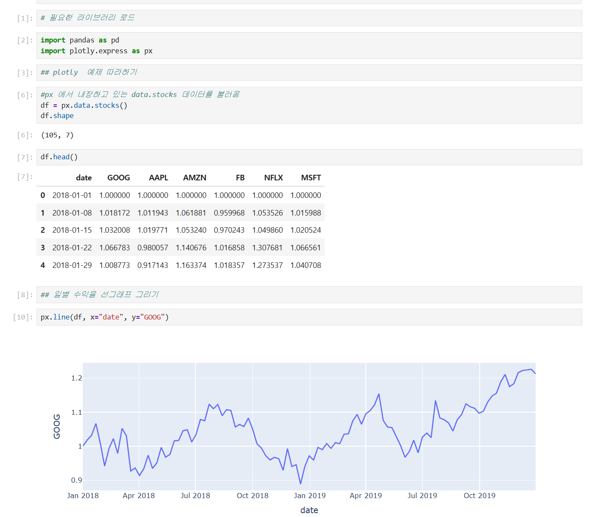
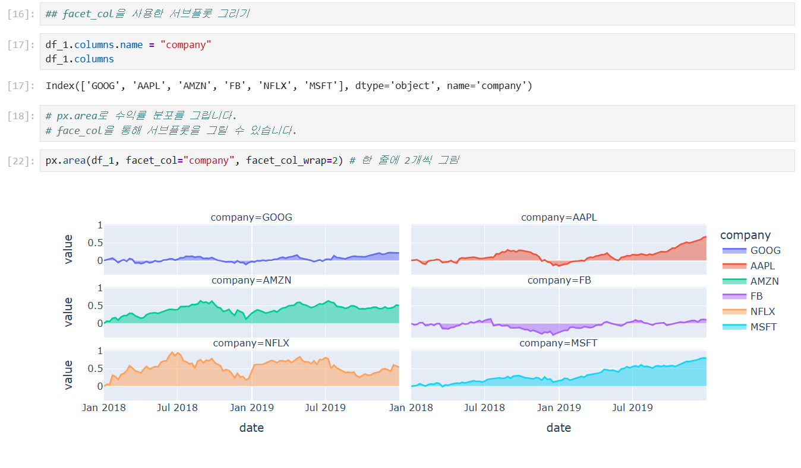
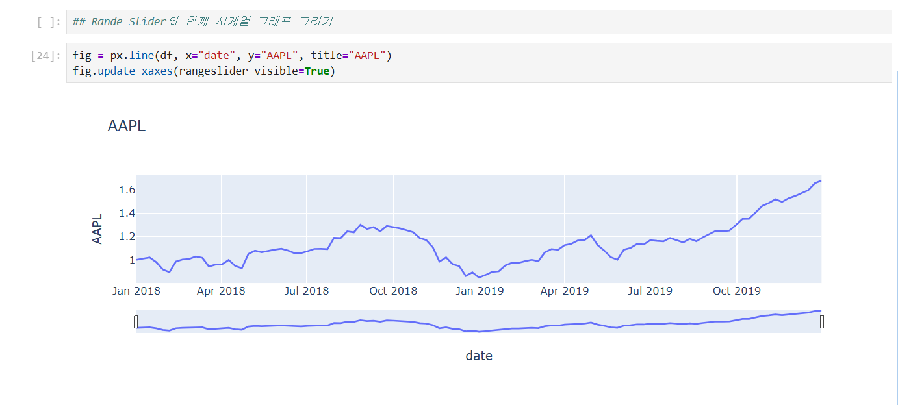
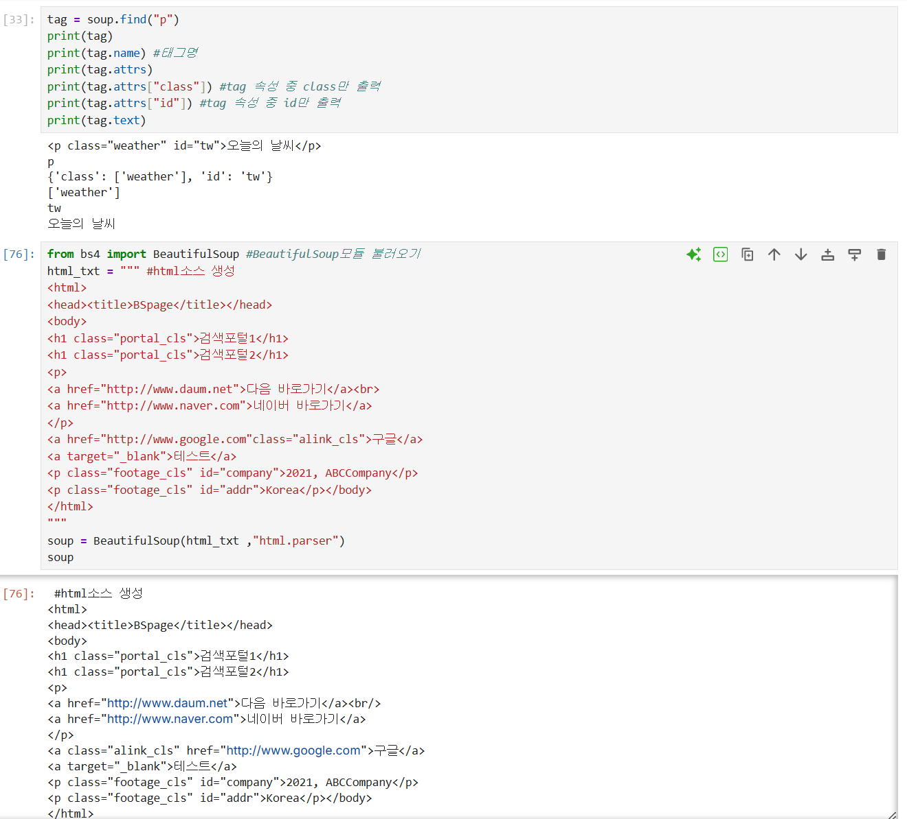
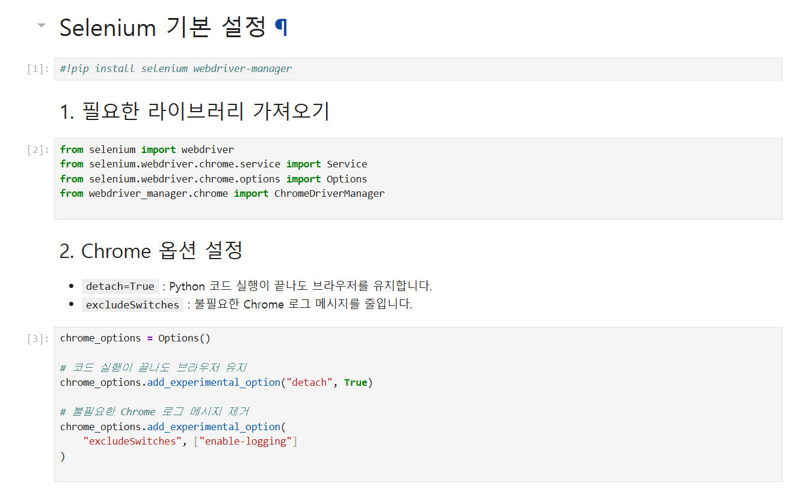

# DAY 69 — 금융 데이터 시각화와 웹 크롤링 실습

> 2026-10-19 · Python, FinanceDataReader, Plotly, BeautifulSoup, Selenium

오늘은 FinanceDataReader로 국내 주식 목록과 일별 시세를 불러와 전일 대비 수익률을 계산하고,
Matplotlib과 Plotly로 시계열을 시각화했다. 이어서 requests·BeautifulSoup으로 정적 HTML을
수집·탐색하고 Selenium으로 동적 웹 페이지를 제어하는 흐름을 실습했다. 마지막에는 생성형
AI와 LLM의 기본 개념, 그리고 웹 데이터를 수집할 때 지켜야 할 보안·윤리 원칙을 정리했다.

## 1. 오늘의 학습 흐름

- FinanceDataReader로 KRX 종목 목록과 삼성전자 OHLCV 데이터 조회
- `shift()`, `diff()`, `pct_change()`로 시계열 변화량과 수익률 계산
- Plotly Express로 선·막대·면적 그래프와 범위 슬라이더 구성
- requests·BeautifulSoup의 요청, HTML 파싱과 CSS 선택자 실습
- Selenium으로 브라우저를 제어하고 동적 페이지 자동화 흐름 확인
- 생성형 AI와 대규모 언어 모델(LLM)의 기본 개념 정리

## 2. FinanceDataReader로 금융 데이터 조회

FinanceDataReader의 `StockListing("KRX")`로 국내 상장 종목 목록을 확인하고,
`DataReader()`로 삼성전자 종목 코드 `005930`의 일별 시세를 불러왔다. 결과에는 시가·고가·저가·
종가·거래량과 등락률이 포함되어 있어 날짜를 인덱스로 사용하는 시계열 DataFrame으로 바로
분석할 수 있었다.

```python
import FinanceDataReader as fdr

krx = fdr.StockListing("KRX")
samsung = fdr.DataReader("005930", "2020-01-01", "2020-12-31")

print(krx[["Code", "Name", "Market"]].head())
print(samsung[["Open", "High", "Low", "Close", "Volume", "Change"]].head())
```



## 3. 전일 대비 변화량과 수익률 계산

`shift(1)`은 이전 행의 값을 현재 행과 나란히 배치한다. 이를 이용해 오늘 종가를 전일 종가로
나누고 1을 빼면 일별 수익률을 직접 계산할 수 있다. 같은 결과를 `pct_change()`로 더 간단하게
구할 수 있으며, `diff()`는 비율이 아닌 종가의 절대 변화량을 계산한다.

```python
samsung["previous_close"] = samsung["Close"].shift(1)
samsung["daily_return"] = samsung["Close"] / samsung["previous_close"] - 1
samsung["daily_return_by_pandas"] = samsung["Close"].pct_change()
samsung["close_difference"] = samsung["Close"].diff()
```

첫 번째 행은 조회 범위 안에 전일 데이터가 없으므로 계산 결과가 `NaN`이 된다. 직접 계산한
수익률과 `pct_change()` 결과가 둘째 행부터 일치하는 것도 확인했다.



Matplotlib으로 기존 `Change` 열과 직접 계산한 수익률을 함께 그려 값의 흐름이 겹치는지
비교했다. 수치만 확인하는 것보다 그래프로 비교하니 계산식이 올바르게 적용됐는지 빠르게
검증할 수 있었다.



## 4. Plotly로 인터랙티브 시계열 시각화

Plotly Express의 예제 주가 데이터로 선 그래프를 만들고 확대·이동·영역 선택 같은 상호작용을
사용해 보았다. 이후 여러 회사의 기준일 대비 상대 변화량으로 막대 그래프와 종목별 면적
서브플롯을 구성하고, x축에 범위 슬라이더를 추가했다.

```python
import plotly.express as px

stocks = px.data.stocks()

fig = px.line(stocks, x="date", y="GOOG", title="Google stock")
fig.update_xaxes(rangeslider_visible=True)
fig.show()
```







예제 데이터에서 각 값에 1을 빼는 계산은 **기준일을 1로 둔 상대 변화량**이며 일별 수익률과는
다르다. 날짜별 수익률이 필요할 때는 종목별로 `pct_change()`를 적용해야 한다.

## 5. requests와 BeautifulSoup으로 정적 페이지 읽기

정적 웹 페이지는 requests로 HTTP 응답을 받고 BeautifulSoup으로 HTML 구조를 분석했다.
요청이 무한정 기다리지 않도록 `timeout`을 지정하고, 상태 코드가 오류인 경우 예외를 발생시키는
방식도 함께 정리했다.

```python
import requests
from bs4 import BeautifulSoup

response = requests.get(
    "https://example.com",
    params={"page": 1},
    timeout=10,
)
response.raise_for_status()

soup = BeautifulSoup(response.text, "html.parser")
title = soup.select_one("h1")
links = soup.select("body p > a[href]")
```

`params=`는 GET뿐 아니라 POST에서도 URL의 쿼리 문자열을 만들 때 사용한다. POST 요청 본문으로
폼 데이터를 보낼 때는 `data=`, JSON을 보낼 때는 `json=`을 사용한다는 차이도 확인했다.



`find()`와 `select_one()`은 한 요소를, `select()`는 조건에 맞는 여러 요소를 찾는다. 태그,
클래스, ID, 속성, 부모·자식 관계를 조합한 CSS 선택자를 사용할 수 있지만 사이트의 DOM이
바뀌면 선택자도 함께 점검해야 한다.

## 6. Selenium으로 동적 페이지 제어

JavaScript로 내용이 그려지는 페이지는 HTML 응답만으로 원하는 요소를 얻기 어려울 수 있다.
Selenium에서 Chrome 옵션과 드라이버를 준비하고 페이지 이동, 요소 선택, 클릭, 화면 저장과
브라우저 종료 흐름을 실습했다.

```python
from selenium import webdriver
from selenium.webdriver.chrome.options import Options
from selenium.webdriver.common.by import By
from selenium.webdriver.support import expected_conditions as EC
from selenium.webdriver.support.ui import WebDriverWait

options = Options()
options.add_experimental_option("detach", True)

driver = webdriver.Chrome(options=options)
try:
    driver.get("https://example.com")
    heading = WebDriverWait(driver, 10).until(
        EC.presence_of_element_located((By.CSS_SELECTOR, "h1"))
    )
finally:
    driver.quit()
```



Opinet 실습에서는 시·도와 시·군·구 선택 목록을 읽고 서울 24개 구를 차례로 선택해 엑셀
버튼을 누르는 반복 흐름을 구성했다. 계정 기반 SNS 페이지에서는 DOM 선택자가 달라져 요소를
찾지 못했고, YouTube 수집 결과에서는 검색어와 결과가 일치하는지 추가 검증이 필요했다.
따라서 오늘은 이를 완성된 수집 결과가 아니라 **동적 페이지 자동화의 불안정성과 검증 필요성**을
확인한 트러블슈팅으로 기록했다.

고정된 `sleep()`만 사용하면 네트워크 속도에 따라 실패할 수 있으므로 `WebDriverWait`으로 필요한
요소가 나타날 때까지 기다리는 편이 안정적이다. 창이나 세션이 닫힌 뒤에는 기존 driver를 다시
사용할 수 없으므로 종료 시점도 명확하게 관리해야 한다.

## 7. 생성형 AI와 LLM 기본 개념

생성형 AI는 학습 데이터에서 패턴을 익혀 텍스트·이미지·음악·코드 같은 새로운 결과를 만드는
기술이다. LLM은 대규모 텍스트 데이터의 통계적 패턴과 문맥 관계를 학습해 다음 토큰을 예측하는
방식으로 텍스트를 생성한다. 사람과 똑같이 의미를 이해한다고 단정할 수 없으며, 그럴듯하지만
사실과 다른 답을 만들 수 있으므로 출처 확인과 결과 검증이 필요하다.

## 8. 웹 수집의 윤리와 보안 원칙

- 사이트의 이용약관과 `robots.txt`를 먼저 확인하고 허용된 범위만 수집한다.
- 요청 간격을 두고 필요한 데이터만 받아 서버에 과도한 부하를 주지 않는다.
- 개인정보·저작권이 있는 본문·로그인 후 콘텐츠를 임의로 저장하거나 재배포하지 않는다.
- 공식 API가 제공되면 화면 자동화보다 API를 우선 검토한다.
- 아이디·비밀번호·토큰은 Notebook에 직접 쓰지 않고 환경변수나 비밀 저장소로 분리한다.
- 수집 결과는 개수, 범위, 검색 조건과 일치하는지 확인한 뒤 사용한다.

## 오늘의 정리

- FinanceDataReader로 KRX 목록과 주식 OHLCV 데이터를 조회했다.
- `shift()`, `diff()`, `pct_change()`의 역할을 구분하고 일별 수익률을 검증했다.
- Plotly로 상호작용 가능한 선·면적 그래프와 범위 슬라이더를 구성했다.
- requests와 BeautifulSoup으로 정적 HTML을 요청하고 CSS 선택자로 원하는 요소를 찾았다.
- Selenium 자동화에서 명시적 대기, 선택자 변경, 세션 관리와 결과 검증의 중요성을 확인했다.
- 생성형 AI와 LLM의 기본 개념, 환각 가능성과 검증 필요성을 정리했다.

> 공개 저장소에는 저작권이 있는 교재 PDF, 원본 Notebook과 수집 데이터 파일을 올리지 않았다.
> 로그인 정보·개인 PC 경로·브라우저 세션값·원시 웹 콘텐츠가 나타난 화면도 제외하고, 계정·키·
> 경로가 노출되지 않은 실습 결과 화면만 선별했다.
