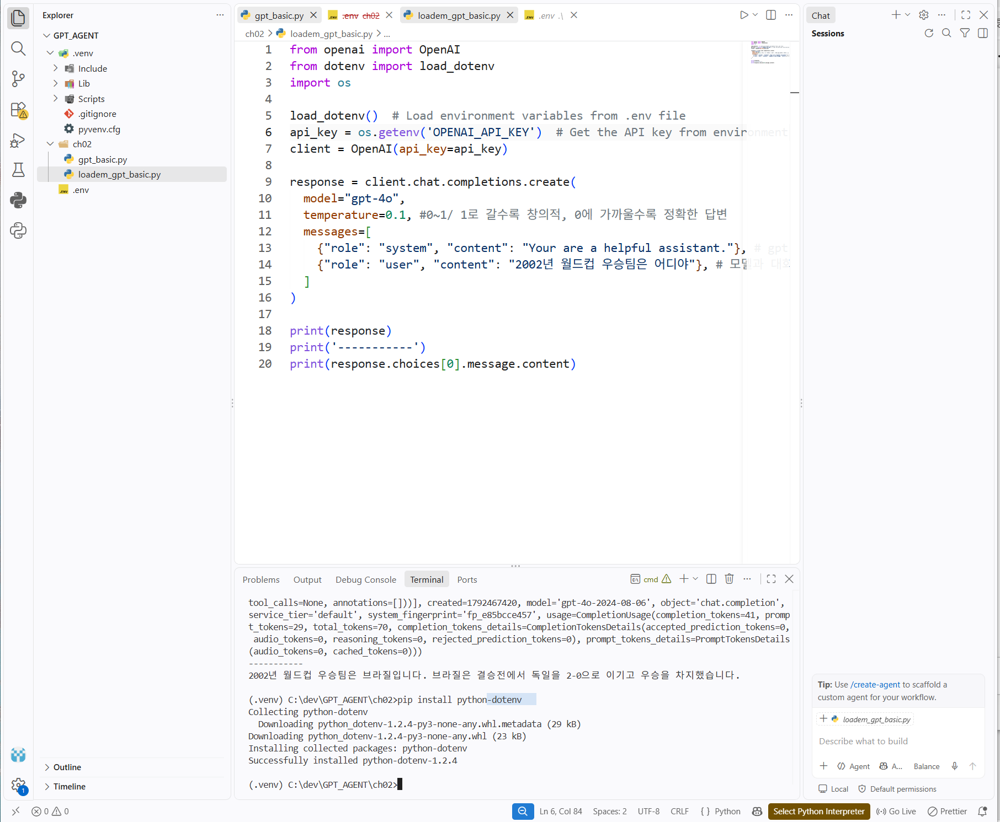
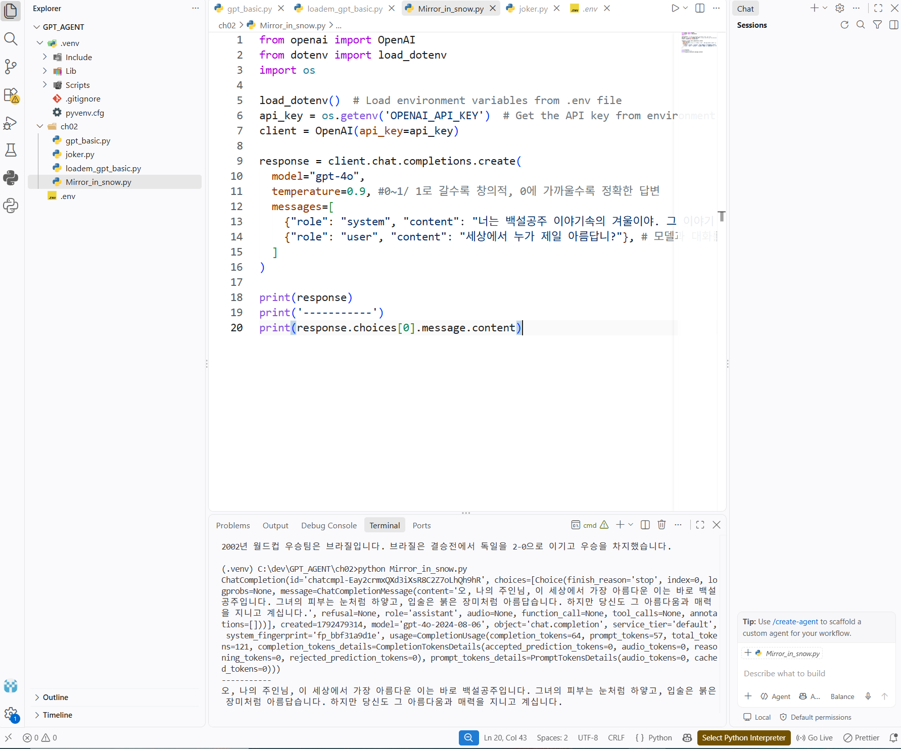

# DAY 70 — LLM 기초와 OpenAI API·Streamlit 챗봇 실습

> 2026-10-20 · Python, LLM, Prompt Engineering, OpenAI API, Streamlit

오늘은 생성형 AI와 대규모 언어 모델(LLM)의 학습 흐름을 정리하고, Python에서 OpenAI API를
호출해 역할 프롬프트와 zero-shot·one-shot·few-shot 방식의 차이를 실습했다. 이어서
single-turn과 multi-turn 대화의 문맥 관리 방식을 비교하고, Streamlit의 세션 상태를 이용해
대화 기록이 유지되는 간단한 챗봇 화면까지 연결했다.

## 1. 오늘의 학습 흐름

- 파운데이션 모델, 사전학습·미세조정과 RLHF의 관계 정리
- LLM의 환각과 RAG·도구 호출을 통한 보완 방법 이해
- 프롬프트의 역할과 지시·예시·제약 기반 작성 방식 비교
- Python OpenAI SDK의 `messages`, `temperature`, 응답 구조 실습
- `.env`와 환경변수를 이용해 API 키를 코드에서 분리
- 역할 프롬프트와 zero-shot·one-shot·few-shot 결과 비교
- single-turn과 multi-turn의 대화 문맥 유지 방식 비교
- Streamlit `session_state`로 대화 기록을 유지하는 챗봇 구성

## 2. LLM은 어떻게 학습하고 조정되는가

LLM은 많은 텍스트에서 토큰 사이의 관계와 문맥 패턴을 학습해 다음에 올 내용을 예측한다.
광범위한 데이터로 사전학습되어 여러 작업에 다시 활용할 수 있는 범용 기반 모델을
**파운데이션 모델**이라고 한다. 파운데이션 모델은 언어 모델에만 한정되는 개념은 아니며,
추가 학습이나 프롬프트를 통해 다양한 작업에 맞게 사용할 수 있다.

```text
대규모 데이터 사전학습
        ↓
여러 작업에 활용 가능한 기반 모델
        ↓
지시 데이터 미세조정
        ↓
사람의 선호 피드백을 반영한 정렬(RLHF 등)
```

- **사전학습(Pre-training)**: 많은 데이터에서 일반적인 패턴과 표현을 학습한다.
- **미세조정(Fine-tuning)**: 특정 작업이나 도메인에 맞는 데이터로 모델을 추가 학습한다.
- **RLHF**: 사람이 응답을 평가한 선호 정보를 보상 신호로 활용해 더 유용한 답변을
  생성하도록 조정하는 방법이다.

## 3. 환각, RAG와 AI 에이전트

LLM은 자연스러운 문장을 만들더라도 사실과 다른 내용을 자신 있게 답할 수 있다. 이를
**환각(Hallucination)**이라고 한다. 따라서 모델의 문장만 신뢰하기보다 근거 자료와 결과를
함께 검증해야 한다.

RAG는 질문과 관련된 외부 문서나 데이터베이스 정보를 먼저 검색한 뒤, 그 내용을 모델의
입력에 포함해 답변을 생성하는 방식이다. 최신 정보와 사내 자료처럼 모델이 알기 어려운
근거를 보강할 수 있지만, 검색 결과가 부정확하거나 모델이 근거를 잘못 해석할 수 있으므로
환각을 완전히 없애거나 정답을 보장하는 방법은 아니다.

AI 에이전트는 목표를 달성하기 위해 환경을 인식하고, 다음 행동을 판단하며, 필요한 도구를
호출하고 결과를 다시 확인하는 흐름을 가진다. 단순히 한 번 답변하는 모델 호출과 달리 여러
단계를 이어서 수행한다는 점이 핵심이다.

## 4. 프롬프트 엔지니어링

프롬프트는 모델이 수행할 작업, 필요한 배경, 출력 조건과 예시를 전달하는 입력이다. 같은
질문이라도 역할과 조건을 얼마나 분명하게 전달하는지에 따라 결과가 달라질 수 있다.

| 방식 | 핵심 | 활용 예시 |
| --- | --- | --- |
| 지시 기반 | 수행할 작업을 명확히 설명 | “세 문장으로 요약해 줘” |
| 예시 기반 | 원하는 입력·출력 패턴을 제시 | 분류 라벨이나 말투 예시 제공 |
| 제약 기반 | 길이·형식·범위를 제한 | 표로 작성, 특정 항목만 포함 |
| 역할 부여 | 응답 관점과 말투를 지정 | 상담사·교사·동화 속 인물 역할 |

예시의 수에 따라 다음과 같이 구분할 수 있다.

- **Zero-shot**: 예시 없이 지시와 질문만 전달한다.
- **One-shot**: 하나의 입력·출력 예시로 원하는 패턴을 보여 준다.
- **Few-shot**: 몇 개의 예시를 제공해 모델이 규칙이나 형식을 더 분명하게 파악하도록 한다.

복잡한 문제는 내부 사고 과정을 그대로 요구하기보다 문제를 작은 단계로 나누고, 필요한
근거와 검증 절차를 명시하는 방식으로 요청하면 결과를 점검하기 쉽다.

## 5. OpenAI SDK와 API 키 관리

실습에 필요한 라이브러리를 가상환경에 설치하고 OpenAI 클라이언트를 생성했다.

```bash
pip install openai python-dotenv streamlit
```

API 키를 Python 파일에 직접 작성하면 저장소나 캡처를 통해 노출될 수 있다. 키는 `.env` 또는
운영체제 환경변수에 저장하고, `.env`는 Git 추적 대상에서 제외해야 한다.

```dotenv
# .env — 실제 값은 저장소에 올리지 않는다.
OPENAI_API_KEY=your_api_key_here
```

```gitignore
.env
.venv/
```

OpenAI SDK는 `OPENAI_API_KEY` 환경변수를 자동으로 읽을 수 있다. 오늘 실습은
Chat Completions 방식으로 진행했다.

```python
from dotenv import load_dotenv
from openai import OpenAI

load_dotenv()
client = OpenAI()

response = client.chat.completions.create(
    model="gpt-4o",  # 실습 시점에 사용한 모델
    messages=[
        {"role": "system", "content": "친절하고 간결한 도우미로 답해 줘."},
        {"role": "user", "content": "2002년 월드컵 우승팀은 어디야?"},
    ],
)

print(response.choices[0].message.content)
```



현재 OpenAI 공식 문서는 새 프로젝트의 기본 인터페이스로 Responses API를 안내하지만,
Chat Completions도 계속 지원한다. 이 기록은 수업에서 직접 실행한 Chat Completions 코드를
기준으로 작성했다. 최신 사용법은 [OpenAI Python API 문서](https://developers.openai.com/api/reference/python)에서
확인할 수 있다.

## 6. 메시지 역할, 응답과 temperature

Chat Completions의 `messages`는 대화 순서대로 역할과 내용을 담는다.

| 역할 | 의미 |
| --- | --- |
| `system` | 모델의 기본 역할·말투·응답 원칙 설정 |
| `user` | 사용자의 질문이나 요청 |
| `assistant` | 모델의 이전 응답 또는 예시 응답 |

전체 응답 객체에는 생성된 답변뿐 아니라 사용 모델, 종료 이유와 토큰 사용량 등이 들어 있다.
본문만 필요할 때는 `response.choices[0].message.content`로 접근했다. 토큰 사용량은 입력 토큰,
출력 토큰과 두 값을 합한 전체 토큰으로 나누어 확인할 수 있다.

`temperature`를 낮추면 결과가 비교적 일관되고, 높이면 표현의 다양성이 커지는 경향이 있다.
다만 낮은 값이 사실 정확도를 보장하는 것은 아니며, 지원 범위와 동작은 모델에 따라 달라질
수 있다.

역할 프롬프트에서는 동화 속 마법 거울 역할을 `system` 메시지로 지정하고 같은 질문에 일반적인
도우미와 다른 말투로 답하는 것을 확인했다.



## 7. Zero-shot·one-shot·few-shot 비교

동물 이름에 맞는 소리를 답하도록 구성해 예시 개수에 따른 차이를 확인했다.

```python
messages = [
    {"role": "system", "content": "어린이가 이해하기 쉬운 말로 답해 줘."},
    {"role": "user", "content": "참새"},
    {"role": "assistant", "content": "짹짹"},
    {"role": "user", "content": "말"},
    {"role": "assistant", "content": "히이잉"},
    {"role": "user", "content": "호랑이"},
]
```

예시가 있으면 모델이 단순 설명보다 짧은 의성어 형식을 따라갈 가능성이 높아졌다. 그러나 같은
프롬프트도 매번 완전히 동일한 답을 내는 것은 아니므로, 반드시 지켜야 하는 출력 형식은 예시와
제약 조건을 함께 쓰고 결과 검증도 추가해야 한다.

## 8. Single-turn과 multi-turn 문맥 관리

single-turn 실습에서는 반복 입력을 받더라도 API에 현재 질문만 보냈다. 화면상으로는 대화가
이어지는 것처럼 보여도 이전 사용자 메시지가 다음 요청에 포함되지 않으므로 모델은 실제로 앞선
대화를 기억하지 못한다.

multi-turn 실습에서는 하나의 `messages` 리스트에 사용자 질문과 모델 응답을 차례로 추가한 뒤
전체 기록을 다시 전송했다.

```python
messages = [
    {"role": "system", "content": "사용자를 돕는 상담사로 답해 줘."},
]

while True:
    user_input = input("사용자: ")
    if user_input == "exit":
        break

    messages.append({"role": "user", "content": user_input})
    answer = get_ai_response(messages)
    messages.append({"role": "assistant", "content": answer})
    print("AI:", answer)
```

| 구분 | API로 보내는 내용 | 특징 |
| --- | --- | --- |
| Single-turn | 현재 질문만 전송 | 구조가 단순하지만 이전 문맥을 유지하지 않음 |
| Multi-turn | 이전 질문과 답변을 함께 전송 | 문맥을 유지하지만 대화가 길어질수록 토큰 사용량 증가 |

single-turn 테스트에서 모델이 앞선 대화를 기억한다고 답한 장면도 있었지만, 실제 요청에는 이전
메시지가 포함되지 않았다. 모델의 자기 설명보다 **내가 전송한 데이터 구조를 확인해야 한다**는
점을 보여 준 좋은 검증 사례였다.

## 9. Streamlit 챗봇으로 연결하기

Streamlit에서는 `st.chat_input()`으로 질문을 받고, `st.chat_message()`로 사용자와 모델의 메시지를
구분해 표시했다. 페이지가 다시 실행되어도 대화 기록을 유지하도록 `st.session_state`에
`messages`를 저장했다.

```python
import streamlit as st

if "messages" not in st.session_state:
    st.session_state.messages = [
        {"role": "assistant", "content": "How can I help you?"}
    ]

for message in st.session_state.messages:
    st.chat_message(message["role"]).write(message["content"])

if prompt := st.chat_input("메시지를 입력하세요"):
    st.session_state.messages.append({"role": "user", "content": prompt})
```

Streamlit은 사용자가 입력할 때마다 스크립트를 다시 실행하므로 일반 변수만 사용하면 이전 값이
사라질 수 있다. `session_state`를 사용하면 같은 브라우저 세션 안에서 대화 목록을 이어서
사용할 수 있다.

## 10. 실습하며 확인한 점

- API 키는 소스 코드와 화면 캡처에 직접 남기지 않는다.
- `.env`를 사용할 때는 `.gitignore` 등록 여부를 함께 확인한다.
- 전체 응답 덤프보다 필요한 본문과 최소한의 메타데이터만 기록한다.
- 역할과 예시를 넣어도 사실성은 별도로 검증해야 한다.
- multi-turn은 메시지 누적 범위와 토큰 사용량을 함께 관리해야 한다.
- 파일명과 실제 역할이 일치하도록 예제 이름도 정리한다.

## 오늘의 정리

- LLM의 사전학습·미세조정·RLHF와 파운데이션 모델의 관계를 정리했다.
- 환각의 한계와 RAG·도구 호출·에이전트의 보완 흐름을 이해했다.
- OpenAI Python SDK로 역할·예시 기반 프롬프트를 실행했다.
- single-turn과 multi-turn의 차이를 실제 `messages` 구조로 확인했다.
- Streamlit의 세션 상태를 이용해 대화형 챗봇 UI를 구성했다.

> 공개 저장소에는 교재 PDF, 원본 학습 메모, `.env`, API 키 입력 영역, 전체 소스 묶음을
> 올리지 않았다. 사용자 경로·내부 IP·키 노출 가능성이 있는 원본 화면도 제외하고, 실제 키와
> 개인정보가 보이지 않는 실습 화면 두 장만 선별했다.
