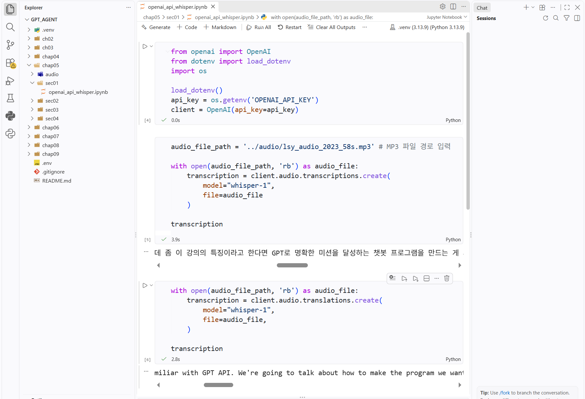
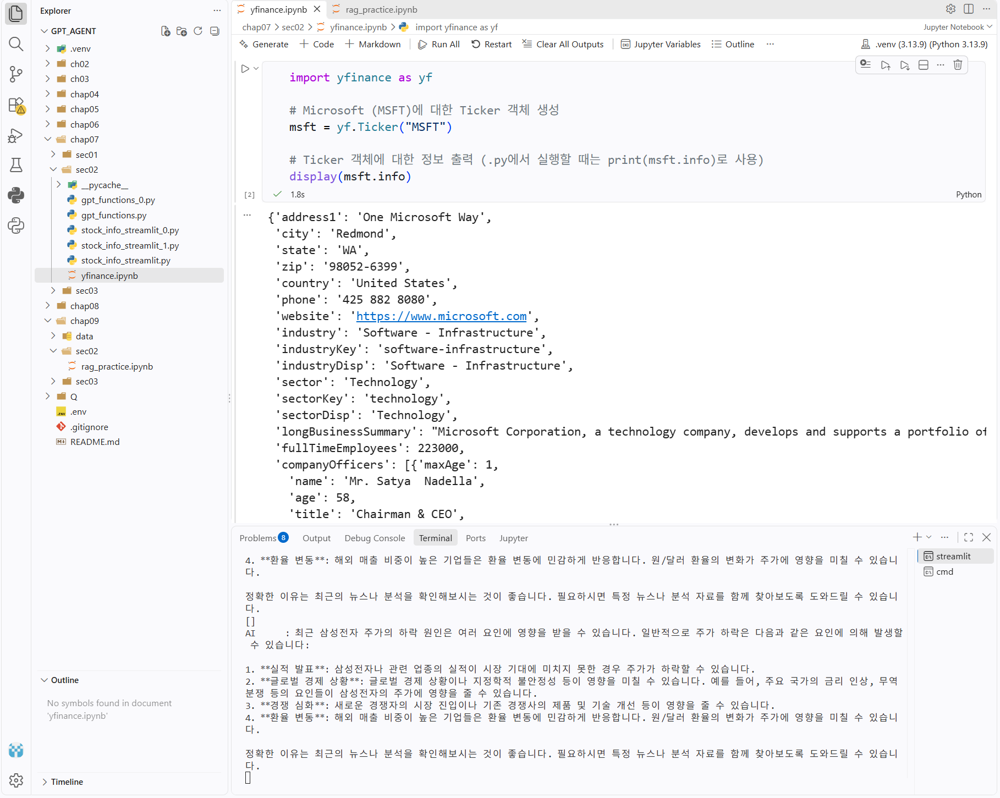

# DAY 71 — 멀티모달 AI와 Function Calling·RAG 실습

> 2026-10-21 · Python, OpenAI API, PyMuPDF, Speech, Vision, Function Calling, LangChain, Chroma, RAG

오늘은 텍스트만 주고받는 챗봇을 넘어 문서·음성·이미지를 처리하고 외부 함수를 호출하는
AI 애플리케이션을 실습했다. PDF 논문에서 텍스트를 추출해 요약하고, 음성을 받아쓰기와
번역으로 변환한 뒤 회의록을 정리했다. 이미지 분석과 TTS도 실행했으며, 마지막에는 세계 시간과
주식 정보를 조회하는 도구 호출 챗봇과 문서에 근거해 답하는 RAG 흐름을 구현했다.

## 1. 오늘의 학습 흐름

- PyMuPDF로 PDF의 페이지별 텍스트 추출 및 헤더·푸터 제외
- 추출한 논문 텍스트를 프롬프트에 넣어 핵심 주장과 내용을 요약
- 음성 파일의 STT·번역과 화자별 회의록 요약·교정
- URL·Base64 이미지 입력, 여러 이미지 비교와 TTS 음성 생성
- JSON Schema로 함수를 정의하고 Function Calling 처리 흐름 구현
- `pytz`를 활용한 세계 시간 조회와 Streamlit 챗봇 연결
- `yfinance`의 종목 정보·시세·추천 데이터 조회 도구 구성
- LangChain·Chroma를 이용한 문서 검색 기반 RAG 실습
- 대화 문맥을 반영해 검색 질문을 다시 쓰는 Query Augmentation 적용

## 2. PDF 텍스트 추출과 AI 요약

먼저 PyMuPDF로 논문의 모든 페이지를 순회하며 텍스트를 추출했다. 단순 추출에서는 논문 제목,
페이지 번호와 같은 헤더·푸터도 반복해서 포함되었다. 페이지 크기를 기준으로 본문 영역만
`clip`해 불필요한 반복 문구를 줄인 뒤 UTF-8 텍스트 파일로 저장했다.

```python
import pymupdf

def extract_body(pdf_path: str) -> str:
    document = pymupdf.open(pdf_path)
    chunks = []

    for page in document:
        rect = page.rect
        body = page.get_text(
            clip=(0, 80, rect.width, rect.height - 80)
        )
        chunks.append(body)

    return "\n".join(chunks)
```

추출한 본문에는 제목, 저자의 문제 인식과 주장, 주요 내용을 구분해서 작성하도록 출력 형식을
명시했다. 모델의 결과는 별도의 파일로 저장해 원문과 요약문을 비교했다.

### 확인한 점

- 상대경로는 **현재 실행 위치**를 기준으로 계산되므로 `data`와 `output` 폴더 위치를 확인해야 한다.
- 헤더·푸터 높이를 고정값으로 자르면 문서마다 본문이 잘릴 수 있어 시각 검증이 필요하다.
- 긴 문서 전문을 한 번에 입력하면 토큰과 비용이 커지므로 문서 길이에 따라 분할 요약이나 RAG를
  선택하는 편이 적절하다.
- 논문 요약은 모델이 만든 초안이므로 주장, 수치와 저자 정보는 원문으로 다시 확인해야 한다.

## 3. 음성 받아쓰기·번역과 회의록 정리

음성 파일을 OpenAI 음성 API에 전달해 원문 언어로 받아쓰기하고 영어 번역 결과도 비교했다.
실습에서는 `whisper-1` 모델을 사용했으며, API 키는 소스에 작성하지 않고 환경변수에서 불러왔다.



이어 화자 구간 정보가 포함된 CSV·RTTM 자료를 Pandas로 읽어 다음 순서로 회의록을 만들었다.

```text
음성 → STT → 화자 구간 분리 → 화자명 매핑
     → 회의 요약 → 발화별 교정 → JSON·Markdown·DOCX 저장
```

- `speaker_id`를 실제 표시 이름과 연결했다.
- 시작·종료 시각, 화자와 발화 내용을 JSON 구조로 변환했다.
- 회의 제목, 주요 내용, 참석자별 입장과 결정 사항을 Markdown으로 요약했다.
- 전체 대화 문맥과 요약문을 참고해 STT 오탈자를 발화별로 교정했다.
- 수정 결과를 JSON, Markdown과 Word 표 형식으로 저장했다.

STT 결과는 고유명사, 숫자, 겹치는 발화와 잡음에 취약할 수 있다. 요약·교정 단계까지 모델에
맡기더라도 원본 음성을 들으며 사람이 최종 확인해야 한다. 회의 음성에는 개인정보나 업무상
민감한 내용이 들어갈 수 있으므로 저장 위치와 외부 API 전송 범위도 먼저 확인해야 한다.

> 현재 OpenAI 공식 문서는 녹음이 끝난 파일에는 파일 전사를, 실시간 마이크 입력에는 Realtime
> 전사를 구분해 안내한다. 수업 코드는 당시 실습한 `whisper-1` 기준이며, 새 구현을 시작할 때는
> [공식 Transcription 문서](https://developers.openai.com/api/docs/guides/transcription)의 지원 모델과
> 입력 방식을 다시 확인한다.

## 4. 이미지 이해와 TTS

이미지 입력은 외부 URL을 전달하는 방식과 로컬 이미지를 Base64 데이터 URL로 변환하는 방식을
모두 실습했다. 한 장을 설명하는 것뿐 아니라 두 장의 공간을 비교하고, 연도별 통계 그래프에서
변화를 찾는 요청도 실행했다.

```python
import base64

def encode_image(path: str) -> str:
    with open(path, "rb") as image_file:
        return base64.b64encode(image_file.read()).decode("utf-8")
```

여러 이미지가 있을 때는 이미지의 순서와 의미를 프롬프트에 함께 적어야 비교 기준이 명확해진다.
작은 글자나 복잡한 그래프는 잘못 읽을 수 있으므로 결과를 원본 수치와 대조해야 한다.

TTS 실습에서는 동일한 문장을 여러 음성으로 변환하고, 이미지 기반 영어 퀴즈의 지문을 MP3로
생성했다. 문제 번호에 따라 음성을 순환 선택해 퀴즈마다 다른 목소리를 적용했다.

## 5. 금융 이미지 분석 과제

주식 차트 다섯 장을 이미지 입력으로 전달해 핵심 데이터와 금융적 의미를 Markdown 보고서로
정리하고 PDF로 변환했다. 이 과정에서 이미지 분석 결과를 구조화된 문서 산출물로 연결하는 전체
흐름을 확인했다.

다만 차트 이미지만으로 변동 원인이나 장기 전망을 단정할 수는 없다. 시세 시점, 기업 공시와
시장 상황을 별도로 검증해야 하며, 이번 결과는 **AI 이미지 분석 연습용 결과이지 투자 조언이
아니다.**

## 6. Function Calling의 동작 원리

Function Calling에서는 모델이 Python 함수를 직접 실행하지 않는다. 애플리케이션이 사용할 수
있는 함수의 이름·설명·인수 구조를 모델에 전달하면, 모델은 필요한 도구와 인수를 선택해 반환한다.
애플리케이션이 실제 함수를 실행하고 그 결과를 다시 전달해야 최종 답변이 완성된다.

```text
사용자 질문
   ↓
모델이 도구 호출 필요 여부 판단
   ↓
함수 이름 + JSON 인수 반환
   ↓
애플리케이션이 함수 실행
   ↓
실행 결과를 대화에 추가
   ↓
모델이 사용자용 최종 답변 생성
```

세계 시간 실습에서는 `get_current_time(timezone)`을 도구로 등록하고 `pytz`로 타임존을 처리했다.
인수가 없는 함수에서 출발해 `timezone` 문자열을 받는 JSON Schema로 확장했으며, 서울·뉴욕·런던
등의 현재 시간을 질문하는 터미널 및 Streamlit 챗봇으로 연결했다.

```python
time_tool = {
    "type": "function",
    "function": {
        "name": "get_current_time",
        "description": "지정한 타임존의 현재 시간을 반환합니다.",
        "parameters": {
            "type": "object",
            "properties": {
                "timezone": {"type": "string"}
            },
            "required": ["timezone"],
        },
    },
}
```

도구 설명이 모호하면 모델이 엉뚱한 함수를 고르거나 잘못된 인수를 만들 수 있다. 인수는 신뢰하지
말고 애플리케이션에서 허용 목록, 자료형과 범위를 다시 검증해야 한다. 함수 정의와 실행 결과를
연결하는 현재 구조는 [OpenAI Function Calling 문서](https://developers.openai.com/api/docs/guides/function-calling)에서
확인할 수 있다.

## 7. yfinance를 연결한 AI 투자 정보 도구

`yfinance`로 공개 시장 데이터를 조회하고, 각 기능을 별도의 도구로 등록했다.

- `get_yf_stock_info`: 티커의 기업·종목 정보 조회
- `get_yf_stock_history`: 지정 기간의 가격 이력 조회
- `get_yf_stock_recommendations`: 공개된 추천 데이터 조회

사용자가 자연어로 질문하면 모델이 필요한 도구를 선택하고, 앱은 반환된 JSON 인수를 파싱해
`yfinance`를 호출했다. 여러 도구 요청이 들어올 수 있도록 `tool_calls`를 반복 처리하고, 조회 결과를
모델에 다시 전달해 사람이 읽기 쉬운 문장으로 정리했다.



스트리밍 응답에서는 도구 호출의 이름과 인수 문자열이 여러 조각으로 나뉠 수 있다. 호출 순서를
나타내는 인덱스를 기준으로 조각을 누적한 뒤 완전한 JSON으로 복원해야 한다는 점도 확인했다.

> 조회 데이터와 모델의 설명은 지연·누락·해석 오류가 있을 수 있다. 실제 거래 판단에는 원 데이터,
> 거래소와 기업 공시를 별도로 확인해야 한다.

## 8. RAG 파이프라인 구성

서울과 뉴욕의 도시 계획 문서를 기반으로 질문에 답하는 RAG를 실습했다. 원본 PDF 자체를
공개하는 대신 로컬에서 문서를 읽고 검색 가능한 벡터 저장소를 만들었다.

```text
PDF 문서 로드
   ↓ PyPDFLoader
문서 분할
   ↓ RecursiveCharacterTextSplitter
임베딩 생성
   ↓ text-embedding-3-large
Chroma 벡터 저장소
   ↓ retriever(k=3)
관련 문서 검색
   ↓
검색 문맥 + 질문을 모델에 전달
   ↓
근거 기반 답변과 source/page 표시
```

실습에서는 문서를 1,000자 단위로 나누고 앞뒤 청크를 100자씩 겹치게 했다. 겹침은 문장 경계에서
내용이 끊기는 문제를 완화하지만, 중복이 커지면 저장량과 검색 결과의 다양성에 영향을 줄 수 있다.
Chroma의 영속 디렉터리가 있으면 기존 벡터 저장소를 불러오고, 없으면 새로 임베딩하도록 구성했다.

벡터 검색은 의미상 가까운 청크를 찾아주지만 항상 정답 근거를 가져오는 것은 아니다. `k`, 청크
크기, overlap과 질문 표현을 조정하고, 검색된 문서의 출처와 페이지를 화면에 표시해 사용자가
근거를 확인할 수 있도록 했다. OpenAI의 관리형 검색 구조에서는 파일을 벡터 저장소에 추가하면
분할·임베딩·인덱싱되는 흐름을 [Retrieval 문서](https://developers.openai.com/api/docs/guides/retrieval)에서
확인할 수 있다.

## 9. Query Augmentation과 대화 문맥

첫 질문 뒤에 사용자가 “뉴욕은?”처럼 대명사나 생략이 포함된 후속 질문을 입력하면 그 문장만으로는
검색 의도가 불명확하다. 이전 대화를 참고해 후속 질문을 독립적인 한 문장으로 다시 쓰고, 원 질문과
보강된 질문을 함께 검색에 사용했다.

```text
이전 질문: 서울시의 온실가스 저감 정책은?
후속 질문: 뉴욕은?
보강 질문: 뉴욕시의 온실가스 저감 정책은 무엇인가?
```

보강된 질문은 검색 품질을 높일 수 있지만 원래 의도를 잘못 바꿀 가능성도 있다. 화면에는 사용자의
원 질문을 유지하고, 검색용 질문과 선택된 근거를 함께 기록하는 것이 디버깅과 검증에 유리하다.

## 10. 실습하며 해결한 문제

- PDF·출력 폴더의 상대경로가 실행 위치와 맞지 않아 경로를 다시 확인했다.
- 반복되는 헤더·푸터를 제외해 요약 입력의 잡음을 줄였다.
- 화자 분리 결과를 표 구조로 변환하고 STT 교정 결과를 여러 파일 형식으로 저장했다.
- 타임존을 함수 인수로 확장하고 여러 도구 호출을 순서대로 처리했다.
- 스트리밍 중 분할된 `tool_calls` 조각을 호출 인덱스별로 합쳤다.
- RAG 후속 질문을 독립 질문으로 바꿔 검색 문맥을 보완했다.

## 11. 보안·저작권 체크

- API 키는 `OPENAI_API_KEY` 환경변수로만 불러오고 `.env`는 Git에서 제외한다.
- 모델이 생성한 함수 인수는 실행 전에 허용 함수·값·자료형을 검증한다.
- 음성, 회의록과 화자 정보는 동의와 보관 정책을 확인한 뒤 외부 서비스로 전송한다.
- 교재 PDF, 논문 전문, 도시 계획 원문과 강의 제공 코드는 공개 저장소에 복사하지 않는다.
- 노트북 출력에는 로컬 경로, 호출 ID와 문서 전문이 포함될 수 있어 원본 파일을 그대로 올리지 않는다.
- 이미지·STT·금융 분석 결과는 환각이나 오인식 가능성이 있으므로 원본 근거와 사람이 검토한다.
- RAG 문서 안의 명령을 애플리케이션 지시로 실행하지 않고, 검색 자료로만 취급한다.

## 오늘의 정리

- PDF에서 본문을 추출·전처리하고 AI 요약 파일로 저장했다.
- 음성 STT·번역부터 화자별 회의록 요약·교정·문서화까지 연결했다.
- 이미지 이해와 TTS로 텍스트 외 입력·출력을 다뤘다.
- Function Calling으로 세계 시간과 최신 주식 데이터를 조회하는 챗봇을 만들었다.
- LangChain·Chroma로 문서를 분할·임베딩·검색하는 RAG 흐름을 구현했다.
- Query Augmentation과 출처 표시로 후속 질문의 검색·검증 과정을 보완했다.

> 공개 저장소에는 교재·논문·도시 계획 PDF, 추출한 전문, 음원, 실명 포함 회의록, 원본 노트북과
> 강의 코드 묶음을 올리지 않았다. 내부 IP·로컬 경로·개인 대화가 보이는 화면도 제외하고, API 키와
> 개인정보가 보이지 않는 실습 화면 두 장만 선별했다.
